# Contact Profiles

<cite>
**Referenced Files in This Document**
- [contact.rb](file://app/models/contact.rb)
- [contacts_controller.rb](file://app/controllers/api/v1/accounts/contacts_controller.rb)
- [contact_inboxes_controller.rb](file://app/controllers/api/v1/accounts/contact_inboxes_controller.rb)
- [contact_identify_action.rb](file://app/actions/contact_identify_action.rb)
- [contact_merge_action.rb](file://app/actions/contact_merge_action.rb)
- [sync_attributes.rb](file://app/services/contacts/sync_attributes.rb)
- [filter_service.rb](file://app/services/contacts/filter_service.rb)
- [bulk_delete_service.rb](file://app/services/contacts/bulk_delete_service.rb)
- [bulk_assign_labels_service.rb](file://app/services/contacts/bulk_assign_labels_service.rb)
- [bulk_remove_labels_service.rb](file://app/services/contacts/bulk_remove_labels_service.rb)
- [contact_ip_lookup_job.rb](file://app/jobs/contact_ip_lookup_job.rb)
- [ip_lookup_service.rb](file://app/services/ip_lookup_service.rb)
- [contact_policy.rb](file://app/policies/contact_policy.rb)
- [20240124054340_add_contact_type_to_contacts.rb](file://db/migrate/20240124054340_add_contact_type_to_contacts.rb)
- [20240124084032_add_middle_name_and_last_name_to_contacts.rb](file://db/migrate/20240124084032_add_middle_name_and_last_name_to_contacts.rb)
- [20240129080827_add_location_and_country_code_to_contacts.rb](file://db/migrate/20240129080827_add_location_and_country_code_to_contacts.rb)
- [20240213131252_add_blocked_to_contacts.rb](file://db/migrate/20240213131252_add_blocked_to_contacts.rb)
- [20250722152516_add_index_on_contact_type_and_account_id_to_contacts.rb](file://db/migrate/20250722152516_add_index_on_contact_type_and_account_id_to_contacts.rb)
</cite>

## Table of Contents
1. [Introduction](#introduction)
2. [Project Structure](#project-structure)
3. [Core Components](#core-components)
4. [Architecture Overview](#architecture-overview)
5. [Detailed Component Analysis](#detailed-component-analysis)
6. [Dependency Analysis](#dependency-analysis)
7. [Performance Considerations](#performance-considerations)
8. [Troubleshooting Guide](#troubleshooting-guide)
9. [Conclusion](#conclusion)

## Introduction
This document explains Chatwoot’s contact profile management system. It covers the Contact model structure, identification and validation rules, status and type management, IP-based geographic enrichment, API workflows for creation/update/deletion, bulk operations, search capabilities, and security considerations. The goal is to provide both a conceptual overview and code-level insights for developers and integrators.

## Project Structure
Contact-related functionality spans models, controllers, actions, services, jobs, policies, and database migrations:

- Model and concerns: app/models/contact.rb
- API endpoints: app/controllers/api/v1/accounts/contacts_controller.rb, app/controllers/api/v1/accounts/contact_inboxes_controller.rb
- Identification and merging: app/actions/contact_identify_action.rb, app/actions/contact_merge_action.rb
- Attribute synchronization: app/services/contacts/sync_attributes.rb
- Filtering and search: app/services/contacts/filter_service.rb
- Bulk operations: app/services/contacts/bulk_delete_service.rb, app/services/contacts/bulk_assign_labels_service.rb, app/services/contacts/bulk_remove_labels_service.rb
- IP lookup: app/jobs/contact_ip_lookup_job.rb, app/services/ip_lookup_service.rb
- Authorization: app/policies/contact_policy.rb
- Schema evolution: db/migrate/* (contact type, name fields, location/country code, blocked flag, indexes)

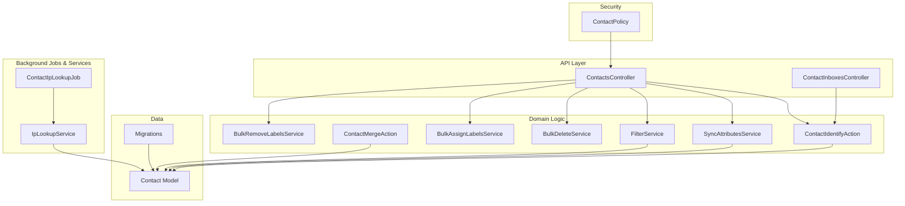

**Diagram sources**
- [contacts_controller.rb](file://app/controllers/api/v1/accounts/contacts_controller.rb)
- [contact_inboxes_controller.rb](file://app/controllers/api/v1/accounts/contact_inboxes_controller.rb)
- [contact_identify_action.rb](file://app/actions/contact_identify_action.rb)
- [contact_merge_action.rb](file://app/actions/contact_merge_action.rb)
- [sync_attributes.rb](file://app/services/contacts/sync_attributes.rb)
- [filter_service.rb](file://app/services/contacts/filter_service.rb)
- [bulk_delete_service.rb](file://app/services/contacts/bulk_delete_service.rb)
- [bulk_assign_labels_service.rb](file://app/services/contacts/bulk_assign_labels_service.rb)
- [bulk_remove_labels_service.rb](file://app/services/contacts/bulk_remove_labels_service.rb)
- [contact_ip_lookup_job.rb](file://app/jobs/contact_ip_lookup_job.rb)
- [ip_lookup_service.rb](file://app/services/ip_lookup_service.rb)
- [contact_policy.rb](file://app/policies/contact_policy.rb)
- [contact.rb](file://app/models/contact.rb)
- [20240124054340_add_contact_type_to_contacts.rb](file://db/migrate/20240124054340_add_contact_type_to_contacts.rb)
- [20240124084032_add_middle_name_and_last_name_to_contacts.rb](file://db/migrate/20240124084032_add_middle_name_and_last_name_to_contacts.rb)
- [20240129080827_add_location_and_country_code_to_contacts.rb](file://db/migrate/20240129080827_add_location_and_country_code_to_contacts.rb)
- [20240213131252_add_blocked_to_contacts.rb](file://db/migrate/20240213131252_add_blocked_to_contacts.rb)

**Section sources**
- [contact.rb](file://app/models/contact.rb)
- [contacts_controller.rb](file://app/controllers/api/v1/accounts/contacts_controller.rb)
- [contact_inboxes_controller.rb](file://app/controllers/api/v1/accounts/contact_inboxes_controller.rb)
- [contact_identify_action.rb](file://app/actions/contact_identify_action.rb)
- [contact_merge_action.rb](file://app/actions/contact_merge_action.rb)
- [sync_attributes.rb](file://app/services/contacts/sync_attributes.rb)
- [filter_service.rb](file://app/services/contacts/filter_service.rb)
- [bulk_delete_service.rb](file://app/services/contacts/bulk_delete_service.rb)
- [bulk_assign_labels_service.rb](file://app/services/contacts/bulk_assign_labels_service.rb)
- [bulk_remove_labels_service.rb](file://app/services/contacts/bulk_remove_labels_service.rb)
- [contact_ip_lookup_job.rb](file://app/jobs/contact_ip_lookup_job.rb)
- [ip_lookup_service.rb](file://app/services/ip_lookup_service.rb)
- [contact_policy.rb](file://app/policies/contact_policy.rb)
- [20240124054340_add_contact_type_to_contacts.rb](file://db/migrate/20240124054340_add_contact_type_to_contacts.rb)
- [20240124084032_add_middle_name_and_last_name_to_contacts.rb](file://db/migrate/20240124084032_add_middle_name_and_last_name_to_contacts.rb)
- [20240129080827_add_location_and_country_code_to_contacts.rb](file://db/migrate/20240129080827_add_location_and_country_code_to_contacts.rb)
- [20240213131252_add_blocked_to_contacts.rb](file://db/migrate/20240213131252_add_blocked_to_contacts.rb)

## Core Components
- Contact model: Represents a person or entity with identity attributes (name parts, email, phone_number, identifier), metadata (custom_attributes), status flags (blocked), type classification (visitor, lead, customer), and location data (location, country_code).
- Identification: Uniqueness and matching logic across email, phone_number, and identifier; supports international phone formats.
- Status and types: Blocked contacts are prevented from initiating conversations; contact types enable segmentation and routing.
- IP lookup: Enriches contact records with geographic information via background jobs and services.
- API surface: REST endpoints for CRUD, association with inboxes, filtering, and bulk operations.
- Policies: Authorization checks for access and mutations.

**Section sources**
- [contact.rb](file://app/models/contact.rb)
- [contact_identify_action.rb](file://app/actions/contact_identify_action.rb)
- [contact_merge_action.rb](file://app/actions/contact_merge_action.rb)
- [sync_attributes.rb](file://app/services/contacts/sync_attributes.rb)
- [contact_ip_lookup_job.rb](file://app/jobs/contact_ip_lookup_job.rb)
- [ip_lookup_service.rb](file://app/services/ip_lookup_service.rb)
- [contact_policy.rb](file://app/policies/contact_policy.rb)

## Architecture Overview
The contact lifecycle flows through API controllers into domain actions and services, persisting changes to the Contact model. Background jobs handle asynchronous tasks like IP enrichment.

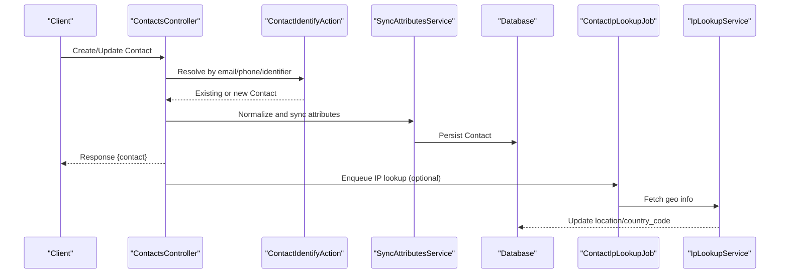

**Diagram sources**
- [contacts_controller.rb](file://app/controllers/api/v1/accounts/contacts_controller.rb)
- [contact_identify_action.rb](file://app/actions/contact_identify_action.rb)
- [sync_attributes.rb](file://app/services/contacts/sync_attributes.rb)
- [contact_ip_lookup_job.rb](file://app/jobs/contact_ip_lookup_job.rb)
- [ip_lookup_service.rb](file://app/services/ip_lookup_service.rb)

## Detailed Component Analysis

### Contact Model Structure
Key aspects of the Contact model include:
- Identity fields: first_name, middle_name, last_name, email, phone_number, identifier
- Custom attributes: custom_attributes JSON column for extensible metadata
- Status and type: blocked boolean, contact_type enum (e.g., visitor, lead, customer)
- Location enrichment: location text, country_code string
- Indexes: optimized queries on account_id and contact_type

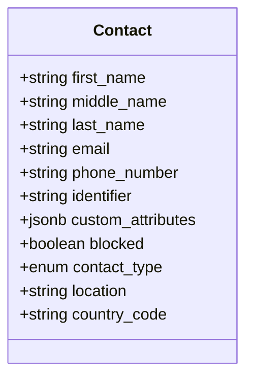

**Diagram sources**
- [contact.rb](file://app/models/contact.rb)
- [20240124054340_add_contact_type_to_contacts.rb](file://db/migrate/20240124054340_add_contact_type_to_contacts.rb)
- [20240124084032_add_middle_name_and_last_name_to_contacts.rb](file://db/migrate/20240124084032_add_middle_name_and_last_name_to_contacts.rb)
- [20240129080827_add_location_and_country_code_to_contacts.rb](file://db/migrate/20240129080827_add_location_and_country_code_to_contacts.rb)
- [20240213131252_add_blocked_to_contacts.rb](file://db/migrate/20240213131252_add_blocked_to_contacts.rb)
- [20250722152516_add_index_on_contact_type_and_account_id_to_contacts.rb](file://db/migrate/20250722152516_add_index_on_contact_type_and_account_id_to_contacts.rb)

**Section sources**
- [contact.rb](file://app/models/contact.rb)
- [20240124054340_add_contact_type_to_contacts.rb](file://db/migrate/20240124054340_add_contact_type_to_contacts.rb)
- [20240124084032_add_middle_name_and_last_name_to_contacts.rb](file://db/migrate/20240124084032_add_middle_name_and_last_name_to_contacts.rb)
- [20240129080827_add_location_and_country_code_to_contacts.rb](file://db/migrate/20240129080827_add_location_and_country_code_to_contacts.rb)
- [20240213131252_add_blocked_to_contacts.rb](file://db/migrate/20240213131252_add_blocked_to_contacts.rb)
- [20250722152516_add_index_on_contact_type_and_account_id_to_contacts.rb](file://db/migrate/20250722152516_add_index_on_contact_type_and_account_id_to_contacts.rb)

### Contact Identification and Validation
Identification ensures uniqueness and correct matching:
- Email uniqueness per account context
- Phone number normalization and international format support
- Unique identifier generation when not provided
- Merge strategy when duplicates are detected

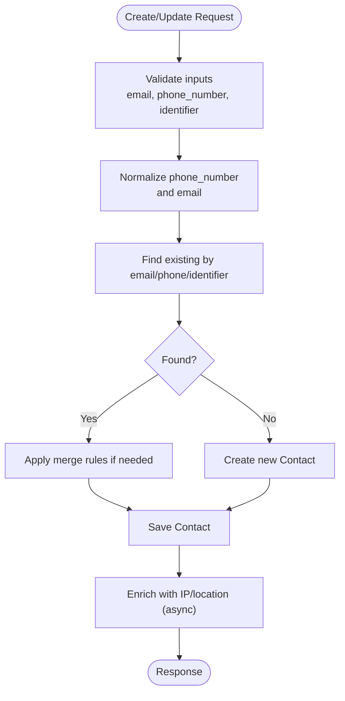

**Diagram sources**
- [contact_identify_action.rb](file://app/actions/contact_identify_action.rb)
- [contact_merge_action.rb](file://app/actions/contact_merge_action.rb)
- [sync_attributes.rb](file://app/services/contacts/sync_attributes.rb)
- [contact_ip_lookup_job.rb](file://app/jobs/contact_ip_lookup_job.rb)

**Section sources**
- [contact_identify_action.rb](file://app/actions/contact_identify_action.rb)
- [contact_merge_action.rb](file://app/actions/contact_merge_action.rb)
- [sync_attributes.rb](file://app/services/contacts/sync_attributes.rb)

### Contact Creation, Updates, and Deletion Workflows
- Creation: API controller validates payload, identifies or creates contact, synchronizes attributes, and returns the persisted record.
- Updates: Similar flow with attribute normalization and optional re-enrichment.
- Deletion: Soft/hard delete via controller action backed by bulk deletion service.

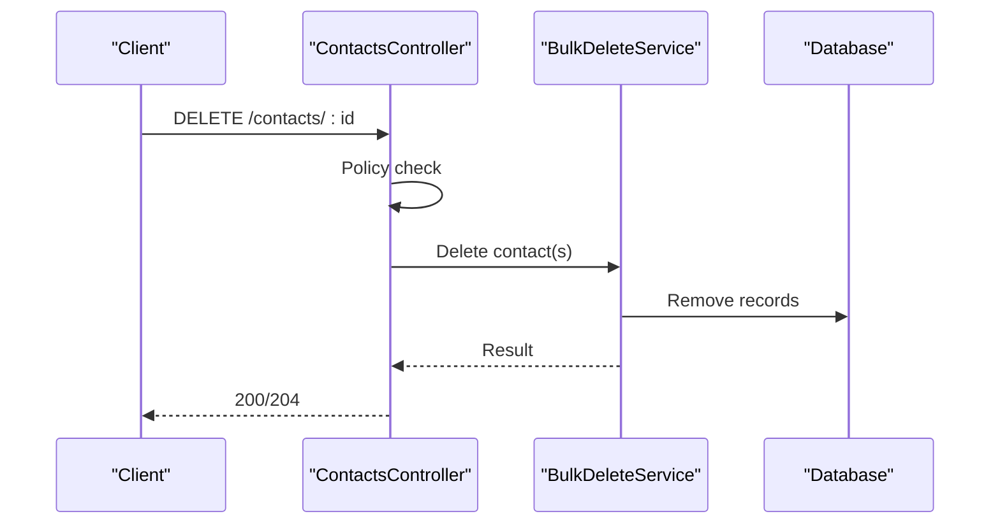

**Diagram sources**
- [contacts_controller.rb](file://app/controllers/api/v1/accounts/contacts_controller.rb)
- [bulk_delete_service.rb](file://app/services/contacts/bulk_delete_service.rb)
- [contact_policy.rb](file://app/policies/contact_policy.rb)

**Section sources**
- [contacts_controller.rb](file://app/controllers/api/v1/accounts/contacts_controller.rb)
- [bulk_delete_service.rb](file://app/services/contacts/bulk_delete_service.rb)
- [contact_policy.rb](file://app/policies/contact_policy.rb)

### Contact Association with Inboxes
ContactInboxesController manages associations between contacts and inboxes, enabling channel-specific interactions.

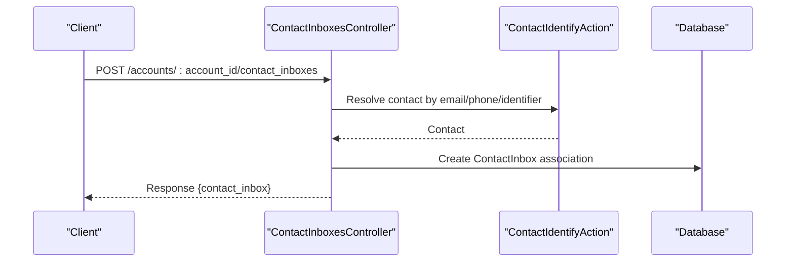

**Diagram sources**
- [contact_inboxes_controller.rb](file://app/controllers/api/v1/accounts/contact_inboxes_controller.rb)
- [contact_identify_action.rb](file://app/actions/contact_identify_action.rb)

**Section sources**
- [contact_inboxes_controller.rb](file://app/controllers/api/v1/accounts/contact_inboxes_controller.rb)
- [contact_identify_action.rb](file://app/actions/contact_identify_action.rb)

### Contact Status Management
- Blocked contacts: Prevented from initiating conversations; controlled by a boolean flag.
- Contact types: Segmentation into visitor, lead, customer for routing and analytics.

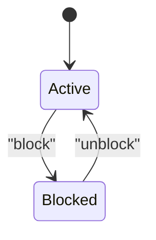

**Diagram sources**
- [20240213131252_add_blocked_to_contacts.rb](file://db/migrate/20240213131252_add_blocked_to_contacts.rb)
- [20240124054340_add_contact_type_to_contacts.rb](file://db/migrate/20240124054340_add_contact_type_to_contacts.rb)

**Section sources**
- [20240213131252_add_blocked_to_contacts.rb](file://db/migrate/20240213131252_add_blocked_to_contacts.rb)
- [20240124054340_add_contact_type_to_contacts.rb](file://db/migrate/20240124054340_add_contact_type_to_contacts.rb)

### IP Lookup and Geographic Enrichment
IP-based enrichment runs asynchronously to update location and country_code on contacts.

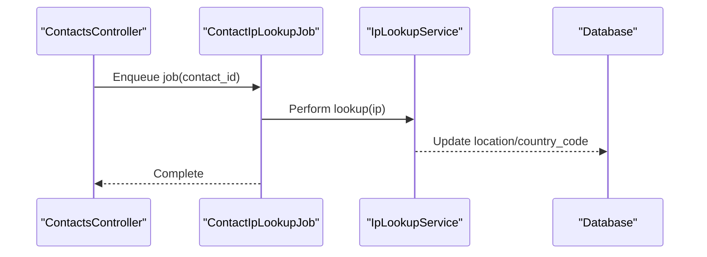

**Diagram sources**
- [contact_ip_lookup_job.rb](file://app/jobs/contact_ip_lookup_job.rb)
- [ip_lookup_service.rb](file://app/services/ip_lookup_service.rb)

**Section sources**
- [contact_ip_lookup_job.rb](file://app/jobs/contact_ip_lookup_job.rb)
- [ip_lookup_service.rb](file://app/services/ip_lookup_service.rb)
- [20240129080827_add_location_and_country_code_to_contacts.rb](file://db/migrate/20240129080827_add_location_and_country_code_to_contacts.rb)

### Bulk Contact Management
Bulk operations allow efficient label assignment/removal and deletion.

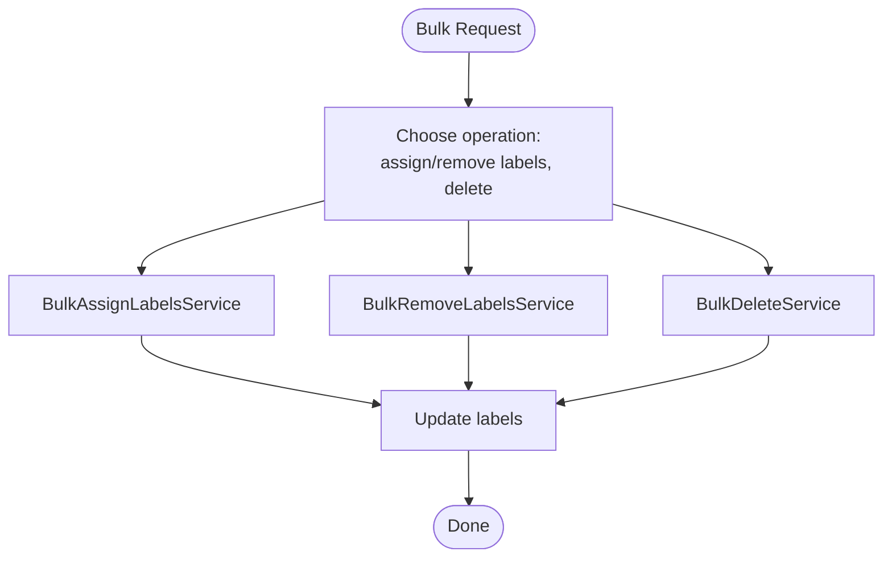

**Diagram sources**
- [bulk_assign_labels_service.rb](file://app/services/contacts/bulk_assign_labels_service.rb)
- [bulk_remove_labels_service.rb](file://app/services/contacts/bulk_remove_labels_service.rb)
- [bulk_delete_service.rb](file://app/services/contacts/bulk_delete_service.rb)

**Section sources**
- [bulk_assign_labels_service.rb](file://app/services/contacts/bulk_assign_labels_service.rb)
- [bulk_remove_labels_service.rb](file://app/services/contacts/bulk_remove_labels_service.rb)
- [bulk_delete_service.rb](file://app/services/contacts/bulk_delete_service.rb)

### Contact Search and Filtering
FilterService provides query building and search capabilities across contact attributes.

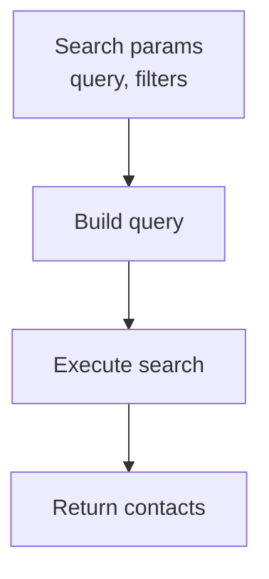

**Diagram sources**
- [filter_service.rb](file://app/services/contacts/filter_service.rb)

**Section sources**
- [filter_service.rb](file://app/services/contacts/filter_service.rb)

## Dependency Analysis
- Controllers depend on actions and services for business logic.
- Actions coordinate identification and merging.
- Services encapsulate attribute synchronization, filtering, and bulk operations.
- Jobs delegate heavy work (IP lookup) to dedicated services.
- Policies enforce authorization at the controller layer.
- Migrations define schema evolution for contact attributes and indexes.

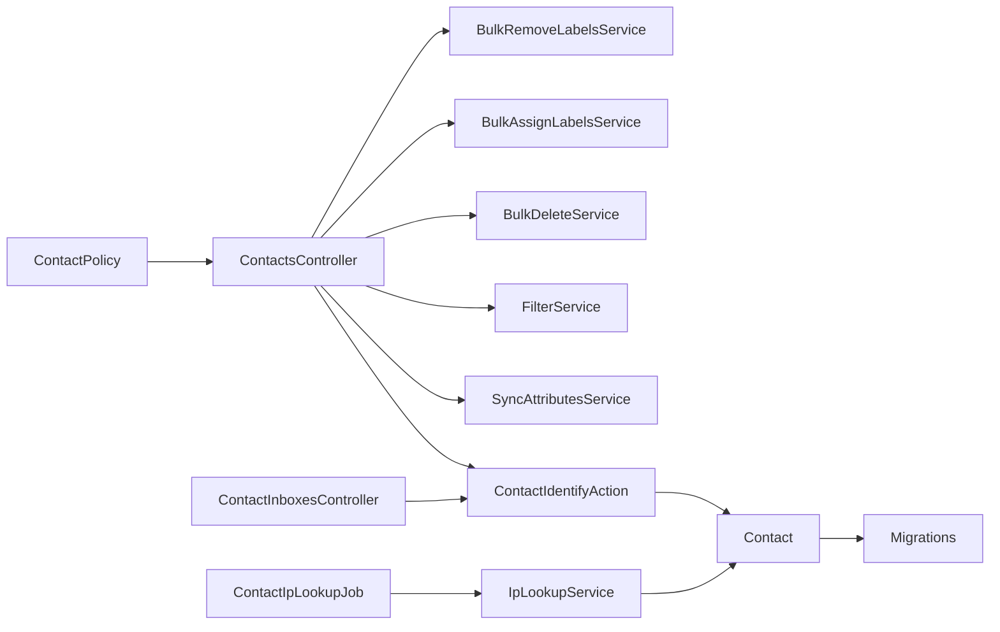

**Diagram sources**
- [contacts_controller.rb](file://app/controllers/api/v1/accounts/contacts_controller.rb)
- [contact_inboxes_controller.rb](file://app/controllers/api/v1/accounts/contact_inboxes_controller.rb)
- [contact_identify_action.rb](file://app/actions/contact_identify_action.rb)
- [sync_attributes.rb](file://app/services/contacts/sync_attributes.rb)
- [filter_service.rb](file://app/services/contacts/filter_service.rb)
- [bulk_delete_service.rb](file://app/services/contacts/bulk_delete_service.rb)
- [bulk_assign_labels_service.rb](file://app/services/contacts/bulk_assign_labels_service.rb)
- [bulk_remove_labels_service.rb](file://app/services/contacts/bulk_remove_labels_service.rb)
- [contact_ip_lookup_job.rb](file://app/jobs/contact_ip_lookup_job.rb)
- [ip_lookup_service.rb](file://app/services/ip_lookup_service.rb)
- [contact_policy.rb](file://app/policies/contact_policy.rb)
- [contact.rb](file://app/models/contact.rb)

**Section sources**
- [contacts_controller.rb](file://app/controllers/api/v1/accounts/contacts_controller.rb)
- [contact_inboxes_controller.rb](file://app/controllers/api/v1/accounts/contact_inboxes_controller.rb)
- [contact_identify_action.rb](file://app/actions/contact_identify_action.rb)
- [sync_attributes.rb](file://app/services/contacts/sync_attributes.rb)
- [filter_service.rb](file://app/services/contacts/filter_service.rb)
- [bulk_delete_service.rb](file://app/services/contacts/bulk_delete_service.rb)
- [bulk_assign_labels_service.rb](file://app/services/contacts/bulk_assign_labels_service.rb)
- [bulk_remove_labels_service.rb](file://app/services/contacts/bulk_remove_labels_service.rb)
- [contact_ip_lookup_job.rb](file://app/jobs/contact_ip_lookup_job.rb)
- [ip_lookup_service.rb](file://app/services/ip_lookup_service.rb)
- [contact_policy.rb](file://app/policies/contact_policy.rb)
- [contact.rb](file://app/models/contact.rb)

## Performance Considerations
- Index usage: Queries on account_id and contact_type benefit from composite indexes.
- Asynchronous enrichment: IP lookup runs in background to avoid blocking API responses.
- Bulk operations: Use dedicated services to minimize N+1 updates and reduce transaction overhead.
- Attribute normalization: Centralized in services to prevent repeated computation.

[No sources needed since this section provides general guidance]

## Troubleshooting Guide
- Duplicate contacts: Review identification logic and merge behavior; ensure consistent email/phone normalization.
- Blocked contacts: Verify blocked flag and policy enforcement before allowing conversation initiation.
- Missing location data: Check background job processing and IP lookup service configuration.
- Search performance: Validate filter parameters and index coverage.

**Section sources**
- [contact_identify_action.rb](file://app/actions/contact_identify_action.rb)
- [contact_merge_action.rb](file://app/actions/contact_merge_action.rb)
- [contact_ip_lookup_job.rb](file://app/jobs/contact_ip_lookup_job.rb)
- [ip_lookup_service.rb](file://app/services/ip_lookup_service.rb)
- [contact_policy.rb](file://app/policies/contact_policy.rb)

## Conclusion
Chatwoot’s contact profile system combines robust identification, flexible attribute storage, clear status/type semantics, and asynchronous enrichment. The layered architecture—controllers delegating to actions and services, with background jobs for heavy tasks—ensures scalability and maintainability. Proper use of policies, validations, and indexes helps secure and optimize contact operations across API and UI interfaces.

[No sources needed since this section summarizes without analyzing specific files]