# Contact Search & Filtering

<cite>
**Referenced Files in This Document**
- [contact.rb](file://app/models/contact.rb)
- [filter_keys.yml](file://lib/filters/filter_keys.yml)
- [searchkick.rb](file://config/initializers/searchkick.rb)
- [message.rb](file://app/models/message.rb)
- [contacts_controller.rb](file://app/controllers/api/v1/accounts/contacts_controller.rb)
- [composeConversationHelper.spec.js](file://app/javascript/dashboard/components-next/NewConversation/helpers/specs/composeConversationHelper.spec.js)
- [filter_service_spec.rb](file://spec/services/contacts/filter_service_spec.rb)
</cite>

## Table of Contents
1. [Introduction](#introduction)
2. [Project Structure](#project-structure)
3. [Core Components](#core-components)
4. [Architecture Overview](#architecture-overview)
5. [Detailed Component Analysis](#detailed-component-analysis)
6. [Dependency Analysis](#dependency-analysis)
7. [Performance Considerations](#performance-considerations)
8. [Troubleshooting Guide](#troubleshooting-guide)
9. [Conclusion](#conclusion)

## Introduction
This document explains Chatwoot’s contact search and filtering capabilities with a focus on:
- PostgreSQL-based indexing for fast, account-scoped lookups
- Elasticsearch/OpenSearch integration via Searchkick for advanced text search
- Query syntax, operators, and filters for multi-criteria discovery
- Label-based filtering and categorization
- Real-time search suggestions and autocomplete behavior
- Ranking strategies and performance optimization techniques
- Permissions and data isolation by account

## Project Structure
Contact search spans models, configuration, controllers, and frontend helpers:
- Model-level indexing and scopes for efficient queries
- Filter definitions that standardize supported attributes and operators
- Searchkick initializer wiring Elasticsearch/OpenSearch connectivity
- API controller exposing the search endpoint
- Frontend helper tests demonstrating autocomplete behavior and result transformation

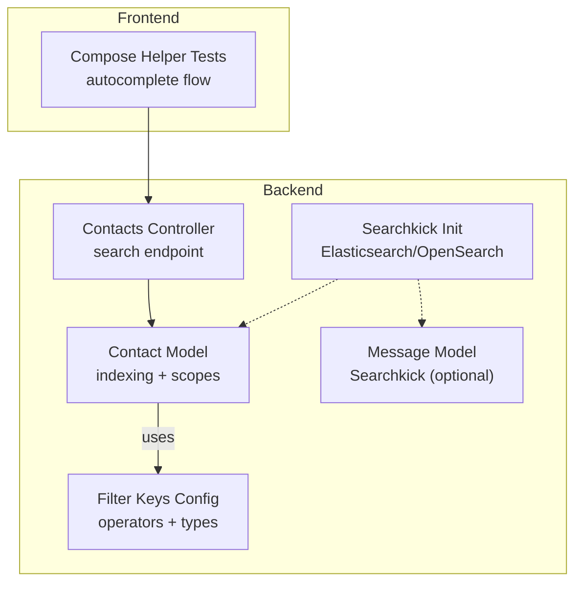

**Diagram sources**
- [contact.rb:26-39](file://app/models/contact.rb#L26-L39)
- [filter_keys.yml:1-12](file://lib/filters/filter_keys.yml#L1-L12)
- [searchkick.rb:1-24](file://config/initializers/searchkick.rb#L1-L24)
- [message.rb:42-42](file://app/models/message.rb#L42-L42)
- [contacts_controller.rb:24-28](file://app/controllers/api/v1/accounts/contacts_controller.rb#L24-L28)
- [composeConversationHelper.spec.js:360-394](file://app/javascript/dashboard/components-next/NewConversation/helpers/specs/composeConversationHelper.spec.js#L360-L394)

**Section sources**
- [contact.rb:26-39](file://app/models/contact.rb#L26-L39)
- [filter_keys.yml:1-12](file://lib/filters/filter_keys.yml#L1-L12)
- [searchkick.rb:1-24](file://config/initializers/searchkick.rb#L1-L24)
- [message.rb:42-42](file://app/models/message.rb#L42-L42)
- [contacts_controller.rb:24-28](file://app/controllers/api/v1/accounts/contacts_controller.rb#L24-L28)
- [composeConversationHelper.spec.js:360-394](file://app/javascript/dashboard/components-next/NewConversation/helpers/specs/composeConversationHelper.spec.js#L360-L394)

## Core Components
- Contact model indexes and scopes:
  - GIN index over name, email, phone_number, identifier for full-text-like matching
  - Account-scoped indexes to enforce data isolation
  - Scopes for ordering by last activity, creation time, city/country, and normalized name
- Filter configuration:
  - Centralized list of supported attributes, data types, and operators for contacts
  - Includes labels, dates, booleans, and text fields
- Searchkick integration:
  - Optional Elasticsearch/OpenSearch client configuration
  - Message model uses Searchkick when advanced search is enabled
- Contacts search controller:
  - Exposes an account-scoped search endpoint used by the frontend

Key responsibilities:
- Fast exact and fuzzy matching via PostgreSQL indexes
- Standardized filter expressions across UI and automation
- Optional advanced text search via Searchkick
- Controlled access per account

**Section sources**
- [contact.rb:26-39](file://app/models/contact.rb#L26-L39)
- [contact.rb:74-123](file://app/models/contact.rb#L74-L123)
- [filter_keys.yml:180-212](file://lib/filters/filter_keys.yml#L180-L212)
- [searchkick.rb:1-24](file://config/initializers/searchkick.rb#L1-L24)
- [message.rb:42-42](file://app/models/message.rb#L42-L42)
- [contacts_controller.rb:24-28](file://app/controllers/api/v1/accounts/contacts_controller.rb#L24-L28)

## Architecture Overview
The contact search pipeline combines database-backed filtering with optional Elasticsearch/OpenSearch search:

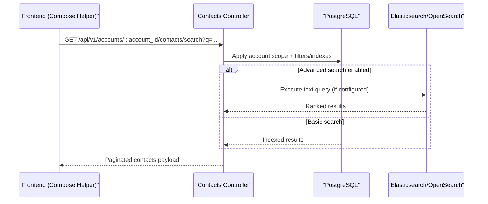

**Diagram sources**
- [contacts_controller.rb:24-28](file://app/controllers/api/v1/accounts/contacts_controller.rb#L24-L28)
- [contact.rb:26-39](file://app/models/contact.rb#L26-L39)
- [searchkick.rb:1-24](file://config/initializers/searchkick.rb#L1-L24)
- [message.rb:42-42](file://app/models/message.rb#L42-L42)

## Detailed Component Analysis

### Contact Model Indexing and Scopes
- Indexing strategy:
  - GIN index over name, email, phone_number, identifier enables fast substring/full-text-like matching
  - Account-scoped indexes ensure isolation between tenants
  - Additional indexes optimize common filters (email uniqueness, phone number, company association)
- Ordering scopes:
  - Last activity, created_at, city/country from additional_attributes, and normalized name ordering

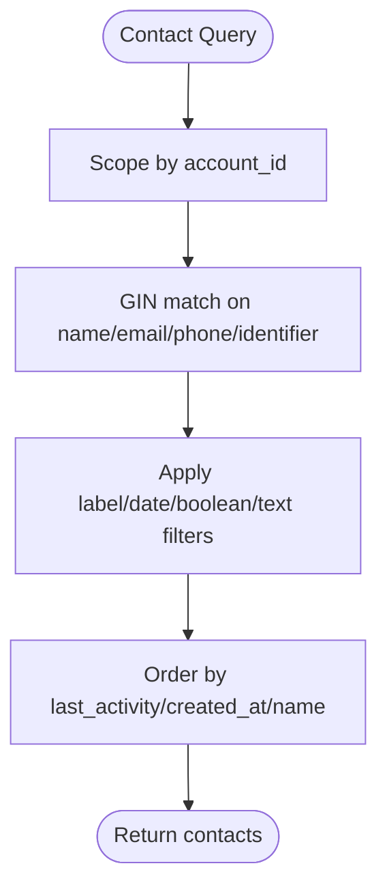

**Diagram sources**
- [contact.rb:26-39](file://app/models/contact.rb#L26-L39)
- [contact.rb:74-123](file://app/models/contact.rb#L74-L123)

**Section sources**
- [contact.rb:26-39](file://app/models/contact.rb#L26-L39)
- [contact.rb:74-123](file://app/models/contact.rb#L74-L123)

### Filter Configuration and Operators
- Supported attribute categories include labels, dates, booleans, and text fields
- Operators include equality, negation, containment, presence checks, comparisons, relative date ranges, and prefix matching
- Labels support presence-based filtering to find contacts with or without specific labels

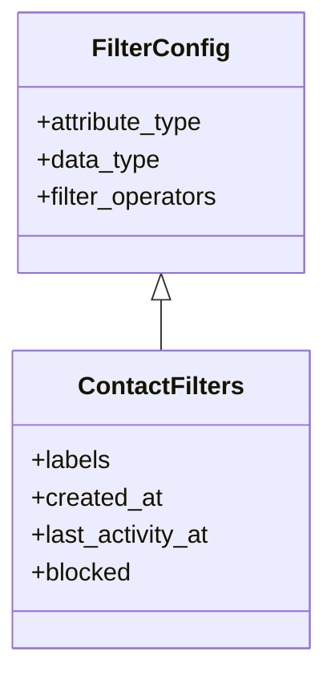

**Diagram sources**
- [filter_keys.yml:180-212](file://lib/filters/filter_keys.yml#L180-L212)

**Section sources**
- [filter_keys.yml:1-12](file://lib/filters/filter_keys.yml#L1-L12)
- [filter_keys.yml:180-212](file://lib/filters/filter_keys.yml#L180-L212)
- [filter_service_spec.rb:201-242](file://spec/services/contacts/filter_service_spec.rb#L201-L242)

### Elasticsearch/OpenSearch Integration
- Searchkick initializer configures client options for OpenSearch/Elasticsearch using environment variables
- Message model conditionally enables Searchkick when advanced search is allowed
- Contact search can leverage this infrastructure for advanced text queries if implemented at the controller/service layer

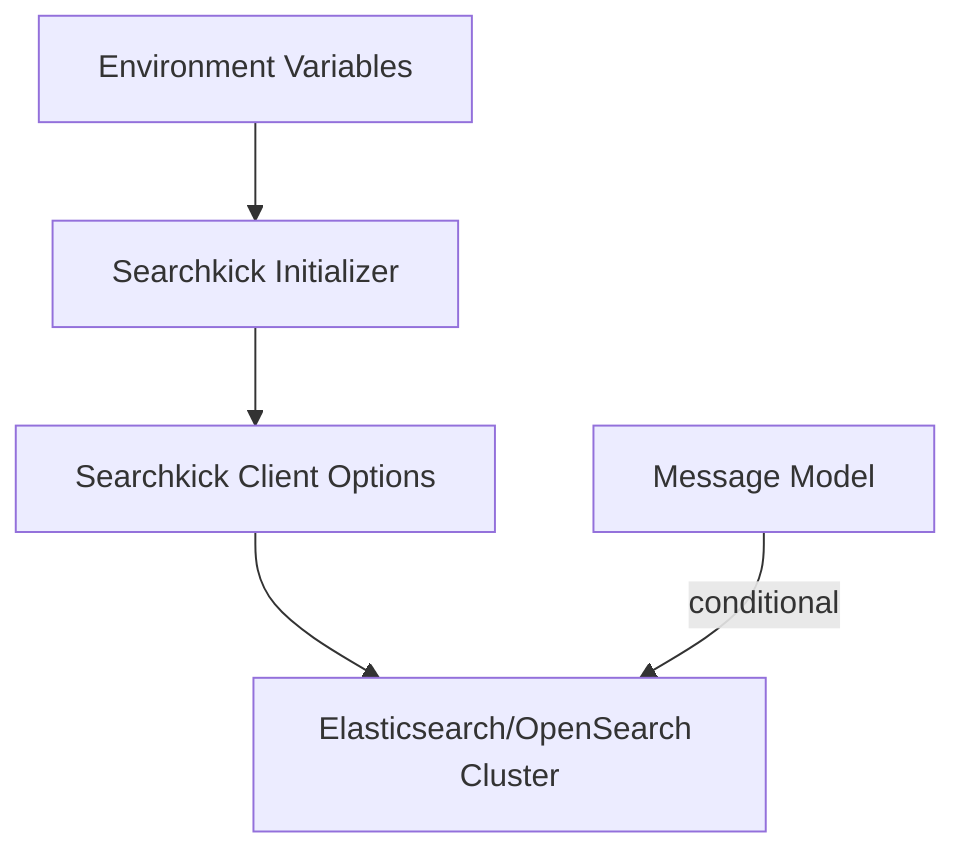

**Diagram sources**
- [searchkick.rb:1-24](file://config/initializers/searchkick.rb#L1-L24)
- [message.rb:42-42](file://app/models/message.rb#L42-L42)

**Section sources**
- [searchkick.rb:1-24](file://config/initializers/searchkick.rb#L1-L24)
- [message.rb:42-42](file://app/models/message.rb#L42-L42)

### Contacts Search Endpoint and Autocomplete Flow
- The contacts search controller exposes an account-scoped search action
- Frontend compose helper tests demonstrate:
  - Minimum character threshold before issuing requests
  - Aborting stale requests using AbortSignal
  - Transforming server payloads to camelCase for UI consumption
  - Returning only contacts with email or phone number where required

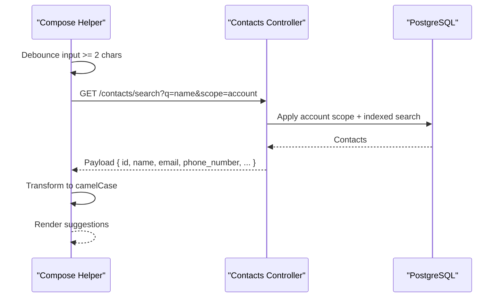

**Diagram sources**
- [contacts_controller.rb:24-28](file://app/controllers/api/v1/accounts/contacts_controller.rb#L24-L28)
- [composeConversationHelper.spec.js:360-394](file://app/javascript/dashboard/components-next/NewConversation/helpers/specs/composeConversationHelper.spec.js#L360-L394)
- [composeConversationHelper.spec.js:439-495](file://app/javascript/dashboard/components-next/NewConversation/helpers/specs/composeConversationHelper.spec.js#L439-L495)

**Section sources**
- [contacts_controller.rb:24-28](file://app/controllers/api/v1/accounts/contacts_controller.rb#L24-L28)
- [composeConversationHelper.spec.js:360-394](file://app/javascript/dashboard/components-next/NewConversation/helpers/specs/composeConversationHelper.spec.js#L360-L394)
- [composeConversationHelper.spec.js:439-495](file://app/javascript/dashboard/components-next/NewConversation/helpers/specs/composeConversationHelper.spec.js#L439-L495)

### Multi-Criteria Filtering
- Contact type:
  - Enumerated values allow filtering by visitor, lead, or customer
- Company association:
  - Company ID column supports filtering by associated company
- Custom attributes:
  - JSONB columns enable flexible attribute storage; combined with filter keys, you can build complex conditions
- Conversation history:
  - While not directly exposed as a contact filter here, conversation-related scopes and associations are available for building derived filters
- Temporal ranges:
  - Date fields like created_at and last_activity_at support greater-than, less-than, and days-before operators

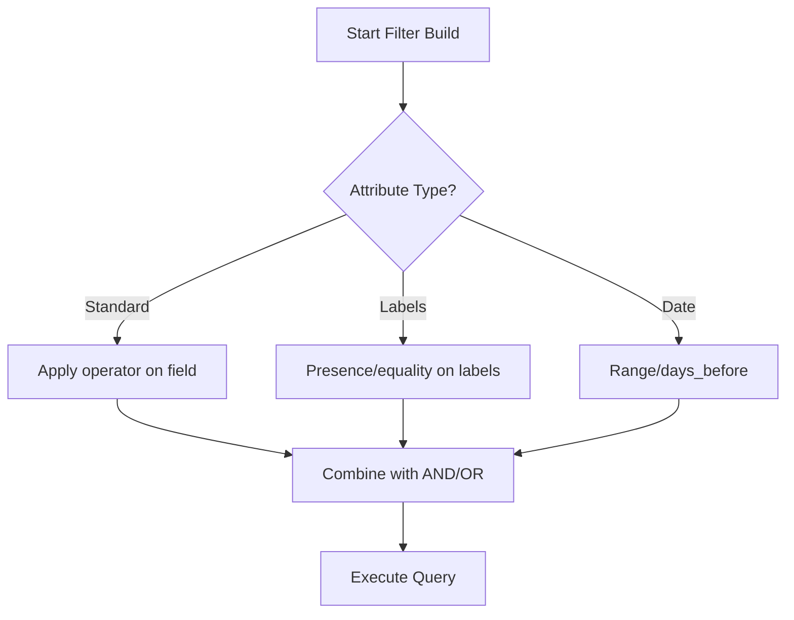

**Diagram sources**
- [filter_keys.yml:180-212](file://lib/filters/filter_keys.yml#L180-L212)
- [contact.rb:72-72](file://app/models/contact.rb#L72-L72)
- [contact.rb:23-24](file://app/models/contact.rb#L23-L24)

**Section sources**
- [contact.rb:72-72](file://app/models/contact.rb#L72-L72)
- [contact.rb:23-24](file://app/models/contact.rb#L23-L24)
- [filter_keys.yml:180-212](file://lib/filters/filter_keys.yml#L180-L212)

### Label-Based Filtering
- Labels are a first-class filter category with presence and equality operators
- Tests verify presence-based filtering returns contacts tagged with specified labels and absence-based filtering excludes them

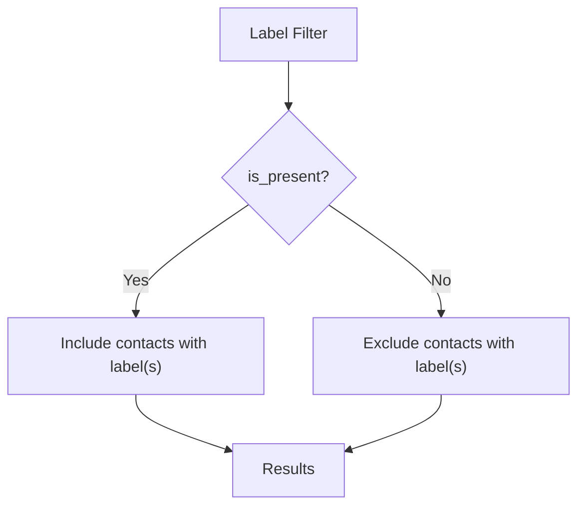

**Diagram sources**
- [filter_keys.yml:180-212](file://lib/filters/filter_keys.yml#L180-L212)
- [filter_service_spec.rb:201-242](file://spec/services/contacts/filter_service_spec.rb#L201-L242)

**Section sources**
- [filter_keys.yml:180-212](file://lib/filters/filter_keys.yml#L180-L212)
- [filter_service_spec.rb:201-242](file://spec/services/contacts/filter_service_spec.rb#L201-L242)

### Real-Time Suggestions and Autocomplete
- Frontend enforces a minimum query length (two characters) before calling the backend
- Requests are cancellable via AbortSignal to avoid race conditions during rapid typing
- Responses are transformed to camelCase for consistent UI consumption

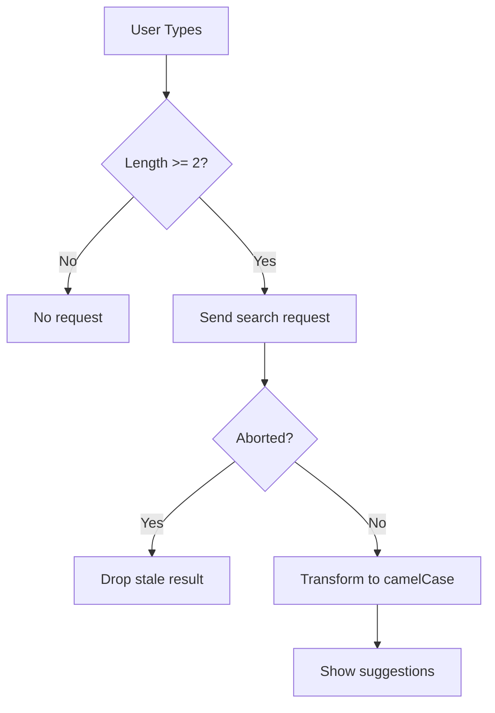

**Diagram sources**
- [composeConversationHelper.spec.js:360-394](file://app/javascript/dashboard/components-next/NewConversation/helpers/specs/composeConversationHelper.spec.js#L360-L394)
- [composeConversationHelper.spec.js:439-495](file://app/javascript/dashboard/components-next/NewConversation/helpers/specs/composeConversationHelper.spec.js#L439-L495)

**Section sources**
- [composeConversationHelper.spec.js:360-394](file://app/javascript/dashboard/components-next/NewConversation/helpers/specs/composeConversationHelper.spec.js#L360-L394)
- [composeConversationHelper.spec.js:439-495](file://app/javascript/dashboard/components-next/NewConversation/helpers/specs/composeConversationHelper.spec.js#L439-L495)

### Search Result Ranking
- PostgreSQL-based searches rely on index scans and deterministic ordering scopes (e.g., last activity, creation time, normalized name)
- When advanced search is enabled, Elasticsearch/OpenSearch can provide relevance ranking through Searchkick

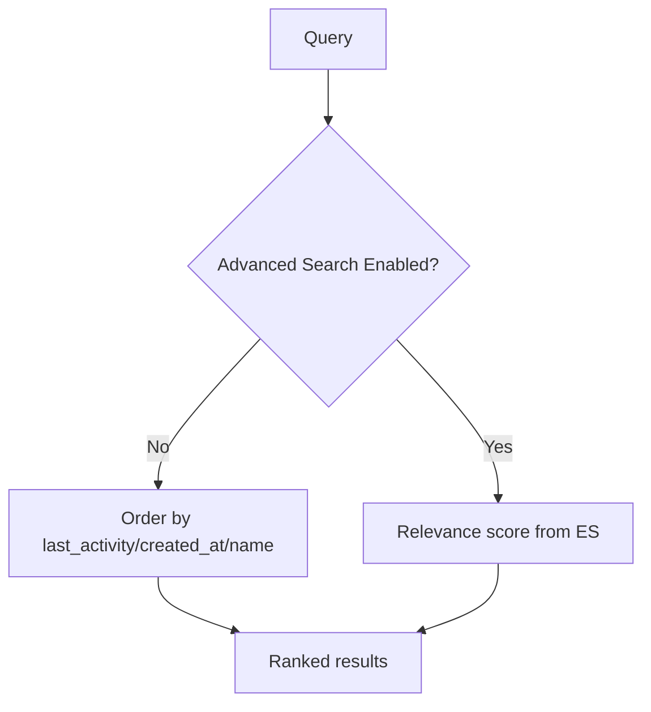

**Diagram sources**
- [contact.rb:74-123](file://app/models/contact.rb#L74-L123)
- [searchkick.rb:1-24](file://config/initializers/searchkick.rb#L1-L24)
- [message.rb:42-42](file://app/models/message.rb#L42-L42)

**Section sources**
- [contact.rb:74-123](file://app/models/contact.rb#L74-L123)
- [searchkick.rb:1-24](file://config/initializers/searchkick.rb#L1-L24)
- [message.rb:42-42](file://app/models/message.rb#L42-L42)

### Saved Searches and Automated Segmentation
- Saved searches are represented by persisted custom filters that store query payloads
- Automation rules can reference contact conditions, enabling automated segmentation based on attributes, labels, and temporal criteria
- Migration scripts show how saved filter queries are updated to align with evolving attribute keys (e.g., company_name)

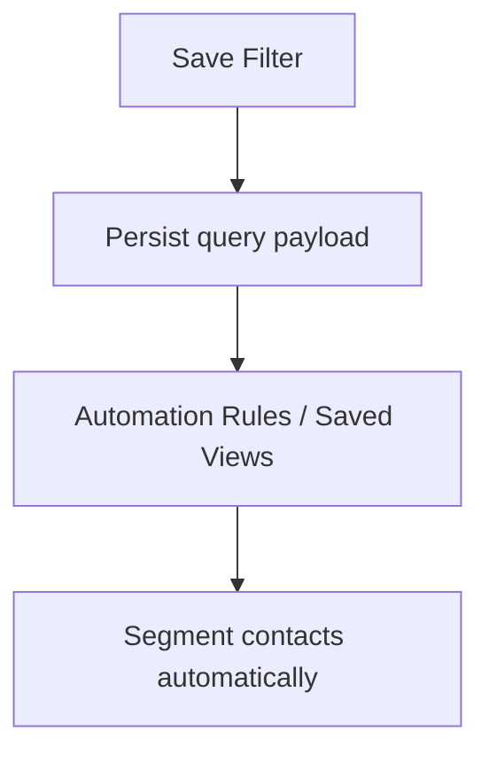

**Diagram sources**
- [filter_keys.yml:1-12](file://lib/filters/filter_keys.yml#L1-L12)

**Section sources**
- [filter_keys.yml:1-12](file://lib/filters/filter_keys.yml#L1-L12)

### Performance Optimization Techniques
- Database indexing:
  - GIN index on key text fields for fast substring/full-text-like matching
  - Account-scoped indexes to reduce scan space
  - Specialized indexes for email uniqueness and phone numbers
- Ordering optimizations:
  - SQL literals for NULLS LAST and case-insensitive normalization to improve sort performance
- Query composition:
  - Narrow early with account scope and high-selectivity filters (e.g., labels, dates)
- Search backend:
  - Offload heavy text search to Elasticsearch/OpenSearch when enabled

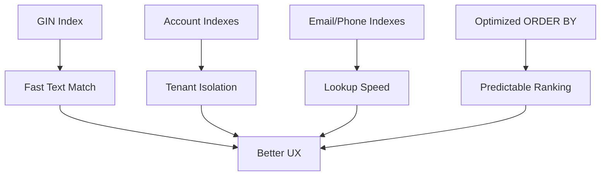

**Diagram sources**
- [contact.rb:26-39](file://app/models/contact.rb#L26-L39)
- [contact.rb:74-123](file://app/models/contact.rb#L74-L123)

**Section sources**
- [contact.rb:26-39](file://app/models/contact.rb#L26-L39)
- [contact.rb:74-123](file://app/models/contact.rb#L74-L123)

### Search Permissions and Data Isolation
- All contact searches are scoped to the current account, ensuring strict data isolation
- The contacts search controller enforces account scoping for all queries

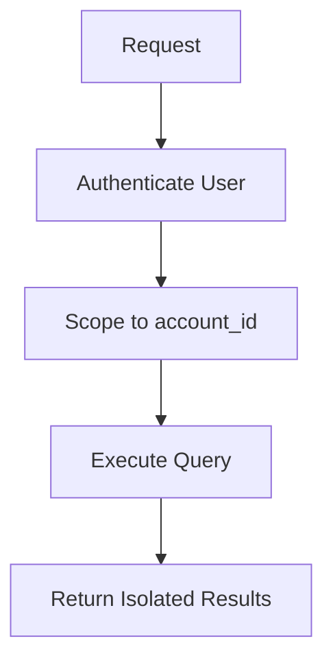

**Diagram sources**
- [contacts_controller.rb:24-28](file://app/controllers/api/v1/accounts/contacts_controller.rb#L24-L28)
- [contact.rb:26-39](file://app/models/contact.rb#L26-L39)

**Section sources**
- [contacts_controller.rb:24-28](file://app/controllers/api/v1/accounts/contacts_controller.rb#L24-L28)
- [contact.rb:26-39](file://app/models/contact.rb#L26-L39)

## Dependency Analysis
- Contact model depends on:
  - Database indexes for performance
  - Filter configuration for standardized operators
- Searchkick initializer configures external search engine connectivity
- Message model optionally integrates with Searchkick for advanced search
- Frontend compose helper tests validate autocomplete behavior and response transformation

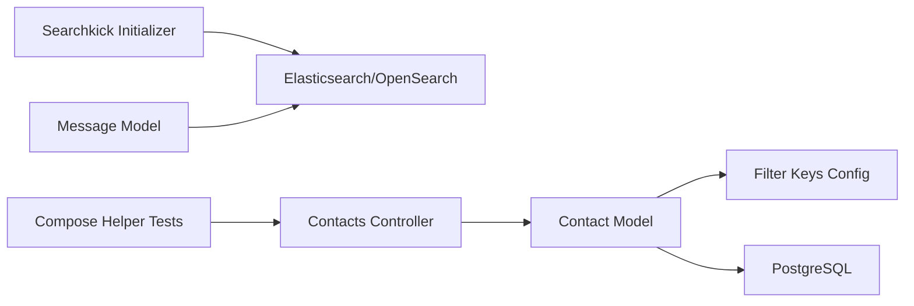

**Diagram sources**
- [contact.rb:26-39](file://app/models/contact.rb#L26-L39)
- [filter_keys.yml:180-212](file://lib/filters/filter_keys.yml#L180-L212)
- [searchkick.rb:1-24](file://config/initializers/searchkick.rb#L1-L24)
- [message.rb:42-42](file://app/models/message.rb#L42-L42)
- [composeConversationHelper.spec.js:360-394](file://app/javascript/dashboard/components-next/NewConversation/helpers/specs/composeConversationHelper.spec.js#L360-L394)
- [contacts_controller.rb:24-28](file://app/controllers/api/v1/accounts/contacts_controller.rb#L24-L28)

**Section sources**
- [contact.rb:26-39](file://app/models/contact.rb#L26-L39)
- [filter_keys.yml:180-212](file://lib/filters/filter_keys.yml#L180-L212)
- [searchkick.rb:1-24](file://config/initializers/searchkick.rb#L1-L24)
- [message.rb:42-42](file://app/models/message.rb#L42-L42)
- [composeConversationHelper.spec.js:360-394](file://app/javascript/dashboard/components-next/NewConversation/helpers/specs/composeConversationHelper.spec.js#L360-L394)
- [contacts_controller.rb:24-28](file://app/controllers/api/v1/accounts/contacts_controller.rb#L24-L28)

## Performance Considerations
- Prefer narrowing queries with account scope and high-selectivity filters (labels, dates)
- Leverage existing GIN and specialized indexes for fast matching
- Use ordering scopes that minimize expensive computations
- Enable Elasticsearch/OpenSearch for heavy text search workloads
- Cache frequent search results at the application level where appropriate

[No sources needed since this section provides general guidance]

## Troubleshooting Guide
- Autocomplete not triggering:
  - Ensure query length meets the minimum threshold
  - Verify network requests are not being aborted prematurely
- Unexpected empty results:
  - Confirm account scoping is correct
  - Validate filter operators and attribute keys against the filter configuration
- Label filter issues:
  - Check presence vs. equality semantics for labels
- Search backend connectivity:
  - Verify environment variables for OpenSearch/Elasticsearch credentials and region settings

**Section sources**
- [composeConversationHelper.spec.js:360-394](file://app/javascript/dashboard/components-next/NewConversation/helpers/specs/composeConversationHelper.spec.js#L360-L394)
- [filter_keys.yml:180-212](file://lib/filters/filter_keys.yml#L180-L212)
- [searchkick.rb:1-24](file://config/initializers/searchkick.rb#L1-L24)

## Conclusion
Chatwoot’s contact search combines robust PostgreSQL indexing with optional Elasticsearch/OpenSearch integration to deliver fast, accurate, and scalable contact discovery. Standardized filter configurations ensure consistent behavior across the UI and automation features. With account-scoped queries, strong indexing, and clear operator definitions, teams can efficiently segment and manage large contact databases while maintaining security and performance.