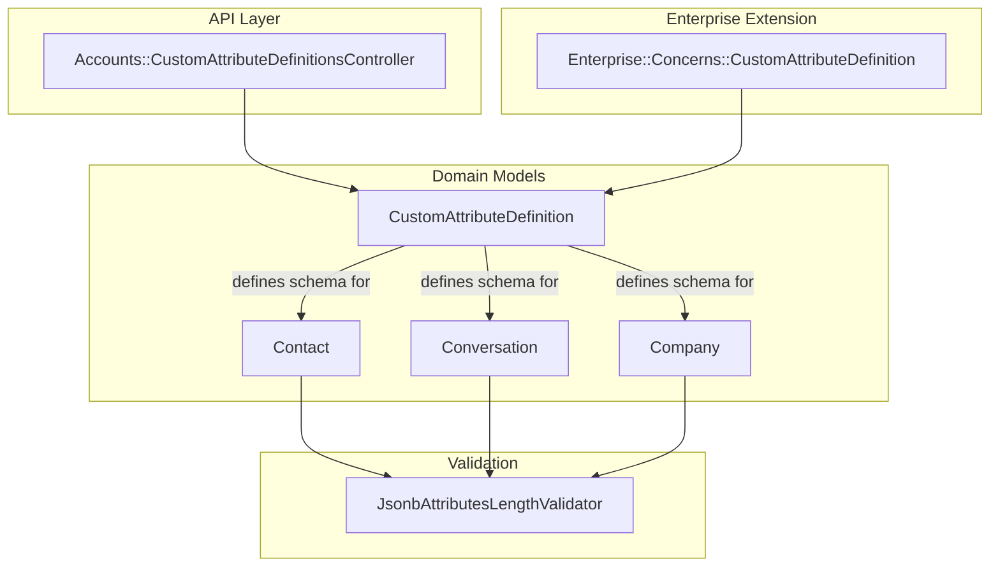
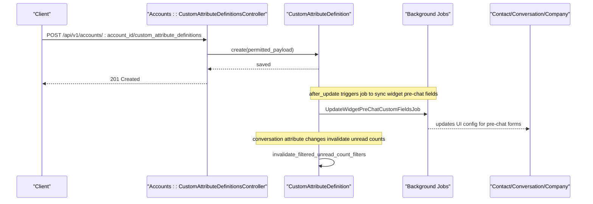
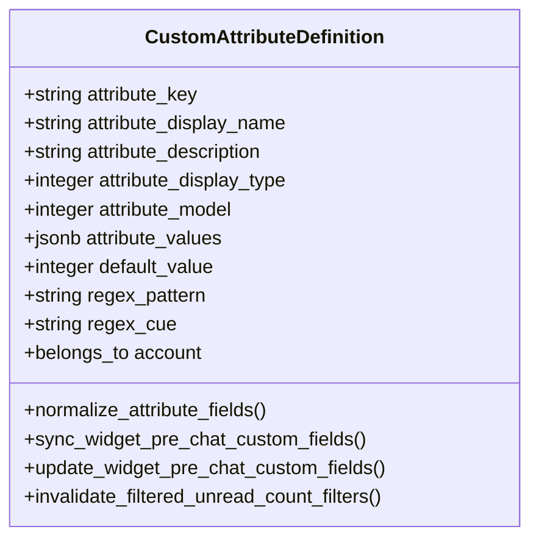
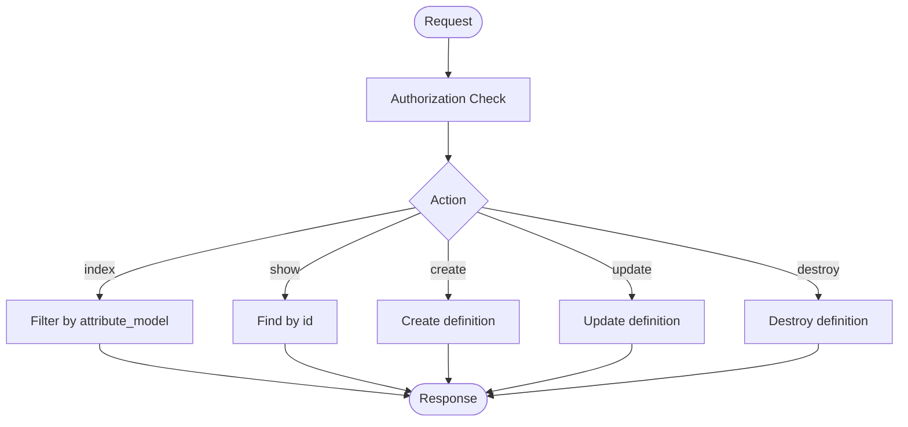
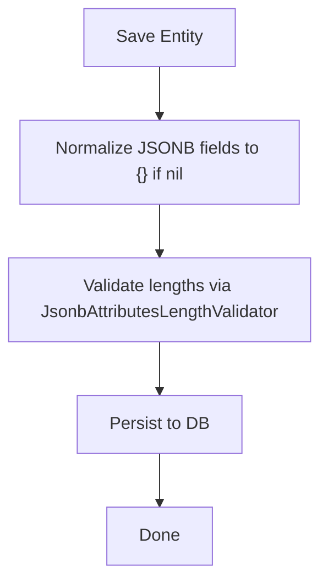
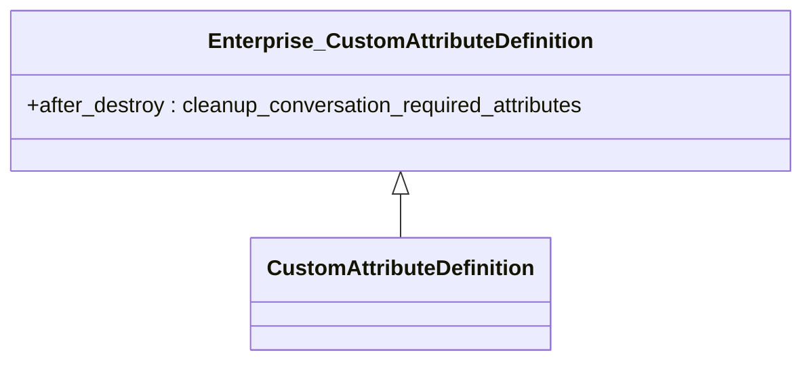
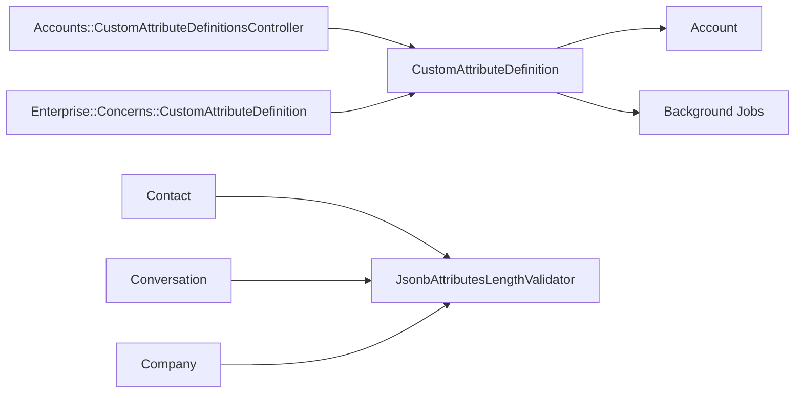

# Custom Attributes

<cite>
**Referenced Files in This Document**
- [custom_attribute_definition.rb](file://app/models/custom_attribute_definition.rb)
- [custom_attribute_definitions_controller.rb](file://app/controllers/api/v1/accounts/custom_attribute_definitions_controller.rb)
- [contact.rb](file://app/models/contact.rb)
- [conversation.rb](file://app/models/conversation.rb)
- [company.rb](file://app/models/company.rb)
- [jsonb_attributes_length_validator.rb](file://app/models/jsonb_attributes_length_validator.rb)
- [enterprise_custom_attribute_definition.rb](file://enterprise/app/models/enterprise/concerns/custom_attribute_definition.rb)
</cite>

## Table of Contents
1. [Introduction](#introduction)
2. [Project Structure](#project-structure)
3. [Core Components](#core-components)
4. [Architecture Overview](#architecture-overview)
5. [Detailed Component Analysis](#detailed-component-analysis)
6. [Dependency Analysis](#dependency-analysis)
7. [Performance Considerations](#performance-considerations)
8. [Troubleshooting Guide](#troubleshooting-guide)
9. [Conclusion](#conclusion)
10. [Appendices](#appendices)

## Introduction
This document explains Chatwoot’s custom attributes system, focusing on how the CustomAttributeDefinition model enables dynamic field creation for conversations, contacts, and companies. It covers supported attribute types, validation rules, API usage, storage in JSONB columns, synchronization across components, inheritance and default values, conditional display logic, performance considerations, naming conventions, and migration strategies.

## Project Structure
The custom attributes feature spans models, controllers, validators, and enterprise extensions:
- Model definition and validations: CustomAttributeDefinition
- API endpoints to manage definitions: Accounts::CustomAttributeDefinitionsController
- Entities that store custom data: Contact, Conversation, Company
- JSONB length validator used by entities
- Enterprise extension handling required conversation attributes

**Diagram sources**
- [custom_attribute_definitions_controller.rb:1-52](file://app/controllers/api/v1/accounts/custom_attribute_definitions_controller.rb#L1-L52)
- [custom_attribute_definition.rb:24-53](file://app/models/custom_attribute_definition.rb#L24-L53)
- [contact.rb:44-70](file://app/models/contact.rb#L44-L70)
- [conversation.rb:57-83](file://app/models/conversation.rb#L57-L83)
- [company.rb:23-36](file://app/models/company.rb#L23-L36)
- [jsonb_attributes_length_validator.rb:1-21](file://app/models/jsonb_attributes_length_validator.rb#L1-L21)
- [enterprise_custom_attribute_definition.rb:1-16](file://enterprise/app/models/enterprise/concerns/custom_attribute_definition.rb#L1-L16)

**Section sources**
- [custom_attribute_definition.rb:24-53](file://app/models/custom_attribute_definition.rb#L24-L53)
- [custom_attribute_definitions_controller.rb:1-52](file://app/controllers/api/v1/accounts/custom_attribute_definitions_controller.rb#L1-L52)
- [contact.rb:44-70](file://app/models/contact.rb#L44-L70)
- [conversation.rb:57-83](file://app/models/conversation.rb#L57-L83)
- [company.rb:23-36](file://app/models/company.rb#L23-L36)
- [jsonb_attributes_length_validator.rb:1-21](file://app/models/jsonb_attributes_length_validator.rb#L1-L21)
- [enterprise_custom_attribute_definition.rb:1-16](file://enterprise/app/models/enterprise/concerns/custom_attribute_definition.rb#L1-L16)

## Core Components
- CustomAttributeDefinition: Defines the schema for dynamic fields (keys, display names, types, regex patterns, list values). Enforces uniqueness per account and entity type, prevents conflicts with standard keys, and triggers background jobs to sync widget pre-chat fields and invalidate unread count filters when conversation attributes change.
- API Controller: Provides index, show, create, update, and destroy actions for custom attribute definitions scoped to the current account.
- Entities (Contact, Conversation, Company): Store actual custom attribute values in a JSONB column and validate size constraints via JsonbAttributesLengthValidator.
- Enterprise Extension: Ensures cleanup of required conversation attributes when a corresponding custom attribute is destroyed.

**Section sources**
- [custom_attribute_definition.rb:24-53](file://app/models/custom_attribute_definition.rb#L24-L53)
- [custom_attribute_definitions_controller.rb:1-52](file://app/controllers/api/v1/accounts/custom_attribute_definitions_controller.rb#L1-L52)
- [contact.rb:44-70](file://app/models/contact.rb#L44-L70)
- [conversation.rb:57-83](file://app/models/conversation.rb#L57-L83)
- [company.rb:23-36](file://app/models/company.rb#L23-L36)
- [jsonb_attributes_length_validator.rb:1-21](file://app/models/jsonb_attributes_length_validator.rb#L1-L21)
- [enterprise_custom_attribute_definition.rb:1-16](file://enterprise/app/models/enterprise/concerns/custom_attribute_definition.rb#L1-L16)

## Architecture Overview
The system separates metadata (attribute definitions) from runtime data (attribute values). Definitions are managed via an API and stored in a dedicated table. Values are persisted as JSONB within each entity. Background jobs synchronize UI configuration and invalidate caches when definitions or values change.

**Diagram sources**
- [custom_attribute_definitions_controller.rb:11-19](file://app/controllers/api/v1/accounts/custom_attribute_definitions_controller.rb#L11-L19)
- [custom_attribute_definition.rb:51-55](file://app/models/custom_attribute_definition.rb#L51-L55)
- [custom_attribute_definition.rb:64-70](file://app/models/custom_attribute_definition.rb#L64-L70)
- [custom_attribute_definition.rb:72-83](file://app/models/custom_attribute_definition.rb#L72-L83)

## Detailed Component Analysis

### CustomAttributeDefinition Model
Responsibilities:
- Define attribute metadata: key, display name, description, type, model scope, regex pattern, list values, default value.
- Validate presence and format of key and display type; normalize whitespace.
- Prevent conflicts with standard attribute keys and automation-only keys.
- Trigger background jobs to keep widget pre-chat fields in sync.
- Invalidate filtered unread counts when conversation attributes change.

Supported attribute models:
- conversation_attribute
- contact_attribute
- company_attribute

Supported attribute display types:
- text
- number
- currency
- percent
- link
- date
- list
- checkbox

Validation rules:
- attribute_key: presence, uniqueness scoped to account and attribute_model, format restricted to letters, numbers, underscores, hyphens.
- attribute_display_name: presence.
- attribute_display_type: presence.
- attribute_model: presence.
- Conflict check on create against standard keys and automation-only keys.

Storage:
- attribute_values: jsonb (for list-type options)
- default_value: integer (used for certain types like boolean or numeric defaults)
- regex_pattern and regex_cue: string fields for input validation cues

**Diagram sources**
- [custom_attribute_definition.rb:24-53](file://app/models/custom_attribute_definition.rb#L24-L53)
- [custom_attribute_definition.rb:59-83](file://app/models/custom_attribute_definition.rb#L59-L83)

**Section sources**
- [custom_attribute_definition.rb:24-53](file://app/models/custom_attribute_definition.rb#L24-L53)
- [custom_attribute_definition.rb:59-98](file://app/models/custom_attribute_definition.rb#L59-L98)

### API Endpoints: Accounts::CustomAttributeDefinitionsController
Endpoints:
- GET /api/v1/accounts/:account_id/custom_attribute_definitions?attribute_model=...
- GET /api/v1/accounts/:account_id/custom_attribute_definitions/:id
- POST /api/v1/accounts/:account_id/custom_attribute_definitions
- PUT /api/v1/accounts/:account_id/custom_attribute_definitions/:id
- DELETE /api/v1/accounts/:account_id/custom_attribute_definitions/:id

Permitted payload fields:
- attribute_display_name
- attribute_description
- attribute_display_type
- attribute_key
- attribute_model
- regex_pattern
- regex_cue
- attribute_values[]

Behavior:
- Index filters by attribute_model using a scope.
- Create/Update/Destroy operate on Current.account-scoped definitions.

**Diagram sources**
- [custom_attribute_definitions_controller.rb:1-52](file://app/controllers/api/v1/accounts/custom_attribute_definitions_controller.rb#L1-L52)

**Section sources**
- [custom_attribute_definitions_controller.rb:1-52](file://app/controllers/api/v1/accounts/custom_attribute_definitions_controller.rb#L1-L52)

### Storage and Validation of Custom Attribute Values
Entities storing custom attributes:
- Contact.custom_attributes: jsonb
- Conversation.custom_attributes: jsonb
- Company.custom_attributes: jsonb

Validation:
- All three entities use JsonbAttributesLengthValidator to enforce limits on string and integer values within the JSONB hash.

Normalization:
- Contact ensures additional_attributes and custom_attributes are initialized as hashes before saving.
- Company also normalizes both JSONB fields.

**Diagram sources**
- [contact.rb:211-228](file://app/models/contact.rb#L211-L228)
- [company.rb:70-75](file://app/models/company.rb#L70-L75)
- [jsonb_attributes_length_validator.rb:1-21](file://app/models/jsonb_attributes_length_validator.rb#L1-L21)

**Section sources**
- [contact.rb:211-228](file://app/models/contact.rb#L211-L228)
- [company.rb:70-75](file://app/models/company.rb#L70-L75)
- [conversation.rb:76-83](file://app/models/conversation.rb#L76-L83)
- [jsonb_attributes_length_validator.rb:1-21](file://app/models/jsonb_attributes_length_validator.rb#L1-L21)

### Inheritance, Defaults, and Conditional Display
- Inheritance: The base CustomAttributeDefinition includes an enterprise concern that adds behavior to clean up required conversation attributes when a conversation-scoped custom attribute is destroyed.
- Default values: The model defines a default_value field intended for typed defaults (e.g., boolean or numeric). Frontend/UI should render defaults based on attribute_display_type and default_value.
- Conditional display: For list-type attributes, attribute_values provides allowed options. Regex pattern and cue can be used to guide input validation and display hints.

**Diagram sources**
- [enterprise_custom_attribute_definition.rb:1-16](file://enterprise/app/models/enterprise/concerns/custom_attribute_definition.rb#L1-L16)
- [custom_attribute_definition.rb:101](file://app/models/custom_attribute_definition.rb#L101)

**Section sources**
- [enterprise_custom_attribute_definition.rb:1-16](file://enterprise/app/models/enterprise/concerns/custom_attribute_definition.rb#L1-L16)
- [custom_attribute_definition.rb:24-53](file://app/models/custom_attribute_definition.rb#L24-L53)

### Accessing Custom Data in Conversations and Reports
- Conversations expose custom_attributes in their serialized output and event payloads.
- Contacts expose custom_attributes in push_event_data and webhook_data.
- Companies include custom_attributes in their persisted state and API responses.

These structures allow downstream systems (dashboards, reports, integrations) to read and filter by custom attribute values.

**Section sources**
- [conversation.rb:68-83](file://app/models/conversation.rb#L68-L83)
- [contact.rb:141-174](file://app/models/contact.rb#L141-L174)
- [company.rb:23-36](file://app/models/company.rb#L23-L36)

## Dependency Analysis
Key relationships:
- API controller depends on Current.account and CustomAttributeDefinition.
- CustomAttributeDefinition belongs to Account and triggers background jobs and cache invalidation.
- Entities depend on JsonbAttributesLengthValidator for JSONB validation.
- Enterprise extension augments CustomAttributeDefinition lifecycle.

**Diagram sources**
- [custom_attribute_definitions_controller.rb:1-52](file://app/controllers/api/v1/accounts/custom_attribute_definitions_controller.rb#L1-L52)
- [custom_attribute_definition.rb:51-55](file://app/models/custom_attribute_definition.rb#L51-L55)
- [contact.rb:44-70](file://app/models/contact.rb#L44-L70)
- [conversation.rb:57-83](file://app/models/conversation.rb#L57-L83)
- [company.rb:23-36](file://app/models/company.rb#L23-L36)
- [jsonb_attributes_length_validator.rb:1-21](file://app/models/jsonb_attributes_length_validator.rb#L1-L21)
- [enterprise_custom_attribute_definition.rb:1-16](file://enterprise/app/models/enterprise/concerns/custom_attribute_definition.rb#L1-L16)

**Section sources**
- [custom_attribute_definitions_controller.rb:1-52](file://app/controllers/api/v1/accounts/custom_attribute_definitions_controller.rb#L1-L52)
- [custom_attribute_definition.rb:51-55](file://app/models/custom_attribute_definition.rb#L51-L55)
- [contact.rb:44-70](file://app/models/contact.rb#L44-L70)
- [conversation.rb:57-83](file://app/models/conversation.rb#L57-L83)
- [company.rb:23-36](file://app/models/company.rb#L23-L36)
- [jsonb_attributes_length_validator.rb:1-21](file://app/models/jsonb_attributes_length_validator.rb#L1-L21)
- [enterprise_custom_attribute_definition.rb:1-16](file://enterprise/app/models/enterprise/concerns/custom_attribute_definition.rb#L1-L16)

## Performance Considerations
- Large numbers of custom attributes:
  - Keep attribute_keys concise and consistent to minimize overhead in queries and indexing.
  - Avoid excessively large values in JSONB; the validator enforces string length and integer range limits.
  - Prefer list-type attributes with predefined options to reduce free-form text volume.
- Synchronization and caching:
  - Changes to conversation-scoped attributes trigger unread count filter invalidation; batch operations where possible to avoid excessive cache busts.
  - Widget pre-chat field sync runs asynchronously; monitor job queues under high churn scenarios.
- Naming conventions:
  - Use lowercase, alphanumeric characters, underscores, and hyphens only.
  - Avoid reserved or standard keys to prevent conflicts.
  - Scope keys clearly by entity type (e.g., prefixing with domain terms) to aid readability and maintenance.

[No sources needed since this section provides general guidance]

## Troubleshooting Guide
Common issues and resolutions:
- Validation errors on attribute_key:
  - Ensure the key matches the allowed format and does not conflict with standard or automation-only keys.
- JSONB value too large:
  - Reduce string lengths or integer magnitudes; the validator will reject oversized values.
- Required conversation attributes not cleaned up:
  - When destroying a conversation-scoped custom attribute that is marked as required at the account level, ensure the enterprise extension is active so required attributes are removed automatically.

Operational checks:
- Verify background jobs for widget pre-chat field sync are running.
- Confirm unread count filters are invalidated after conversation attribute changes.

**Section sources**
- [custom_attribute_definition.rb:39-46](file://app/models/custom_attribute_definition.rb#L39-L46)
- [custom_attribute_definition.rb:93-98](file://app/models/custom_attribute_definition.rb#L93-L98)
- [jsonb_attributes_length_validator.rb:1-21](file://app/models/jsonb_attributes_length_validator.rb#L1-L21)
- [enterprise_custom_attribute_definition.rb:1-16](file://enterprise/app/models/enterprise/concerns/custom_attribute_definition.rb#L1-L16)

## Conclusion
Chatwoot’s custom attributes system provides a flexible, validated, and scalable way to extend core entities with dynamic fields. By separating definitions from values, leveraging JSONB storage, and enforcing strict validation and naming rules, the system supports rich customization while maintaining performance and consistency. Use the API to manage definitions, rely on built-in validators for data integrity, and follow best practices for naming and sizing to optimize performance at scale.

[No sources needed since this section summarizes without analyzing specific files]

## Appendices

### API Usage Examples
- Create a custom attribute definition:
  - Endpoint: POST /api/v1/accounts/:account_id/custom_attribute_definitions
  - Payload fields: attribute_display_name, attribute_description, attribute_display_type, attribute_key, attribute_model, regex_pattern, regex_cue, attribute_values[]
- List definitions filtered by entity type:
  - Endpoint: GET /api/v1/accounts/:account_id/custom_attribute_definitions?attribute_model=contact_attribute
- Update or delete a definition:
  - PUT /api/v1/accounts/:account_id/custom_attribute_definitions/:id
  - DELETE /api/v1/accounts/:account_id/custom_attribute_definitions/:id

**Section sources**
- [custom_attribute_definitions_controller.rb:11-24](file://app/controllers/api/v1/accounts/custom_attribute_definitions_controller.rb#L11-L24)
- [custom_attribute_definitions_controller.rb:36-46](file://app/controllers/api/v1/accounts/custom_attribute_definitions_controller.rb#L36-L46)

### Defining Custom Attributes and Validation Rules
- Choose attribute_model: conversation_attribute, contact_attribute, or company_attribute.
- Select attribute_display_type: text, number, currency, percent, link, date, list, checkbox.
- Provide attribute_key following naming rules and avoiding conflicts.
- For list-type attributes, populate attribute_values with allowed options.
- Optionally set regex_pattern and regex_cue to guide input validation and display.

**Section sources**
- [custom_attribute_definition.rb:48-53](file://app/models/custom_attribute_definition.rb#L48-L53)
- [custom_attribute_definition.rb:39-46](file://app/models/custom_attribute_definition.rb#L39-L46)

### Accessing Custom Data in Conversations and Reports
- Read custom_attributes from conversation and contact payloads.
- Use these values in dashboards, filters, and reports.
- Ensure attribute definitions exist for any custom keys you plan to query or display.

**Section sources**
- [conversation.rb:68-83](file://app/models/conversation.rb#L68-L83)
- [contact.rb:141-174](file://app/models/contact.rb#L141-L174)

### Migration Strategies for Existing Data
- Adding new custom attributes:
  - Create definitions via API; existing records will have empty JSONB entries for new keys.
  - Backfill missing values if necessary using bulk update scripts that write into custom_attributes JSONB.
- Renaming or changing types:
  - Prefer adding a new attribute_key and migrating data gradually; deprecate old keys after backfill and validation.
- Handling required conversation attributes:
  - Ensure enterprise extension is enabled so required attributes are cleaned up when definitions are removed.

**Section sources**
- [custom_attribute_definition.rb:51-55](file://app/models/custom_attribute_definition.rb#L51-L55)
- [enterprise_custom_attribute_definition.rb:1-16](file://enterprise/app/models/enterprise/concerns/custom_attribute_definition.rb#L1-L16)