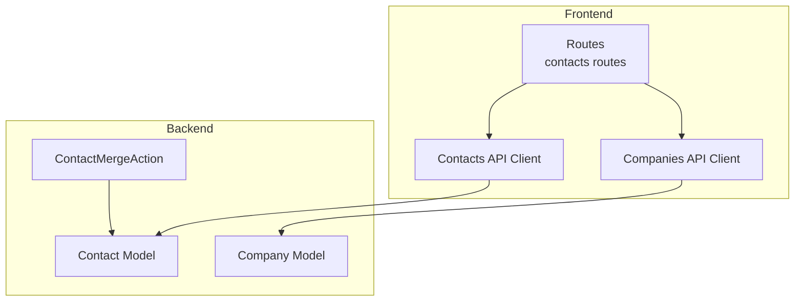
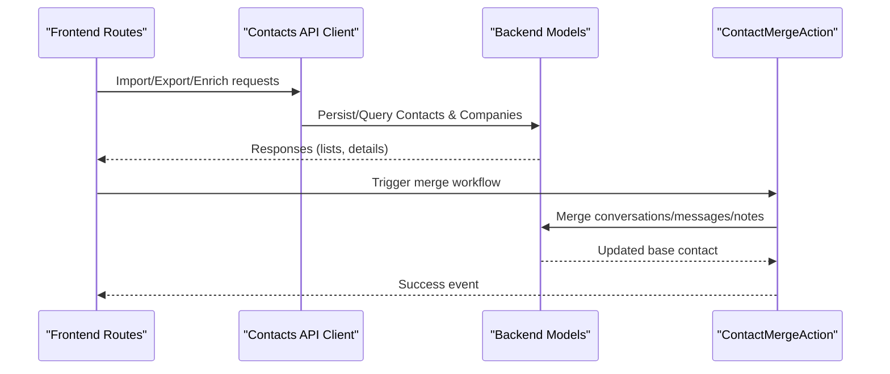
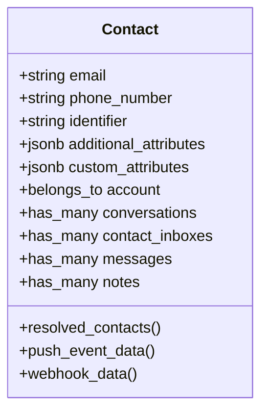
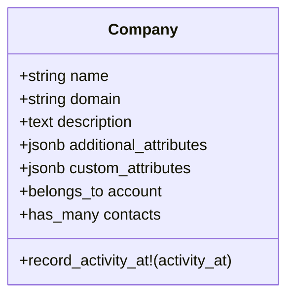
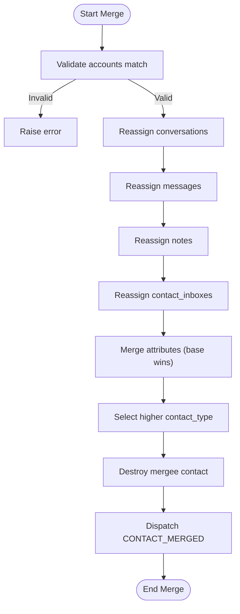
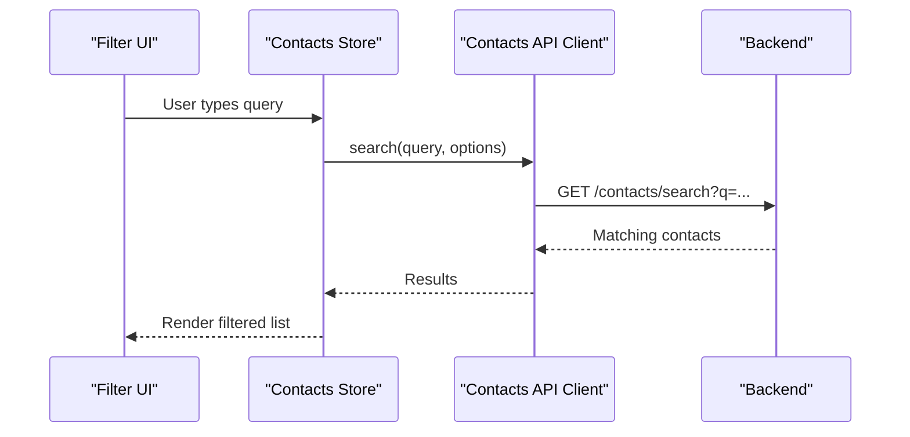
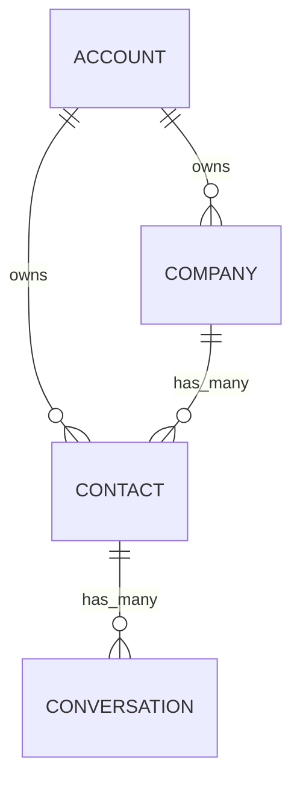
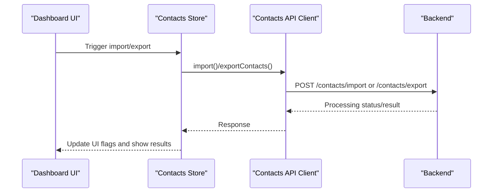
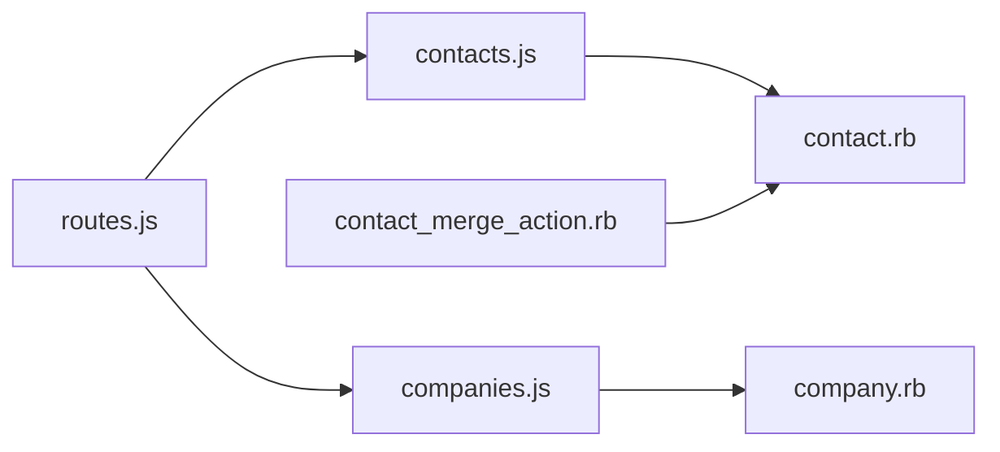

# Customer Management

<cite>
**Referenced Files in This Document**
- [contact.rb](file://app/models/contact.rb)
- [company.rb](file://app/models/company.rb)
- [contact_merge_action.rb](file://app/actions/contact_merge_action.rb)
- [routes.js](file://app/javascript/dashboard/routes/dashboard/contacts/routes.js)
- [contacts.js (API client)](file://app/javascript/dashboard/api/contacts.js)
- [companies.js (API client)](file://app/javascript/dashboard/api/companies.js)
- [actions.js (contacts store)](file://app/javascript/dashboard/store/modules/contacts/actions.js)
</cite>

## Table of Contents
1. [Introduction](#introduction)
2. [Project Structure](#project-structure)
3. [Core Components](#core-components)
4. [Architecture Overview](#architecture-overview)
5. [Detailed Component Analysis](#detailed-component-analysis)
6. [Dependency Analysis](#dependency-analysis)
7. [Performance Considerations](#performance-considerations)
8. [Troubleshooting Guide](#troubleshooting-guide)
9. [Conclusion](#conclusion)

## Introduction
This document explains Chatwoot’s customer relationship management capabilities with a focus on contact profile management, company organization structures, and segmentation features. It covers custom attribute definitions for extending data models, contact merging and deduplication, enrichment processes, search and filtering, activity history and timelines, relationships between contacts, companies, and conversations, API usage examples, bulk operations, import/export, and privacy/security considerations.

## Project Structure
The CRM functionality is implemented across backend models, actions, and frontend routes/API clients:
- Backend models define the core entities (Contact, Company) and their relationships.
- An action orchestrates contact merging and deduplication.
- Frontend routes expose CRM pages and views.
- Frontend API clients provide methods for importing, exporting, enriching, and managing contacts and companies.

**Diagram sources**
- [routes.js:11-51](file://app/javascript/dashboard/routes/dashboard/contacts/routes.js#L11-L51)
- [contacts.js (API client):88-105](file://app/javascript/dashboard/api/contacts.js#L88-L105)
- [companies.js (API client):48-69](file://app/javascript/dashboard/api/companies.js#L48-L69)
- [contact.rb:44-70](file://app/models/contact.rb#L44-L70)
- [company.rb:23-43](file://app/models/company.rb#L23-L43)
- [contact_merge_action.rb:1-20](file://app/actions/contact_merge_action.rb#L1-L20)

**Section sources**
- [routes.js:11-51](file://app/javascript/dashboard/routes/dashboard/contacts/routes.js#L11-L51)
- [contacts.js (API client):88-105](file://app/javascript/dashboard/api/contacts.js#L88-L105)
- [companies.js (API client):48-69](file://app/javascript/dashboard/api/companies.js#L48-L69)
- [contact.rb:44-70](file://app/models/contact.rb#L44-L70)
- [company.rb:23-43](file://app/models/company.rb#L23-L43)
- [contact_merge_action.rb:1-20](file://app/actions/contact_merge_action.rb#L1-L20)

## Core Components
- Contact model: Stores identity fields (email, phone_number, identifier), attributes (additional_attributes, custom_attributes), and relationships to conversations, messages, notes, and companies. Provides scopes for ordering and resolving resolved contacts. Dispatches lifecycle events and triggers IP lookup when enabled.
- Company model: Represents organizations with name, domain, description, and counts. Supports search by name/domain and activity roll-up. Enqueues background jobs for favicon fetching and syncing contact names when company name changes.
- ContactMergeAction: Orchestrates merging two contacts within an account, consolidating conversations, messages, notes, and inbox associations, then removing the mergee while preserving the higher contact type.

Key responsibilities:
- Contact profile management and validation
- Company organization and association
- Contact merging and deduplication
- Event dispatching and background tasks

**Section sources**
- [contact.rb:44-70](file://app/models/contact.rb#L44-L70)
- [contact.rb:176-180](file://app/models/contact.rb#L176-L180)
- [contact.rb:193-228](file://app/models/contact.rb#L193-L228)
- [company.rb:23-43](file://app/models/company.rb#L23-L43)
- [company.rb:64-83](file://app/models/company.rb#L64-L83)
- [contact_merge_action.rb:1-70](file://app/actions/contact_merge_action.rb#L1-L70)

## Architecture Overview
The CRM architecture connects frontend UI flows to backend models and services:
- Frontend routes render CRM pages and manage state.
- API clients call backend endpoints for CRUD, import/export, and enrichment.
- Backend models enforce validations, maintain relationships, and trigger background jobs.
- Actions encapsulate complex workflows like merging.

**Diagram sources**
- [routes.js:11-51](file://app/javascript/dashboard/routes/dashboard/contacts/routes.js#L11-L51)
- [contacts.js (API client):88-105](file://app/javascript/dashboard/api/contacts.js#L88-L105)
- [companies.js (API client):48-69](file://app/javascript/dashboard/api/companies.js#L48-L69)
- [contact.rb:44-70](file://app/models/contact.rb#L44-L70)
- [contact_merge_action.rb:1-70](file://app/actions/contact_merge_action.rb#L1-L70)

## Detailed Component Analysis

### Contact Profile Management
- Identity fields: email, phone_number, identifier with uniqueness constraints scoped to account.
- Attributes: additional_attributes and custom_attributes stored as JSONB; prepared and synced via callbacks.
- Relationships: belongs_to account; has_many conversations, contact_inboxes, messages, notes; optional company association.
- Lifecycle hooks: before_validation prepares attributes; after_create_commit dispatches create event and triggers IP lookup; after_update_commit dispatches update event; after_destroy_commit dispatches delete event.
- Resolved contacts: filters contacts that have at least one identification field or are leads depending on CRM version flag.

**Diagram sources**
- [contact.rb:44-70](file://app/models/contact.rb#L44-L70)
- [contact.rb:176-180](file://app/models/contact.rb#L176-L180)
- [contact.rb:141-174](file://app/models/contact.rb#L141-L174)

**Section sources**
- [contact.rb:44-70](file://app/models/contact.rb#L44-L70)
- [contact.rb:176-180](file://app/models/contact.rb#L176-L180)
- [contact.rb:193-228](file://app/models/contact.rb#L193-L228)

### Company Organization Structures
- Fields: name, domain, description, additional_attributes, custom_attributes.
- Validations: presence of account_id and name; domain format and uniqueness per account; length limits.
- Relationships: belongs_to account; has_many contacts.
- Activity tracking: last_activity_at with roll-up interval to avoid excessive updates.
- Background jobs: fetch favicon asynchronously; enqueue sync of contact company names when company name changes.

**Diagram sources**
- [company.rb:23-43](file://app/models/company.rb#L23-L43)
- [company.rb:64-83](file://app/models/company.rb#L64-L83)

**Section sources**
- [company.rb:23-43](file://app/models/company.rb#L23-L43)
- [company.rb:64-83](file://app/models/company.rb#L64-L83)

### Custom Attribute Definitions and Dynamic Fields
- Both Contact and Company support custom_attributes and additional_attributes as JSONB fields.
- The frontend fixtures demonstrate attribute metadata such as display_name, display_type, key, and regex patterns, indicating dynamic field configuration for contacts.
- These attributes allow extensible data models without schema migrations.

**Section sources**
- [contact.rb:44-70](file://app/models/contact.rb#L44-L70)
- [company.rb:23-43](file://app/models/company.rb#L23-L43)

### Contact Merging and Deduplication
- ContactMergeAction performs a transactional merge:
  - Validates both contacts belong to the same account.
  - Reassigns conversations, messages, notes, and contact_inboxes from mergee to base.
  - Merges attributes with base contact taking precedence; selects higher contact_type.
  - Destroys mergee and dispatches a merged event.

**Diagram sources**
- [contact_merge_action.rb:1-70](file://app/actions/contact_merge_action.rb#L1-L70)

**Section sources**
- [contact_merge_action.rb:1-70](file://app/actions/contact_merge_action.rb#L1-L70)

### Data Enrichment Processes
- Company API client exposes an enrichment endpoint to trigger enrichment for a company record.
- Contact model triggers IP lookup job when feature is enabled, enriching location-related data.

**Section sources**
- [companies.js (API client):67-69](file://app/javascript/dashboard/api/companies.js#L67-L69)
- [contact.rb:193-197](file://app/models/contact.rb#L193-L197)

### Contact Search and Filtering Capabilities
- Frontend routes include segments and labels views for contact lists, enabling segmentation-based browsing.
- Company API client provides searchContacts method to query contacts associated with a company.
- Frontend filter helpers demonstrate searching contacts by name/email/identifier through a dedicated search API.

**Diagram sources**
- [routes.js:11-51](file://app/javascript/dashboard/routes/dashboard/contacts/routes.js#L11-L51)
- [companies.js (API client):48-51](file://app/javascript/dashboard/api/companies.js#L48-L51)

**Section sources**
- [routes.js:11-51](file://app/javascript/dashboard/routes/dashboard/contacts/routes.js#L11-L51)
- [companies.js (API client):48-51](file://app/javascript/dashboard/api/companies.js#L48-L51)

### Activity History Tracking and Interaction Timelines
- Contact model tracks last_activity_at and provides ordering scopes.
- Company model records last_activity_at with roll-up logic to reduce frequent updates.
- Conversations, messages, and notes are linked to contacts, forming interaction timelines.

**Section sources**
- [contact.rb:74-123](file://app/models/contact.rb#L74-L123)
- [company.rb:49-68](file://app/models/company.rb#L49-L68)

### Relationship Between Contacts, Companies, and Conversations
- Contact belongs_to account and optionally associates with a company.
- Contact has_many conversations; conversations link back to contacts.
- Company has_many contacts; changing company name enqueues synchronization of contact names.

**Diagram sources**
- [contact.rb:58-64](file://app/models/contact.rb#L58-L64)
- [company.rb:38-40](file://app/models/company.rb#L38-L40)

**Section sources**
- [contact.rb:58-64](file://app/models/contact.rb#L58-L64)
- [company.rb:38-40](file://app/models/company.rb#L38-L40)

### Contact API Usage, Bulk Operations, and Data Import/Export
- Import: Contacts API client exposes an import method to upload files for bulk creation/update.
- Export: Contacts API client exposes exportContacts to generate exports based on query payloads.
- Store actions handle UI flags and error handling during import/export.

**Diagram sources**
- [contacts.js (API client):88-105](file://app/javascript/dashboard/api/contacts.js#L88-L105)
- [actions.js (contacts store):184-206](file://app/javascript/dashboard/store/modules/contacts/actions.js#L184-L206)

**Section sources**
- [contacts.js (API client):88-105](file://app/javascript/dashboard/api/contacts.js#L88-L105)
- [actions.js (contacts store):184-206](file://app/javascript/dashboard/store/modules/contacts/actions.js#L184-L206)

## Dependency Analysis
- Frontend routes depend on feature flags and permissions to access CRM pages.
- API clients encapsulate HTTP calls for contacts and companies, including enrichment, import, export, and search.
- Backend models enforce data integrity and orchestrate background jobs.
- ContactMergeAction depends on multiple related models to ensure consistent state during merges.

**Diagram sources**
- [routes.js:11-51](file://app/javascript/dashboard/routes/dashboard/contacts/routes.js#L11-L51)
- [contacts.js (API client):88-105](file://app/javascript/dashboard/api/contacts.js#L88-L105)
- [companies.js (API client):48-69](file://app/javascript/dashboard/api/companies.js#L48-L69)
- [contact.rb:44-70](file://app/models/contact.rb#L44-L70)
- [company.rb:23-43](file://app/models/company.rb#L23-L43)
- [contact_merge_action.rb:1-70](file://app/actions/contact_merge_action.rb#L1-L70)

**Section sources**
- [routes.js:11-51](file://app/javascript/dashboard/routes/dashboard/contacts/routes.js#L11-L51)
- [contacts.js (API client):88-105](file://app/javascript/dashboard/api/contacts.js#L88-L105)
- [companies.js (API client):48-69](file://app/javascript/dashboard/api/companies.js#L48-L69)
- [contact.rb:44-70](file://app/models/contact.rb#L44-L70)
- [company.rb:23-43](file://app/models/company.rb#L23-L43)
- [contact_merge_action.rb:1-70](file://app/actions/contact_merge_action.rb#L1-L70)

## Performance Considerations
- Use scopes for efficient ordering and filtering (e.g., last_activity_at, name).
- Avoid frequent updates to last_activity_at by using roll-up intervals for companies.
- Leverage JSONB attributes for flexible data without schema changes; keep attribute sizes reasonable.
- Offload heavy tasks (IP lookup, favicon fetching, name synchronization) to background jobs.

[No sources needed since this section provides general guidance]

## Troubleshooting Guide
- Validation errors: Ensure email and phone_number conform to formats; invalid values are reverted to previous valid states.
- Account scoping: Merging requires both contacts to belong to the same account; otherwise, an error is raised.
- Feature flags: IP lookup and company features must be enabled to utilize enrichment and company-specific behaviors.
- UI state: Import/export operations set UI flags; check for error responses and clear flags appropriately.

**Section sources**
- [contact.rb:199-209](file://app/models/contact.rb#L199-L209)
- [contact_merge_action.rb:24-32](file://app/actions/contact_merge_action.rb#L24-L32)
- [contact.rb:193-197](file://app/models/contact.rb#L193-L197)
- [actions.js (contacts store):184-206](file://app/javascript/dashboard/store/modules/contacts/actions.js#L184-L206)

## Conclusion
Chatwoot’s CRM provides robust contact and company management with extensible attributes, powerful search and segmentation, reliable merging and deduplication, and comprehensive integration points for enrichment and background processing. The frontend routes and API clients offer intuitive workflows for import/export and daily operations, while backend models and actions ensure data integrity and performance.

[No sources needed since this section summarizes without analyzing specific files]