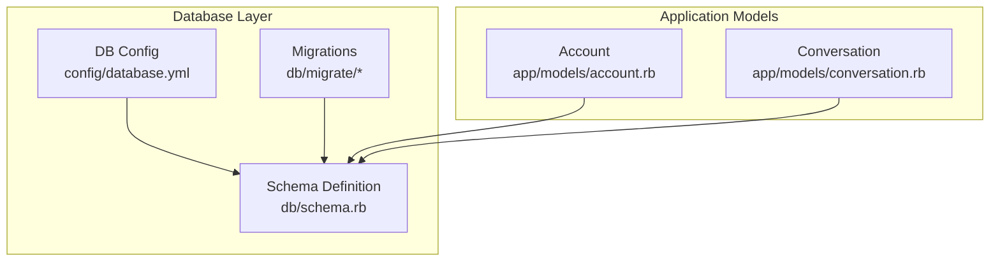
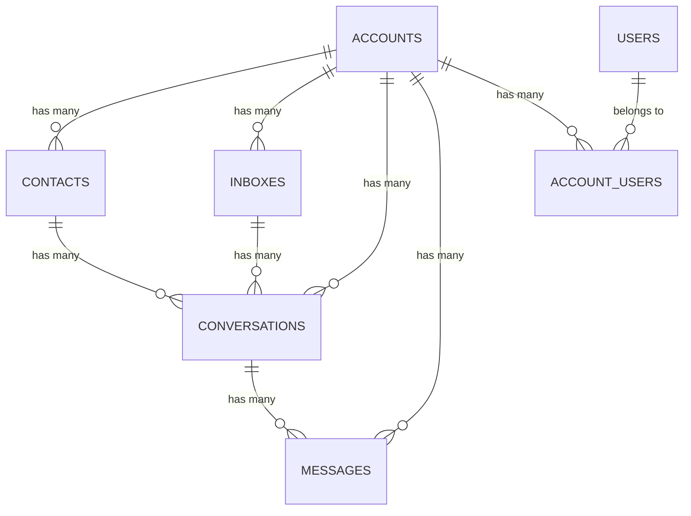
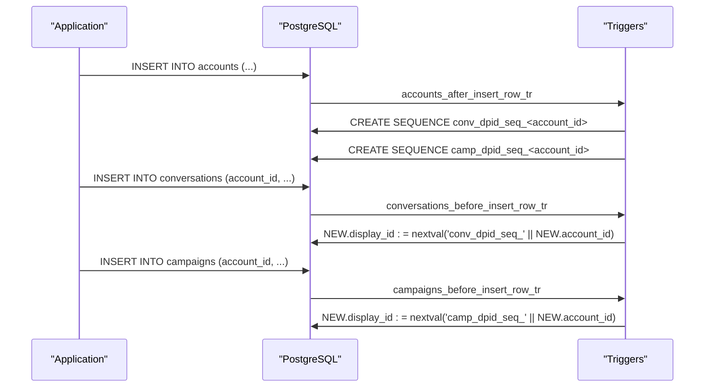
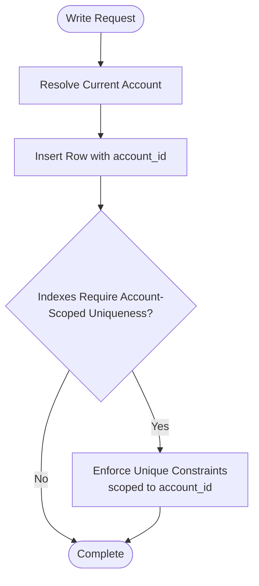
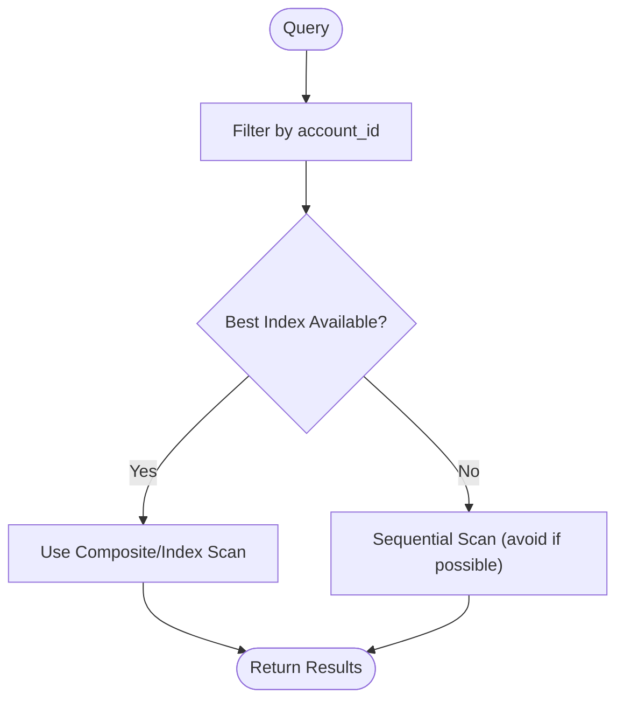
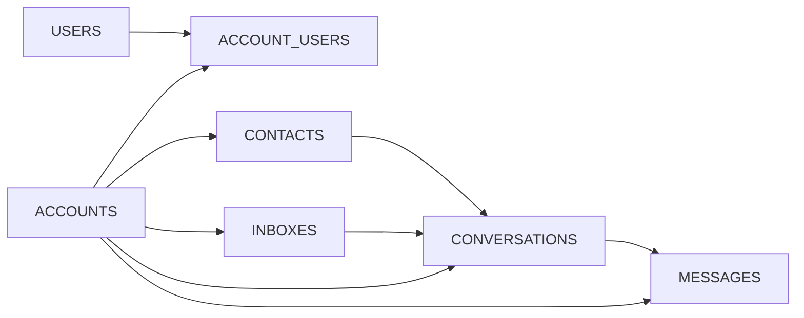

# Database Design

<cite>
**Referenced Files in This Document**
- [schema.rb](file://db/schema.rb)
- [database.yml](file://config/database.yml)
- [account.rb](file://app/models/account.rb)
- [conversation.rb](file://app/models/conversation.rb)
- [20230426130150_init_schema.rb](file://db/migrate/20230426130150_init_schema.rb)
- [20250806140002_create_agent_capacity_policies.rb](file://db/migrate/20250806140002_create_agent_capacity_policies.rb)
</cite>

## Table of Contents
1. [Introduction](#introduction)
2. [Project Structure](#project-structure)
3. [Core Components](#core-components)
4. [Architecture Overview](#architecture-overview)
5. [Detailed Component Analysis](#detailed-component-analysis)
6. [Dependency Analysis](#dependency-analysis)
7. [Performance Considerations](#performance-considerations)
8. [Troubleshooting Guide](#troubleshooting-guide)
9. [Conclusion](#conclusion)
10. [Appendices](#appendices)

## Introduction
This document describes Chatwoot’s PostgreSQL data model and how it supports multi-tenant isolation, entity relationships (accounts, users, contacts, conversations, messages), integrity constraints, indexes, migration strategy, performance considerations, and operational concerns such as retention and security. It is based on the generated schema and core models that define primary keys, foreign key relationships, and database triggers used for per-account identifiers.

## Project Structure
The database layer is defined by:
- A generated schema file that captures all tables, columns, indexes, constraints, and triggers.
- Migration files that evolve the schema over time.
- Model code that defines associations and some database-level behaviors (e.g., triggers).
- Database configuration that sets connection parameters and statement timeouts.

**Diagram sources**
- [schema.rb:1-20](file://db/schema.rb#L1-L20)
- [database.yml:1-32](file://config/database.yml#L1-L32)
- [account.rb:214-220](file://app/models/account.rb#L214-L220)
- [conversation.rb:437-441](file://app/models/conversation.rb#L437-L441)

**Section sources**
- [schema.rb:1-20](file://db/schema.rb#L1-L20)
- [database.yml:1-32](file://config/database.yml#L1-L32)

## Core Components
This section outlines the core entities and their relationships as reflected in the schema and models.

- Account: The tenant root. All major entities are scoped to an account_id.
- User: System user; membership to accounts via account_users.
- Contact: Customer identity records scoped to an account.
- Inbox: Channel endpoint within an account.
- Conversation: Threaded interactions scoped to an account and inbox.
- Message: Individual message events within a conversation.

Key relationships:
- Account has many Contacts, Conversations, Inboxes, Messages, Users (via account_users), Labels, Teams, etc.
- Conversation belongs to Account and Inbox; has many Messages.
- Contact is linked to Conversations and other account-scoped entities.
- Messages belong to Conversations and are also scoped to Account and Inbox.

**Diagram sources**
- [schema.rb:64-80](file://db/schema.rb#L64-L80)
- [schema.rb:803-833](file://db/schema.rb#L803-L833)
- [schema.rb:1337-1363](file://db/schema.rb#L1337-L1363)
- [schema.rb:990-1038](file://db/schema.rb#L990-L1038)
- [schema.rb:1443-1475](file://db/schema.rb#L1443-L1475)
- [schema.rb:45-62](file://db/schema.rb#L45-L62)
- [schema.rb:1748-1787](file://db/schema.rb#L1748-L1787)

**Section sources**
- [schema.rb:64-80](file://db/schema.rb#L64-L80)
- [schema.rb:803-833](file://db/schema.rb#L803-L833)
- [schema.rb:1337-1363](file://db/schema.rb#L1337-L1363)
- [schema.rb:990-1038](file://db/schema.rb#L990-L1038)
- [schema.rb:1443-1475](file://db/schema.rb#L1443-L1475)
- [schema.rb:45-62](file://db/schema.rb#L45-L62)
- [schema.rb:1748-1787](file://db/schema.rb#L1748-L1787)

## Architecture Overview
Chatwoot uses a single PostgreSQL database with row-level multi-tenancy enforced by account_id on most tables. Per-tenant display IDs are generated using per-account sequences created by database triggers.

**Diagram sources**
- [schema.rb:1836-1863](file://db/schema.rb#L1836-L1863)
- [account.rb:214-220](file://app/models/account.rb#L214-L220)
- [conversation.rb:437-441](file://app/models/conversation.rb#L437-L441)

## Detailed Component Analysis

### Multi-Tenant Data Isolation and Account Scoping
- Most tables include an integer or bigint account_id column to scope data to a tenant.
- Indexes frequently include account_id to optimize per-tenant queries.
- Some tables use partial or composite unique indexes scoped to account_id to enforce uniqueness within a tenant.

Examples:
- Contacts: index on (account_id, email) and (account_id, identifier) for uniqueness within an account.
- Conversations: unique index on (account_id, display_id) and (uuid).
- Messages: multiple indexes including (account_id, inbox_id) and (account_id, content_type, created_at).

**Diagram sources**
- [schema.rb:803-833](file://db/schema.rb#L803-L833)
- [schema.rb:990-1038](file://db/schema.rb#L990-L1038)
- [schema.rb:1443-1475](file://db/schema.rb#L1443-L1475)

**Section sources**
- [schema.rb:803-833](file://db/schema.rb#L803-L833)
- [schema.rb:990-1038](file://db/schema.rb#L990-L1038)
- [schema.rb:1443-1475](file://db/schema.rb#L1443-L1475)

### Entity Relationships and Integrity

#### Accounts
- Primary key: id (serial).
- Important fields: name, domain, support_email, status, feature flags, settings JSONB.
- Sequences: Per-account sequences for conversation and campaign display IDs are created on insert.

Constraints and indexes:
- Status index for filtering.
- Per-account sequence creation via trigger.

**Section sources**
- [schema.rb:64-80](file://db/schema.rb#L64-L80)
- [schema.rb:1836-1863](file://db/schema.rb#L1836-L1863)
- [account.rb:214-220](file://app/models/account.rb#L214-L220)

#### Users and Account Membership
- Users table stores authentication and profile data.
- account_users links users to accounts with role and availability attributes.
- Unique constraint ensures one membership per user per account.

Integrity:
- Composite unique index on (account_id, user_id).
- Indexes on user_id and account_id for lookups.

**Section sources**
- [schema.rb:45-62](file://db/schema.rb#L45-L62)
- [schema.rb:1748-1787](file://db/schema.rb#L1748-L1787)

#### Contacts
- Scoped to account_id.
- Supports email, phone_number, identifier, custom_attributes, contact_type, company association.
- Multiple indexes for search and deduplication within an account.

Integrity:
- Unique indexes on (account_id, email) and (account_id, identifier).
- Partial indexes for resolved contacts and non-empty identifiers.

**Section sources**
- [schema.rb:803-833](file://db/schema.rb#L803-L833)

#### Inboxes
- Belong to an account and channel.
- Configuration includes auto-assignment, greeting, working hours, CSAT settings.

Integrity:
- Index on account_id and channel_id/channel_type.

**Section sources**
- [schema.rb:1337-1363](file://db/schema.rb#L1337-L1363)

#### Conversations
- Scoped to account_id and inbox_id.
- Includes assignee (user or AI bot), team, campaign, SLA policy, timestamps, labels cache, priority, waiting_since.
- Display ID is generated per account via trigger.

Integrity:
- Unique index on (account_id, display_id).
- Unique uuid index.
- Many indexes for common filters (status, priority, created_at, assignee).

**Section sources**
- [schema.rb:990-1038](file://db/schema.rb#L990-L1038)
- [conversation.rb:437-441](file://app/models/conversation.rb#L437-L441)

#### Messages
- Scoped to account_id, inbox_id, conversation_id.
- Contains content, type, sender polymorphism, sentiment, additional attributes.
- Extensive indexing for high-throughput reads/writes and analytics.

Integrity:
- Indexes on (account_id, inbox_id), (conversation_id, account_id, message_type, created_at), and more.

**Section sources**
- [schema.rb:1443-1475](file://db/schema.rb#L1443-L1475)

### Schema Evolution and Backward Compatibility
- The schema is managed through Rails migrations under db/migrate.
- The generated schema.rb reflects the current state and is used for fast setup via schema:load.
- Example evolution:
  - Initial schema definition.
  - Addition of agent capacity policies and related assignment infrastructure.

Migration examples:
- Initial schema creation.
- Creating agent capacity policies table.

**Section sources**
- [20230426130150_init_schema.rb](file://db/migrate/20230426130150_init_schema.rb)
- [20250806140002_create_agent_capacity_policies.rb](file://db/migrate/20250806140002_create_agent_capacity_policies.rb)
- [schema.rb:1-12](file://db/schema.rb#L1-L12)

### Data Access Patterns and Query Optimization
Common patterns:
- Tenant-scoped queries always filter by account_id.
- Frequent filters on conversations by status, priority, created_at, assignee, inbox.
- Message queries often filter by account_id, inbox_id, conversation_id, and message_type.

Indexing strategies observed:
- Composite indexes for frequent query predicates (e.g., account_id + status, account_id + inbox_id).
- GIN indexes for JSONB and trigram text search where applicable.
- Partial indexes for specific subsets (e.g., ringing calls, pending automation executions).

[No sources needed since this diagram shows conceptual workflow, not actual code structure]

**Section sources**
- [schema.rb:990-1038](file://db/schema.rb#L990-L1038)
- [schema.rb:1443-1475](file://db/schema.rb#L1443-L1475)

### Security, Encryption, and Access Control
- Authentication and session data reside in users and related tables.
- Secrets and tokens are stored in various tables (e.g., access_tokens, platform apps, channels).
- PostgreSQL extensions enabled include pgcrypto for cryptographic functions.
- Application-level encryption and access control should be applied to sensitive fields at the application layer; the schema does not show explicit encrypted columns beyond standard hashed passwords and tokens.

Operational notes:
- Ensure secrets are managed via environment variables and secret managers.
- Restrict database roles and permissions to least privilege.
- Enable TLS for client connections and consider enabling pg_catalog auditing where required.

**Section sources**
- [schema.rb:13-19](file://db/schema.rb#L13-L19)
- [schema.rb:21-29](file://db/schema.rb#L21-L29)
- [schema.rb:1748-1787](file://db/schema.rb#L1748-L1787)

### Retention, Archival, and Backup
- No built-in archival tables are present in the schema for general message or conversation archival.
- Operational archival should be implemented via scheduled jobs or external tools to move old data to cold storage.
- Backup procedures should follow standard PostgreSQL backup practices (logical dumps or physical backups) and align with retention policies defined at the organization level.

[No sources needed since this section provides general guidance]

## Dependency Analysis
High-level dependencies between core tables:

**Diagram sources**
- [schema.rb:45-62](file://db/schema.rb#L45-L62)
- [schema.rb:803-833](file://db/schema.rb#L803-L833)
- [schema.rb:1337-1363](file://db/schema.rb#L1337-L1363)
- [schema.rb:990-1038](file://db/schema.rb#L990-L1038)
- [schema.rb:1443-1475](file://db/schema.rb#L1443-L1475)
- [schema.rb:1748-1787](file://db/schema.rb#L1748-L1787)

**Section sources**
- [schema.rb:45-62](file://db/schema.rb#L45-L62)
- [schema.rb:803-833](file://db/schema.rb#L803-L833)
- [schema.rb:1337-1363](file://db/schema.rb#L1337-L1363)
- [schema.rb:990-1038](file://db/schema.rb#L990-L1038)
- [schema.rb:1443-1475](file://db/schema.rb#L1443-L1475)
- [schema.rb:1748-1787](file://db/schema.rb#L1748-L1787)

## Performance Considerations
- Connection pool sizing:
  - Pool size varies by process type (web vs worker) and environment variables.
- Statement timeout:
  - Default statement_timeout configured to prevent long-running queries from blocking resources.
- Indexing:
  - Heavy use of composite indexes for common query patterns (e.g., account-scoped filters).
  - GIN indexes for JSONB and trigram-based full-text search.
- Trigger overhead:
  - Per-account sequence generation adds minimal overhead but must be considered during bulk inserts.

Recommendations:
- Always include account_id in WHERE clauses to leverage indexes.
- Avoid SELECT *; project only necessary columns.
- Monitor slow queries and add targeted indexes for new access patterns.
- Use batched writes for large imports to reduce lock contention.

**Section sources**
- [database.yml:1-14](file://config/database.yml#L1-L14)
- [schema.rb:990-1038](file://db/schema.rb#L990-L1038)
- [schema.rb:1443-1475](file://db/schema.rb#L1443-L1475)
- [schema.rb:1836-1863](file://db/schema.rb#L1836-L1863)

## Troubleshooting Guide
Common issues and diagnostics:
- Missing account scoping:
  - Symptoms: Cross-tenant data leakage or missing rows.
  - Fix: Ensure all queries filter by account_id and rely on scopes/helpers provided by models.
- Sequence errors for display IDs:
  - Symptoms: Duplicate display_id or sequence not found.
  - Fix: Verify per-account sequences exist; recreate via account deletion/creation flows or manual sequence creation.
- Slow queries:
  - Symptoms: High latency on conversation/message lists.
  - Fix: Add or refine indexes matching query predicates; avoid unnecessary joins; paginate results.

Operational checks:
- Validate database.yml settings for pool size and timeouts.
- Review migration history for recent schema changes that may affect performance.

**Section sources**
- [database.yml:1-32](file://config/database.yml#L1-L32)
- [schema.rb:1836-1863](file://db/schema.rb#L1836-L1863)

## Conclusion
Chatwoot’s PostgreSQL schema centers around a robust multi-tenant design with account_id scoping, extensive indexing for performance, and database triggers for per-tenant display IDs. The schema evolves through migrations, and the generated schema.rb serves as the canonical reference. For production operations, emphasize tenant-scoped queries, careful indexing, secure handling of secrets, and well-defined retention/archival processes aligned with organizational policies.

## Appendices

### Key Tables Summary
- accounts: Tenant root with settings and feature flags.
- users: Authentication and profile data.
- account_users: User-to-account membership.
- contacts: Customer identities scoped to accounts.
- inboxes: Channel endpoints scoped to accounts.
- conversations: Threads scoped to accounts and inboxes.
- messages: Events within conversations, heavily indexed.

**Section sources**
- [schema.rb:64-80](file://db/schema.rb#L64-L80)
- [schema.rb:45-62](file://db/schema.rb#L45-L62)
- [schema.rb:803-833](file://db/schema.rb#L803-L833)
- [schema.rb:1337-1363](file://db/schema.rb#L1337-L1363)
- [schema.rb:990-1038](file://db/schema.rb#L990-L1038)
- [schema.rb:1443-1475](file://db/schema.rb#L1443-L1475)