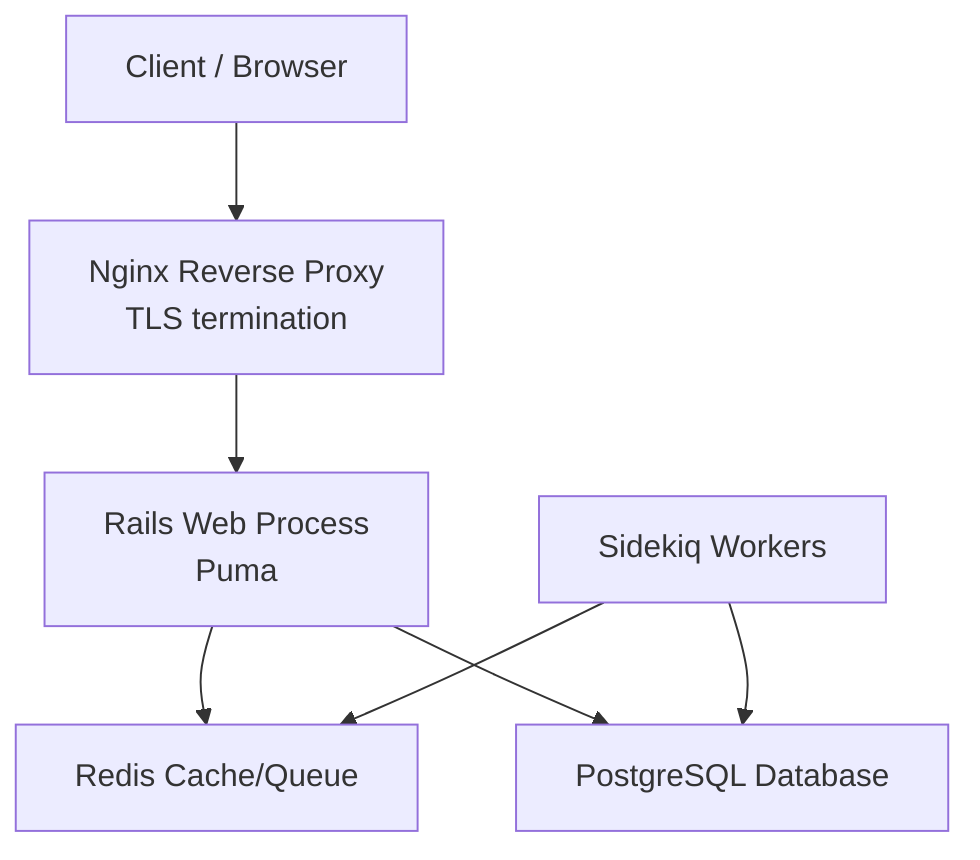
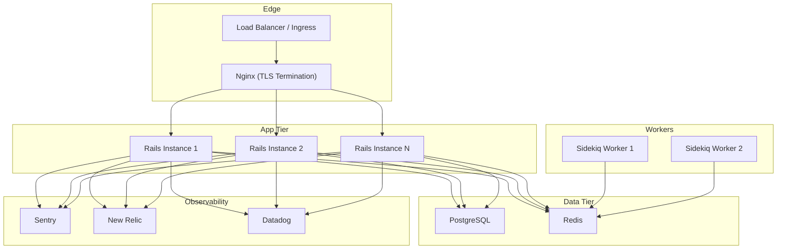
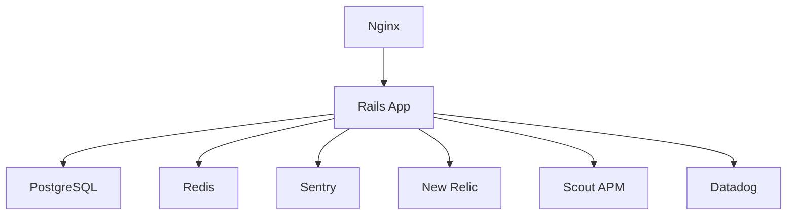

# Deployment & Operations

<cite>
**Referenced Files in This Document**
- [README.md](file://README.md)
- [docker-compose.yaml](file://docker-compose.yaml)
- [docker-compose.production.yaml](file://docker-compose.production.yaml)
- [config/database.yml](file://config/database.yml)
- [config/application.rb](file://config/application.rb)
- [config/initializers/sentry.rb](file://config/initializers/sentry.rb)
- [config/newrelic.yml](file://config/newrelic.yml)
- [config/scout_apm.yml](file://config/scout_apm.yml)
- [config/initializers/datadog.rb](file://config/initializers/datadog.rb)
- [deployment/nginx_chatwoot.conf](file://deployment/nginx_chatwoot.conf)
</cite>

## Table of Contents
1. [Introduction](#introduction)
2. [Project Structure](#project-structure)
3. [Core Components](#core-components)
4. [Architecture Overview](#architecture-overview)
5. [Detailed Component Analysis](#detailed-component-analysis)
6. [Dependency Analysis](#dependency-analysis)
7. [Performance Considerations](#performance-considerations)
8. [Troubleshooting Guide](#troubleshooting-guide)
9. [Conclusion](#conclusion)

## Introduction
This document provides comprehensive deployment and operations guidance for Chatwoot, covering production strategies using Docker containers, Kubernetes (via DigitalOcean 1-Click), and traditional server setups. It details environment configuration, database setup, external service dependencies, scaling strategies, monitoring and logging integrations (Sentry, New Relic, Datadog), backup and recovery procedures, disaster planning, maintenance tasks, performance tuning, resource allocation, capacity planning, security hardening, SSL configuration, compliance considerations, and troubleshooting common operational issues.

## Project Structure
Chatwoot is a Rails application with background jobs managed by Sidekiq. Production deployments typically run:
- A web process (Rails/Puma) serving HTTP requests
- A worker process (Sidekiq) processing background jobs
- PostgreSQL as the primary database
- Redis for caching, sessions, and job queues
- Nginx as a reverse proxy and TLS terminator

**Diagram sources**
- [docker-compose.production.yaml:10-35](file://docker-compose.production.yaml#L10-L35)
- [docker-compose.production.yaml:37-57](file://docker-compose.production.yaml#L37-L57)
- [deployment/nginx_chatwoot.conf:1-64](file://deployment/nginx_chatwoot.conf#L1-L64)

**Section sources**
- [README.md:101-122](file://README.md#L101-L122)
- [docker-compose.production.yaml:1-63](file://docker-compose.production.yaml#L1-L63)
- [docker-compose.yaml:1-120](file://docker-compose.yaml#L1-L120)

## Core Components
- Web Application (Rails): Serves API and dashboard UI; runs under Puma via Rails server command.
- Background Jobs (Sidekiq): Processes asynchronous tasks such as email delivery, integrations, and scheduled jobs.
- Database (PostgreSQL): Stores all application data; uses pgvector image in containerized environments.
- Cache/Queue (Redis): Powers caching, session storage, and Sidekiq job queue.
- Reverse Proxy (Nginx): Handles TLS termination, request forwarding, and static asset routing.

Key runtime behaviors:
- Environment variables drive configuration for DB, Redis, APMs, and feature flags.
- APM agents are conditionally loaded based on environment variables.
- Sentry is enabled in staging and production when DSN is set.
- New Relic agent can be enabled via license key and app name.
- Datadog tracing is enabled when DD_TRACE_AGENT_URL is present.

**Section sources**
- [docker-compose.production.yaml:10-35](file://docker-compose.production.yaml#L10-L35)
- [docker-compose.production.yaml:37-57](file://docker-compose.production.yaml#L37-L57)
- [config/application.rb:11-34](file://config/application.rb#L11-L34)
- [config/initializers/sentry.rb:1-16](file://config/initializers/sentry.rb#L1-L16)
- [config/newrelic.yml:10-22](file://config/newrelic.yml#L10-L22)
- [config/initializers/datadog.rb:1-7](file://config/initializers/datadog.rb#L1-L7)

## Architecture Overview
The production architecture consists of:
- Nginx at the edge terminating TLS and proxying to Rails
- Multiple Rails instances behind a load balancer (horizontal scaling)
- Sidekiq workers scaled independently based on workload
- Shared PostgreSQL and Redis services (or managed equivalents)
- Optional APM and error tracking integrations

**Diagram sources**
- [docker-compose.production.yaml:10-35](file://docker-compose.production.yaml#L10-L35)
- [docker-compose.production.yaml:37-57](file://docker-compose.production.yaml#L37-L57)
- [config/application.rb:11-34](file://config/application.rb#L11-L34)
- [config/initializers/sentry.rb:1-16](file://config/initializers/sentry.rb#L1-L16)
- [config/newrelic.yml:10-22](file://config/newrelic.yml#L10-L22)
- [config/initializers/datadog.rb:1-7](file://config/initializers/datadog.rb#L1-L7)

## Detailed Component Analysis

### Docker Compose Production Setup
- Services: rails, sidekiq, postgres, redis
- Volumes: persistent storage for app files, PostgreSQL data, and Redis data
- Ports: Rails bound to localhost:3000; PostgreSQL to 5433; Redis to 6380
- Environment: NODE_ENV=production, RAILS_ENV=production, INSTALLATION_ENV=docker
- Entrypoints and commands define how Rails and Sidekiq start

Operational notes:
- Use .env file for secrets and configuration overrides
- Ensure Redis password is set via REDIS_PASSWORD
- Persist storage_data, postgres_data, and redis_data volumes

**Section sources**
- [docker-compose.production.yaml:1-63](file://docker-compose.production.yaml#L1-L63)

### Traditional Server Setup with Nginx
- Nginx listens on ports 80 and 443, redirects HTTP to HTTPS
- Upstream backend points to Rails on 127.0.0.1:3000
- WebSocket support configured via Upgrade headers
- TLS settings include modern protocols, ciphers, HSTS, and session cache
- Certificates managed by Certbot at specified paths

Operational notes:
- Replace chatwoot.domain.com with your domain
- Ensure certificates exist at the specified paths
- Adjust client_max_body_size and timeouts according to workload

**Section sources**
- [deployment/nginx_chatwoot.conf:1-64](file://deployment/nginx_chatwoot.conf#L1-L64)

### Database Configuration
- Adapter: PostgreSQL
- Host and port configurable via POSTGRES_HOST and POSTGRES_PORT
- Pool size adapts between Sidekiq and Rails processes
- Reaping frequency configured for connection health
- Statement timeout tuned via POSTGRES_STATEMENT_TIMEOUT

Production recommendations:
- Set POSTGRES_DATABASE, POSTGRES_USERNAME, POSTGRES_PASSWORD
- Tune pool sizes based on concurrency and DB capacity
- Monitor statement timeouts and adjust as needed

**Section sources**
- [config/database.yml:1-32](file://config/database.yml#L1-L32)

### Monitoring and Logging Integrations
- Sentry: Enabled when SENTRY_DSN is set; supports performance sampling and PII control
- New Relic: Agent enabled via NEW_RELIC_LICENSE_KEY; app name customizable; distributed tracing enabled
- Scout APM: Configurable via SCOUT_NAME and SCOUT_KEY
- Datadog: Tracing instrumentation enabled when DD_TRACE_AGENT_URL is set

Operational notes:
- Set appropriate environment variables per integration
- Control PII exposure with DISABLE_SENTRY_PII
- Enable/disable agents per environment using provided config options

**Section sources**
- [config/initializers/sentry.rb:1-16](file://config/initializers/sentry.rb#L1-L16)
- [config/newrelic.yml:10-22](file://config/newrelic.yml#L10-L22)
- [config/scout_apm.yml:1-10](file://config/scout_apm.yml#L1-L10)
- [config/initializers/datadog.rb:1-7](file://config/initializers/datadog.rb#L1-L7)

### Application Boot and APM Loading
- Dotenv loads environment variables early
- Conditional requires for Datadog, Elastic APM, Scout APM, New Relic, and Sentry
- Heroku autoscaling support via JudoScale when JUDOSCALE_URL is set
- Redis SSL verify mode controlled by REDIS_OPENSSL_VERIFY_MODE

Operational notes:
- Ensure required gems are included in Gemfile for chosen APMs
- Configure encryption keys if enabling MFA/2FA features
- Validate Redis SSL settings for secure connections

**Section sources**
- [config/application.rb:11-34](file://config/application.rb#L11-L34)
- [config/application.rb:92-109](file://config/application.rb#L92-L109)

### Scaling Strategies
Horizontal scaling:
- Run multiple Rails instances behind a load balancer or Kubernetes ingress
- Scale Sidekiq workers independently based on queue depth and throughput
- Use shared Redis and PostgreSQL (managed services recommended)

Vertical scaling:
- Increase CPU/RAM for Rails and Sidekiq processes
- Tune PostgreSQL instance size and IOPS
- Optimize Redis memory and persistence settings

High availability:
- Deploy multiple replicas of Rails and Sidekiq across zones
- Use managed PostgreSQL with multi-AZ replication
- Use managed Redis with failover capabilities
- Configure health checks and auto-restart policies

Load balancing:
- Place Nginx or an external load balancer in front of Rails instances
- Ensure sticky sessions are not required unless using in-memory session stores

**Section sources**
- [docker-compose.production.yaml:10-35](file://docker-compose.production.yaml#L10-L35)
- [docker-compose.production.yaml:37-57](file://docker-compose.production.yaml#L37-L57)
- [deployment/nginx_chatwoot.conf:1-64](file://deployment/nginx_chatwoot.conf#L1-L64)

### Backup and Recovery Procedures
- PostgreSQL backups: Use pg_dump or managed service snapshots; schedule regular backups
- Redis backups: Enable RDB/AOF persistence and back up volume data
- File storage: Back up persistent storage volumes used by Rails
- Disaster recovery: Test restore procedures regularly; maintain offsite backups

Recovery steps:
- Restore PostgreSQL from latest snapshot
- Restore Redis data if applicable
- Mount persisted storage volumes
- Verify application connectivity and functionality

**Section sources**
- [docker-compose.production.yaml:59-63](file://docker-compose.production.yaml#L59-L63)

### Maintenance Tasks
- Database migrations: Run db:migrate during zero-downtime deployments
- Asset precompilation: Precompile assets if not served by CDN
- Log rotation: Configure log rotation for Nginx and application logs
- Certificate renewal: Automate Let’s Encrypt renewal via Certbot
- Dependency updates: Regularly update Ruby gems and system packages

**Section sources**
- [deployment/nginx_chatwoot.conf:52-58](file://deployment/nginx_chatwoot.conf#L52-L58)

### Performance Tuning Guidelines
- Rails:
  - Tune RAILS_MAX_THREADS and SIDEKIQ_CONCURRENCY
  - Enable eager loading and disable unnecessary previewers
- PostgreSQL:
  - Adjust statement_timeout and pool sizes
  - Monitor slow queries and optimize indexes
- Redis:
  - Set appropriate memory limits and eviction policies
  - Enable persistence for durability
- Nginx:
  - Tune keepalive and timeouts
  - Enable gzip compression and caching where appropriate

Resource allocation recommendations:
- Start with small instances and scale horizontally first
- Allocate sufficient CPU and RAM for Rails and Sidekiq
- Use SSD-backed storage for PostgreSQL
- Monitor memory usage and adjust worker counts accordingly

Capacity planning:
- Track message throughput, concurrent users, and job queue lengths
- Plan for peak traffic and seasonal spikes
- Implement auto-scaling policies based on metrics

**Section sources**
- [config/database.yml:1-14](file://config/database.yml#L1-L14)
- [config/application.rb:70-85](file://config/application.rb#L70-L85)
- [deployment/nginx_chatwoot.conf:1-64](file://deployment/nginx_chatwoot.conf#L1-L64)

### Security Hardening and Compliance
- TLS: Enforce HTTPS with strong ciphers and HSTS
- Secrets management: Use environment variables or secret managers; avoid committing secrets
- Access controls: Restrict database and Redis access to internal networks
- Headers: Configure security headers and CORS policies
- Compliance: Follow organizational policies for data retention and privacy

SSL configuration:
- Use modern TLS versions and ciphers
- Manage certificates with Certbot
- Enable HSTS and session caching

Compliance considerations:
- Data encryption at rest and in transit
- Audit logging and access reviews
- Minimize PII exposure in logs and error reports

**Section sources**
- [deployment/nginx_chatwoot.conf:23-64](file://deployment/nginx_chatwoot.conf#L23-L64)
- [config/initializers/sentry.rb:10-14](file://config/initializers/sentry.rb#L10-L14)

### Troubleshooting Guide
Common issues and resolutions:
- Redis connection failures:
  - Verify REDIS_PASSWORD and network access
  - Check REDIS_OPENSSL_VERIFY_MODE for SSL connections
- PostgreSQL connection errors:
  - Confirm POSTGRES_HOST, POSTGRES_PORT, credentials
  - Review pool sizes and statement timeouts
- TLS handshake errors:
  - Ensure certificates exist and are valid
  - Verify Nginx configuration and certificate paths
- High latency or timeouts:
  - Monitor APM traces (Sentry, New Relic, Datadog)
  - Tune Nginx timeouts and Rails thread pools

Diagnostic steps:
- Inspect application logs and Nginx access/error logs
- Use APM dashboards to identify bottlenecks
- Validate environment variables and secrets
- Check resource utilization (CPU, memory, disk I/O)

**Section sources**
- [config/application.rb:92-109](file://config/application.rb#L92-L109)
- [config/database.yml:1-14](file://config/database.yml#L1-L14)
- [deployment/nginx_chatwoot.conf:17-31](file://deployment/nginx_chatwoot.conf#L17-L31)

## Dependency Analysis
Runtime dependencies and their roles:
- PostgreSQL: Primary data store
- Redis: Caching, sessions, and job queue
- APM tools: Sentry, New Relic, Scout APM, Datadog (optional)
- Nginx: Reverse proxy and TLS termination

**Diagram sources**
- [docker-compose.production.yaml:10-35](file://docker-compose.production.yaml#L10-L35)
- [docker-compose.production.yaml:37-57](file://docker-compose.production.yaml#L37-L57)
- [config/application.rb:11-34](file://config/application.rb#L11-L34)

**Section sources**
- [docker-compose.production.yaml:1-63](file://docker-compose.production.yaml#L1-L63)
- [config/application.rb:11-34](file://config/application.rb#L11-L34)

## Performance Considerations
- Horizontal scaling is preferred for stateless Rails instances
- Vertical scaling should complement horizontal scaling for database and cache layers
- Use managed services for PostgreSQL and Redis to leverage built-in optimizations
- Monitor APM metrics to identify hotspots and tune configurations
- Implement caching strategies and optimize database queries
- Use CDNs for static assets and consider asset precompilation

[No sources needed since this section provides general guidance]

## Troubleshooting Guide
- Verify environment variables for all integrations and services
- Check logs for errors related to DB, Redis, and APM agents
- Validate TLS configuration and certificate validity
- Use APM tools to trace requests and identify performance bottlenecks
- Perform load testing to validate scaling and resource allocation

**Section sources**
- [config/initializers/sentry.rb:1-16](file://config/initializers/sentry.rb#L1-L16)
- [config/newrelic.yml:10-22](file://config/newrelic.yml#L10-L22)
- [config/initializers/datadog.rb:1-7](file://config/initializers/datadog.rb#L1-L7)

## Conclusion
Chatwoot’s production deployment relies on a robust stack of Rails, Sidekiq, PostgreSQL, Redis, and Nginx. Proper environment configuration, secure TLS setup, and observability integrations are critical for reliability and performance. Adopt horizontal scaling for the application tier, manage databases and caches with high availability, and implement comprehensive monitoring and backup strategies. Continuously tune resources and monitor metrics to ensure optimal operation under varying workloads.

[No sources needed since this section summarizes without analyzing specific files]