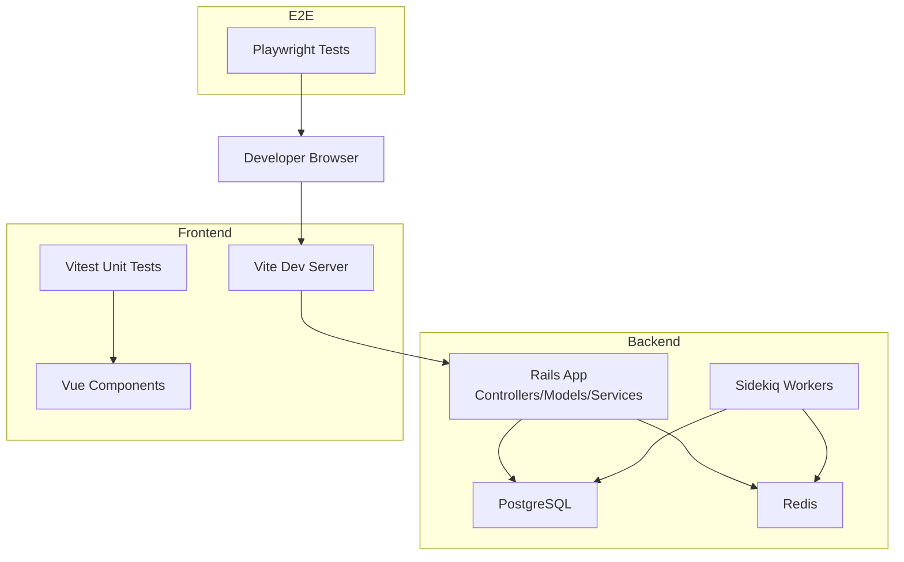
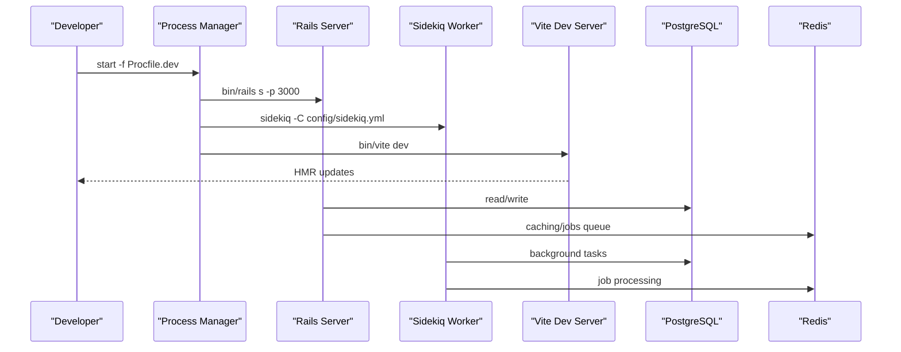
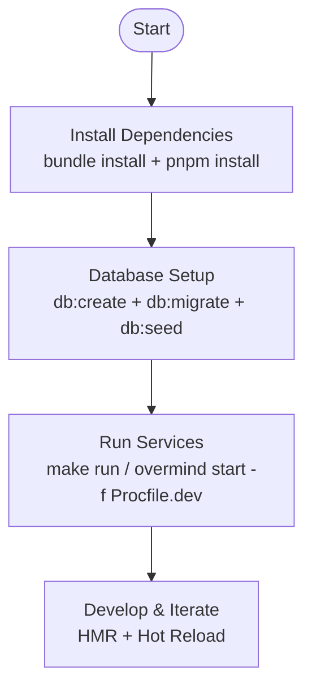
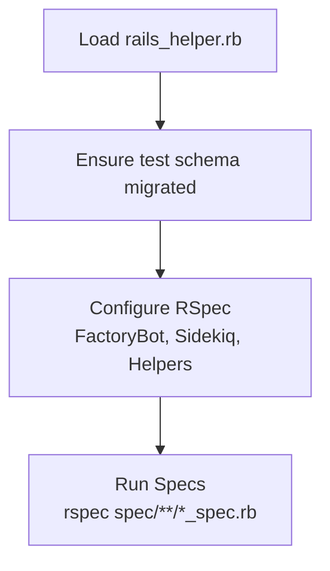
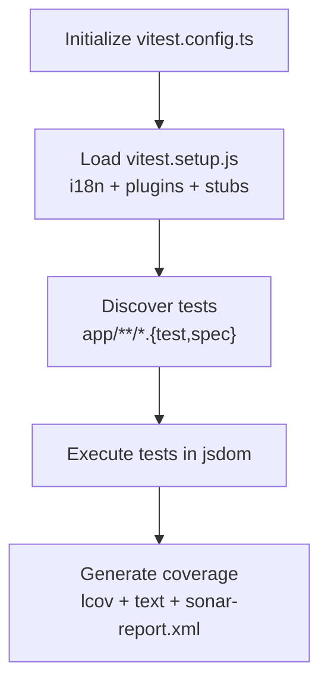
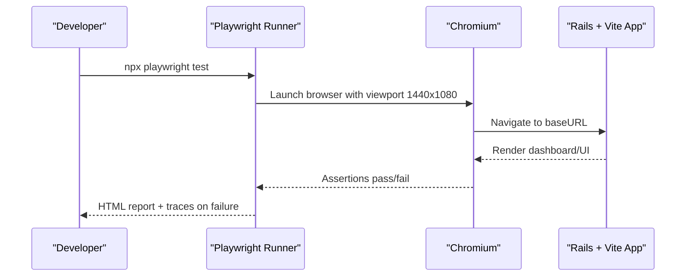
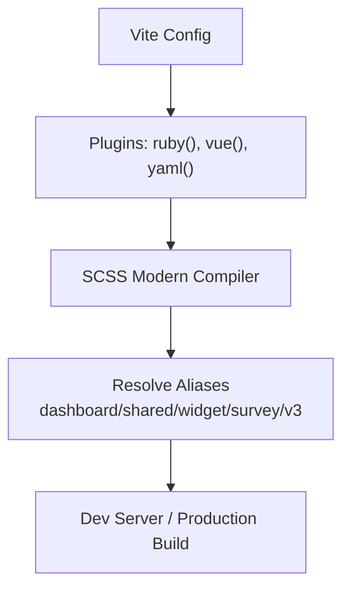
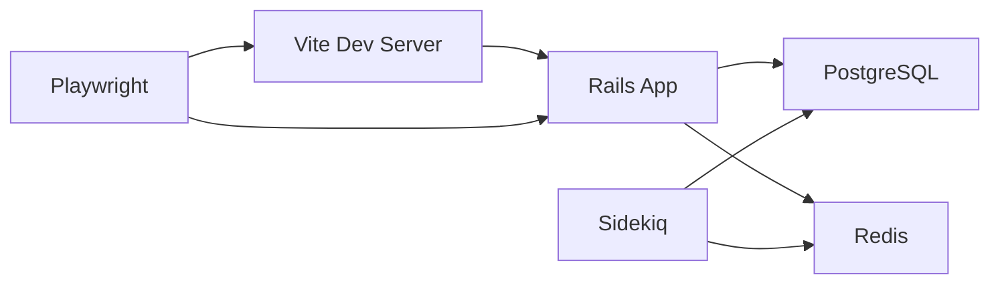

# Development Guide

<cite>
**Referenced Files in This Document**
- [README.md](file://README.md)
- [CONTRIBUTING.md](file://CONTRIBUTING.md)
- [Gemfile](file://Gemfile)
- [package.json](file://package.json)
- [Procfile.dev](file://Procfile.dev)
- [Makefile](file://Makefile)
- [vite.config.ts](file://vite.config.ts)
- [vite.shared.ts](file://vite.shared.ts)
- [vitest.config.ts](file://vitest.config.ts)
- [vitest.setup.js](file://vitest.setup.js)
- [.eslintrc.js](file:.eslintrc.js)
- [.rubocop.yml](file:.rubocop.yml)
- [spec/rails_helper.rb](file://spec/rails_helper.rb)
- [spec/spec_helper.rb](file://spec/spec_helper.rb)
- [tests/playwright/playwright.config.ts](file://tests/playwright/playwright.config.ts)
- [docker-compose.test.yaml](file://docker-compose.test.yaml)
</cite>

## Table of Contents
1. [Introduction](#introduction)
2. [Project Structure](#project-structure)
3. [Core Components](#core-components)
4. [Architecture Overview](#architecture-overview)
5. [Detailed Component Analysis](#detailed-component-analysis)
6. [Dependency Analysis](#dependency-analysis)
7. [Performance Considerations](#performance-considerations)
8. [Troubleshooting Guide](#troubleshooting-guide)
9. [Conclusion](#conclusion)
10. [Appendices](#appendices)

## Introduction
This guide explains how to set up a local development environment for Chatwoot, follow coding standards, and run tests across the backend (Ruby/Rails with RSpec) and frontend (Vue/Vite with Vitest). It also covers end-to-end testing with Playwright, debugging and profiling tools, build system configuration, contribution workflow, and best practices for maintainable code.

## Project Structure
Chatwoot is a Rails 7 application with a Vue-based frontend built via Vite. The repository includes:
- Backend: Ruby gems defined in Gemfile, RSpec specs under spec/, Sidekiq workers, controllers, models, services, and initializers.
- Frontend: Vue components under app/javascript, Vite configuration, Vitest setup, ESLint rules, and Storybook-like stories via Histoire.
- E2E: Playwright tests under tests/playwright.
- Dev tooling: Makefile targets, Procfile.dev for process orchestration, Docker Compose for test environments.

**Diagram sources**
- [Procfile.dev:1-5](file://Procfile.dev#L1-L5)
- [docker-compose.test.yaml:16-39](file://docker-compose.test.yaml#L16-L39)
- [vite.config.ts:1-18](file://vite.config.ts#L1-L18)
- [vitest.config.ts:1-43](file://vitest.config.ts#L1-L43)
- [tests/playwright/playwright.config.ts:1-37](file://tests/playwright/playwright.config.ts#L1-L37)

**Section sources**
- [README.md:88-122](file://README.md#L88-L122)
- [package.json:1-25](file://package.json#L1-L25)
- [Gemfile:1-282](file://Gemfile#L1-L282)

## Core Components
- Backend runtime: Rails server, Sidekiq worker, and Vite dev server are orchestrated via Procfile.dev.
- Database and cache: PostgreSQL and Redis are required; docker-compose.test.yaml provides containers for them.
- Testing:
  - Backend: RSpec with rails_helper and spec_helper configurations.
  - Frontend: Vitest with jsdom environment and shared setup.
  - E2E: Playwright configured for Chromium with traces on failure.
- Linting and formatting:
  - Ruby: Rubocop with custom cops and performance extensions.
  - JavaScript/Vue: ESLint with Airbnb base, Prettier, Vue 3 recommended, i18n plugin, and Vitest globals.

**Section sources**
- [Procfile.dev:1-5](file://Procfile.dev#L1-L5)
- [docker-compose.test.yaml:41-59](file://docker-compose.test.yaml#L41-L59)
- [spec/rails_helper.rb:1-101](file://spec/rails_helper.rb#L1-L101)
- [spec/spec_helper.rb:1-20](file://spec/spec_helper.rb#L1-L20)
- [vitest.config.ts:1-43](file://vitest.config.ts#L1-L43)
- [vitest.setup.js:1-21](file://vitest.setup.js#L1-L21)
- [tests/playwright/playwright.config.ts:1-37](file://tests/playwright/playwright.config.ts#L1-L37)
- [.rubocop.yml:1-353](file://.rubocop.yml#L1-L353)
- [.eslintrc.js:1-258](file:.eslintrc.js#L1-L258)

## Architecture Overview
The development stack runs three main processes:
- Backend: Rails server on port 3000.
- Worker: Sidekiq consuming background jobs.
- Frontend: Vite dev server serving Vue assets and handling hot reload.

**Diagram sources**
- [Procfile.dev:1-5](file://Procfile.dev#L1-L5)
- [docker-compose.test.yaml:16-39](file://docker-compose.test.yaml#L16-L39)

**Section sources**
- [Procfile.dev:1-5](file://Procfile.dev#L1-L5)
- [Makefile:35-59](file://Makefile#L35-L59)

## Detailed Component Analysis

### Development Environment Setup
- Prerequisites: Ruby 3.4.4, Node 24.x, pnpm 10.x.
- Install dependencies:
  - Ruby gems via bundler.
  - Frontend packages via pnpm.
- Prepare database:
  - Create, migrate, seed using Makefile or Rails commands.
- Start services:
  - Use make run to start Rails, Sidekiq, and Vite via overmind.
  - Alternatively, use foreman with Procfile.dev.

**Diagram sources**
- [Makefile:6-24](file://Makefile#L6-L24)
- [Makefile:35-49](file://Makefile#L35-L49)
- [Procfile.dev:1-5](file://Procfile.dev#L1-L5)

**Section sources**
- [Gemfile:1-10](file://Gemfile#L1-L10)
- [package.json:153-156](file://package.json#L153-L156)
- [Makefile:6-24](file://Makefile#L6-L24)
- [Makefile:35-49](file://Makefile#L35-L49)

### Coding Standards

#### Ruby (Rubocop)
- Enforces layout, metrics, Rails conventions, and RSpec style.
- Custom cops include attachment download checks, one class per file, and email usage patterns.
- Performance and Rails-specific rules are enabled.

Key areas:
- Metrics limits for classes, methods, blocks.
- RSpec nested groups and expectations constraints.
- Exclusions for specific files where necessary.

**Section sources**
- [.rubocop.yml:1-353](file://.rubocop.yml#L1-L353)

#### JavaScript/Vue (ESLint + Prettier)
- Extends Airbnb base, Prettier, Vue 3 recommended, Vitest globals, and i18n plugin.
- Rules enforce component naming, prop/emits declaration, no unused refs, and template hygiene.
- i18n keys are validated against locale directories.

Key areas:
- Vue block order and macro ordering.
- Strict rules for unused properties and emits.
- i18n settings pointing to locale JSON files.

**Section sources**
- [.eslintrc.js:1-258](file:.eslintrc.js#L1-L258)

### Testing Strategies

#### Backend Testing (RSpec)
- Configuration:
  - rails_helper loads Rails environment, migrations, FactoryBot, Sidekiq testing, and OpenAPI validation helpers.
  - spec_helper disables network calls via WebMock and configures RSpec matchers and mocks.
- Execution:
  - Use bundle exec rspec or rake tasks.
  - Transactions are used by default for fixtures.

**Diagram sources**
- [spec/rails_helper.rb:1-101](file://spec/rails_helper.rb#L1-L101)
- [spec/spec_helper.rb:1-20](file://spec/spec_helper.rb#L1-L20)

**Section sources**
- [spec/rails_helper.rb:1-101](file://spec/rails_helper.rb#L1-L101)
- [spec/spec_helper.rb:1-20](file://spec/spec_helper.rb#L1-L20)

#### Frontend Testing (Vitest)
- Configuration:
  - Uses jsdom environment, includes app/**/*.test|spec files.
  - Coverage reporters include lcov and text; output to sonar-report.xml.
  - Shared setup initializes i18n and FloatingVue, stubs common UI components.
- Execution:
  - npm/pnpm scripts: test, test:watch, test:coverage.

**Diagram sources**
- [vitest.config.ts:1-43](file://vitest.config.ts#L1-L43)
- [vitest.setup.js:1-21](file://vitest.setup.js#L1-L21)

**Section sources**
- [vitest.config.ts:1-43](file://vitest.config.ts#L1-L43)
- [vitest.setup.js:1-21](file://vitest.setup.js#L1-L21)
- [package.json:5-11](file://package.json#L5-L11)

#### End-to-End Testing (Playwright)
- Configuration:
  - Test directory under tests, timeouts for actions/navigation, retries in CI, HTML reporter.
  - Base URL defaults to localhost:3000; traces retained on failure.
  - Chromium project with desktop viewport.

**Diagram sources**
- [tests/playwright/playwright.config.ts:1-37](file://tests/playwright/playwright.config.ts#L1-L37)

**Section sources**
- [tests/playwright/playwright.config.ts:1-37](file://tests/playwright/playwright.config.ts#L1-L37)

### Build System and Asset Compilation
- Vite integration:
  - vite-plugin-ruby integrates with Rails asset pipeline.
  - Vue plugin options define custom element handling.
  - SCSS modern compiler API enabled.
  - Aliases map dashboard, shared, widget, survey, and v3 modules.

**Diagram sources**
- [vite.config.ts:1-18](file://vite.config.ts#L1-L18)
- [vite.shared.ts:1-23](file://vite.shared.ts#L1-L23)

**Section sources**
- [vite.config.ts:1-18](file://vite.config.ts#L1-L18)
- [vite.shared.ts:1-23](file://vite.shared.ts#L1-L23)

### Contribution Workflow and Pull Requests
- Branching model follows git-flow with develop as base branch.
- Refer to the official contributing guide for detailed instructions.

Best practices:
- Keep PRs focused and small.
- Include tests for new functionality.
- Ensure linting and tests pass locally before opening PRs.

**Section sources**
- [README.md:96-99](file://README.md#L96-L99)
- [CONTRIBUTING.md:1-6](file://CONTRIBUTING.md#L1-L6)

### Debugging Techniques and Profiling Tools
- Backend debugging:
  - Use debug gem and pry-rails for interactive debugging.
  - Rack-mini-profiler and meta_request for request profiling and query inspection.
  - Stackprof for CPU profiling.
- Frontend debugging:
  - Use browser devtools; ensure HMR is active via Vite dev server.
  - Leverage Vitest watch mode for rapid feedback.

**Section sources**
- [Gemfile:228-245](file://Gemfile#L228-L245)
- [Procfile.dev:1-5](file://Procfile.dev#L1-L5)

### Performance Analysis
- Backend:
  - Enable rack-mini-profiler and meta_request in development.
  - Use Sidekiq monitoring and logs for job performance.
- Frontend:
  - Bundle analysis scripts available in package.json for SDK and widget bundles.
  - Size limits enforced for widget and SDK bundles.

**Section sources**
- [Gemfile:228-245](file://Gemfile#L228-L245)
- [package.json:15-20](file://package.json#L15-L20)
- [package.json:26-35](file://package.json#L26-L35)

### Best Practices for Maintainable Code
- Ruby:
  - Follow Rubocop rules; keep classes/methods within length limits.
  - Prefer explicitness and readability; avoid global variables unless necessary.
- JavaScript/Vue:
  - Adhere to ESLint rules; use Vue macros for props/emits; avoid unused properties.
  - Keep components small and composable; leverage shared helpers.
- Testing:
  - Write unit tests for business logic; add integration tests for service interactions.
  - Cover critical user flows with Playwright E2E tests.

**Section sources**
- [.rubocop.yml:1-353](file://.rubocop.yml#L1-L353)
- [.eslintrc.js:1-258](file:.eslintrc.js#L1-L258)

## Dependency Analysis
High-level dependency relationships:
- Rails depends on PostgreSQL and Redis for persistence and caching/job queues.
- Vite serves Vue assets and integrates with Rails via vite-plugin-ruby.
- Sidekiq consumes jobs from Redis and interacts with PostgreSQL.
- Playwright tests drive the running application through the browser.

**Diagram sources**
- [Procfile.dev:1-5](file://Procfile.dev#L1-L5)
- [docker-compose.test.yaml:16-39](file://docker-compose.test.yaml#L16-L39)
- [tests/playwright/playwright.config.ts:1-37](file://tests/playwright/playwright.config.ts#L1-L37)

**Section sources**
- [Procfile.dev:1-5](file://Procfile.dev#L1-L5)
- [docker-compose.test.yaml:16-39](file://docker-compose.test.yaml#L16-L39)

## Performance Considerations
- Use database indexes and efficient queries; prefer find_each for large datasets.
- Offload heavy work to Sidekiq jobs; monitor job throughput and latency.
- Monitor frontend bundle sizes; use size-limit thresholds to prevent regressions.
- Profile Ruby code with stackprof and inspect requests with rack-mini-profiler.

[No sources needed since this section provides general guidance]

## Troubleshooting Guide
Common issues and resolutions:
- Database not ready:
  - Ensure PostgreSQL container is running and migrations applied.
- Redis connection errors:
  - Verify Redis container is up and accessible on expected ports.
- Frontend assets not loading:
  - Confirm Vite dev server is running and HMR endpoints are reachable.
- Tests failing due to network calls:
  - WebMock is enabled in spec_helper; mock external HTTP calls appropriately.

**Section sources**
- [docker-compose.test.yaml:41-59](file://docker-compose.test.yaml#L41-L59)
- [spec/spec_helper.rb:1-20](file://spec/spec_helper.rb#L1-L20)

## Conclusion
This guide outlined the development environment setup, coding standards, testing strategies, and build system for Chatwoot. By following the provided workflows and best practices, contributors can efficiently develop, test, and extend Chatwoot’s functionality while maintaining code quality and performance.

[No sources needed since this section summarizes without analyzing specific files]

## Appendices

### Quick Commands Reference
- Setup:
  - make setup
- Database:
  - make db_create
  - make db_migrate
  - make db_seed
- Run:
  - make run
- Debug:
  - make debug
  - make debug_worker

**Section sources**
- [Makefile:6-24](file://Makefile#L6-L24)
- [Makefile:35-61](file://Makefile#L35-L61)