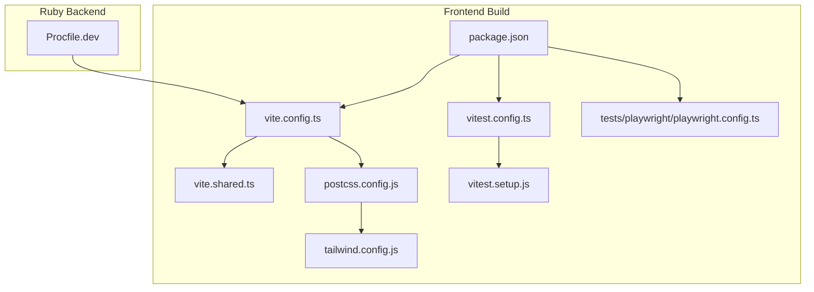
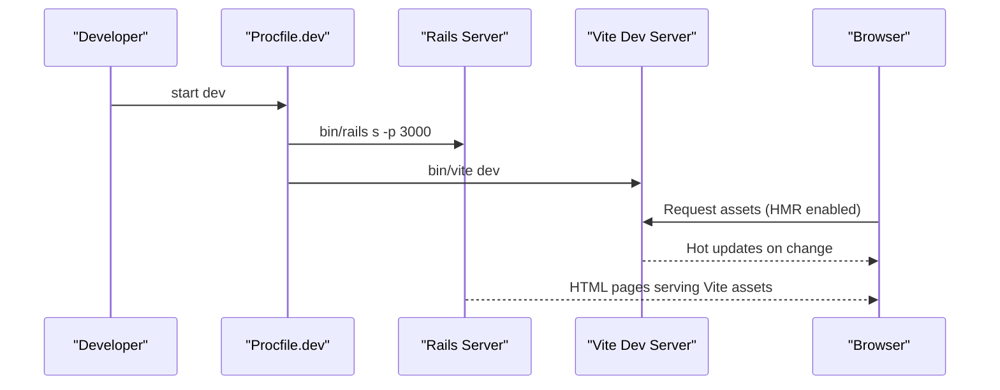
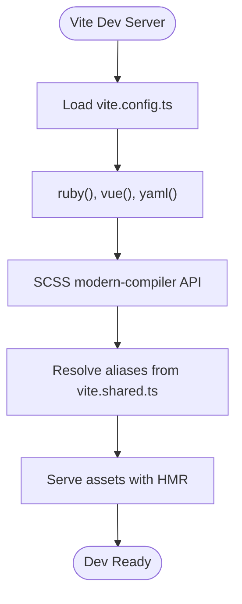
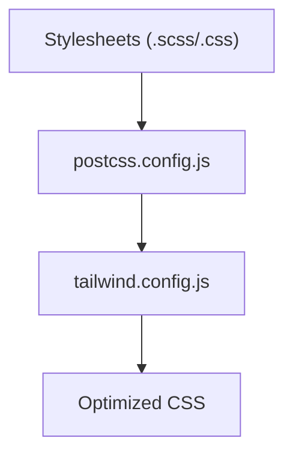
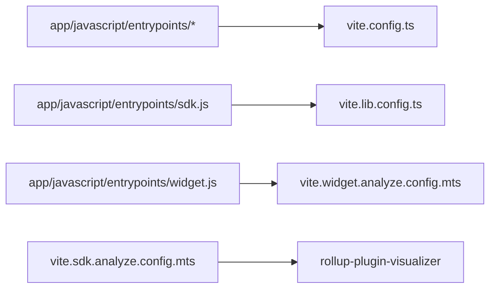
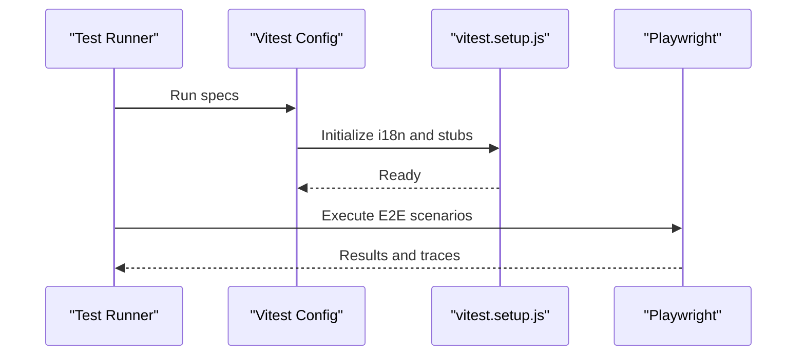
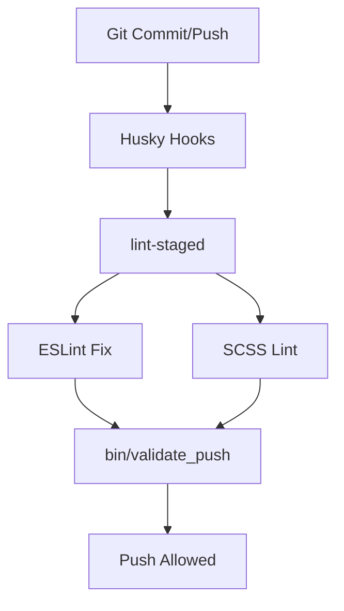
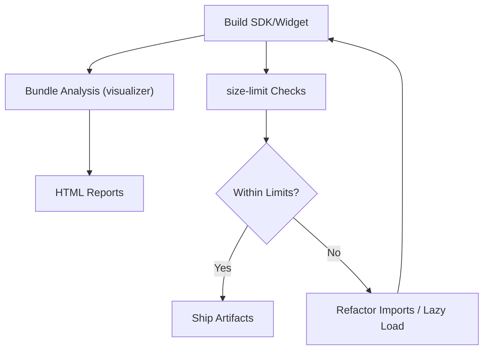
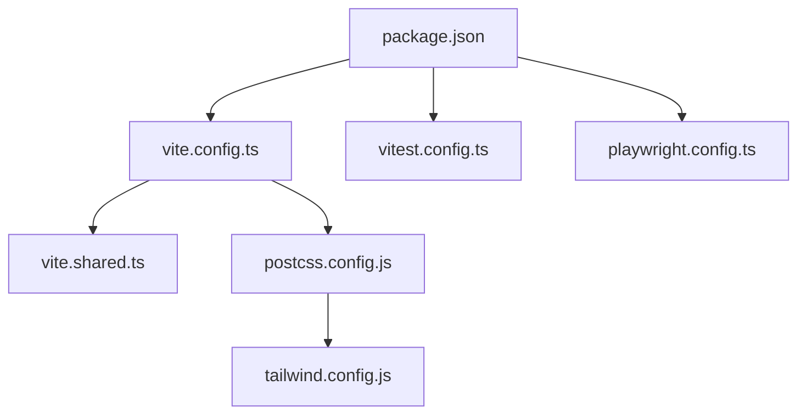

# Build System & Development Workflow

<cite>
**Referenced Files in This Document**
- [package.json](file://package.json)
- [vite.config.ts](file://vite.config.ts)
- [vite.shared.ts](file://vite.shared.ts)
- [postcss.config.js](file://postcss.config.js)
- [tailwind.config.js](file://tailwind.config.js)
- [vitest.config.ts](file://vitest.config.ts)
- [vitest.setup.js](file://vitest.setup.js)
- [playwright.config.ts](file://tests/playwright/playwright.config.ts)
- [Procfile.dev](file://Procfile.dev)
- [vite.lib.config.ts](file://vite.lib.config.ts)
- [vite.sdk.analyze.config.mts](file://vite.sdk.analyze.config.mts)
- [vite.widget.analyze.config.mts](file://vite.widget.analyze.config.mts)
- [.eslintrc.js](file://.eslintrc.js)
</cite>

## Table of Contents
1. [Introduction](#introduction)
2. [Project Structure](#project-structure)
3. [Core Components](#core-components)
4. [Architecture Overview](#architecture-overview)
5. [Detailed Component Analysis](#detailed-component-analysis)
6. [Dependency Analysis](#dependency-analysis)
7. [Performance Considerations](#performance-considerations)
8. [Troubleshooting Guide](#troubleshooting-guide)
9. [Conclusion](#conclusion)

## Introduction
This document explains Chatwoot’s modern frontend build system powered by Vite, including development server configuration, hot module replacement (HMR), production optimizations, asset pipeline (CSS with Tailwind CSS, JavaScript bundling, and image handling), testing with Vitest and Playwright, and the development workflow for linting, formatting, and code quality. It also provides guidance on adding dependencies, configuring plugins, optimizing bundle size, environment-specific configurations, and deployment preparation.

## Project Structure
The frontend build is centered around Vite with shared configuration, multiple entrypoints (dashboard, widget, SDK), PostCSS + Tailwind CSS for styles, and a comprehensive testing setup using Vitest and Playwright. The Ruby backend runs alongside Vite during development via Procfile.dev.

**Diagram sources**
- [package.json:5-24](file://package.json#L5-L24)
- [vite.config.ts:1-18](file://vite.config.ts#L1-L18)
- [vite.shared.ts:1-23](file://vite.shared.ts#L1-L23)
- [postcss.config.js:1-15](file://postcss.config.js#L1-L15)
- [tailwind.config.js:1-329](file://tailwind.config.js#L1-L329)
- [vitest.config.ts:1-43](file://vitest.config.ts#L1-L43)
- [vitest.setup.js:1-21](file://vitest.setup.js#L1-L21)
- [tests/playwright/playwright.config.ts:1-37](file://tests/playwright/playwright.config.ts#L1-L37)
- [Procfile.dev:1-5](file://Procfile.dev#L1-L5)

**Section sources**
- [package.json:5-24](file://package.json#L5-L24)
- [Procfile.dev:1-5](file://Procfile.dev#L1-L5)

## Core Components
- Vite main config: Vue plugin, YAML support, SCSS modern compiler API, alias resolution.
- Shared aliases and Vue compiler options to standardize imports across builds.
- PostCSS pipeline with preset-env, import, Tailwind CSS, and Autoprefixer.
- Tailwind CSS configuration with content scanning, theme extensions, animations, and icon integration.
- Vitest unit test runner with jsdom, coverage, thread pool, and global setup.
- Playwright E2E test runner with browser defaults, timeouts, and project definitions.
- SDK library build producing an IIFE bundle with pre-compressed artifacts.
- Bundle analysis configs for SDK and Widget to visualize sizes.

**Section sources**
- [vite.config.ts:1-18](file://vite.config.ts#L1-L18)
- [vite.shared.ts:1-23](file://vite.shared.ts#L1-L23)
- [postcss.config.js:1-15](file://postcss.config.js#L1-L15)
- [tailwind.config.js:1-329](file://tailwind.config.js#L1-L329)
- [vitest.config.ts:1-43](file://vitest.config.ts#L1-L43)
- [vitest.setup.js:1-21](file://vitest.setup.js#L1-L21)
- [tests/playwright/playwright.config.ts:1-37](file://tests/playwright/playwright.config.ts#L1-L37)
- [vite.lib.config.ts:1-65](file://vite.lib.config.ts#L1-L65)
- [vite.sdk.analyze.config.mts:1-35](file://vite.sdk.analyze.config.mts#L1-L35)
- [vite.widget.analyze.config.mts:1-39](file://vite.widget.analyze.config.mts#L1-L39)

## Architecture Overview
The development workflow starts Rails and Vite concurrently. Vite serves the app with HMR, while PostCSS/Tailwind process styles. Tests run against a JSDOM environment, and E2E tests run against a live server. Production builds generate optimized assets and compressed SDK bundles.

**Diagram sources**
- [Procfile.dev:1-5](file://Procfile.dev#L1-L5)
- [vite.config.ts:1-18](file://vite.config.ts#L1-L18)

## Detailed Component Analysis

### Vite Main Configuration and HMR
- Plugins: Ruby integration, Vue, and YAML loader.
- CSS: SCSS modern compiler API configured for performance and compatibility.
- Aliases: Centralized path aliases for dashboard, shared, widget, etc.
- HMR: Enabled by default in development; changes are reflected instantly.

**Diagram sources**
- [vite.config.ts:1-18](file://vite.config.ts#L1-L18)
- [vite.shared.ts:1-23](file://vite.shared.ts#L1-L23)

**Section sources**
- [vite.config.ts:1-18](file://vite.config.ts#L1-L18)
- [vite.shared.ts:1-23](file://vite.shared.ts#L1-L23)

### Asset Pipeline: CSS Processing with Tailwind CSS
- PostCSS chain: preset-env → postcss-import → tailwindcss → autoprefixer.
- Tailwind content paths scan Vue components and ERB templates to purge unused styles.
- Theme extensions: custom fonts, colors, keyframes, animations, and typography.
- Icons: Integrated via @egoist/tailwindcss-icons with multiple collections.

**Diagram sources**
- [postcss.config.js:1-15](file://postcss.config.js#L1-L15)
- [tailwind.config.js:1-329](file://tailwind.config.js#L1-L329)

**Section sources**
- [postcss.config.js:1-15](file://postcss.config.js#L1-L15)
- [tailwind.config.js:1-329](file://tailwind.config.js#L1-L329)

### JavaScript Bundling and Entry Points
- Main app uses Vite with Vue and YAML support.
- SDK library build produces a single IIFE bundle with inline dynamic imports and emits .br and .gz variants.
- Separate analyze configs for SDK and Widget to inspect bundle composition.

**Diagram sources**
- [vite.config.ts:1-18](file://vite.config.ts#L1-L18)
- [vite.lib.config.ts:1-65](file://vite.lib.config.ts#L1-L65)
- [vite.widget.analyze.config.mts:1-39](file://vite.widget.analyze.config.mts#L1-L39)
- [vite.sdk.analyze.config.mts:1-35](file://vite.sdk.analyze.config.mts#L1-L35)

**Section sources**
- [vite.lib.config.ts:1-65](file://vite.lib.config.ts#L1-L65)
- [vite.sdk.analyze.config.mts:1-35](file://vite.sdk.analyze.config.mts#L1-L35)
- [vite.widget.analyze.config.mts:1-39](file://vite.widget.analyze.config.mts#L1-L39)

### Testing Framework: Vitest and Playwright
- Vitest:
  - Environment: jsdom.
  - Coverage: lcov/text reporters, include/exclude patterns.
  - Globals: true, thread pool enabled.
  - Setup: fake-indexeddb and vitest.setup.js for i18n and component stubs.
- Playwright:
  - Base URL configurable via env, default localhost:3000.
  - Timeouts, retries, workers, trace retention on failure.
  - Chromium project with desktop viewport.

**Diagram sources**
- [vitest.config.ts:1-43](file://vitest.config.ts#L1-L43)
- [vitest.setup.js:1-21](file://vitest.setup.js#L1-L21)
- [tests/playwright/playwright.config.ts:1-37](file://tests/playwright/playwright.config.ts#L1-L37)

**Section sources**
- [vitest.config.ts:1-43](file://vitest.config.ts#L1-L43)
- [vitest.setup.js:1-21](file://vitest.setup.js#L1-L21)
- [tests/playwright/playwright.config.ts:1-37](file://tests/playwright/playwright.config.ts#L1-L37)

### Development Workflow: Linting, Formatting, and Code Quality
- ESLint: Airbnb base, Prettier, Vue 3 recommended, Vitest globals, i18n rules.
- Prettier: Enforced via ESLint rule.
- Husky: Pre-push hook triggers validation script.
- Lint-staged: Auto-fix JS/Vue files and lint SCSS on commit.

**Diagram sources**
- [.eslintrc.js:1-258](file://.eslintrc.js#L1-L258)
- [package.json:157-179](file://package.json#L157-L179)

**Section sources**
- [.eslintrc.js:1-258](file://.eslintrc.js#L1-L258)
- [package.json:157-179](file://package.json#L157-L179)

### Adding New Dependencies
- Runtime dependencies go under dependencies; dev tools under devDependencies.
- Pin versions where necessary; use pnpm overrides for critical packages like Vite and Vitest.
- Ensure new modules integrate with existing plugins (e.g., Vue, Tailwind).

Guidance:
- Add package to package.json or install via pnpm.
- If it affects CSS, ensure Tailwind content paths include relevant files.
- For large libraries, consider lazy loading or dynamic imports to reduce initial bundle.

**Section sources**
- [package.json:36-152](file://package.json#L36-L152)
- [package.json:162-169](file://package.json#L162-L169)

### Configuring Build Plugins
- Vite plugins: ruby, vue, yaml are active in main config.
- Additional Rollup plugins can be added via vite configs for specialized builds (SDK, Widget analysis).
- Use vite.shared.ts to centralize aliases and Vue compiler options.

Guidance:
- Extend vite.config.ts for app-level plugins.
- Create dedicated configs for library or analysis builds when needed.
- Keep shared settings in vite.shared.ts to avoid duplication.

**Section sources**
- [vite.config.ts:1-18](file://vite.config.ts#L1-L18)
- [vite.shared.ts:1-23](file://vite.shared.ts#L1-L23)
- [vite.lib.config.ts:1-65](file://vite.lib.config.ts#L1-L65)
- [vite.widget.analyze.config.mts:1-39](file://vite.widget.analyze.config.mts#L1-L39)

### Optimizing Bundle Size
- Use bundle analysis configs to visualize SDK and Widget sizes.
- Leverage size-limit thresholds defined in package.json to enforce limits.
- Prefer tree-shaking-friendly imports and avoid heavy synchronous dependencies.
- Compress SDK outputs (.br, .gz) for delivery.

**Diagram sources**
- [vite.sdk.analyze.config.mts:1-35](file://vite.sdk.analyze.config.mts#L1-L35)
- [vite.widget.analyze.config.mts:1-39](file://vite.widget.analyze.config.mts#L1-L39)
- [package.json:26-35](file://package.json#L26-L35)
- [vite.lib.config.ts:17-44](file://vite.lib.config.ts#L17-L44)

**Section sources**
- [package.json:26-35](file://package.json#L26-L35)
- [vite.sdk.analyze.config.mts:1-35](file://vite.sdk.analyze.config.mts#L1-L35)
- [vite.widget.analyze.config.mts:1-39](file://vite.widget.analyze.config.mts#L1-L39)
- [vite.lib.config.ts:17-44](file://vite.lib.config.ts#L17-L44)

### Environment-Specific Configurations
- Development:
  - Rails server and Vite dev server started via Procfile.dev.
  - HMR enabled automatically.
- Testing:
  - Vitest uses jsdom environment and thread pool.
  - Playwright reads BASE_URL from environment; defaults to localhost:3000.
- Production:
  - Vite builds optimize assets; SDK builds emit compressed variants.
  - Tailwind purges unused styles based on content paths.

**Section sources**
- [Procfile.dev:1-5](file://Procfile.dev#L1-L5)
- [vitest.config.ts:13-38](file://vitest.config.ts#L13-L38)
- [tests/playwright/playwright.config.ts:18-27](file://tests/playwright/playwright.config.ts#L18-L27)
- [tailwind.config.js:25-39](file://tailwind.config.js#L25-L39)

### Deployment Preparation
- Build steps:
  - Main app assets built by Vite.
  - SDK library built via vite.lib.config.ts producing public/packs/js/sdk.js and compressed variants.
  - Optional bundle analysis reports generated via analyze configs.
- Assets:
  - Ensure Tailwind content paths cover all template/component locations.
  - Verify size-limit thresholds pass before release.
- Environment variables:
  - Configure BASE_URL for Playwright if running E2E in CI.
  - Set any runtime environment variables required by the app.

**Section sources**
- [vite.lib.config.ts:46-64](file://vite.lib.config.ts#L46-L64)
- [vite.sdk.analyze.config.mts:17-33](file://vite.sdk.analyze.config.mts#L17-L33)
- [vite.widget.analyze.config.mts:29-37](file://vite.widget.analyze.config.mts#L29-L37)
- [tests/playwright/playwright.config.ts:21-27](file://tests/playwright/playwright.config.ts#L21-L27)

## Dependency Analysis
The frontend build depends on Vite, Vue, PostCSS, Tailwind CSS, Vitest, and Playwright. Shared configuration ensures consistent behavior across app, SDK, and Widget builds.

**Diagram sources**
- [package.json:1-24](file://package.json#L1-L24)
- [vite.config.ts:1-18](file://vite.config.ts#L1-L18)
- [vite.shared.ts:1-23](file://vite.shared.ts#L1-L23)
- [postcss.config.js:1-15](file://postcss.config.js#L1-L15)
- [tailwind.config.js:1-329](file://tailwind.config.js#L1-L329)
- [vitest.config.ts:1-43](file://vitest.config.ts#L1-L43)
- [tests/playwright/playwright.config.ts:1-37](file://tests/playwright/playwright.config.ts#L1-L37)

**Section sources**
- [package.json:1-24](file://package.json#L1-L24)

## Performance Considerations
- Enable SCSS modern-compiler API for faster compilation.
- Use Tailwind content scanning to minimize CSS output.
- Analyze bundle sizes regularly with visualizer configs.
- Enforce size limits via size-limit to prevent regressions.
- Prefer lazy-loading heavy features and avoid unnecessary synchronous imports.

[No sources needed since this section provides general guidance]

## Troubleshooting Guide
- HMR not updating:
  - Ensure Vite dev server is running and Procfile.dev includes the vite task.
  - Check browser console for WebSocket connection errors.
- Tailwind styles missing:
  - Verify content paths in tailwind.config.js include all relevant Vue/ERB files.
  - Confirm PostCSS pipeline loads Tailwind and Autoprefixer.
- Tests failing due to i18n:
  - Use provided setup that initializes i18n without loading full locale sets.
  - For assertions on translated text, use helpers that load full i18n data.
- Playwright cannot connect:
  - Ensure BASE_URL points to a running server; default is http://localhost:3000.
  - Check headless mode and viewport settings if UI behaves differently locally vs CI.

**Section sources**
- [Procfile.dev:1-5](file://Procfile.dev#L1-L5)
- [tailwind.config.js:25-39](file://tailwind.config.js#L25-L39)
- [postcss.config.js:1-15](file://postcss.config.js#L1-L15)
- [vitest.setup.js:1-21](file://vitest.setup.js#L1-L21)
- [tests/playwright/playwright.config.ts:18-27](file://tests/playwright/playwright.config.ts#L18-L27)

## Conclusion
Chatwoot’s build system leverages Vite for fast development and optimized production builds, integrates Tailwind CSS through PostCSS, and supports robust testing with Vitest and Playwright. Shared configurations streamline multi-entry builds (app, SDK, widget), while analysis and size-limit tools help maintain performance. Following the guidance here will help you extend the pipeline, add dependencies safely, and prepare reliable deployments.