# Design System & Styling

<cite>
**Referenced Files in This Document**
- [tailwind.config.js](file://tailwind.config.js)
- [colors.js](file://theme/colors.js)
- [icons.js](file://theme/icons.js)
- [app.scss](file://app/javascript/dashboard/assets/scss/app.scss)
- [histoire.scss](file://app/javascript/design-system/histoire.scss)
- [vite.shared.ts](file://vite.shared.ts)
- [Button.vue](file://app/javascript/dashboard/components-next/button/Button.vue)
- [FileIcon.story.vue](file://app/javascript/dashboard/components-next/icon/FileIcon.story.vue)
- [_reset.scss](file://app/javascript/widget/assets/scss/_reset.scss)
</cite>

## Table of Contents
1. [Introduction](#introduction)
2. [Project Structure](#project-structure)
3. [Core Components](#core-components)
4. [Architecture Overview](#architecture-overview)
5. [Detailed Component Analysis](#detailed-component-analysis)
6. [Dependency Analysis](#dependency-analysis)
7. [Performance Considerations](#performance-considerations)
8. [Troubleshooting Guide](#troubleshooting-guide)
9. [Conclusion](#conclusion)

## Introduction
This document explains Chatwoot’s design system and styling approach, focusing on Tailwind CSS integration, custom theme configuration, design tokens, reusable components, typography, spacing, icons, responsive patterns, accessibility, style isolation, theming (including dark mode), and cross-browser considerations. It is intended for both technical and non-technical readers to understand how the UI is structured and extended consistently across the application.

## Project Structure
The design system spans several layers:
- Configuration layer: Tailwind configuration and color tokens
- Asset layer: SCSS entry points and resets
- Component layer: Vue components using Tailwind utilities and design tokens
- Storybook/Histoire layer: Component documentation and visual testing

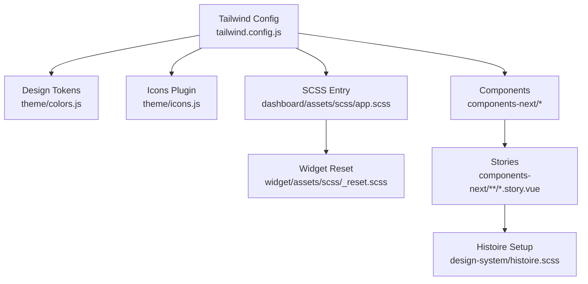

**Diagram sources**
- [tailwind.config.js:1-329](file://tailwind.config.js#L1-L329)
- [colors.js:1-291](file://theme/colors.js#L1-L291)
- [app.scss:1-2](file://app/javascript/dashboard/assets/scss/app.scss#L1-L2)
- [_reset.scss:1-53](file://app/javascript/widget/assets/scss/_reset.scss#L1-L53)
- [FileIcon.story.vue:1-36](file://app/javascript/dashboard/components-next/icon/FileIcon.story.vue#L1-L36)
- [histoire.scss:1-22](file://app/javascript/design-system/histoire.scss#L1-L22)

**Section sources**
- [tailwind.config.js:1-329](file://tailwind.config.js#L1-L329)
- [colors.js:1-291](file://theme/colors.js#L1-L291)
- [app.scss:1-2](file://app/javascript/dashboard/assets/scss/app.scss#L1-L2)
- [_reset.scss:1-53](file://app/javascript/widget/assets/scss/_reset.scss#L1-L53)
- [FileIcon.story.vue:1-36](file://app/javascript/dashboard/components-next/icon/FileIcon.story.vue#L1-L36)
- [histoire.scss:1-22](file://app/javascript/design-system/histoire.scss#L1-L22)

## Core Components
- Tailwind CSS is the primary utility framework with a custom theme that extends default values for fonts, font weights, typography styles, screens, colors, animations, and plugins.
- Color tokens are centralized in a dedicated module and consumed by Tailwind via an import. The token set includes semantic palettes and CSS variables for dynamic theming.
- Iconography is integrated via a plugin that registers multiple icon collections and a custom “woot” collection defined in a separate file.
- SCSS entry point imports shared dashboard styles; widget-specific resets ensure consistent baseline behavior.
- Reusable UI components live under components-next and are styled primarily with Tailwind utilities, exposing props/attributes for variants, sizes, and colors.

Key responsibilities:
- tailwind.config.js: Theme extension, content scanning, screen breakpoints, typography presets, animations, and plugins (typography + icons).
- theme/colors.js: Centralized color tokens and CSS variable mappings for dynamic themes.
- theme/icons.js: Icon registry used by the icons plugin.
- app.scss: Dashboard SCSS entry.
- _reset.scss: Widget reset for consistent rendering.
- Button.vue: Example component demonstrating variant/color/size resolution and attribute forwarding.

**Section sources**
- [tailwind.config.js:1-329](file://tailwind.config.js#L1-L329)
- [colors.js:1-291](file://theme/colors.js#L1-L291)
- [icons.js](file://theme/icons.js)
- [app.scss:1-2](file://app/javascript/dashboard/assets/scss/app.scss#L1-L2)
- [_reset.scss:1-53](file://app/javascript/widget/assets/scss/_reset.scss#L1-L53)
- [Button.vue:46-85](file://app/javascript/dashboard/components-next/button/Button.vue#L46-L85)

## Architecture Overview
The styling architecture follows a layered approach:
- Configuration-driven tokens and utilities (Tailwind)
- Centralized color and icon definitions
- Scoped SCSS entry points per surface (dashboard, widget)
- Component-level composition using utilities and tokens
- Documentation and visual regression via Histoire stories

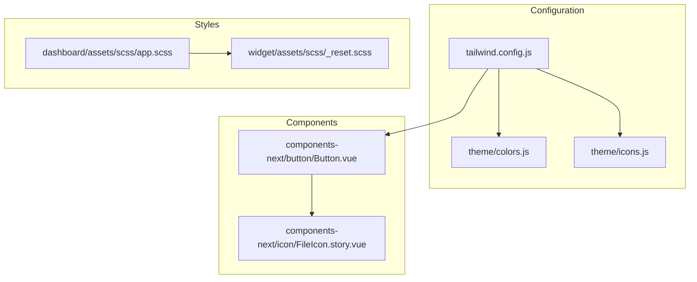

**Diagram sources**
- [tailwind.config.js:1-329](file://tailwind.config.js#L1-L329)
- [colors.js:1-291](file://theme/colors.js#L1-L291)
- [icons.js](file://theme/icons.js)
- [app.scss:1-2](file://app/javascript/dashboard/assets/scss/app.scss#L1-L2)
- [_reset.scss:1-53](file://app/javascript/widget/assets/scss/_reset.scss#L1-L53)
- [Button.vue:46-85](file://app/javascript/dashboard/components-next/button/Button.vue#L46-L85)
- [FileIcon.story.vue:1-36](file://app/javascript/dashboard/components-next/icon/FileIcon.story.vue#L1-L36)

## Detailed Component Analysis

### Tailwind Integration and Custom Theme
- Dark mode is enabled via class strategy, allowing runtime toggling by adding/removing a class on the root element.
- Content paths scan all Vue and ERB templates to generate minimal CSS.
- Typography preset bubble provides consistent prose-like styles for rich text areas.
- Screens define a comprehensive breakpoint scale including extra-large and 3xl.
- Font families include Inter and InterDisplay with sensible fallbacks.
- Animations and keyframes are centralized for consistent motion design.
- Plugins:
  - @tailwindcss/typography for prose-like content styling
  - @egoist/tailwindcss-icons for icon usage across components
  - A custom touch variant for coarse pointer devices

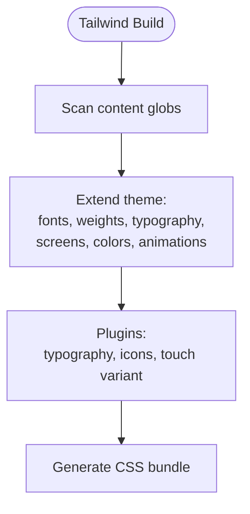

**Diagram sources**
- [tailwind.config.js:23-39](file://tailwind.config.js#L23-L39)
- [tailwind.config.js:40-219](file://tailwind.config.js#L40-L219)
- [tailwind.config.js:220-303](file://tailwind.config.js#L220-L303)
- [tailwind.config.js:305-325](file://tailwind.config.js#L305-L325)

**Section sources**
- [tailwind.config.js:1-329](file://tailwind.config.js#L1-L329)

### Design Tokens and Colors
- Colors are defined in a single source of truth and imported into Tailwind.
- Two token systems coexist:
  - Legacy palette names (e.g., woot, green, yellow, slate, black, red, violet)
  - Next design system tokens (n.*) mapped to CSS variables for dynamic theming
- Semantic tokens cover surfaces, solids, alpha overlays, borders, text roles, buttons, labels, and portal theming.

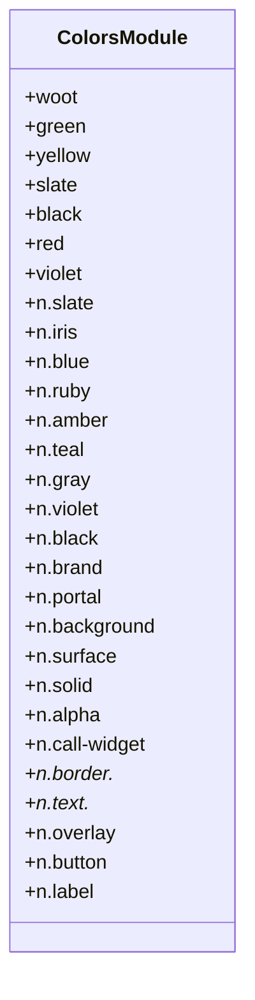

**Diagram sources**
- [colors.js:16-291](file://theme/colors.js#L16-L291)

**Section sources**
- [colors.js:1-291](file://theme/colors.js#L1-L291)

### Icon System
- Icons are registered via a plugin with multiple collections and a custom “woot” collection.
- Components consume icons through generated utility classes or component wrappers.
- Stories demonstrate usage patterns for different file types.

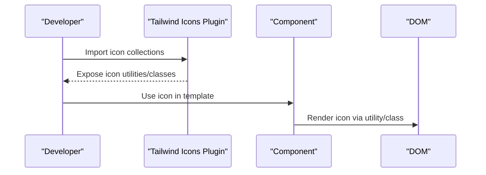

**Diagram sources**
- [tailwind.config.js:305-321](file://tailwind.config.js#L305-L321)
- [icons.js](file://theme/icons.js)
- [FileIcon.story.vue:1-36](file://app/javascript/dashboard/components-next/icon/FileIcon.story.vue#L1-L36)

**Section sources**
- [tailwind.config.js:305-321](file://tailwind.config.js#L305-L321)
- [icons.js](file://theme/icons.js)
- [FileIcon.story.vue:1-36](file://app/javascript/dashboard/components-next/icon/FileIcon.story.vue#L1-L36)

### Reusable UI Components
- Components use Tailwind utilities for layout, spacing, and appearance.
- Props and attributes drive variants, colors, and sizes, enabling flexible composition.
- Attribute forwarding ensures standard HTML attributes are passed through when appropriate.

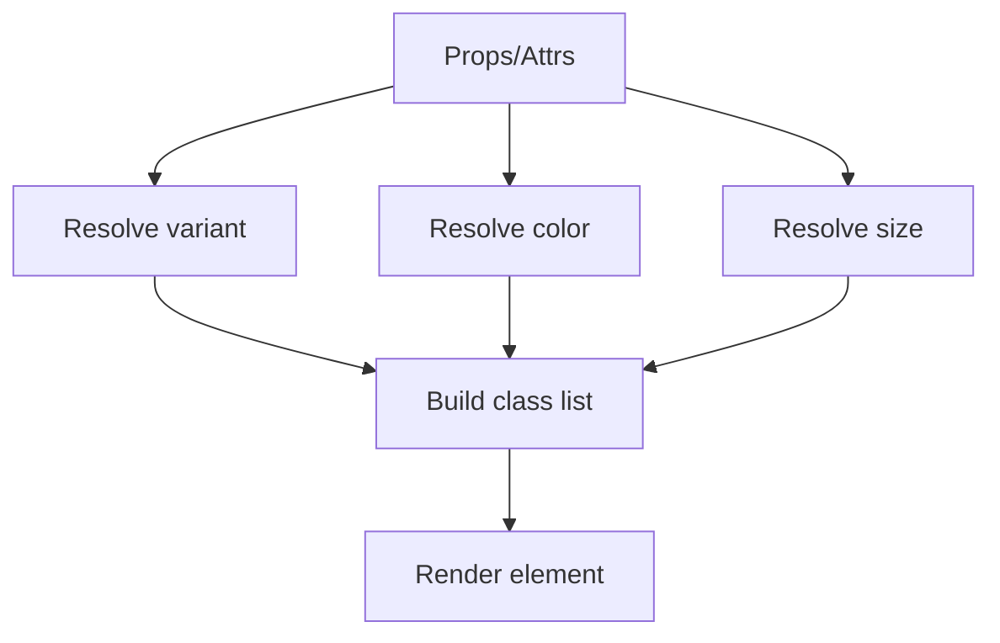

**Diagram sources**
- [Button.vue:46-85](file://app/javascript/dashboard/components-next/button/Button.vue#L46-L85)

**Section sources**
- [Button.vue:46-85](file://app/javascript/dashboard/components-next/button/Button.vue#L46-L85)

### Typography and Spacing
- Typography:
  - Custom font families (Inter, InterDisplay) with robust fallbacks
  - Extended font weights for nuanced hierarchy
  - Bubble typography preset for rich text blocks
- Spacing:
  - Uses Tailwind’s spacing scale; additional custom spacings can be added via theme extensions if needed
- Responsive:
  - Breakpoints from xs to 3xl provide fine-grained control

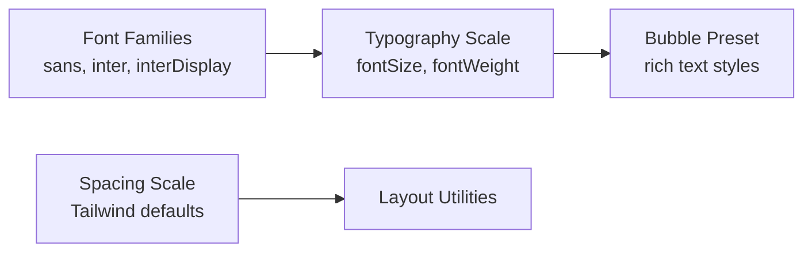

**Diagram sources**
- [tailwind.config.js:40-53](file://tailwind.config.js#L40-L53)
- [tailwind.config.js:54-195](file://tailwind.config.js#L54-L195)
- [tailwind.config.js:197-210](file://tailwind.config.js#L197-L210)

**Section sources**
- [tailwind.config.js:40-53](file://tailwind.config.js#L40-L53)
- [tailwind.config.js:54-195](file://tailwind.config.js#L54-L195)
- [tailwind.config.js:197-210](file://tailwind.config.js#L197-L210)

### Responsive Design Patterns
- Breakpoints: xs, sm, md, lg, xl, 2xl, 3xl
- Touch interactions: A custom touch variant targets coarse pointer devices
- Utility-first approach encourages composing responsive layouts directly in templates

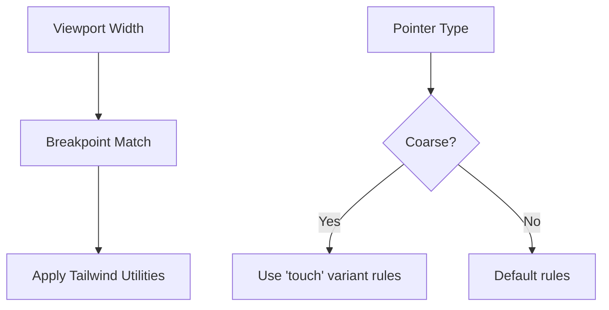

**Diagram sources**
- [tailwind.config.js:197-205](file://tailwind.config.js#L197-L205)
- [tailwind.config.js:322-324](file://tailwind.config.js#L322-L324)

**Section sources**
- [tailwind.config.js:197-205](file://tailwind.config.js#L197-L205)
- [tailwind.config.js:322-324](file://tailwind.config.js#L322-L324)

### Accessibility Compliance
- Components expose ARIA attributes and roles where appropriate (e.g., aria-expanded, role="button", role="tablist").
- Color tokens support contrast-aware combinations; tests validate contrast ratios for adjusted colors.
- Focus management and keyboard navigation should be ensured within interactive components.

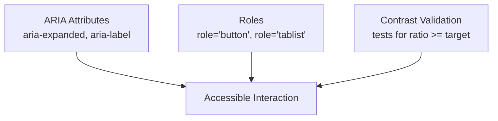

**Diagram sources**
- [Button.vue:46-85](file://app/javascript/dashboard/components-next/button/Button.vue#L46-L85)

**Section sources**
- [Button.vue:46-85](file://app/javascript/dashboard/components-next/button/Button.vue#L46-L85)

### CSS Architecture and Style Isolation
- SCSS entry point for dashboard aggregates shared styles.
- Widget reset ensures isolated baseline styles for embedded widgets.
- Histoire setup imports dashboard styles and defines story-specific CSS variables for preview consistency.

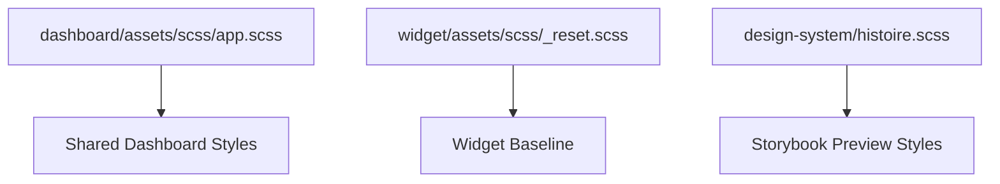

**Diagram sources**
- [app.scss:1-2](file://app/javascript/dashboard/assets/scss/app.scss#L1-L2)
- [_reset.scss:1-53](file://app/javascript/widget/assets/scss/_reset.scss#L1-L53)
- [histoire.scss:1-22](file://app/javascript/design-system/histoire.scss#L1-L22)

**Section sources**
- [app.scss:1-2](file://app/javascript/dashboard/assets/scss/app.scss#L1-L2)
- [_reset.scss:1-53](file://app/javascript/widget/assets/scss/_reset.scss#L1-L53)
- [histoire.scss:1-22](file://app/javascript/design-system/histoire.scss#L1-L22)

### Theming Customization and Dark Mode
- Dark mode uses a class-based strategy, enabling runtime toggling by applying a class to the root element.
- Color tokens leverage CSS variables for dynamic theming, supporting light/dark and brand customization.
- Portal theming exposes dynamic CSS variables for external-facing portals.

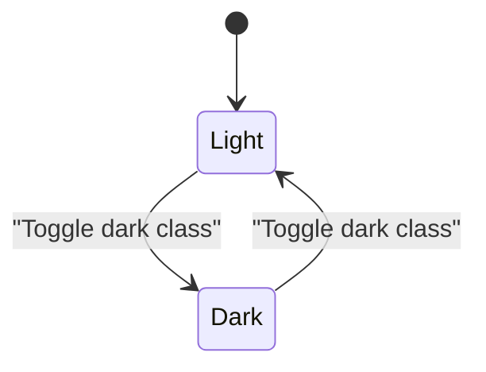

**Diagram sources**
- [tailwind.config.js:23-24](file://tailwind.config.js#L23-L24)
- [colors.js:228-289](file://theme/colors.js#L228-L289)

**Section sources**
- [tailwind.config.js:23-24](file://tailwind.config.js#L23-L24)
- [colors.js:228-289](file://theme/colors.js#L228-L289)

### Cross-Browser Compatibility
- Reset styles normalize browser defaults for consistent rendering.
- Font stacks include broad platform fallbacks.
- Animations and transforms use widely supported properties.

**Section sources**
- [_reset.scss:1-53](file://app/javascript/widget/assets/scss/_reset.scss#L1-L53)
- [tailwind.config.js:11-21](file://tailwind.config.js#L11-L21)
- [tailwind.config.js:220-303](file://tailwind.config.js#L220-L303)

## Dependency Analysis
The following diagram maps key dependencies between configuration, tokens, styles, and components.

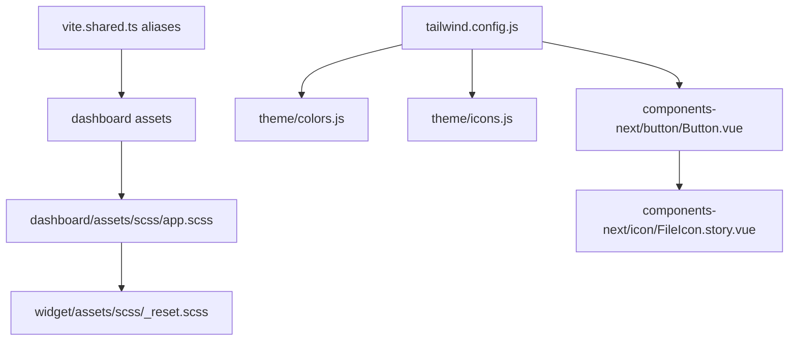

**Diagram sources**
- [vite.shared.ts:1-22](file://vite.shared.ts#L1-L22)
- [tailwind.config.js:1-329](file://tailwind.config.js#L1-L329)
- [colors.js:1-291](file://theme/colors.js#L1-L291)
- [icons.js](file://theme/icons.js)
- [app.scss:1-2](file://app/javascript/dashboard/assets/scss/app.scss#L1-L2)
- [_reset.scss:1-53](file://app/javascript/widget/assets/scss/_reset.scss#L1-L53)
- [Button.vue:46-85](file://app/javascript/dashboard/components-next/button/Button.vue#L46-L85)
- [FileIcon.story.vue:1-36](file://app/javascript/dashboard/components-next/icon/FileIcon.story.vue#L1-L36)

**Section sources**
- [vite.shared.ts:1-22](file://vite.shared.ts#L1-L22)
- [tailwind.config.js:1-329](file://tailwind.config.js#L1-L329)
- [colors.js:1-291](file://theme/colors.js#L1-L291)
- [icons.js](file://theme/icons.js)
- [app.scss:1-2](file://app/javascript/dashboard/assets/scss/app.scss#L1-L2)
- [_reset.scss:1-53](file://app/javascript/widget/assets/scss/_reset.scss#L1-L53)
- [Button.vue:46-85](file://app/javascript/dashboard/components-next/button/Button.vue#L46-L85)
- [FileIcon.story.vue:1-36](file://app/javascript/dashboard/components-next/icon/FileIcon.story.vue#L1-L36)

## Performance Considerations
- Tailwind’s content scanning generates minimal CSS by targeting only used utilities.
- Token-driven colors reduce duplication and enable efficient updates.
- Animation definitions are centralized to avoid redundant code.
- Using utility-first styling reduces custom CSS bloat and improves maintainability.

[No sources needed since this section provides general guidance]

## Troubleshooting Guide
- Dark mode not applying:
  - Ensure the root element has the correct class for dark mode.
  - Verify Tailwind’s darkMode is set to class and that the class is toggled at runtime.
- Colors not updating:
  - Confirm CSS variables are defined and referenced correctly in tokens.
  - Check that theme/colors.js exports are properly imported into Tailwind.
- Icons not rendering:
  - Validate that icon collections are registered in the Tailwind config and that the icon class matches the collection name.
- Inconsistent widget styles:
  - Ensure the widget reset is included so baseline styles do not leak from host pages.

**Section sources**
- [tailwind.config.js:23-24](file://tailwind.config.js#L23-L24)
- [colors.js:16-291](file://theme/colors.js#L16-L291)
- [tailwind.config.js:305-321](file://tailwind.config.js#L305-L321)
- [_reset.scss:1-53](file://app/javascript/widget/assets/scss/_reset.scss#L1-L53)

## Conclusion
Chatwoot’s design system combines Tailwind CSS with a centralized token model, robust iconography, and a clear SCSS architecture. The result is a scalable, accessible, and themeable UI foundation that supports responsive layouts, consistent typography, and reusable components. By adhering to the established conventions—utility-first styling, token-driven colors, and documented component APIs—teams can extend the system confidently while maintaining visual and behavioral consistency across the product.

[No sources needed since this section summarizes without analyzing specific files]