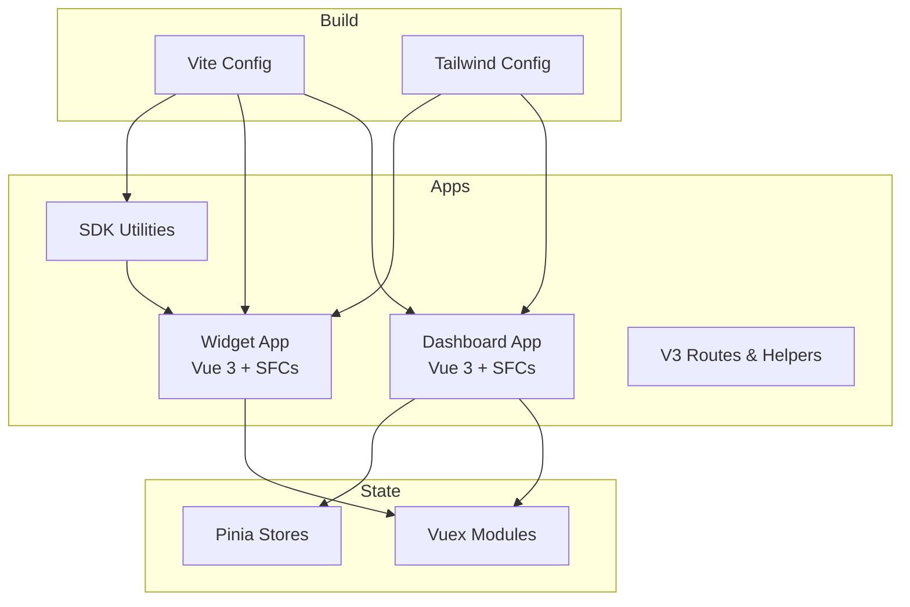
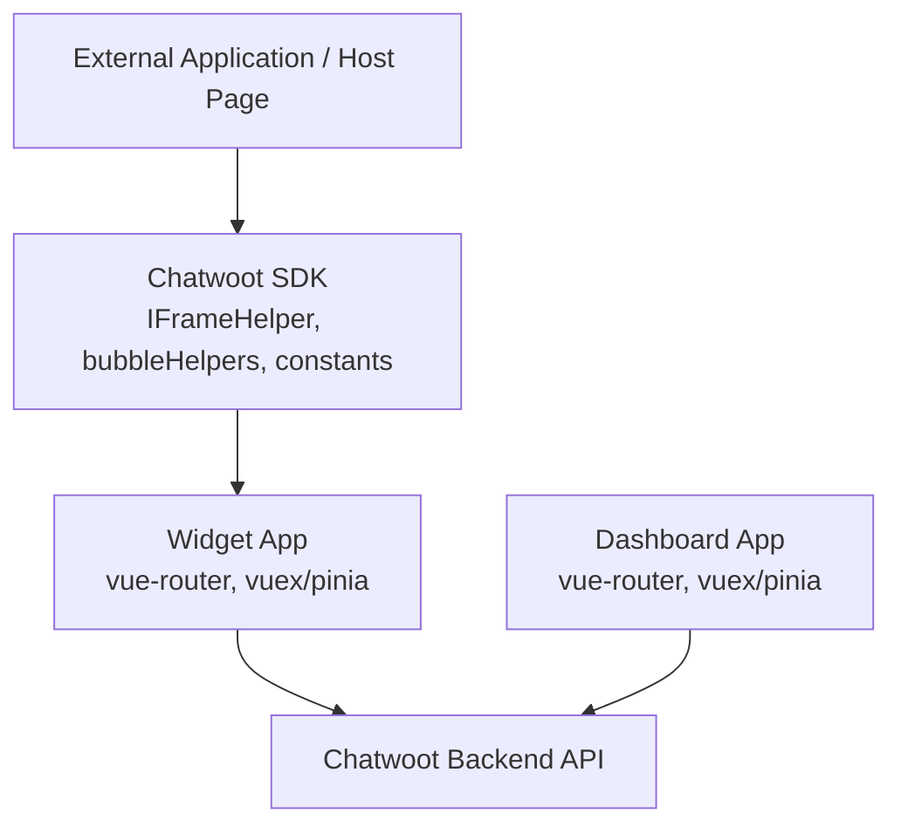
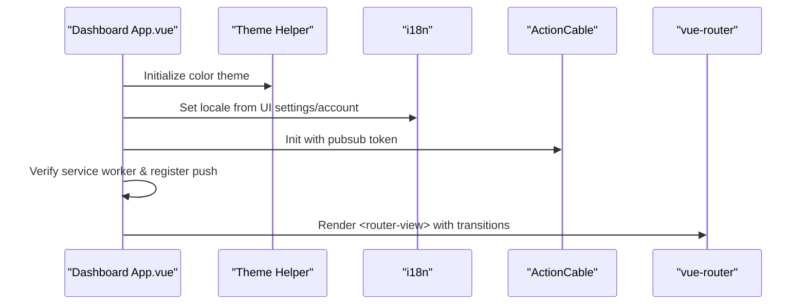
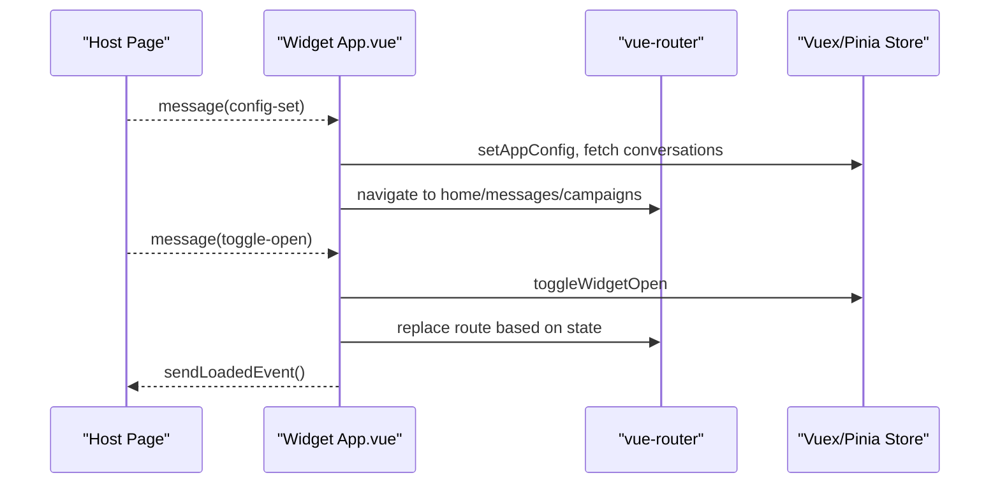
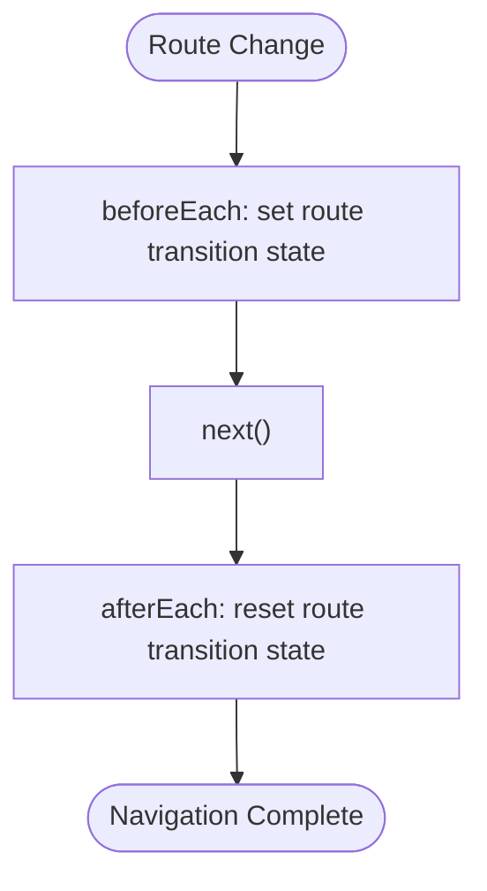
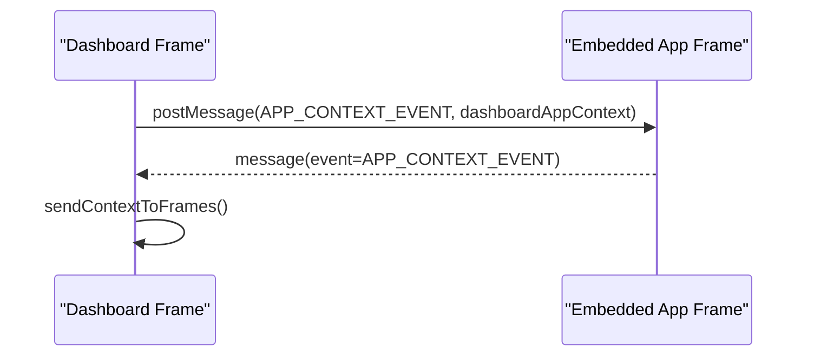
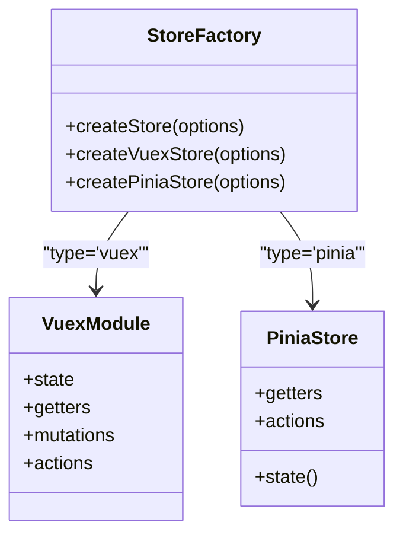
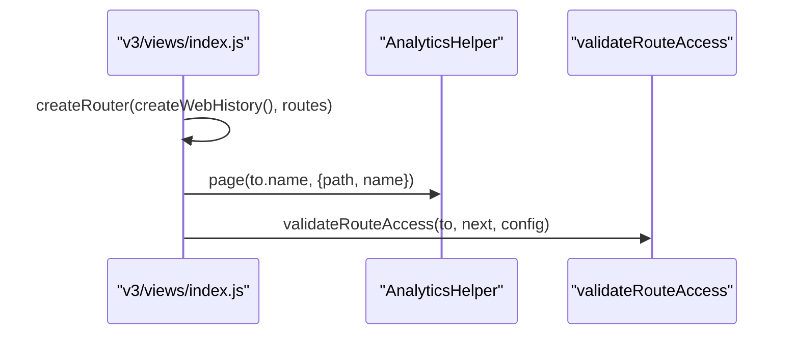

# Frontend Architecture

<cite>
**Referenced Files in This Document**
- [package.json](file://package.json)
- [vite.config.ts](file://vite.config.ts)
- [vite.shared.ts](file://vite.shared.ts)
- [tailwind.config.js](file://tailwind.config.js)
- [app/javascript/dashboard/App.vue](file://app/javascript/dashboard/App.vue)
- [app/javascript/widget/App.vue](file://app/javascript/widget/App.vue)
- [app/javascript/widget/router.js](file://app/javascript/widget/router.js)
- [app/javascript/v3/views/index.js](file://app/javascript/v3/views/index.js)
- [app/javascript/dashboard/store/storeFactory.js](file://app/javascript/dashboard/store/storeFactory.js)
- [app/javascript/dashboard/composables/store.js](file://app/javascript/dashboard/composables/store.js)
- [app/javascript/dashboard/components/widgets/DashboardApp/Frame.vue](file://app/javascript/dashboard/components/widgets/DashboardApp/Frame.vue)
</cite>

## Table of Contents
1. [Introduction](#introduction)
2. [Project Structure](#project-structure)
3. [Core Components](#core-components)
4. [Architecture Overview](#architecture-overview)
5. [Detailed Component Analysis](#detailed-component-analysis)
6. [Dependency Analysis](#dependency-analysis)
7. [Performance Considerations](#performance-considerations)
8. [Troubleshooting Guide](#troubleshooting-guide)
9. [Conclusion](#conclusion)

## Introduction
This document describes the architecture of Chatwoot’s modern frontend, which is built with Vue 3.x and TypeScript tooling, Vite for building, Tailwind CSS for styling, and a hybrid state management approach using both Vuex and Pinia. It covers:
- Component-based architecture with single-file components and composition API patterns
- Reactive state management with Pinia (and legacy Vuex modules)
- Build system configuration with Vite
- Design system implementation with Tailwind CSS and custom tokens
- Routing structure and navigation patterns for dashboard and widget apps
- Widget SDK architecture for embedding Chatwoot in external applications
- Styling approaches, asset management, and internationalization setup
- Performance optimization techniques and browser compatibility considerations

## Project Structure
The frontend code is organized into multiple application bundles under app/javascript:
- dashboard: Main admin dashboard application
- widget: Embedded customer-facing chat widget
- sdk: Lightweight SDK utilities for embedding and communication
- v3: Next-generation dashboard routes and helpers
- shared: Shared utilities, components, and helpers used across apps
- portal, survey, superadmin: Additional feature-specific frontends



**Diagram sources**
- [vite.config.ts:1-18](file://vite.config.ts#L1-L18)
- [tailwind.config.js:1-329](file://tailwind.config.js#L1-L329)
- [app/javascript/dashboard/App.vue:1-182](file://app/javascript/dashboard/App.vue#L1-L182)
- [app/javascript/widget/App.vue:1-400](file://app/javascript/widget/App.vue#L1-L400)
- [app/javascript/dashboard/store/storeFactory.js:89-229](file://app/javascript/dashboard/store/storeFactory.js#L89-L229)

**Section sources**
- [package.json:1-182](file://package.json#L1-L182)
- [vite.config.ts:1-18](file://vite.config.ts#L1-L18)
- [vite.shared.ts:1-23](file://vite.shared.ts#L1-L23)
- [tailwind.config.js:1-329](file://tailwind.config.js#L1-L329)

## Core Components
- Single-file components (SFCs): Both dashboard and widget apps are composed of Vue 3 SFCs. The root components initialize global behaviors like theme, locale, routing, and event handling.
- Composition API patterns: Composables such as useStore, useAccount, useFontSize, and useUISettings centralize cross-cutting concerns and provide reactive access to store data and UI settings.
- State management: A unified factory supports both Vuex and Pinia stores. Newer features increasingly use Pinia stores created via createPiniaStore, while legacy modules remain in Vuex.
- Internationalization: vue-i18n is configured at the app level; locales are set from UI settings or account preferences.
- Routing: vue-router manages navigation within each app (dashboard and widget), with guards for analytics and access control.

Key responsibilities:
- Dashboard root component initializes theme, locale, real-time connections, service workers, and renders router-view with banners and notifications.
- Widget root component handles iframe/RNWebView messaging, campaign flows, unread message handling, and sets up i18n and color variables.

**Section sources**
- [app/javascript/dashboard/App.vue:1-182](file://app/javascript/dashboard/App.vue#L1-L182)
- [app/javascript/widget/App.vue:1-400](file://app/javascript/widget/App.vue#L1-L400)
- [app/javascript/dashboard/composables/store.js:1-31](file://app/javascript/dashboard/composables/store.js#L1-L31)
- [app/javascript/dashboard/store/storeFactory.js:89-229](file://app/javascript/dashboard/store/storeFactory.js#L89-L229)

## Architecture Overview
The frontend consists of two primary runtime applications (dashboard and widget) plus an SDK layer that facilitates embedding and cross-frame communication. Vite orchestrates builds for development and production, while Tailwind CSS provides a consistent design system.



**Diagram sources**
- [app/javascript/widget/router.js:1-77](file://app/javascript/widget/router.js#L1-L77)
- [app/javascript/dashboard/App.vue:1-182](file://app/javascript/dashboard/App.vue#L1-L182)
- [app/javascript/widget/App.vue:1-400](file://app/javascript/widget/App.vue#L1-L400)

## Detailed Component Analysis

### Dashboard Root Application
Responsibilities:
- Initializes color theme based on system preference and listens for changes.
- Sets locale from UI settings or account preferences.
- Initializes ActionCable for real-time updates and reconnect service.
- Verifies service worker existence and registers push subscriptions.
- Renders banner components and router-view with transitions.



**Diagram sources**
- [app/javascript/dashboard/App.vue:86-136](file://app/javascript/dashboard/App.vue#L86-L136)
- [app/javascript/dashboard/App.vue:140-165](file://app/javascript/dashboard/App.vue#L140-L165)

**Section sources**
- [app/javascript/dashboard/App.vue:1-182](file://app/javascript/dashboard/App.vue#L1-L182)

### Widget Root Application
Responsibilities:
- Detects environment (iframe vs RNWebView).
- Registers message listeners for host page events (config-set, toggle-open, set-user, etc.).
- Manages campaigns, unread messages, and route transitions.
- Sets i18n locale and CSS variables for theming.
- Emits loaded events back to host.



**Diagram sources**
- [app/javascript/widget/App.vue:92-113](file://app/javascript/widget/App.vue#L92-L113)
- [app/javascript/widget/App.vue:270-357](file://app/javascript/widget/App.vue#L270-L357)
- [app/javascript/widget/App.vue:358-363](file://app/javascript/widget/App.vue#L358-L363)

**Section sources**
- [app/javascript/widget/App.vue:1-400](file://app/javascript/widget/App.vue#L1-L400)

### Widget Routing and Navigation Guards
- Uses hash history suitable for embedded contexts.
- Defines routes for unread messages, campaigns, home, prechat form, messages, and article viewer.
- Implements navigation guards to prevent duplicate submissions during route transitions by toggling a route transition state in the store.



**Diagram sources**
- [app/javascript/widget/router.js:1-77](file://app/javascript/widget/router.js#L1-L77)

**Section sources**
- [app/javascript/widget/router.js:1-77](file://app/javascript/widget/router.js#L1-L77)

### Dashboard App Embedding and Context Propagation
- The dashboard can be embedded via iframes and communicates context (theme, app context) to child frames using postMessage.
- Listens for messages to update frame visibility and theme synchronization.



**Diagram sources**
- [app/javascript/dashboard/components/widgets/DashboardApp/Frame.vue:94-123](file://app/javascript/dashboard/components/widgets/DashboardApp/Frame.vue#L94-L123)

**Section sources**
- [app/javascript/dashboard/components/widgets/DashboardApp/Frame.vue:94-123](file://app/javascript/dashboard/components/widgets/DashboardApp/Frame.vue#L94-L123)

### State Management: Vuex and Pinia Factory
- Unified factory creates either Vuex modules or Pinia stores depending on configuration.
- Provides standard CRUD actions and getters, plus UI flags and metadata normalization.
- Composables bridge Vue 3 setup with existing Vuex store when needed.



**Diagram sources**
- [app/javascript/dashboard/store/storeFactory.js:89-229](file://app/javascript/dashboard/store/storeFactory.js#L89-L229)
- [app/javascript/dashboard/composables/store.js:1-31](file://app/javascript/dashboard/composables/store.js#L1-L31)

**Section sources**
- [app/javascript/dashboard/store/storeFactory.js:89-229](file://app/javascript/dashboard/store/storeFactory.js#L89-L229)
- [app/javascript/dashboard/composables/store.js:1-31](file://app/javascript/dashboard/composables/store.js#L1-L31)

### V3 Dashboard Router Initialization
- Creates a web history router for the next-generation dashboard routes.
- Adds analytics tracking and validates route access against configuration.



**Diagram sources**
- [app/javascript/v3/views/index.js:1-24](file://app/javascript/v3/views/index.js#L1-L24)

**Section sources**
- [app/javascript/v3/views/index.js:1-24](file://app/javascript/v3/views/index.js#L1-L24)

## Dependency Analysis
- Build tools:
  - Vite is configured with Vue plugin, Ruby integration, YAML support, SCSS modern compiler, and alias resolution.
  - Tailwind CSS is extended with custom typography, animations, colors, and icon collections.
- Runtime dependencies:
  - Vue 3.x, vue-router, vue-i18n, pinia, vuex, axios, mitt, floating-vue, dompurify, and others.
- Size constraints:
  - Size limits enforced for widget bundle and SDK bundle to ensure fast loading in embedded contexts.

```mermaid
graph LR
Vite["vite.config.ts"] --> Plugins["@vitejs/plugin-vue", "vite-plugin-ruby", "@rollup/plugin-yaml"]
Tailwind["tailwind.config.js"] --> Typography["@tailwindcss/typography"]
Tailwind --> Icons["@egoist/tailwindcss-icons"]
Package["package.json"] --> Deps["Vue, Router, i18n, Pinia, Vuex, Axios, Mitt"]
Package --> Limits["size-limit rules"]
```

**Diagram sources**
- [vite.config.ts:1-18](file://vite.config.ts#L1-L18)
- [tailwind.config.js:1-329](file://tailwind.config.js#L1-L329)
- [package.json:1-182](file://package.json#L1-L182)

**Section sources**
- [vite.config.ts:1-18](file://vite.config.ts#L1-L18)
- [tailwind.config.js:1-329](file://tailwind.config.js#L1-L329)
- [package.json:1-182](file://package.json#L1-L182)

## Performance Considerations
- Bundle size constraints:
  - Enforced limits for widget and SDK bundles via size-limit to maintain fast load times in embedded environments.
- Code splitting:
  - Widget routes use dynamic imports to split chunks per view.
- Asset and CSS optimization:
  - Tailwind content scanning targets specific directories to minimize unused styles.
  - SCSS uses modern compiler API for faster builds.
- Real-time efficiency:
  - ActionCable initialization and reconnect service manage connection resilience without unnecessary overhead.
- Browser compatibility:
  - Polyfills like urlpattern-polyfill are included to support older browsers where necessary.

[No sources needed since this section provides general guidance]

## Troubleshooting Guide
Common issues and resolutions:
- Locale not applied:
  - Ensure locale is set from UI settings or account preferences in the dashboard root component.
- Widget not responding to host messages:
  - Verify message listener registration and event names match between host and widget.
- Route transition glitches:
  - Check navigation guards that toggle route transition state to prevent duplicate submissions.
- Theme mismatch in embedded frames:
  - Confirm postMessage context propagation and theme change handlers in dashboard embedding logic.

**Section sources**
- [app/javascript/dashboard/App.vue:86-136](file://app/javascript/dashboard/App.vue#L86-L136)
- [app/javascript/widget/App.vue:270-357](file://app/javascript/widget/App.vue#L270-L357)
- [app/javascript/widget/router.js:66-75](file://app/javascript/widget/router.js#L66-L75)
- [app/javascript/dashboard/components/widgets/DashboardApp/Frame.vue:94-123](file://app/javascript/dashboard/components/widgets/DashboardApp/Frame.vue#L94-L123)

## Conclusion
Chatwoot’s frontend leverages Vue 3 single-file components, composition API patterns, and a hybrid state management strategy combining Vuex and Pinia. Vite powers fast development and optimized production builds, while Tailwind CSS provides a robust design system. The widget SDK enables seamless embedding through iframe messaging, and the routing architecture ensures safe navigation and analytics tracking. With size limits, code splitting, and polyfills, the system balances performance and compatibility across environments.

[No sources needed since this section summarizes without analyzing specific files]