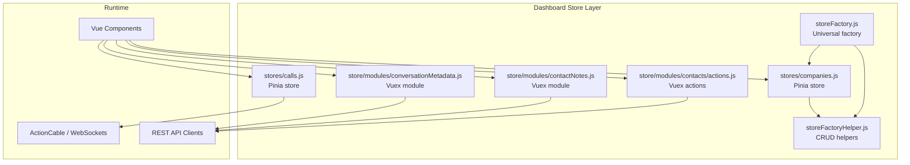
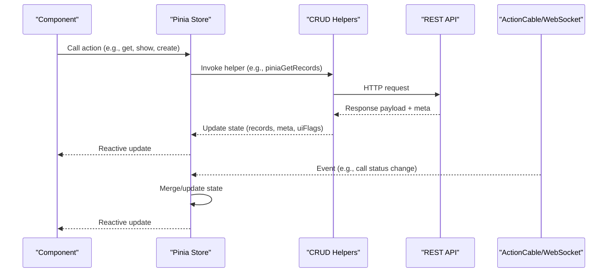
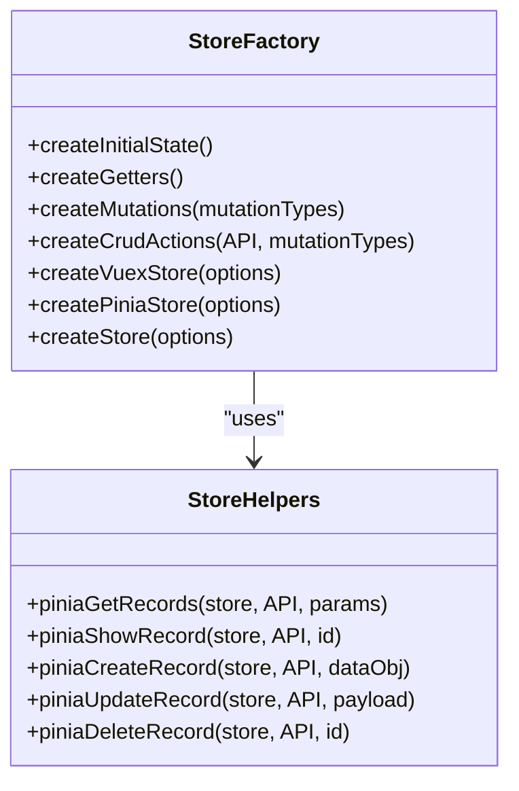
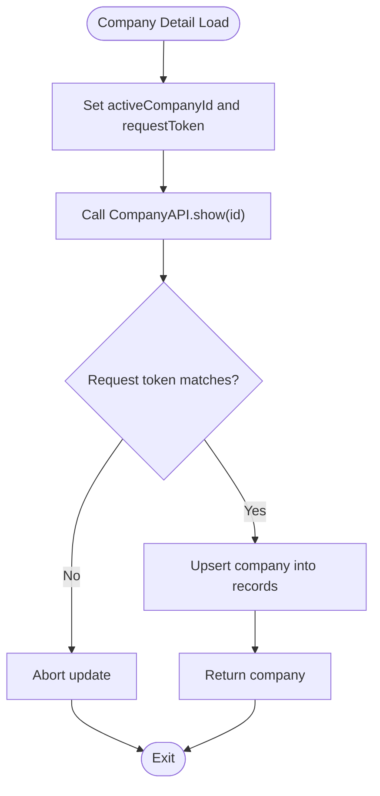
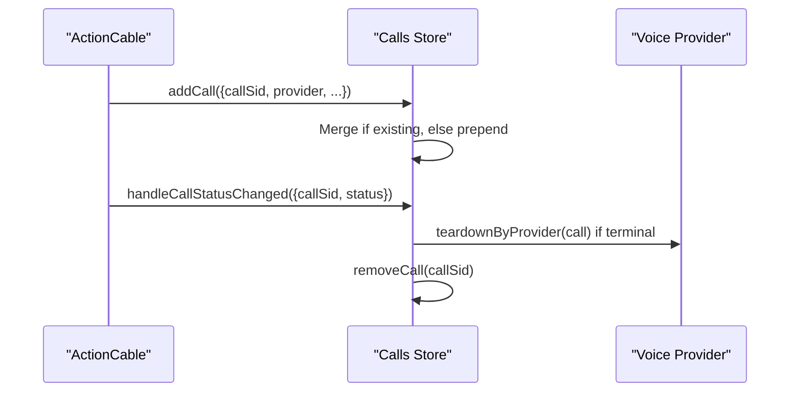
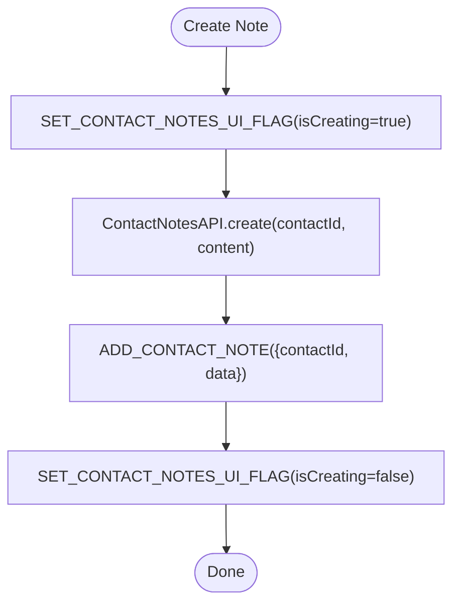
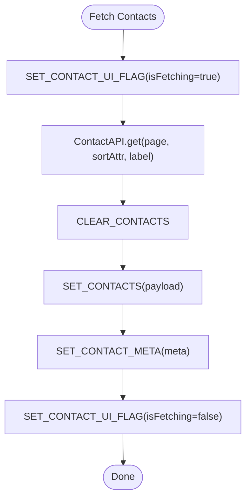
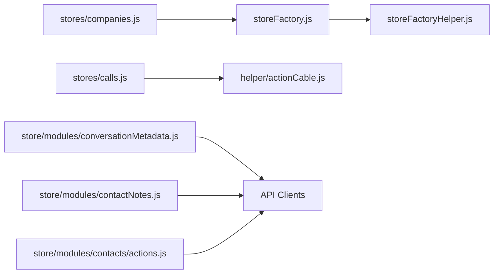

# State Management with Pinia

<cite>
**Referenced Files in This Document**
- [storeFactory.js](file://app/javascript/dashboard/store/storeFactory.js)
- [storeFactoryHelper.js](file://app/javascript/dashboard/store/storeFactoryHelper.js)
- [companies.js](file://app/javascript/dashboard/stores/companies.js)
- [calls.js](file://app/javascript/dashboard/stores/calls.js)
- [conversationMetadata.js](file://app/javascript/dashboard/store/modules/conversationMetadata.js)
- [contactNotes.js](file://app/javascript/dashboard/store/modules/contactNotes.js)
- [contacts actions.js](file://app/javascript/dashboard/store/modules/contacts/actions.js)
- [actionCable.js](file://app/javascript/dashboard/helper/actionCable.js)
</cite>

## Table of Contents
1. [Introduction](#introduction)
2. [Project Structure](#project-structure)
3. [Core Components](#core-components)
4. [Architecture Overview](#architecture-overview)
5. [Detailed Component Analysis](#detailed-component-analysis)
6. [Dependency Analysis](#dependency-analysis)
7. [Performance Considerations](#performance-considerations)
8. [Troubleshooting Guide](#troubleshooting-guide)
9. [Conclusion](#conclusion)

## Introduction
This document explains Chatwoot’s state management implementation using Pinia, focusing on the store architecture, module organization, and reactive data flow patterns. It covers core stores for companies (as a representative domain), calls (real-time voice sessions), and legacy modules such as conversation metadata and contact notes. It also documents real-time synchronization via ActionCable/WebSocket updates, background job integration points, persistence strategies, computed properties (getters), and actions that encapsulate business logic. Finally, it provides guidance for debugging and optimizing performance for large datasets.

## Project Structure
The dashboard uses a hybrid approach:
- A universal store factory supports both Vuex and Pinia, enabling gradual migration.
- Newer feature stores are implemented directly with Pinia’s defineStore API.
- Legacy modules still use Vuex-style modules under store/modules.



**Diagram sources**
- [storeFactory.js:1-230](file://app/javascript/dashboard/store/storeFactory.js#L1-L230)
- [storeFactoryHelper.js:1-204](file://app/javascript/dashboard/store/storeFactoryHelper.js#L1-L204)
- [companies.js:1-516](file://app/javascript/dashboard/stores/companies.js#L1-L516)
- [calls.js:1-106](file://app/javascript/dashboard/stores/calls.js#L1-L106)
- [conversationMetadata.js:1-27](file://app/javascript/dashboard/store/modules/conversationMetadata.js#L1-L27)
- [contactNotes.js:1-98](file://app/javascript/dashboard/store/modules/contactNotes.js#L1-L98)
- [contacts actions.js:75-114](file://app/javascript/dashboard/store/modules/contacts/actions.js#L75-L114)
- [actionCable.js:448-539](file://app/javascript/dashboard/helper/actionCable.js#L448-L539)

**Section sources**
- [storeFactory.js:1-230](file://app/javascript/dashboard/store/storeFactory.js#L1-L230)
- [storeFactoryHelper.js:1-204](file://app/javascript/dashboard/store/storeFactoryHelper.js#L1-L204)
- [companies.js:1-516](file://app/javascript/dashboard/stores/companies.js#L1-L516)
- [calls.js:1-106](file://app/javascript/dashboard/stores/calls.js#L1-L106)
- [conversationMetadata.js:1-27](file://app/javascript/dashboard/store/modules/conversationMetadata.js#L1-L27)
- [contactNotes.js:1-98](file://app/javascript/dashboard/store/modules/contactNotes.js#L1-L98)
- [contacts actions.js:75-114](file://app/javascript/dashboard/store/modules/contacts/actions.js#L75-L114)
- [actionCable.js:448-539](file://app/javascript/dashboard/helper/actionCable.js#L448-L539)

## Core Components
- Universal Store Factory: Provides a unified interface to create either Vuex or Pinia stores, standardizing CRUD operations, UI flags, and meta handling.
- CRUD Helpers: Encapsulate async workflows for listing, showing, creating, updating, and deleting records, including error handling and UI flag toggling.
- Companies Store: A Pinia store implementing rich business logic around company entities, contacts, conversations, notes, search, and pagination.
- Calls Store: A Pinia store managing real-time voice call sessions, merging incoming events, and coordinating teardown across providers.
- Conversation Metadata Module: A Vuex module storing per-conversation metadata keyed by ID.
- Contact Notes Module: A Vuex module managing per-contact note lists with add/delete operations.
- Contacts Actions (Legacy): Vuex actions for fetching and displaying contacts, demonstrating traditional mutation-driven updates.

**Section sources**
- [storeFactory.js:1-230](file://app/javascript/dashboard/store/storeFactory.js#L1-L230)
- [storeFactoryHelper.js:1-204](file://app/javascript/dashboard/store/storeFactoryHelper.js#L1-L204)
- [companies.js:1-516](file://app/javascript/dashboard/stores/companies.js#L1-L516)
- [calls.js:1-106](file://app/javascript/dashboard/stores/calls.js#L1-L106)
- [conversationMetadata.js:1-27](file://app/javascript/dashboard/store/modules/conversationMetadata.js#L1-L27)
- [contactNotes.js:1-98](file://app/javascript/dashboard/store/modules/contactNotes.js#L1-L98)
- [contacts actions.js:75-114](file://app/javascript/dashboard/store/modules/contacts/actions.js#L75-L114)

## Architecture Overview
The system follows a layered pattern:
- Presentation layer (components) interacts with Pinia stores or Vuex modules.
- Stores encapsulate business logic, coordinate API calls, and maintain reactive state.
- Real-time updates from ActionCable/WebSockets mutate stores directly to keep UI in sync.
- Background jobs (e.g., Sidekiq) update server-side state; clients reflect changes via WebSocket events.



**Diagram sources**
- [storeFactoryHelper.js:93-203](file://app/javascript/dashboard/store/storeFactoryHelper.js#L93-L203)
- [calls.js:28-40](file://app/javascript/dashboard/stores/calls.js#L28-L40)
- [actionCable.js:448-539](file://app/javascript/dashboard/helper/actionCable.js#L448-L539)

## Detailed Component Analysis

### Universal Store Factory (Pinia/Vuex)
- Purpose: Provide a consistent API for creating stores with standardized state shape, getters, mutations/actions, and CRUD helpers.
- Key capabilities:
  - Standardized initial state: records array, meta object, uiFlags for loading states.
  - Getters for list retrieval, single record lookup, UI flags, and meta.
  - CRUD actions/helpers for both Vuex and Pinia, ensuring uniform behavior.
  - Factory method to switch between Vuex and Pinia implementations.



**Diagram sources**
- [storeFactory.js:42-89](file://app/javascript/dashboard/store/storeFactory.js#L42-L89)
- [storeFactory.js:136-189](file://app/javascript/dashboard/store/storeFactory.js#L136-L189)
- [storeFactoryHelper.js:93-203](file://app/javascript/dashboard/store/storeFactoryHelper.js#L93-L203)

**Section sources**
- [storeFactory.js:1-230](file://app/javascript/dashboard/store/storeFactory.js#L1-L230)
- [storeFactoryHelper.js:1-204](file://app/javascript/dashboard/store/storeFactoryHelper.js#L1-L204)

### Companies Store (Pinia)
- Responsibilities:
  - Manage company records, active context, and related resources (contacts, conversations, notes).
  - Handle pagination, searching, enrichment, avatar deletion, and custom attribute operations.
  - Normalize payloads and meta, toggle UI flags, and guard against race conditions using request tokens.
- Data model highlights:
  - records: normalized company list
  - activeCompanyId: current context
  - companyContacts/companyConversations/companyNotes: paginated lists with associated meta
  - contactSearchResults/search meta/query: local search state
- Computed properties (getters):
  - List accessors like getCompaniesList.
- Business logic examples:
  - Upserting company records after API responses.
  - Updating counts when contacts are attached/removed.
  - Conditional re-fetching based on active context and request tokens.



**Diagram sources**
- [companies.js:146-175](file://app/javascript/dashboard/stores/companies.js#L146-L175)

**Section sources**
- [companies.js:1-516](file://app/javascript/dashboard/stores/companies.js#L1-L516)

### Calls Store (Pinia)
- Responsibilities:
  - Maintain an in-memory list of call sessions with provider-specific teardown logic.
  - Merge incoming events to avoid overwriting partial data.
  - Expose getters for active/incoming calls and actions for lifecycle management.
- Real-time integration:
  - ActionCable events trigger add/remove/set-active operations.
  - Provider-aware cleanup ensures correct teardown for WhatsApp vs Twilio.



**Diagram sources**
- [calls.js:28-40](file://app/javascript/dashboard/stores/calls.js#L28-L40)
- [calls.js:42-71](file://app/javascript/dashboard/stores/calls.js#L42-L71)
- [actionCable.js:448-539](file://app/javascript/dashboard/helper/actionCable.js#L448-L539)

**Section sources**
- [calls.js:1-106](file://app/javascript/dashboard/stores/calls.js#L1-L106)
- [actionCable.js:448-539](file://app/javascript/dashboard/helper/actionCable.js#L448-L539)

### Conversation Metadata Module (Vuex)
- Purpose: Store per-conversation metadata keyed by numeric IDs.
- Accessor: Getter returns metadata for a given conversation ID, defaulting to empty object if missing.

```mermaid
classDiagram
class ConversationMetadataModule {
+state.records : Map<number, any>
+getters.getConversationMetadata(id)
+mutations.SET_CONVERSATION_METADATA({id, data})
}
```

**Diagram sources**
- [conversationMetadata.js:1-27](file://app/javascript/dashboard/store/modules/conversationMetadata.js#L1-L27)

**Section sources**
- [conversationMetadata.js:1-27](file://app/javascript/dashboard/store/modules/conversationMetadata.js#L1-L27)

### Contact Notes Module (Vuex)
- Purpose: Manage per-contact note lists with create/delete operations.
- Operations:
  - Create note: API call then ADD_CONTACT_NOTE mutation.
  - Delete note: API call then DELETE_CONTACT_NOTE mutation.
  - UI flags track isCreating/isDeleting states.



**Diagram sources**
- [contactNotes.js:44-52](file://app/javascript/dashboard/store/modules/contactNotes.js#L44-L52)
- [contactNotes.js:67-90](file://app/javascript/dashboard/store/modules/contactNotes.js#L67-L90)

**Section sources**
- [contactNotes.js:1-98](file://app/javascript/dashboard/store/modules/contactNotes.js#L1-L98)

### Contacts Actions (Legacy Vuex)
- Purpose: Fetch and display contacts with pagination and sorting.
- Patterns:
  - Toggle UI flags before/after API calls.
  - Clear and set contacts list, then set meta.
  - Show single contact detail with item-level UI flags.



**Diagram sources**
- [contacts actions.js:75-89](file://app/javascript/dashboard/store/modules/contacts/actions.js#L75-L89)

**Section sources**
- [contacts actions.js:75-114](file://app/javascript/dashboard/store/modules/contacts/actions.js#L75-L114)

## Dependency Analysis
- The universal factory composes helpers and exposes a consistent API for both Vuex and Pinia stores.
- Pinia stores (companies, calls) rely on direct API clients and, in the case of calls, WebSocket events.
- Vuex modules (conversationMetadata, contactNotes, contacts actions) follow traditional mutation-driven updates.



**Diagram sources**
- [storeFactory.js:1-230](file://app/javascript/dashboard/store/storeFactory.js#L1-L230)
- [storeFactoryHelper.js:1-204](file://app/javascript/dashboard/store/storeFactoryHelper.js#L1-L204)
- [companies.js:1-516](file://app/javascript/dashboard/stores/companies.js#L1-L516)
- [calls.js:1-106](file://app/javascript/dashboard/stores/calls.js#L1-L106)
- [conversationMetadata.js:1-27](file://app/javascript/dashboard/store/modules/conversationMetadata.js#L1-L27)
- [contactNotes.js:1-98](file://app/javascript/dashboard/store/modules/contactNotes.js#L1-L98)
- [contacts actions.js:75-114](file://app/javascript/dashboard/store/modules/contacts/actions.js#L75-L114)
- [actionCable.js:448-539](file://app/javascript/dashboard/helper/actionCable.js#L448-L539)

**Section sources**
- [storeFactory.js:1-230](file://app/javascript/dashboard/store/storeFactory.js#L1-L230)
- [storeFactoryHelper.js:1-204](file://app/javascript/dashboard/store/storeFactoryHelper.js#L1-L204)
- [companies.js:1-516](file://app/javascript/dashboard/stores/companies.js#L1-L516)
- [calls.js:1-106](file://app/javascript/dashboard/stores/calls.js#L1-L106)
- [conversationMetadata.js:1-27](file://app/javascript/dashboard/store/modules/conversationMetadata.js#L1-L27)
- [contactNotes.js:1-98](file://app/javascript/dashboard/store/modules/contactNotes.js#L1-L98)
- [contacts actions.js:75-114](file://app/javascript/dashboard/store/modules/contacts/actions.js#L75-L114)
- [actionCable.js:448-539](file://app/javascript/dashboard/helper/actionCable.js#L448-L539)

## Performance Considerations
- Pagination and incremental loading:
  - Use page-based APIs and append results for infinite scroll scenarios (see company conversations/notes).
- Avoid unnecessary re-renders:
  - Prefer immutable updates and targeted upserts rather than replacing entire arrays.
- Debounce and cancelation:
  - Use request tokens to ignore stale responses (implemented in companies store).
- Minimize deep cloning:
  - Only clone necessary fields during merges (e.g., preserving caller snapshots in calls store).
- Efficient lookups:
  - Keep records indexed by ID where possible; use find/filter judiciously.
- UI flags granularity:
  - Track specific operations (fetchingList, fetchingItem, creatingItem, etc.) to prevent global loading states.

[No sources needed since this section provides general guidance]

## Troubleshooting Guide
- Stale responses and race conditions:
  - Ensure request tokens match before applying updates (companies store pattern).
- WebSocket event ordering:
  - Verify that incoming events merge correctly without overwriting partial data (calls store pattern).
- Error handling:
  - Centralize error throwing and ensure UI flags are reset in finally blocks.
- Provider-specific teardown:
  - Confirm teardown paths are invoked for active calls to release resources (calls store).
- Debugging techniques:
  - Inspect store state and getters in Vue DevTools.
  - Log API requests/responses and WebSocket events to correlate state changes.
  - Add temporary console logs around critical actions (e.g., upsert, remove, setUIFlag).

**Section sources**
- [companies.js:146-175](file://app/javascript/dashboard/stores/companies.js#L146-L175)
- [calls.js:28-71](file://app/javascript/dashboard/stores/calls.js#L28-L71)
- [storeFactoryHelper.js:93-203](file://app/javascript/dashboard/store/storeFactoryHelper.js#L93-L203)

## Conclusion
Chatwoot’s state management combines a universal factory with modern Pinia stores and legacy Vuex modules. The factory standardizes CRUD operations and UI state, while domain stores encapsulate complex business logic. Real-time synchronization via ActionCable keeps the UI responsive, and careful use of request tokens and targeted updates ensures correctness and performance. For new features, prefer Pinia stores with clear separation of concerns, robust error handling, and efficient data structures.

[No sources needed since this section summarizes without analyzing specific files]