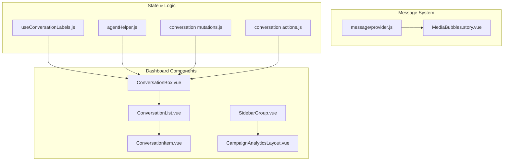
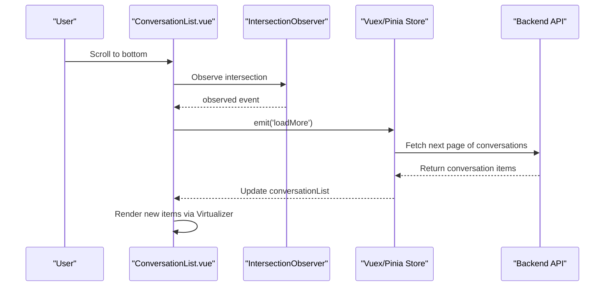
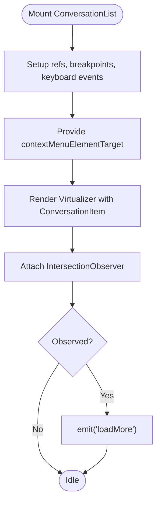
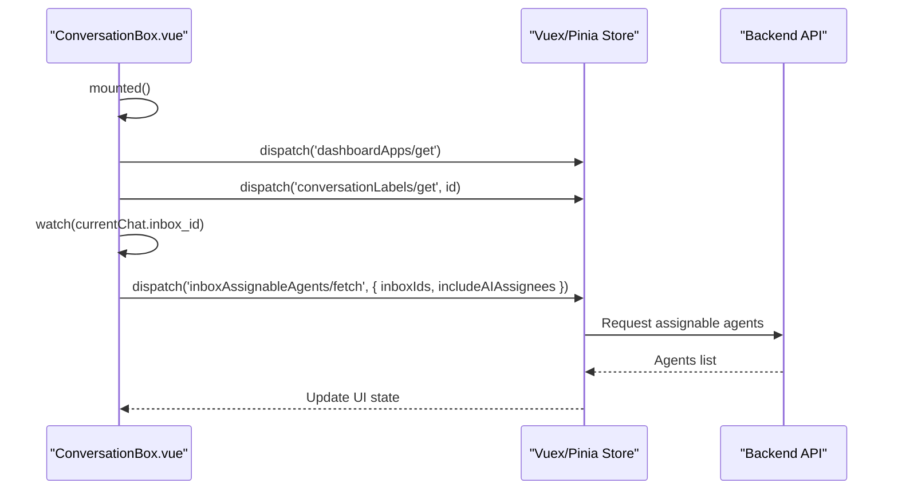
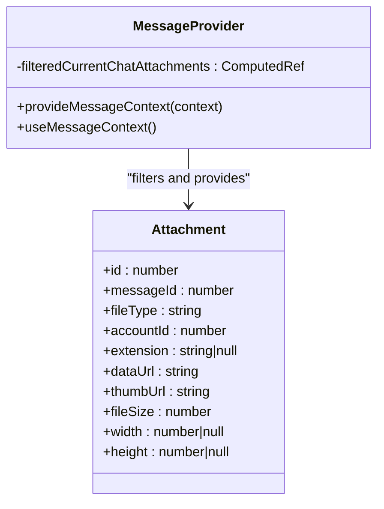
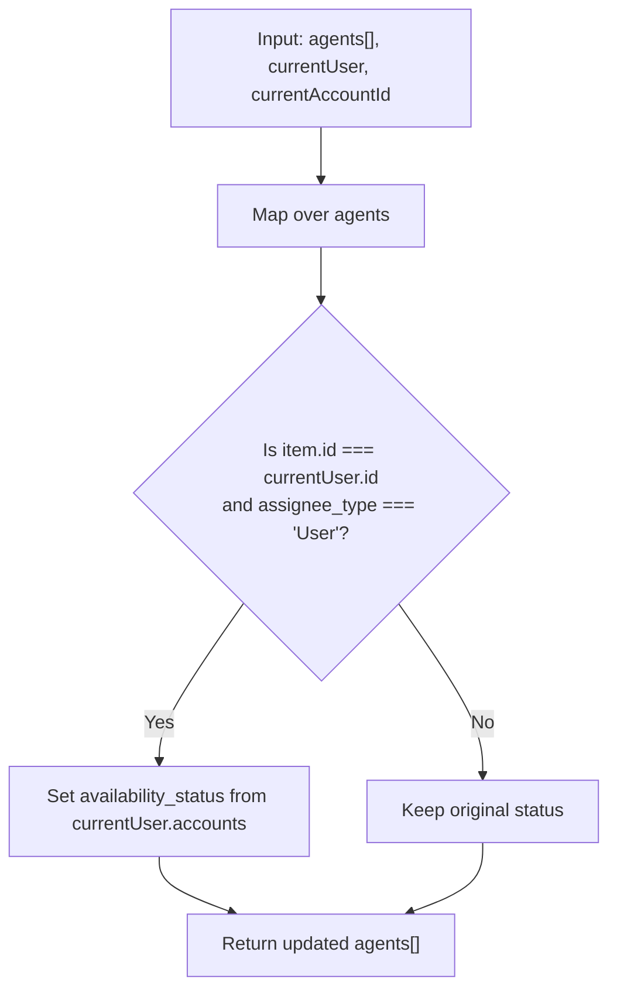
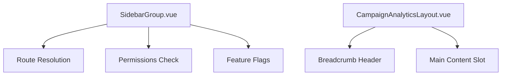
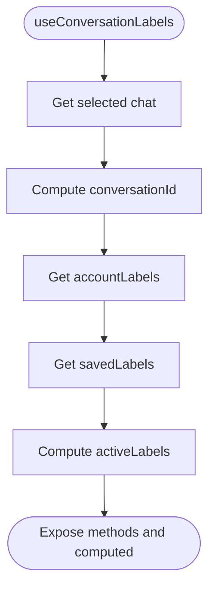
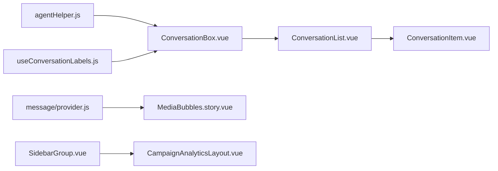

# Dashboard Components

<cite>
**Referenced Files in This Document**
- [ConversationList.vue](file://app/javascript/dashboard/components/ConversationList.vue)
- [ConversationItem.vue](file://app/javascript/dashboard/components/ConversationItem.vue)
- [ChatList.vue](file://app/javascript/dashboard/components/ChatList.vue)
- [ConversationBox.vue](file://app/javascript/dashboard/components/widgets/conversation/ConversationBox.vue)
- [useConversationLabels.js](file://app/javascript/dashboard/composables/useConversationLabels.js)
- [agentHelper.js](file://app/javascript/dashboard/helper/agentHelper.js)
- [provider.js](file://app/javascript/dashboard/components-next/message/provider.js)
- [MediaBubbles.story.vue](file://app/javascript/dashboard/components-next/message/stories/MediaBubbles.story.vue)
- [SidebarGroup.vue](file://app/javascript/dashboard/components-next/sidebar/SidebarGroup.vue)
- [CampaignAnalyticsLayout.vue](file://app/javascript/dashboard/components-next/Campaigns/CampaignAnalyticsLayout.vue)
- [conversation mutations.js](file://app/javascript/widget/store/modules/conversation/mutations.js)
- [conversation actions.js](file://app/javascript/widget/store/modules/conversation/actions.js)
</cite>

## Table of Contents
1. [Introduction](#introduction)
2. [Project Structure](#project-structure)
3. [Core Components](#core-components)
4. [Architecture Overview](#architecture-overview)
5. [Detailed Component Analysis](#detailed-component-analysis)
6. [Dependency Analysis](#dependency-analysis)
7. [Performance Considerations](#performance-considerations)
8. [Troubleshooting Guide](#troubleshooting-guide)
9. [Conclusion](#conclusion)

## Introduction
This document explains the Chatwoot dashboard Vue.js components with a focus on conversation management UI, agent tools interface, and real-time collaboration features. It covers component architecture, state management via Pinia/Vuex stores, props and events patterns, composition strategies, and performance considerations. Key components include ConversationList, MessageComposer (via message provider), AgentPresence helpers, and layout scaffolding such as SidebarGroup and CampaignAnalyticsLayout.

## Project Structure
The dashboard frontend is organized into:
- Components: reusable UI building blocks for conversations, messages, sidebar, and layouts
- Composables: shared logic for labels, keyboard shortcuts, and store interactions
- Stores: centralized state for conversations, agents, and UI flags
- Helpers: utility functions for presence and formatting

**Diagram sources**
- [ConversationList.vue:1-95](file://app/javascript/dashboard/components/ConversationList.vue#L1-L95)
- [ConversationItem.vue:1-30](file://app/javascript/dashboard/components/ConversationItem.vue#L1-L30)
- [ConversationBox.vue:51-105](file://app/javascript/dashboard/components/widgets/conversation/ConversationBox.vue#L51-L105)
- [provider.js:1-152](file://app/javascript/dashboard/components-next/message/provider.js#L1-L152)
- [MediaBubbles.story.vue:57-113](file://app/javascript/dashboard/components-next/message/stories/MediaBubbles.story.vue#L57-L113)
- [useConversationLabels.js:1-45](file://app/javascript/dashboard/composables/useConversationLabels.js#L1-L45)
- [agentHelper.js:33-54](file://app/javascript/dashboard/helper/agentHelper.js#L33-L54)
- [conversation mutations.js:83-132](file://app/javascript/widget/store/modules/conversation/mutations.js#L83-L132)
- [conversation actions.js:145-186](file://app/javascript/widget/store/modules/conversation/actions.js#L145-L186)

**Section sources**
- [ConversationList.vue:1-95](file://app/javascript/dashboard/components/ConversationList.vue#L1-L95)
- [ConversationBox.vue:51-105](file://app/javascript/dashboard/components/widgets/conversation/ConversationBox.vue#L51-L105)

## Core Components
- ConversationList: Virtualized list of conversations with keyboard navigation, context menu integration, and infinite scroll via IntersectionObserver. Emits loadMore to fetch additional items.
- ConversationItem: Renders individual conversation entries, integrates with selection and assignment actions through Vue provide/inject.
- ConversationBox: Orchestrates conversation details, label fetching, and dashboard app tabs; dispatches store actions when current chat changes.
- Message Provider: Provides typed attachment context and filtered media attachments to nested message components.
- Agent Presence Helper: Computes dynamic availability status for the current user across accounts.
- Layout Components: SidebarGroup and CampaignAnalyticsLayout provide navigational structure and page scaffolding.

**Section sources**
- [ConversationList.vue:1-95](file://app/javascript/dashboard/components/ConversationList.vue#L1-L95)
- [ConversationItem.vue:1-30](file://app/javascript/dashboard/components/ConversationItem.vue#L1-L30)
- [ConversationBox.vue:51-105](file://app/javascript/dashboard/components/widgets/conversation/ConversationBox.vue#L51-L105)
- [provider.js:1-152](file://app/javascript/dashboard/components-next/message/provider.js#L1-L152)
- [agentHelper.js:33-54](file://app/javascript/dashboard/helper/agentHelper.js#L33-L54)
- [SidebarGroup.vue:1-42](file://app/javascript/dashboard/components-next/sidebar/SidebarGroup.vue#L1-L42)
- [CampaignAnalyticsLayout.vue:1-32](file://app/javascript/dashboard/components-next/Campaigns/CampaignAnalyticsLayout.vue#L1-L32)

## Architecture Overview
The dashboard follows a layered architecture:
- Presentation Layer: Vue components render UI and handle user interactions
- Composition Layer: Composables encapsulate business logic and store bindings
- State Layer: Vuex/Pinia stores manage global state and side effects
- Utilities: Helpers and services support data transformation and API calls

**Diagram sources**
- [ConversationList.vue:40-57](file://app/javascript/dashboard/components/ConversationList.vue#L40-L57)
- [conversation actions.js:145-186](file://app/javascript/widget/store/modules/conversation/actions.js#L145-L186)

## Detailed Component Analysis

### ConversationList
Responsibilities:
- Virtualizes large lists using virtua/vue Virtualizer for performance
- Integrates keyboard navigation via useChatListKeyboardEvents
- Exposes context menu target via provide/inject
- Handles responsive expanded card mode based on breakpoints
- Triggers loadMore via IntersectionObserver

Props and Events:
- Props: conversationList, isLoading, showEndOfListMessage, label, teamId, foldersId, conversationType, showAssignee, isOnExpandedLayout
- Events: loadMore

Key behaviors:
- Context menu toggle state prevents scrolling conflicts
- Exposes conversationListRef for parent access

**Diagram sources**
- [ConversationList.vue:1-95](file://app/javascript/dashboard/components/ConversationList.vue#L1-L95)

**Section sources**
- [ConversationList.vue:1-95](file://app/javascript/dashboard/components/ConversationList.vue#L1-L95)

### ConversationItem
Responsibilities:
- Renders a single conversation entry
- Uses provide/inject to integrate with selection, assignment, labeling, and status updates from parent contexts
- Supports both compact and expanded views

Props:
- source, teamId, label, conversationType, foldersId, showAssignee, showExpanded

Integration points:
- Injected actions: selectConversation, deSelectConversation, assignAgent, assignTeam, assignLabels, removeLabels, updateConversationStatus

**Section sources**
- [ConversationItem.vue:1-30](file://app/javascript/dashboard/components/ConversationItem.vue#L1-L30)

### ConversationBox
Responsibilities:
- Manages conversation details panel
- Dispatches store actions to fetch labels and dashboard apps
- Watches currentChat changes to reset UI state and trigger label fetch

Lifecycle:
- mounted: fetch labels and dashboard apps
- watch currentChat.id: reset activeIndex and fetch labels
- watch currentChat.inbox_id: fetch assignable agents including AI assignees

**Diagram sources**
- [ConversationBox.vue:51-105](file://app/javascript/dashboard/components/widgets/conversation/ConversationBox.vue#L51-L105)

**Section sources**
- [ConversationBox.vue:51-105](file://app/javascript/dashboard/components/widgets/conversation/ConversationBox.vue#L51-L105)

### Message Composer and Media Handling
Responsibilities:
- Message provider exposes typed attachment context and filters media attachments for display
- Stories demonstrate handling of audio, image, video, and broken media scenarios

Key concepts:
- Attachment types: image, audio, video, file, location, fallback, share, story_mention, contact, ig_reel
- FilteredCurrentChatAttachments computed property selects media types suitable for bubble rendering

**Diagram sources**
- [provider.js:1-152](file://app/javascript/dashboard/components-next/message/provider.js#L1-L152)
- [MediaBubbles.story.vue:57-113](file://app/javascript/dashboard/components-next/message/stories/MediaBubbles.story.vue#L57-L113)

**Section sources**
- [provider.js:1-152](file://app/javascript/dashboard/components-next/message/provider.js#L1-L152)
- [MediaBubbles.story.vue:57-113](file://app/javascript/dashboard/components-next/message/stories/MediaBubbles.story.vue#L57-L113)

### Agent Presence and Tools Interface
Responsibilities:
- Agent helper computes dynamic presence for the current user across multiple accounts
- Used by agent tools interfaces to reflect accurate online/offline status

Logic highlights:
- Updates availability_status for the current user if assignee_type is User
- Preserves other agents' statuses unchanged

**Diagram sources**
- [agentHelper.js:33-54](file://app/javascript/dashboard/helper/agentHelper.js#L33-L54)

**Section sources**
- [agentHelper.js:33-54](file://app/javascript/dashboard/helper/agentHelper.js#L33-L54)

### Layout and Navigation Components
- SidebarGroup: Provides collapsible groups, popover states, route resolution, permissions, and feature flag checks.
- CampaignAnalyticsLayout: Scaffolds analytics pages with breadcrumb and main content area.

**Diagram sources**
- [SidebarGroup.vue:1-42](file://app/javascript/dashboard/components-next/sidebar/SidebarGroup.vue#L1-L42)
- [CampaignAnalyticsLayout.vue:1-32](file://app/javascript/dashboard/components-next/Campaigns/CampaignAnalyticsLayout.vue#L1-L32)

**Section sources**
- [SidebarGroup.vue:1-42](file://app/javascript/dashboard/components-next/sidebar/SidebarGroup.vue#L1-L42)
- [CampaignAnalyticsLayout.vue:1-32](file://app/javascript/dashboard/components-next/Campaigns/CampaignAnalyticsLayout.vue#L1-L32)

### Conversation Labels Management
Composable useConversationLabels centralizes label-related state and getters:
- currentChat and conversationId derived from selected chat
- accountLabels from labels store getter
- savedLabels and activeLabels computed from conversation labels store

**Diagram sources**
- [useConversationLabels.js:1-45](file://app/javascript/dashboard/composables/useConversationLabels.js#L1-L45)

**Section sources**
- [useConversationLabels.js:1-45](file://app/javascript/dashboard/composables/useConversationLabels.js#L1-L45)

## Dependency Analysis
Component relationships and dependencies:
- ConversationList depends on ConversationItem and virtualization utilities
- ConversationBox orchestrates store actions and child components
- Message provider supplies typed context to message components
- Agent helper supports presence calculations used by agent tools
- Layout components depend on routing and policy systems

**Diagram sources**
- [ConversationList.vue:1-95](file://app/javascript/dashboard/components/ConversationList.vue#L1-L95)
- [ConversationItem.vue:1-30](file://app/javascript/dashboard/components/ConversationItem.vue#L1-L30)
- [ConversationBox.vue:51-105](file://app/javascript/dashboard/components/widgets/conversation/ConversationBox.vue#L51-L105)
- [provider.js:1-152](file://app/javascript/dashboard/components-next/message/provider.js#L1-L152)
- [MediaBubbles.story.vue:57-113](file://app/javascript/dashboard/components-next/message/stories/MediaBubbles.story.vue#L57-L113)
- [agentHelper.js:33-54](file://app/javascript/dashboard/helper/agentHelper.js#L33-L54)
- [useConversationLabels.js:1-45](file://app/javascript/dashboard/composables/useConversationLabels.js#L1-L45)
- [SidebarGroup.vue:1-42](file://app/javascript/dashboard/components-next/sidebar/SidebarGroup.vue#L1-L42)
- [CampaignAnalyticsLayout.vue:1-32](file://app/javascript/dashboard/components-next/Campaigns/CampaignAnalyticsLayout.vue#L1-L32)

**Section sources**
- [ConversationList.vue:1-95](file://app/javascript/dashboard/components/ConversationList.vue#L1-L95)
- [ConversationBox.vue:51-105](file://app/javascript/dashboard/components/widgets/conversation/ConversationBox.vue#L51-L105)
- [provider.js:1-152](file://app/javascript/dashboard/components-next/message/provider.js#L1-L152)
- [agentHelper.js:33-54](file://app/javascript/dashboard/helper/agentHelper.js#L33-L54)
- [useConversationLabels.js:1-45](file://app/javascript/dashboard/composables/useConversationLabels.js#L1-L45)
- [SidebarGroup.vue:1-42](file://app/javascript/dashboard/components-next/sidebar/SidebarGroup.vue#L1-L42)
- [CampaignAnalyticsLayout.vue:1-32](file://app/javascript/dashboard/components-next/Campaigns/CampaignAnalyticsLayout.vue#L1-L32)

## Performance Considerations
- Virtualization: Use Virtualizer to render only visible items in long conversation lists, reducing DOM overhead.
- Lazy Loading: IntersectionObserver triggers incremental loading to avoid heavy initial payloads.
- Selective Rendering: Conditional rendering of expanded cards based on screen size improves responsiveness.
- Efficient Store Updates: Mutations and actions update minimal state slices and sort messages efficiently.
- Context Optimization: Provide/inject reduces prop drilling and re-renders for shared context like context menus and message attachments.

[No sources needed since this section provides general guidance]

## Troubleshooting Guide
Common issues and resolutions:
- Infinite scroll not triggering: Ensure IntersectionObserver options are bound to the correct container ref and rootMargin is set appropriately.
- Context menu blocking scroll: Toggle overflow behavior when context menu is open to prevent unintended scrolling.
- Missing assignable agents: Verify that currentChat.inbox_id is present before dispatching fetch actions.
- Incorrect agent presence: Confirm that currentUser.accounts contains the currentAccountId and availability_status is correctly mapped.
- Message attachments not displaying: Validate attachment types against allowed media types and ensure dataUrl/thumbUrl are available.

**Section sources**
- [ConversationList.vue:40-57](file://app/javascript/dashboard/components/ConversationList.vue#L40-L57)
- [ConversationBox.vue:51-105](file://app/javascript/dashboard/components/widgets/conversation/ConversationBox.vue#L51-L105)
- [agentHelper.js:33-54](file://app/javascript/dashboard/helper/agentHelper.js#L33-L54)
- [provider.js:121-152](file://app/javascript/dashboard/components-next/message/provider.js#L121-L152)

## Conclusion
Chatwoot’s dashboard components implement a robust, scalable architecture centered around virtualized lists, composable logic, and typed message context. The combination of ConversationList, ConversationItem, ConversationBox, and message provider enables efficient conversation management, rich media handling, and collaborative features. Proper state management via stores and careful lifecycle handling ensure responsive and maintainable UIs.

[No sources needed since this section summarizes without analyzing specific files]