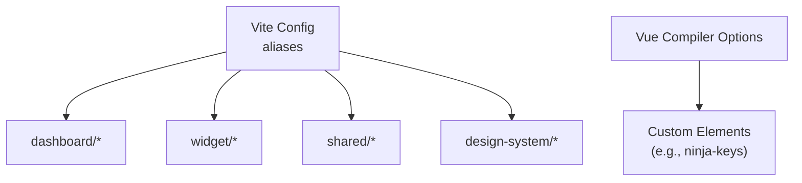
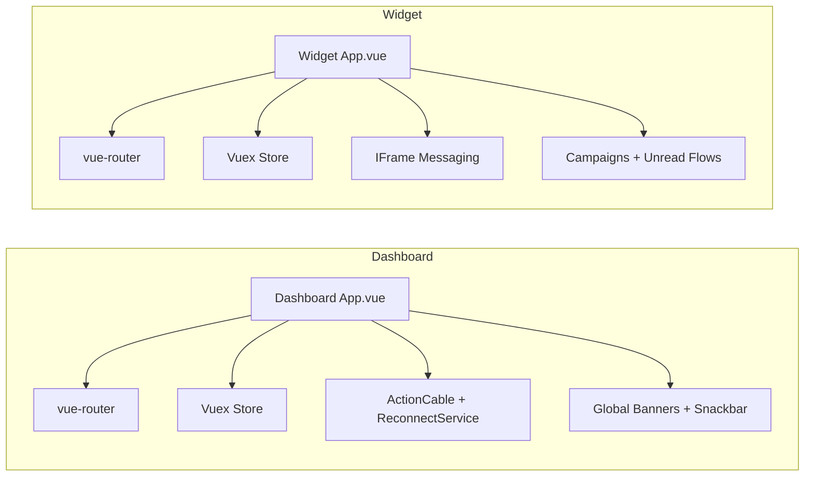
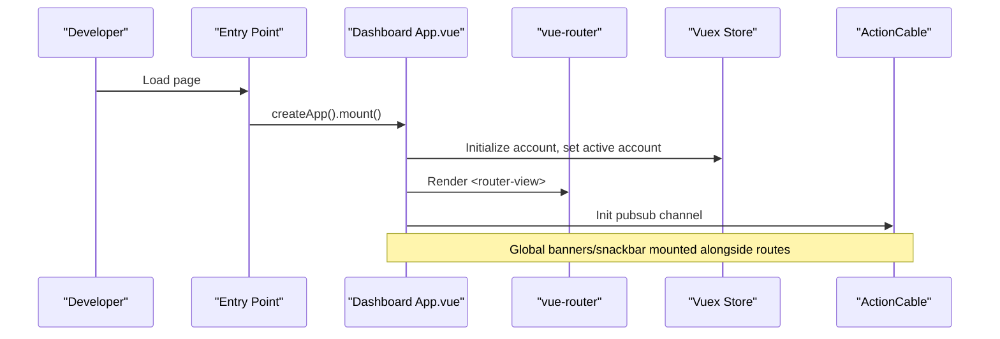
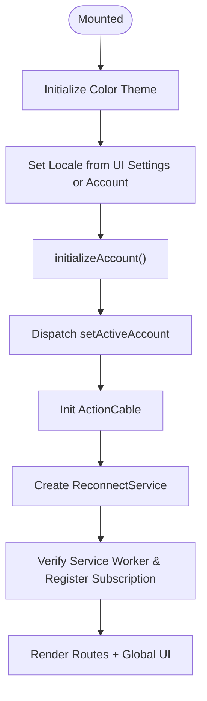
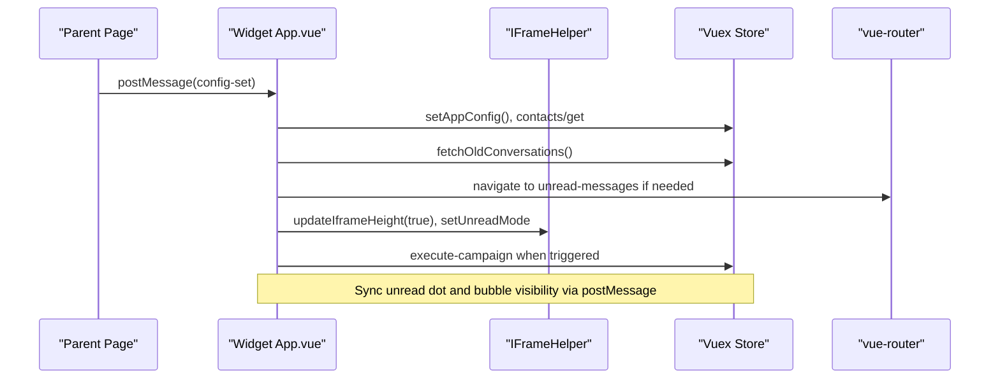
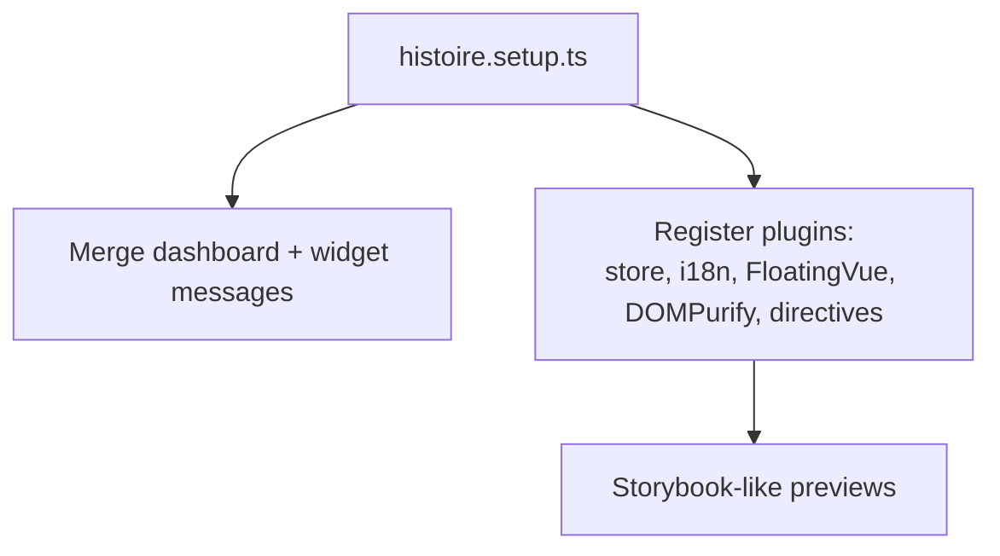
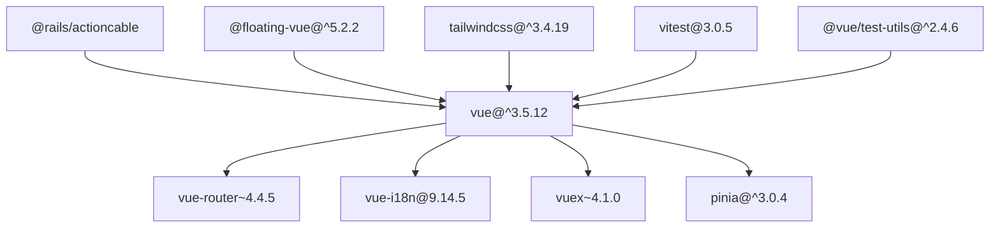

# Vue.js Components & Architecture

<cite>
**Referenced Files in This Document**
- [package.json](file://package.json)
- [vite.shared.ts](file://vite.shared.ts)
- [App.vue (Dashboard)](file://app/javascript/dashboard/App.vue)
- [App.vue (Widget)](file://app/javascript/widget/App.vue)
- [superadmin_pages.js](file://app/javascript/entrypoints/superadmin_pages.js)
- [histoire.setup.ts](file://app/javascript/histoire.setup.ts)
</cite>

## Table of Contents
1. [Introduction](#introduction)
2. [Project Structure](#project-structure)
3. [Core Components](#core-components)
4. [Architecture Overview](#architecture-overview)
5. [Detailed Component Analysis](#detailed-component-analysis)
6. [Dependency Analysis](#dependency-analysis)
7. [Performance Considerations](#performance-considerations)
8. [Troubleshooting Guide](#troubleshooting-guide)
9. [Conclusion](#conclusion)

## Introduction
This document explains Chatwoot’s Vue.js component architecture with a focus on single-file components, Composition API usage patterns, and the organization of the dashboard and widget applications. It covers how the root components initialize global state, handle real-time updates, manage routing, and communicate via stores and events. It also outlines testing and performance strategies used across the codebase.

## Project Structure
Chatwoot uses Vite to build multiple front-end targets:
- Dashboard application for agents/admins
- Widget SDK embedded in external sites
- Shared utilities, design system, and storybook-like development environment

Key configuration:
- Aliases map logical module names to physical directories for dashboard, widget, shared helpers, and design assets.
- The Vue compiler is configured to recognize custom elements used by third-party libraries.

**Diagram sources**
- [vite.shared.ts:3-14](file://vite.shared.ts#L3-L14)
- [vite.shared.ts:16-22](file://vite.shared.ts#L16-L22)

**Section sources**
- [vite.shared.ts:1-22](file://vite.shared.ts#L1-L22)

## Core Components
Two primary root components bootstrap their respective applications:
- Dashboard App: Initializes account context, theme, i18n, ActionCable, push notifications, and renders routed views plus global banners and snackbars.
- Widget App: Bootstraps the embeddable chat UI, handles iframe messaging, locale and color theming, unread/campaign flows, and integrates with the parent page via postMessage.

Both use Vue 3 Single File Components, Vuex for state, vue-router for navigation, and vue-i18n for localization.

**Diagram sources**
- [App.vue (Dashboard):1-182](file://app/javascript/dashboard/App.vue#L1-L182)
- [App.vue (Widget):1-400](file://app/javascript/widget/App.vue#L1-L400)

**Section sources**
- [App.vue (Dashboard):1-182](file://app/javascript/dashboard/App.vue#L1-L182)
- [App.vue (Widget):1-400](file://app/javascript/widget/App.vue#L1-L400)

## Architecture Overview
The frontend follows a layered architecture:
- Entry points mount Vue apps and render top-level components.
- Root components orchestrate initialization (locale, theme, store, router).
- Views are rendered through vue-router.
- State is centralized in Vuex modules; actions dispatch side effects (API calls, real-time subscriptions).
- Real-time updates flow via ActionCable in the dashboard and postMessage in the widget.

**Diagram sources**
- [superadmin_pages.js:1-30](file://app/javascript/entrypoints/superadmin_pages.js#L1-L30)
- [App.vue (Dashboard):1-182](file://app/javascript/dashboard/App.vue#L1-L182)

## Detailed Component Analysis

### Dashboard Root Component
Responsibilities:
- Account initialization and activation
- Theme and locale setup
- ActionCable connection and reconnection service
- Push notification registration
- Rendering of route views and global UI chrome (banners, snackbar)

Patterns:
- Composition API composables for account, font size, and UI settings
- Vuex getters mapped into computed properties
- Lifecycle hooks for initialization and cleanup

**Diagram sources**
- [App.vue (Dashboard):86-136](file://app/javascript/dashboard/App.vue#L86-L136)

**Section sources**
- [App.vue (Dashboard):1-182](file://app/javascript/dashboard/App.vue#L1-L182)

### Widget Root Component
Responsibilities:
- Configuration via mixin and URL parameters
- Iframe and RNWebView communication
- Locale and color scheme management
- Campaign and unread message handling
- Event bus integration for cross-frame events

Patterns:
- Mixins for configuration
- Composables for dark mode and availability
- Vuex actions for conversation, campaign, agent, and app config
- Event emitter for internal widget events

**Diagram sources**
- [App.vue (Widget):92-113](file://app/javascript/widget/App.vue#L92-L113)
- [App.vue (Widget):270-356](file://app/javascript/widget/App.vue#L270-L356)

**Section sources**
- [App.vue (Widget):1-400](file://app/javascript/widget/App.vue#L1-L400)

### Storybook-like Development Setup
The project uses a setup file to configure Vue plugins globally for stories and tests:
- Registers Vuex store and vue-i18n
- Integrates FloatingVue, DOMPurify HTML directive, resize observer directive, and click-away directive
- Merges dashboard and widget locales for unified story rendering

**Diagram sources**
- [histoire.setup.ts:13-51](file://app/javascript/histoire.setup.ts#L13-L51)

**Section sources**
- [histoire.setup.ts:1-51](file://app/javascript/histoire.setup.ts#L1-L51)

## Dependency Analysis
Top-level dependencies relevant to Vue architecture:
- Vue 3 ecosystem: vue, vue-router, pinia/vuex, vue-i18n
- Real-time: @rails/actioncable
- UI: floating-vue, tailwindcss, prosemirror-based editor packages
- Testing: vitest, @vue/test-utils, jsdom
- Build: vite, vite-plugin-ruby

**Diagram sources**
- [package.json:36-151](file://package.json#L36-L151)

**Section sources**
- [package.json:1-182](file://package.json#L1-L182)

## Performance Considerations
- Bundle size limits: The project enforces size constraints for widget and SDK bundles using size-limit.
- Virtualization: Uses virtua for large list virtualization to improve rendering performance.
- Lazy loading: Route-level and component-level lazy loading can be applied where appropriate.
- Efficient reactivity: Prefer composables and computed properties to minimize unnecessary re-renders.
- Real-time efficiency: Debounce heavy operations on incoming events; batch store updates where possible.

[No sources needed since this section provides general guidance]

## Troubleshooting Guide
Common issues and resolutions:
- Locale not applying: Ensure locale is set via UI settings or account preferences; verify i18n instance is initialized before rendering localized content.
- ActionCable not reconnecting: Confirm ReconnectService is instantiated and that pubsub token is available during initialization.
- Widget iframe height incorrect: Verify updateIframeHeight is called after content changes and extra scroll space is calculated.
- Bubble visibility not updating: Check SDK_SET_BUBBLE_VISIBILITY event handling and ensure store action toggles bubble visibility accordingly.

**Section sources**
- [App.vue (Dashboard):112-135](file://app/javascript/dashboard/App.vue#L112-L135)
- [App.vue (Widget):147-156](file://app/javascript/widget/App.vue#L147-L156)
- [App.vue (Widget):353-355](file://app/javascript/widget/App.vue#L353-L355)

## Conclusion
Chatwoot’s Vue.js architecture centers around two root applications—Dashboard and Widget—each bootstrapped with consistent patterns for state, routing, localization, and real-time updates. The dashboard focuses on agent workflows with robust real-time capabilities, while the widget emphasizes seamless embedding and communication with host pages. Shared tooling and configuration streamline development and maintain consistency across both applications.