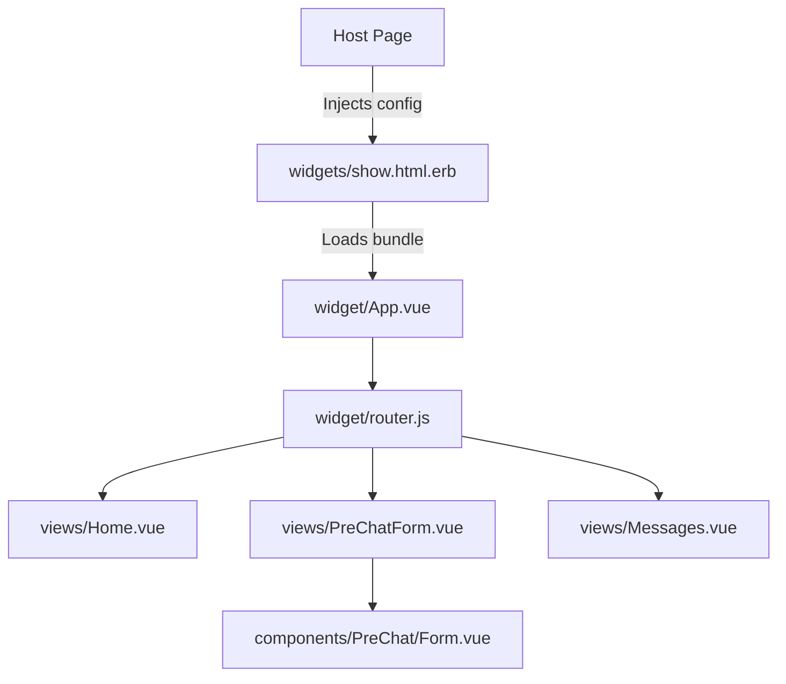
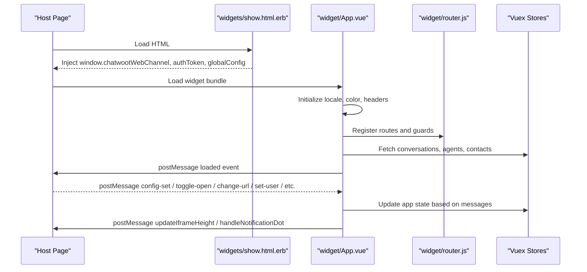
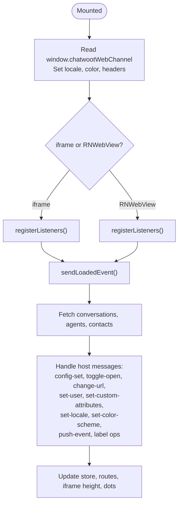
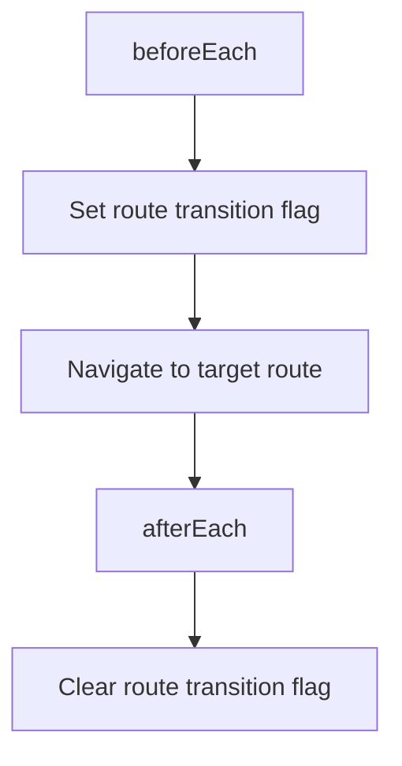
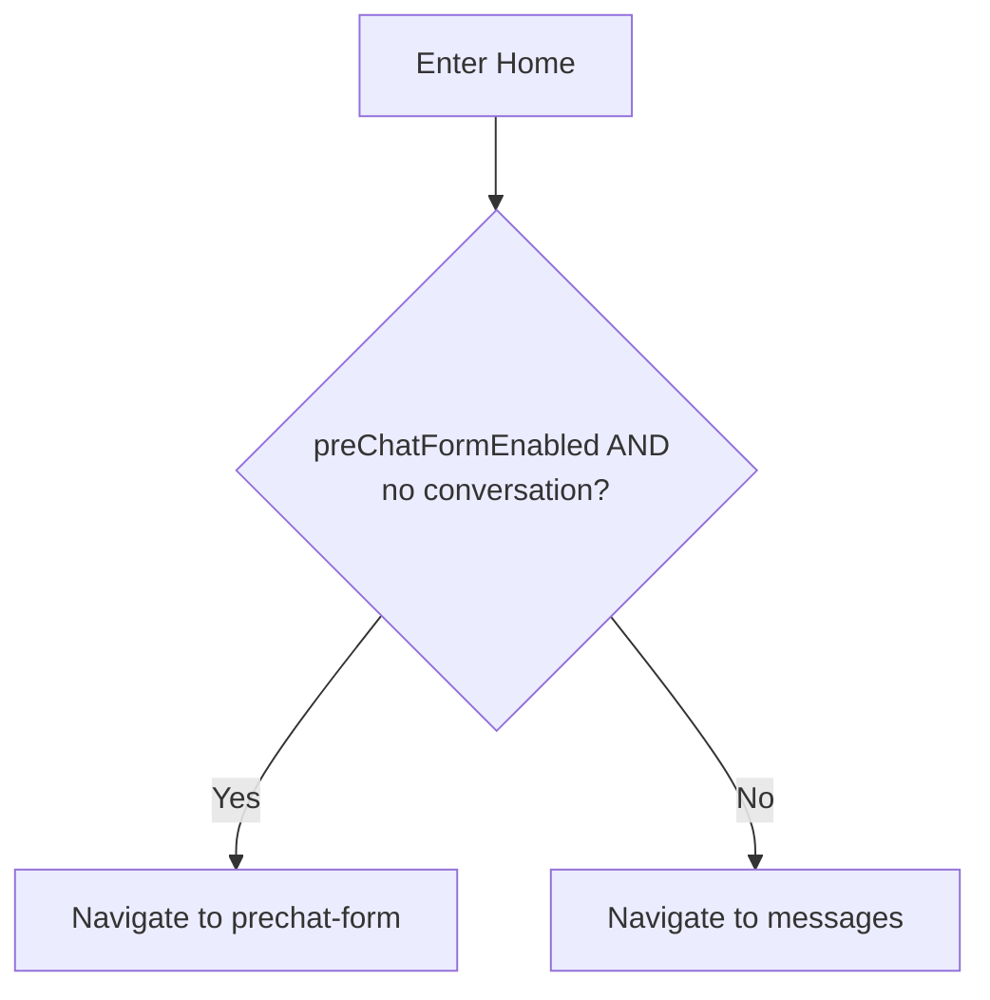
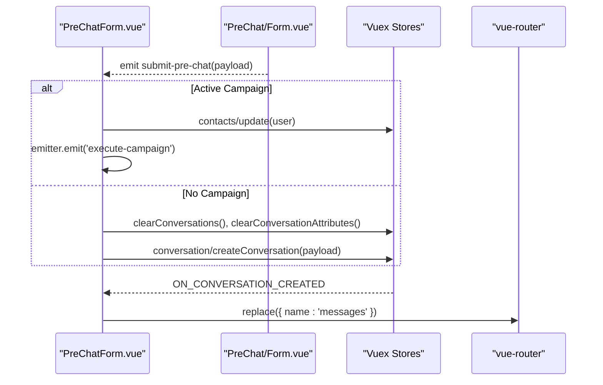
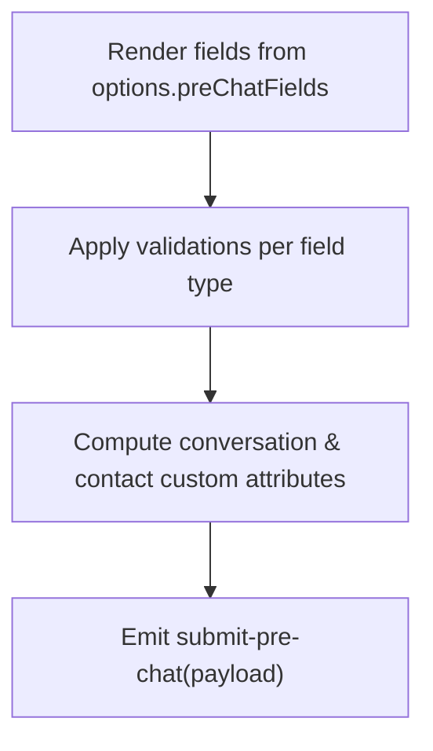
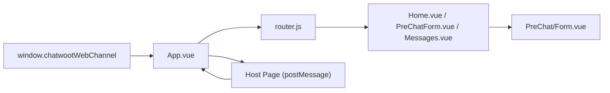

# Widget Components

<cite>
**Referenced Files in This Document**
- [show.html.erb](file://app/views/widgets/show.html.erb)
- [App.vue](file://app/javascript/widget/App.vue)
- [router.js](file://app/javascript/widget/router.js)
- [Home.vue](file://app/javascript/widget/views/Home.vue)
- [Messages.vue](file://app/javascript/widget/views/Messages.vue)
- [PreChatForm.vue](file://app/javascript/widget/views/PreChatForm.vue)
- [Form.vue](file://app/javascript/widget/components/PreChat/Form.vue)
</cite>

## Table of Contents
1. [Introduction](#introduction)
2. [Project Structure](#project-structure)
3. [Core Components](#core-components)
4. [Architecture Overview](#architecture-overview)
5. [Detailed Component Analysis](#detailed-component-analysis)
6. [Dependency Analysis](#dependency-analysis)
7. [Performance Considerations](#performance-considerations)
8. [Troubleshooting Guide](#troubleshooting-guide)
9. [Conclusion](#conclusion)

## Introduction
This document explains Chatwoot’s embeddable widget SDK components and their integration patterns. It covers the widget shell, routing, core views (including pre-chat form), message thread layout, and how the widget communicates with the parent application via a cross-frame messaging bridge. It also documents configuration injection, theming variables, responsive behavior, event handling, and performance considerations for production deployments.

## Project Structure
The widget is a Vue application embedded into a host page. The Rails view injects runtime configuration into global JavaScript objects that the widget reads at startup. The widget then initializes its router, stores, and UI based on this configuration.

**Diagram sources**
- [show.html.erb:7-35](file://app/views/widgets/show.html.erb#L7-L35)
- [App.vue:92-113](file://app/javascript/widget/App.vue#L92-L113)
- [router.js:5-45](file://app/javascript/widget/router.js#L5-L45)
- [Home.vue:1-48](file://app/javascript/widget/views/Home.vue#L1-L48)
- [PreChatForm.vue:1-83](file://app/javascript/widget/views/PreChatForm.vue#L1-L83)
- [Form.vue:1-365](file://app/javascript/widget/components/PreChat/Form.vue#L1-L365)

**Section sources**
- [show.html.erb:7-35](file://app/views/widgets/show.html.erb#L7-L35)
- [App.vue:92-113](file://app/javascript/widget/App.vue#L92-L113)
- [router.js:5-45](file://app/javascript/widget/router.js#L5-L45)

## Core Components
- Widget Shell (App.vue): Initializes locale, theme color, API headers, iframe/RNWebView communication, unread/campaign flows, and route transitions.
- Router (router.js): Declares routes for home, pre-chat form, messages, article viewer, unread messages, and campaigns; guards prevent duplicate actions during navigation.
- Home View (Home.vue): Entry screen showing team availability and optional knowledge base articles; navigates to pre-chat or messages depending on configuration.
- Pre-Chat Form View (PreChatForm.vue): Orchestrates pre-chat submission, campaign execution, contact updates, and conversation creation; redirects to messages after successful creation.
- Pre-Chat Form Component (Form.vue): Renders dynamic fields, validates inputs, maps field types, and emits structured submission data.
- Messages View (Messages.vue): Displays grouped conversation and footer input area.

Note: While the requested names ChatBubble, MessageThread, ContactForm, and WidgetConfig are not exact component names in this codebase, they map conceptually to:
- ChatBubble → bubble launcher and notification dot managed by App.vue and communicated via iframe events.
- MessageThread → Messages.vue + ConversationWrap (not included here).
- ContactForm → PreChat Form (Form.vue).
- WidgetConfig → runtime configuration injected by show.html.erb and consumed by App.vue.

**Section sources**
- [App.vue:39-113](file://app/javascript/widget/App.vue#L39-L113)
- [router.js:5-45](file://app/javascript/widget/router.js#L5-L45)
- [Home.vue:1-48](file://app/javascript/widget/views/Home.vue#L1-L48)
- [PreChatForm.vue:1-83](file://app/javascript/widget/views/PreChatForm.vue#L1-L83)
- [Form.vue:1-365](file://app/javascript/widget/components/PreChat/Form.vue#L1-L365)
- [Messages.vue:1-30](file://app/javascript/widget/views/Messages.vue#L1-L30)

## Architecture Overview
The widget runs inside an iframe (or RNWebView) and communicates with the host page using postMessage. The server-side template injects initial configuration into window.chatwootWebChannel and other globals. On mount, the widget sets up i18n, colors, API headers, and registers listeners for configuration updates, URL changes, toggle open/close, user attributes, labels, and more.

**Diagram sources**
- [show.html.erb:7-35](file://app/views/widgets/show.html.erb#L7-L35)
- [App.vue:92-113](file://app/javascript/widget/App.vue#L92-L113)
- [App.vue:270-357](file://app/javascript/widget/App.vue#L270-L357)
- [router.js:66-75](file://app/javascript/widget/router.js#L66-L75)

## Detailed Component Analysis

### Widget Shell (App.vue)
Responsibilities:
- Reads initial configuration from window.chatwootWebChannel and sets i18n locale and CSS variable for theme color.
- Sets API authorization header.
- Detects iframe vs RNWebView environments and registers appropriate listeners.
- Manages unread messages dialog and campaign flows.
- Handles incoming messages from host: config-set, toggle-open, change-url, push-event, set-label/remove-label, set-user/set-custom-attributes, set-locale, set-color-scheme, and bubble visibility control.
- Emits height updates and notification dot updates to host.

Key behaviors:
- Locale resolution supports both base and variant locales against enabledLanguages.
- RTL support toggles document direction based on current locale.
- Route-based logic controls when to show unread or campaign views and resets states appropriately.

**Diagram sources**
- [App.vue:92-113](file://app/javascript/widget/App.vue#L92-L113)
- [App.vue:129-136](file://app/javascript/widget/App.vue#L129-L136)
- [App.vue:157-173](file://app/javascript/widget/App.vue#L157-L173)
- [App.vue:270-357](file://app/javascript/widget/App.vue#L270-L357)

**Section sources**
- [App.vue:39-113](file://app/javascript/widget/App.vue#L39-L113)
- [App.vue:129-173](file://app/javascript/widget/App.vue#L129-L173)
- [App.vue:270-357](file://app/javascript/widget/App.vue#L270-L357)

### Router (router.js)
Responsibilities:
- Defines routes for unread-messages, campaigns, home, prechat-form, messages, and article-viewer.
- Uses hash history suitable for iframes.
- Guards disable user interactions during route transitions to prevent duplicate submissions and race conditions.

**Diagram sources**
- [router.js:5-45](file://app/javascript/widget/router.js#L5-L45)
- [router.js:66-75](file://app/javascript/widget/router.js#L66-L75)

**Section sources**
- [router.js:5-45](file://app/javascript/widget/router.js#L5-L45)
- [router.js:66-75](file://app/javascript/widget/router.js#L66-L75)

### Home View (Home.vue)
Responsibilities:
- Shows team availability and optional knowledge base content.
- Navigates to pre-chat form if enabled and no existing conversation; otherwise to messages.

**Diagram sources**
- [Home.vue:1-48](file://app/javascript/widget/views/Home.vue#L1-L48)

**Section sources**
- [Home.vue:1-48](file://app/javascript/widget/views/Home.vue#L1-L48)

### Pre-Chat Form View (PreChatForm.vue)
Responsibilities:
- Subscribes to conversation created event and redirects to messages upon success.
- On submit:
  - If part of a campaign: triggers campaign execution and updates contact info atomically.
  - Otherwise: clears previous conversation state and creates a new conversation with provided attributes.

**Diagram sources**
- [PreChatForm.vue:1-83](file://app/javascript/widget/views/PreChatForm.vue#L1-L83)

**Section sources**
- [PreChatForm.vue:1-83](file://app/javascript/widget/views/PreChatForm.vue#L1-L83)

### Pre-Chat Form Component (Form.vue)
Responsibilities:
- Renders dynamic fields defined by options.preChatFields with validation rules and custom types (e.g., phone input).
- Computes conversation and contact custom attributes from configured fields.
- Emits structured payload including fullName, emailAddress, phoneNumber, message, activeCampaignId, and attribute maps.

Validation highlights:
- Supports email, phone, URL, date, text, select, number, checkbox, and regex-matched custom attributes.
- Normalizes regex flags to avoid stateful lastIndex issues across keystrokes.

**Diagram sources**
- [Form.vue:1-365](file://app/javascript/widget/components/PreChat/Form.vue#L1-L365)

**Section sources**
- [Form.vue:1-365](file://app/javascript/widget/components/PreChat/Form.vue#L1-L365)

### Messages View (Messages.vue)
Responsibilities:
- Displays grouped conversation list and footer input area.
- Marks user last seen on mount.

**Section sources**
- [Messages.vue:1-30](file://app/javascript/widget/views/Messages.vue#L1-L30)

## Dependency Analysis
- Configuration Injection: The Rails view populates window.chatwootWebChannel with inbox details, feature flags, working hours, timezone, and pre-chat settings. The widget reads these values at startup to configure locale, color, and behavior.
- Event Bridge: App.vue listens to host-originated messages and dispatches Vuex actions accordingly. It also sends messages back to the host for UI synchronization (height, notification dot, unread mode).
- Routing: Router defines nested routes under a header layout and top-level special routes for unread and campaigns. Guards coordinate UI state during navigation.

**Diagram sources**
- [show.html.erb:7-35](file://app/views/widgets/show.html.erb#L7-L35)
- [App.vue:92-113](file://app/javascript/widget/App.vue#L92-L113)
- [App.vue:270-357](file://app/javascript/widget/App.vue#L270-L357)
- [router.js:5-45](file://app/javascript/widget/router.js#L5-L45)

**Section sources**
- [show.html.erb:7-35](file://app/views/widgets/show.html.erb#L7-L35)
- [App.vue:92-113](file://app/javascript/widget/App.vue#L92-L113)
- [App.vue:270-357](file://app/javascript/widget/App.vue#L270-L357)
- [router.js:5-45](file://app/javascript/widget/router.js#L5-L45)

## Performance Considerations
- Route Transition Guard: A global guard disables user interactions during navigation to prevent duplicate submissions and redundant API calls, improving stability under high latency.
- Lazy Loading: Routes use dynamic imports to reduce initial bundle size.
- IFrame Height Sync: The widget calculates extra scroll space and notifies the host to adjust iframe height, preventing content clipping and reflows.
- Notification Dot Optimization: The widget only updates the host’s notification dot when necessary and respects bubble visibility settings.
- Locale Resolution: Efficiently resolves supported locales to avoid unnecessary re-renders.

[No sources needed since this section provides general guidance]

## Troubleshooting Guide
Common issues and resolutions:
- Widget does not initialize:
  - Ensure the host page loads the widget bundle and that window.chatwootWebChannel is present before initialization.
  - Verify that the widget receives a loaded event from the host and that the host can communicate via postMessage.
- Colors or theme not applied:
  - Confirm that widgetColor is set in window.chatwootWebChannel and that the widget sets the CSS variable --widget-color.
- Unread messages not shown:
  - Check that the host sends the correct events to trigger unread view and that the widget updates iframe height and unread mode accordingly.
- Pre-chat form not submitting:
  - Validate field configurations and ensure required fields are properly marked.
  - For campaigns, confirm that contact attributes are sent within the same request as contact identification to avoid races.

**Section sources**
- [App.vue:129-136](file://app/javascript/widget/App.vue#L129-L136)
- [App.vue:226-248](file://app/javascript/widget/App.vue#L226-L248)
- [PreChatForm.vue:35-73](file://app/javascript/widget/views/PreChatForm.vue#L35-L73)
- [Form.vue:169-211](file://app/javascript/widget/components/PreChat/Form.vue#L169-L211)

## Conclusion
Chatwoot’s widget SDK is a modular Vue application that integrates seamlessly into host pages via a Rails-rendered template. It uses a robust cross-frame messaging protocol to synchronize UI state, manage configuration, and handle events such as opening/closing, locale switching, and user attribute updates. The architecture emphasizes safe navigation, efficient rendering, and flexible customization through configuration and theming variables. By following the patterns outlined here, integrators can reliably embed, customize, and extend the widget to meet diverse business needs.