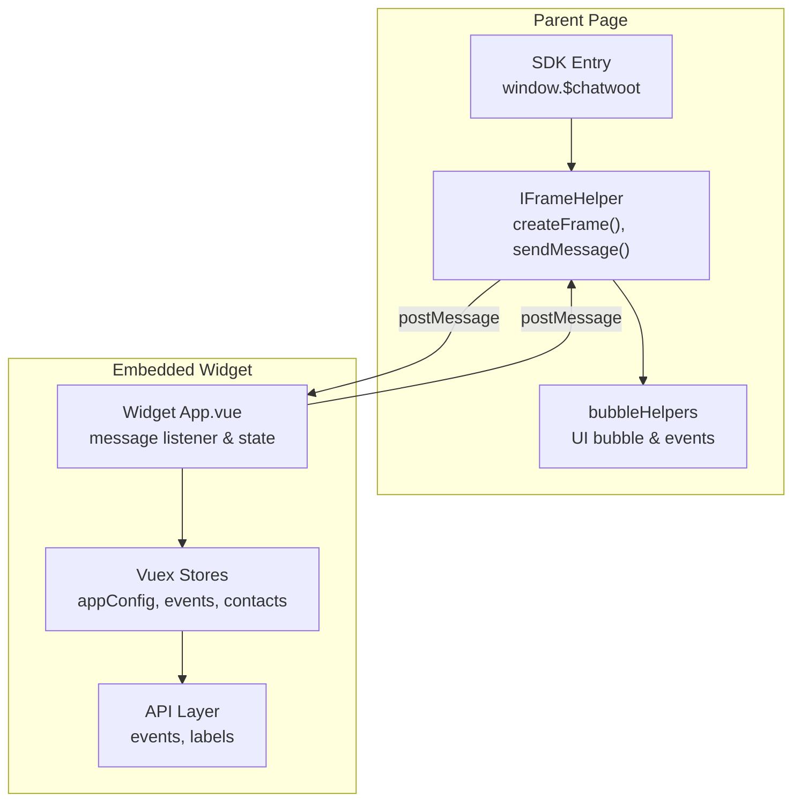
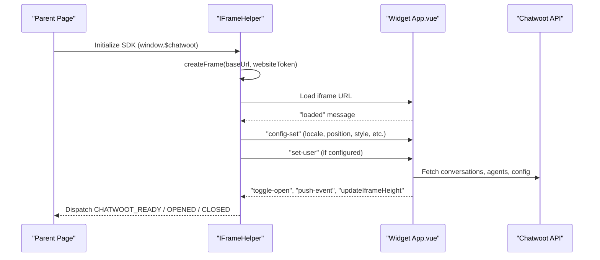
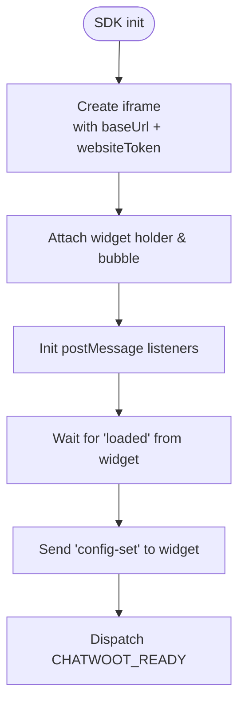
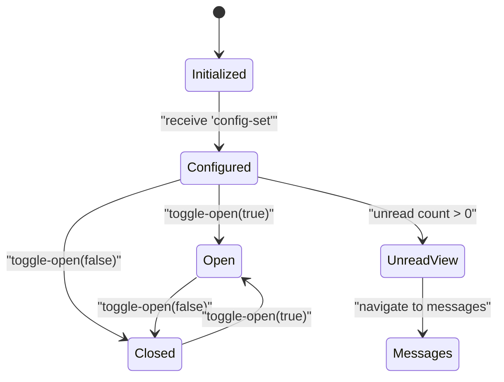
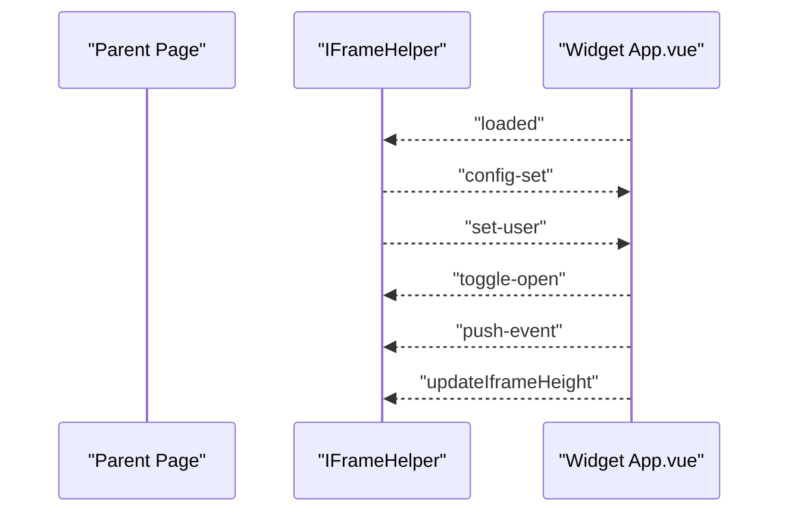
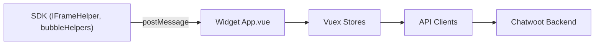

# Widget SDK Architecture

<cite>
**Referenced Files in This Document**
- [IFrameHelper.js](file://app/javascript/sdk/IFrameHelper.js)
- [bubbleHelpers.js](file://app/javascript/sdk/bubbleHelpers.js)
- [App.vue](file://app/javascript/widget/App.vue)
- [sdkEvents.js](file://app/javascript/widget/constants/sdkEvents.js)
- [events.js](file://app/javascript/widget/api/events.js)
- [events store module](file://app/javascript/widget/store/modules/events.js)
- [appConfig store module](file://app/javascript/widget/store/modules/appConfig.js)
- [conversationLabels API](file://app/javascript/widget/api/conversationLabels.js)
</cite>

## Table of Contents
1. [Introduction](#introduction)
2. [Project Structure](#project-structure)
3. [Core Components](#core-components)
4. [Architecture Overview](#architecture-overview)
5. [Detailed Component Analysis](#detailed-component-analysis)
6. [Dependency Analysis](#dependency-analysis)
7. [Performance Considerations](#performance-considerations)
8. [Troubleshooting Guide](#troubleshooting-guide)
9. [Conclusion](#conclusion)

## Introduction
This document explains the architecture of Chatwoot’s Widget SDK used to embed a customer support chat into external web applications. It covers initialization, configuration, event handling, lifecycle management, communication between the parent page and the embedded widget, security considerations, public API surface for programmatic control, customization options, integration examples, troubleshooting, and performance optimization techniques.

## Project Structure
The Widget SDK is composed of two main parts:
- Parent-side SDK (in app/javascript/sdk): injects an iframe, manages the bubble UI, and handles postMessage-based communication with the embedded widget.
- Embedded widget application (in app/javascript/widget): a Vue application that renders the chat UI, processes messages, and responds to SDK commands via postMessage.

**Diagram sources**
- [IFrameHelper.js:52-90](file://app/javascript/sdk/IFrameHelper.js#L52-L90)
- [bubbleHelpers.js:64-102](file://app/javascript/sdk/bubbleHelpers.js#L64-L102)
- [App.vue:92-113](file://app/javascript/widget/App.vue#L92-L113)

**Section sources**
- [IFrameHelper.js:52-90](file://app/javascript/sdk/IFrameHelper.js#L52-L90)
- [bubbleHelpers.js:64-102](file://app/javascript/sdk/bubbleHelpers.js#L64-L102)
- [App.vue:92-113](file://app/javascript/widget/App.vue#L92-L113)

## Core Components
- Parent SDK entry and global API: Exposes window.$chatwoot methods for initialization, user identification, toggling visibility, and controlling behavior.
- IFrameHelper: Creates and manages the iframe, sets up postMessage listeners, updates height, and coordinates bubble UI.
- bubbleHelpers: Builds the floating bubble UI, handles open/close interactions, and dispatches SDK events.
- Widget App.vue: The embedded Vue app that listens to messages from the parent, applies configuration, manages routes/views, and emits events back to the parent.
- Eventing layer: Captures widget events and posts them to the backend via the widget events API.

Key responsibilities:
- Initialization and configuration propagation from parent to widget.
- Bidirectional messaging using postMessage.
- Lifecycle hooks for ready/opened/closed/error states.
- User identity and custom attributes synchronization.
- Appearance and behavior customization.

**Section sources**
- [IFrameHelper.js:52-90](file://app/javascript/sdk/IFrameHelper.js#L52-L90)
- [bubbleHelpers.js:64-102](file://app/javascript/sdk/bubbleHelpers.js#L64-L102)
- [App.vue:92-113](file://app/javascript/widget/App.vue#L92-L113)
- [events.js](file://app/javascript/widget/api/events.js)
- [events store module](file://app/javascript/widget/store/modules/events.js)

## Architecture Overview
The SDK uses an iframe-based architecture where the parent page hosts a lightweight controller (IFrameHelper + bubbleHelpers) and the embedded widget runs inside the iframe as a full-featured Vue application. Communication occurs exclusively through postMessage.

**Diagram sources**
- [IFrameHelper.js:52-90](file://app/javascript/sdk/IFrameHelper.js#L52-L90)
- [IFrameHelper.js:154-194](file://app/javascript/sdk/IFrameHelper.js#L154-L194)
- [App.vue:92-113](file://app/javascript/widget/App.vue#L92-L113)
- [App.vue:270-356](file://app/javascript/widget/App.vue#L270-L356)

## Detailed Component Analysis

### SDK Initialization and Configuration
- The SDK creates an iframe pointing to the widget endpoint with a website token and optional conversation cookie.
- It loads shared CSS, attaches the widget holder, and initializes postMessage communication.
- On widget load, the SDK sends a comprehensive configuration payload including locale, position, bubble visibility, popout button, style, dark mode, unread dialog preference, welcome text, availability messages, and feature flags.

**Diagram sources**
- [IFrameHelper.js:52-90](file://app/javascript/sdk/IFrameHelper.js#L52-L90)
- [IFrameHelper.js:154-194](file://app/javascript/sdk/IFrameHelper.js#L154-L194)

**Section sources**
- [IFrameHelper.js:52-90](file://app/javascript/sdk/IFrameHelper.js#L52-L90)
- [IFrameHelper.js:154-194](file://app/javascript/sdk/IFrameHelper.js#L154-L194)

### Widget Lifecycle and State Management
- The embedded widget detects whether it is running inside an iframe or directly. In iframe mode, it registers message listeners, sends a loaded event, and applies configuration.
- It manages routes for home, messages, unread view, and campaigns, and synchronizes UI state (open/close, unread notifications).
- It exposes actions to update app configuration, handle locale changes, color schemes, and toggle widget visibility.

**Diagram sources**
- [App.vue:92-113](file://app/javascript/widget/App.vue#L92-L113)
- [App.vue:270-356](file://app/javascript/widget/App.vue#L270-L356)

**Section sources**
- [App.vue:92-113](file://app/javascript/widget/App.vue#L92-L113)
- [App.vue:270-356](file://app/javascript/widget/App.vue#L270-L356)

### Communication Protocols (postMessage)
- Parent-to-widget messages include:
  - config-set: initial configuration
  - set-user: user identity
  - set-custom-attributes / delete-custom-attribute: attribute updates
  - set-conversation-custom-attributes / delete-conversation-custom-attribute: per-conversation attributes
  - set-label / remove-label: label management
  - toggle-open: open/close widget
  - change-url: referrer info updates
  - push-event: emit widget events
  - set-color-scheme: theme switching
  - updateIframeHeight: resize iframe content
  - setUnreadMode / resetUnreadMode: unread view controls
  - handleNotificationDot: notification dot sync
- Widget-to-parent messages include:
  - loaded: widget ready
  - toggle-open: widget open/close state
  - push-event: event emission
  - updateIframeHeight: requested height
  - setUnreadMode / resetUnreadMode: unread view state
  - handleNotificationDot: unread count updates

**Diagram sources**
- [IFrameHelper.js:100-113](file://app/javascript/sdk/IFrameHelper.js#L100-L113)
- [IFrameHelper.js:154-194](file://app/javascript/sdk/IFrameHelper.js#L154-L194)
- [App.vue:270-356](file://app/javascript/widget/App.vue#L270-L356)

**Section sources**
- [IFrameHelper.js:100-113](file://app/javascript/sdk/IFrameHelper.js#L100-L113)
- [IFrameHelper.js:154-194](file://app/javascript/sdk/IFrameHelper.js#L154-L194)
- [App.vue:270-356](file://app/javascript/widget/App.vue#L270-L356)

### Public API Surface (Programmatic Control)
The SDK exposes a global API on window.$chatwoot. Based on the implementation patterns, the following capabilities are available:
- Initialization and lifecycle:
  - initialize: start the SDK with base URL and website token
  - toggle: open/close the widget
  - toggleBubbleVisibility: show/hide the bubble
- User identity:
  - setUser(identifier, userData): identify the current user
  - setCustomAttributes(attributes): set custom attributes
  - deleteCustomAttribute(key): remove a custom attribute
- Messaging and events:
  - track(eventName): send a widget event
  - on(event, handler): listen to SDK events like ready, opened, closed, error, postback
- Appearance and behavior:
  - setColorScheme(theme): switch light/dark mode
  - setLocale(locale): change language
  - setBubbleLabel(label): update bubble label

Note: For exact method signatures and parameters, refer to the SDK entrypoint implementation and the helper functions invoked by these methods.

**Section sources**
- [IFrameHelper.js:154-194](file://app/javascript/sdk/IFrameHelper.js#L154-L194)
- [bubbleHelpers.js:74-102](file://app/javascript/sdk/bubbleHelpers.js#L74-L102)

### Customization Options
Appearance:
- Position: left/right placement of the bubble
- Style: rounded or flat design
- Dark mode: light/dark theme
- Welcome title and description
- Available/unavailable messages
- Hide message bubble flag
- Popout button visibility

Behavior:
- Show unread messages dialog
- Enable file upload
- Enable emoji picker
- Allow ending conversations
- Locale/language selection

These options are propagated via the config-set message and applied within the widget’s appConfig store.

**Section sources**
- [IFrameHelper.js:154-194](file://app/javascript/sdk/IFrameHelper.js#L154-L194)
- [appConfig store module:53-86](file://app/javascript/widget/store/modules/appConfig.js#L53-L86)

### Security Considerations
- postMessage origin validation: The widget validates incoming messages to ensure they originate from the expected SDK channel.
- Cookie-based session continuity: The SDK reads/writes a conversation cookie to maintain session context across pages.
- Error handling: Errors from the widget are dispatched to the parent with typed error identifiers; certain errors trigger cleanup (e.g., removing user cookies).
- Content Security Policy: The iframe allows specific features (camera, microphone, fullscreen, display-capture, picture-in-picture, clipboard-write) only when necessary.

Best practices:
- Always set a secure baseDomain for cookies if deploying across subdomains.
- Avoid exposing sensitive data in custom attributes.
- Validate and sanitize any data passed via setUser or custom attributes.

**Section sources**
- [IFrameHelper.js:100-113](file://app/javascript/sdk/IFrameHelper.js#L100-L113)
- [IFrameHelper.js:195-201](file://app/javascript/sdk/IFrameHelper.js#L195-L201)
- [IFrameHelper.js:39-50](file://app/javascript/sdk/IFrameHelper.js#L39-L50)

### Practical Integration Examples
- Vanilla JavaScript:
  - Include the SDK script tag provided by your Chatwoot installation.
  - Call window.$chatwoot.initialize({ baseUrl, websiteToken }).
  - Optionally call window.$chatwoot.setUser and window.$chatwoot.setCustomAttributes before opening the widget.
- React:
  - Initialize the SDK in a useEffect hook on mount.
  - Use a component-level effect to call setUser when authentication state changes.
  - Trigger window.$chatwoot.toggle() from a button click.
- Vue:
  - Initialize the SDK in mounted() and clean up in unmounted().
  - Update user identity via setUser when router guards resolve authenticated users.
- Next.js / Nuxt:
  - Initialize the SDK in a layout component to ensure it runs once per page transition.
  - Use getServerSideProps or middleware to pass websiteToken securely.

[No sources needed since this section provides general guidance]

## Dependency Analysis
The SDK and widget have clear separation of concerns:
- Parent SDK depends on DOM helpers, bubble helpers, and cookie utilities.
- Widget app depends on Vuex stores, API clients, and i18n.
- Communication is strictly via postMessage, minimizing coupling.

**Diagram sources**
- [IFrameHelper.js:52-90](file://app/javascript/sdk/IFrameHelper.js#L52-L90)
- [App.vue:92-113](file://app/javascript/widget/App.vue#L92-L113)

**Section sources**
- [IFrameHelper.js:52-90](file://app/javascript/sdk/IFrameHelper.js#L52-L90)
- [App.vue:92-113](file://app/javascript/widget/App.vue#L92-L113)

## Performance Considerations
- Lazy loading: Defer SDK initialization until the user is likely to engage (e.g., after scroll depth or time threshold).
- Minimize postMessage traffic: Batch configuration updates and avoid frequent small messages.
- Optimize iframe resizing: Use fixed-height mode for static views to reduce reflows.
- Debounce route changes: When tracking referrer changes, debounce to prevent excessive API calls.
- Asset caching: Ensure the widget assets are cached via CDN and service worker strategies.

[No sources needed since this section provides general guidance]

## Troubleshooting Guide
Common issues and resolutions:
- Widget not appearing:
  - Verify baseUrl and websiteToken are correct.
  - Check that the SDK script is included and initialized before use.
- Bubble not visible:
  - Ensure hideMessageBubble is not set to true.
  - Confirm bubble styles are not overridden by host CSS.
- User not identified:
  - Call setUser before opening the widget.
  - Check for SET_USER_ERROR and ensure cookies are properly set.
- Events not firing:
  - Ensure you subscribe to CHATWOOT_READY before calling methods that depend on it.
  - Verify push-event messages are being sent from the widget.
- Height misalignment:
  - Listen for updateIframeHeight and adjust container size accordingly.
- Theme mismatch:
  - Use setColorScheme to align with the host application’s theme.

Operational tips:
- Use CHATWOOT_OPENED and CHATWOOT_CLOSED to track user engagement.
- Log CHATWOOT_ERROR payloads to diagnose initialization or identity issues.
- Inspect postMessage traffic in browser dev tools to validate communication flow.

**Section sources**
- [sdkEvents.js:1-8](file://app/javascript/widget/constants/sdkEvents.js#L1-L8)
- [IFrameHelper.js:195-201](file://app/javascript/sdk/IFrameHelper.js#L195-L201)
- [IFrameHelper.js:258-284](file://app/javascript/sdk/IFrameHelper.js#L258-L284)

## Conclusion
Chatwoot’s Widget SDK provides a robust, iframe-based mechanism to embed customer support into external applications. It offers a clear initialization path, extensive configuration options, a well-defined event system, and strong security practices. By leveraging the documented API and best practices, integrators can deliver a seamless, customizable, and performant support experience across diverse web frameworks and platforms.