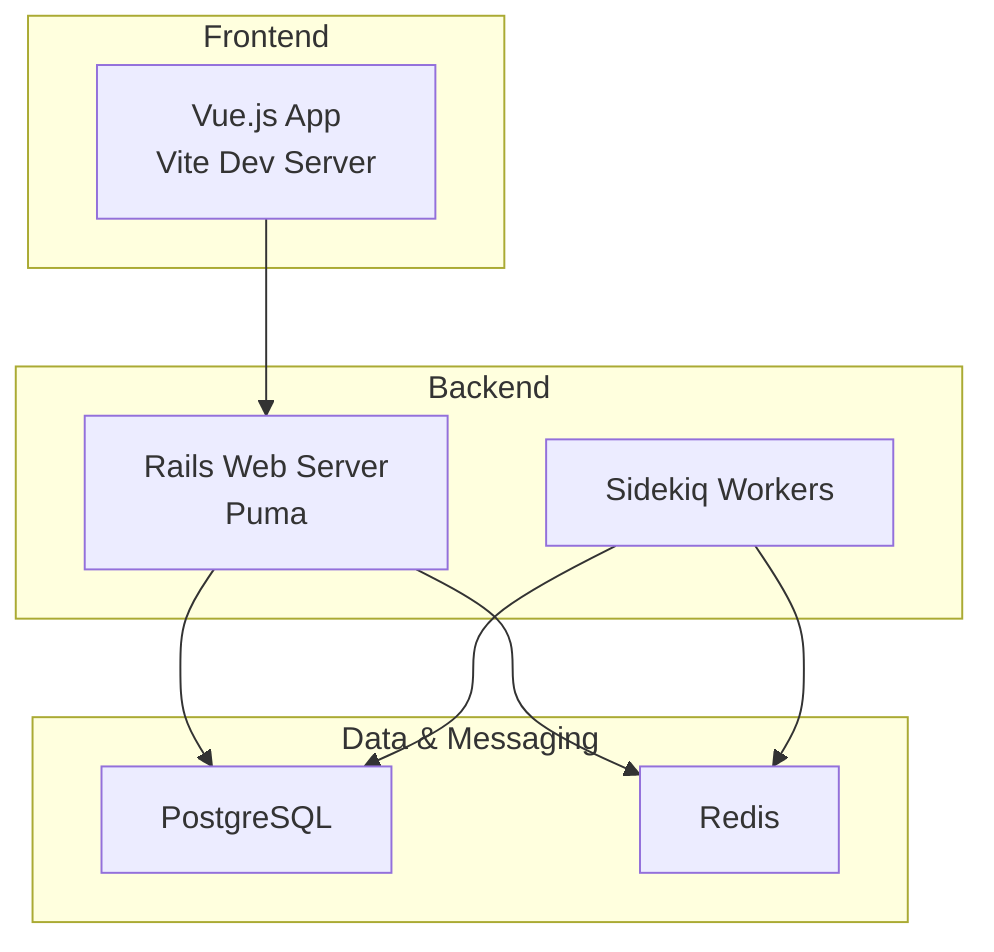
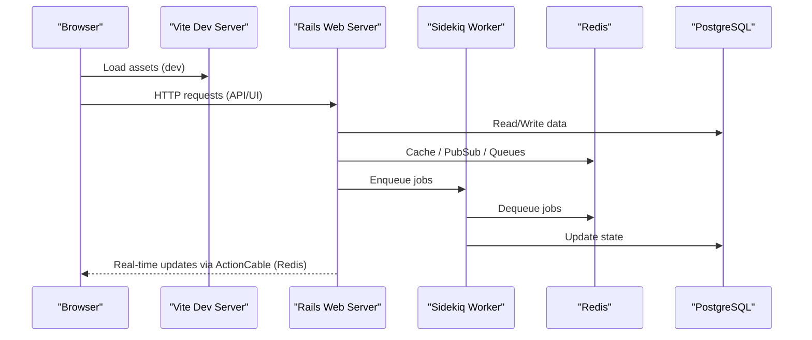
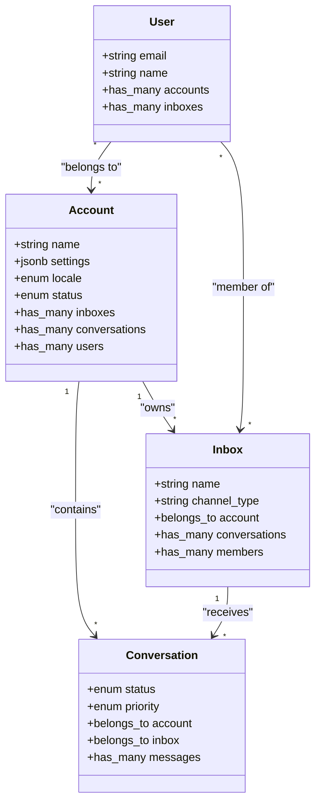
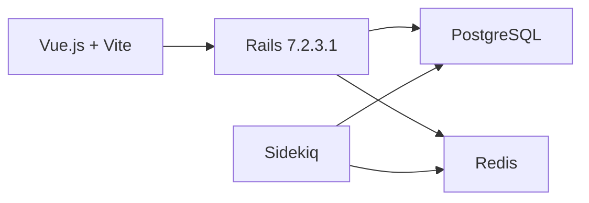

# Getting Started

<cite>
**Referenced Files in This Document**
- [README.md](file://README.md)
- [docker-compose.yaml](file://docker-compose.yaml)
- [Gemfile](file://Gemfile)
- [package.json](file://package.json)
- [config/database.yml](file://config/database.yml)
- [config/cable.yml](file://config/cable.yml)
- [config/application.rb](file://config/application.rb)
- [app/models/account.rb](file://app/models/account.rb)
- [app/models/inbox.rb](file://app/models/inbox.rb)
- [app/models/conversation.rb](file://app/models/conversation.rb)
- [app/models/user.rb](file://app/models/user.rb)
</cite>

## Table of Contents
1. [Introduction](#introduction)
2. [Project Structure](#project-structure)
3. [Core Components](#core-components)
4. [Architecture Overview](#architecture-overview)
5. [Detailed Component Analysis](#detailed-component-analysis)
6. [Dependency Analysis](#dependency-analysis)
7. [Performance Considerations](#performance-considerations)
8. [Troubleshooting Guide](#troubleshooting-guide)
9. [Conclusion](#conclusion)

## Introduction
Chatwoot is a modern, open-source, self-hosted customer support platform that centralizes omnichannel conversations (web chat, email, social channels, messaging apps) into a single dashboard. It includes AI-powered automation to help automate responses and reduce agent workload. The platform provides a Help Center portal, collaboration tools, integrations, and reporting capabilities.

Key highlights:
- Omnichannel support desk with live chat, email, Facebook, Instagram, Twitter, WhatsApp, Telegram, Line, SMS, and more.
- AI agent “Captain” for automated responses and common query handling.
- Help center portal for publishing articles and FAQs.
- Real-time communication via ActionCable backed by Redis.
- Full-stack architecture: Vue.js frontend, Rails backend, PostgreSQL database, and Redis for caching/queues/websockets.

For more details, see the project’s README.

**Section sources**
- [README.md:6-49](file://README.md#L6-L49)

## Project Structure
At a high level, Chatwoot consists of:
- Backend: Ruby on Rails application with controllers, models, services, jobs, and configuration files under app/, config/, lib/.
- Frontend: Vue.js application built with Vite, integrated via vite_rails.
- Infrastructure: Docker Compose defines services for Rails, Sidekiq, Vite dev server, PostgreSQL, Redis, and Mailhog.

**Diagram sources**
- [docker-compose.yaml:18-83](file://docker-compose.yaml#L18-L83)
- [docker-compose.yaml:85-105](file://docker-compose.yaml#L85-L105)

**Section sources**
- [docker-compose.yaml:1-120](file://docker-compose.yaml#L1-L120)

## Core Components
This section introduces core concepts you will use when setting up and operating Chatwoot:
- Account: Represents your organization or tenant; contains settings, limits, and relationships to inboxes, contacts, conversations, etc.
- Inbox: A channel endpoint (email, web widget, social, messaging) where conversations are received.
- Conversation: A thread between a contact and your team within an inbox.
- User: An agent or administrator who manages accounts, inboxes, and conversations.

These entities are modeled as Rails ActiveRecord classes and form the backbone of the support workflow.

**Section sources**
- [app/models/account.rb:26-110](file://app/models/account.rb#L26-L110)
- [app/models/inbox.rb:42-80](file://app/models/inbox.rb#L42-L80)
- [app/models/conversation.rb:57-134](file://app/models/conversation.rb#L57-L134)
- [app/models/user.rb:48-118](file://app/models/user.rb#L48-L118)

## Architecture Overview
Chatwoot runs as a full-stack application:
- Frontend: Vue.js UI served by Rails with Vite integration for development and builds.
- Backend: Rails API and views, with Puma as the web server.
- Background Jobs: Sidekiq processes background tasks using Redis as the queue store.
- Real-time: ActionCable uses Redis for pub/sub to deliver real-time updates.
- Database: PostgreSQL stores all persistent data.

**Diagram sources**
- [docker-compose.yaml:18-83](file://docker-compose.yaml#L18-L83)
- [config/cable.yml:1-9](file://config/cable.yml#L1-L9)
- [config/database.yml:1-14](file://config/database.yml#L1-L14)

## Detailed Component Analysis

### Installation Requirements
- Ruby on Rails: Rails 7.2.3.1 is used by the project.
- Ruby version: 3.4.4 is specified in the Gemfile.
- Node.js: Required for frontend tooling; engines specify Node 24.x and pnpm 10.x.
- PostgreSQL: Used as the primary database.
- Redis: Used for caching, queues, and ActionCable.

Environment variables commonly used:
- POSTGRES_HOST, POSTGRES_PORT, POSTGRES_DATABASE, POSTGRES_USERNAME, POSTGRES_PASSWORD
- REDIS_URL, REDIS_PASSWORD
- FRONTEND_URL (used by some components)

**Section sources**
- [Gemfile:3-8](file://Gemfile#L3-L8)
- [package.json:153-156](file://package.json#L153-L156)
- [config/database.yml:1-19](file://config/database.yml#L1-L19)
- [config/cable.yml:1-9](file://config/cable.yml#L1-L9)

### Setup Using Docker Compose (Recommended)
Docker Compose provides a ready-to-run environment with Rails, Sidekiq, Vite, PostgreSQL, Redis, and Mailhog.

Steps:
1. Ensure Docker and Docker Compose are installed.
2. Clone the repository and navigate to the root directory.
3. Create a .env file with required variables (e.g., REDIS_URL, REDIS_PASSWORD, POSTGRES_*).
4. Start services: docker compose up --build
5. Access the app at http://localhost:3000.

Notes:
- The Rails service exposes port 3000.
- Vite dev server is exposed on port 3036 during development.
- PostgreSQL is exposed on port 5432 and Redis on 6379 for local access if needed.

**Section sources**
- [docker-compose.yaml:18-83](file://docker-compose.yaml#L18-L83)
- [docker-compose.yaml:85-105](file://docker-compose.yaml#L85-L105)

### Manual Installation
If you prefer not to use Docker:
1. Install Ruby 3.4.4 and Node.js 24.x (or compatible versions per engines).
2. Install dependencies:
   - Ruby: bundle install
   - Frontend: pnpm install
3. Configure environment variables:
   - Database: set POSTGRES_HOST, POSTGRES_PORT, POSTGRES_DATABASE, POSTGRES_USERNAME, POSTGRES_PASSWORD
   - Redis: set REDIS_URL and optionally REDIS_PASSWORD
4. Set up the database:
   - rails db:create
   - rails db:migrate
5. Seed initial data (if applicable):
   - rails db:seed
6. Start services:
   - Web server: rails server -p 3000
   - Background jobs: sidekiq -C config/sidekiq.yml
   - Frontend dev server: bin/vite dev (for development)

**Section sources**
- [Gemfile:3-8](file://Gemfile#L3-L8)
- [package.json:153-156](file://package.json#L153-L156)
- [config/database.yml:15-19](file://config/database.yml#L15-L19)
- [config/cable.yml:1-9](file://config/cable.yml#L1-L9)

### Initial Configuration Steps
- Environment variables:
  - Database: POSTGRES_HOST, POSTGRES_PORT, POSTGRES_DATABASE, POSTGRES_USERNAME, POSTGRES_PASSWORD
  - Redis: REDIS_URL, REDIS_PASSWORD
  - Frontend URL: FRONTEND_URL (used by some features like CSAT links)
- Application initialization:
  - Dotenv loads environment variables early in boot.
  - Optional APMs (Datadog, Elastic APM, Scout, New Relic, Sentry) can be enabled via environment variables.
- Encryption (MFA/2FA):
  - If ACTIVE_RECORD_ENCRYPTION_PRIMARY_KEY and related keys are present, encryption is configured and MFA can be enforced.

**Section sources**
- [config/application.rb:11-28](file://config/application.rb#L11-L28)
- [config/application.rb:73-85](file://config/application.rb#L73-L85)
- [config/database.yml:1-19](file://config/database.yml#L1-L19)
- [config/cable.yml:1-9](file://config/cable.yml#L1-L9)

### Database Setup
- Adapter: PostgreSQL
- Pool size and timeouts are configurable via environment variables.
- Development/test/production databases are defined with environment-specific defaults.

Common tasks:
- rails db:create
- rails db:migrate
- rails db:seed (if provided)

**Section sources**
- [config/database.yml:1-19](file://config/database.yml#L1-L19)

### First Deployment Guidance
- Use Docker Compose for quick local deployment.
- For production, ensure:
  - Proper environment variables for DB, Redis, and optional APMs.
  - Reverse proxy (e.g., Nginx) in front of Puma.
  - Sidekiq running as a separate process.
  - Static assets precompiled if not using Vite dev server.
- Refer to the README for additional deployment options (Heroku, DigitalOcean).

**Section sources**
- [README.md:101-122](file://README.md#L101-L122)

### Basic Concepts
- Account: Your organization or tenant; holds settings, limits, and relationships to inboxes, contacts, conversations, teams, etc.
- Inbox: A channel endpoint (email, web widget, social, messaging) where conversations are received.
- Conversation: A thread between a contact and your team within an inbox; supports status, priority, assignment, and labels.
- User: An agent or administrator who manages accounts, inboxes, and conversations; supports roles and permissions.

**Diagram sources**
- [app/models/account.rb:26-110](file://app/models/account.rb#L26-L110)
- [app/models/inbox.rb:42-80](file://app/models/inbox.rb#L42-L80)
- [app/models/conversation.rb:57-134](file://app/models/conversation.rb#L57-L134)
- [app/models/user.rb:48-118](file://app/models/user.rb#L48-L118)

**Section sources**
- [app/models/account.rb:26-110](file://app/models/account.rb#L26-L110)
- [app/models/inbox.rb:42-80](file://app/models/inbox.rb#L42-L80)
- [app/models/conversation.rb:57-134](file://app/models/conversation.rb#L57-L134)
- [app/models/user.rb:48-118](file://app/models/user.rb#L48-L118)

## Dependency Analysis
The system relies on several key dependencies:
- Rails 7.2.3.1 and Ruby 3.4.4 for the backend.
- Vue.js and Vite for the frontend.
- PostgreSQL for persistence.
- Redis for caching, queues, and real-time communication.

**Diagram sources**
- [Gemfile:3-8](file://Gemfile#L3-L8)
- [package.json:153-156](file://package.json#L153-L156)
- [config/database.yml:1-14](file://config/database.yml#L1-L14)
- [config/cable.yml:1-9](file://config/cable.yml#L1-L9)

**Section sources**
- [Gemfile:3-8](file://Gemfile#L3-L8)
- [package.json:153-156](file://package.json#L153-L156)
- [config/database.yml:1-14](file://config/database.yml#L1-L14)
- [config/cable.yml:1-9](file://config/cable.yml#L1-L9)

## Performance Considerations
- Database pool sizing: Adjust RAILS_MAX_THREADS and SIDEKIQ_CONCURRENCY based on workload.
- Statement timeout: Tune POSTGRES_STATEMENT_TIMEOUT to balance long-running queries and timeouts.
- Redis reconnection: ActionCable retries with exponential backoff to handle temporary Redis outages.
- Asset pipeline: In development, Vite dev server improves rebuild speed; in production, precompile assets for performance.

**Section sources**
- [config/database.yml:1-14](file://config/database.yml#L1-L14)
- [config/cable.yml:1-9](file://config/cable.yml#L1-L9)

## Troubleshooting Guide
Common setup issues and resolutions:
- Cannot connect to PostgreSQL:
  - Verify POSTGRES_HOST, POSTGRES_PORT, POSTGRES_DATABASE, POSTGRES_USERNAME, POSTGRES_PASSWORD.
  - Ensure the database exists and migrations have run.
- Redis connection errors:
  - Check REDIS_URL and REDIS_PASSWORD.
  - Confirm Redis is reachable and accepts connections on the configured host/port.
- ActionCable not delivering real-time updates:
  - Validate Redis connectivity and password.
  - Review reconnect attempts and SSL verify mode settings.
- Frontend asset loading issues:
  - Ensure Vite dev server is running and accessible.
  - Confirm NODE_ENV and RAILS_ENV are set correctly in development.

Additional checks:
- Application boot: Dotenv loads environment variables early; confirm they are present.
- Encryption/MFA: If enabling MFA, ensure encryption keys are configured.

**Section sources**
- [config/database.yml:1-19](file://config/database.yml#L1-L19)
- [config/cable.yml:1-9](file://config/cable.yml#L1-L9)
- [config/application.rb:11-28](file://config/application.rb#L11-L28)
- [config/application.rb:73-85](file://config/application.rb#L73-L85)

## Conclusion
You now have the essentials to get Chatwoot running locally or in production. Use Docker Compose for rapid setup, configure environment variables for PostgreSQL and Redis, and follow the manual installation steps if needed. Explore Accounts, Inboxes, Conversations, and Users to understand how support workflows operate. Leverage real-time features powered by Redis and extend functionality through integrations and AI automation.