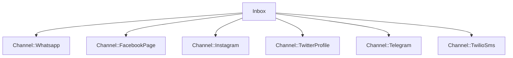
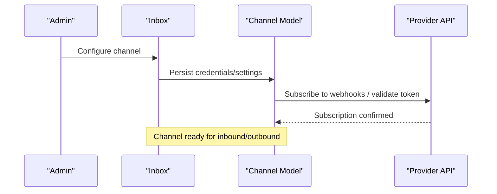
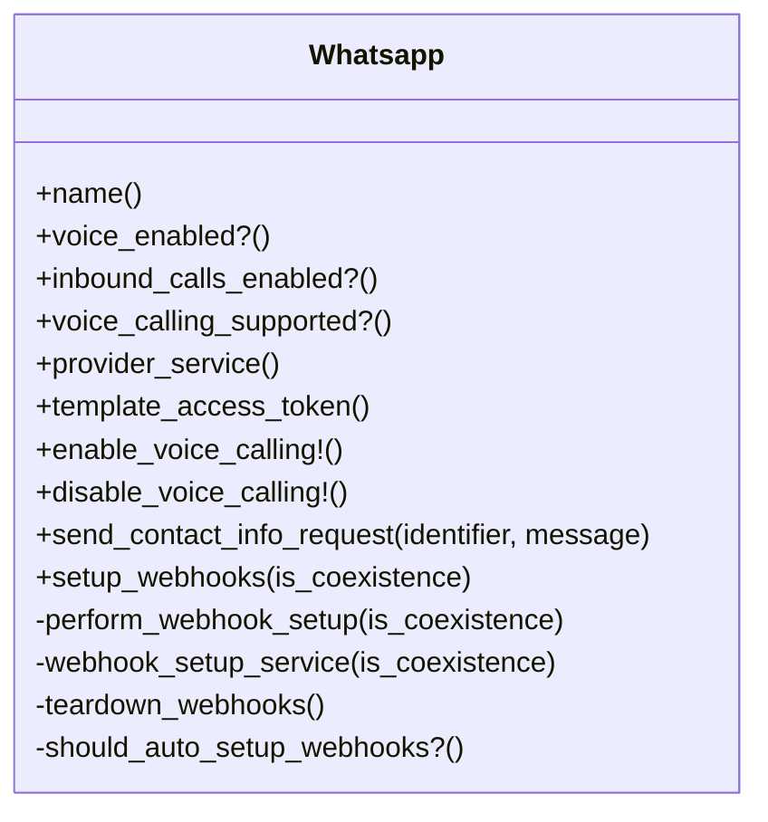
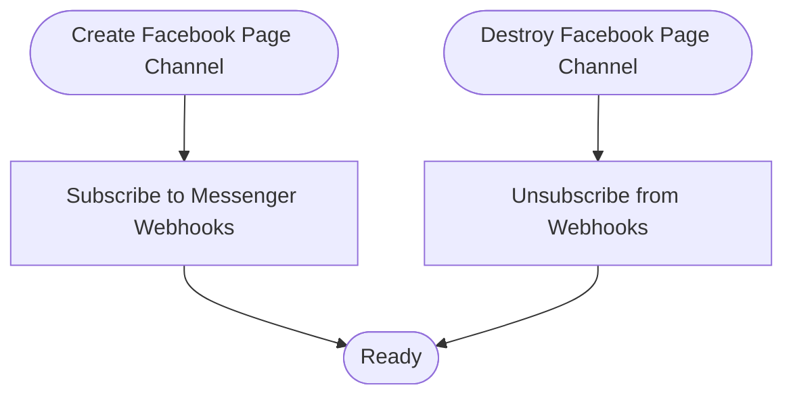
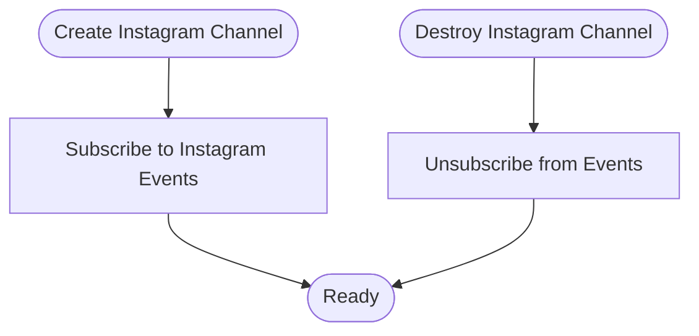
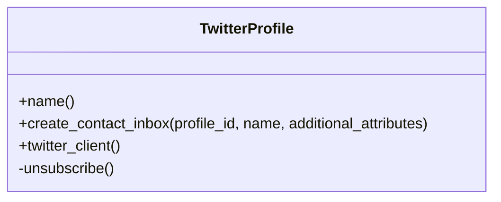
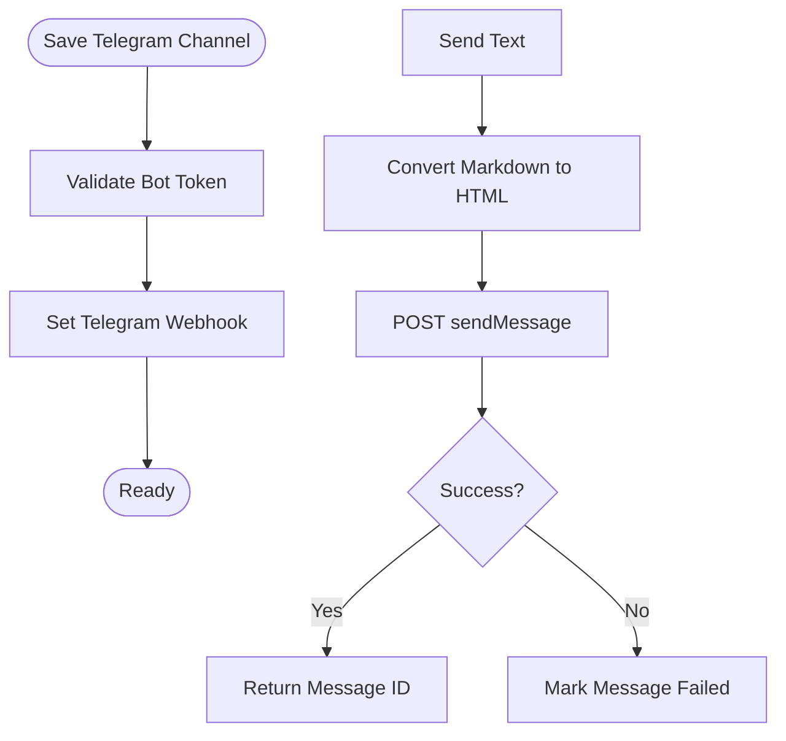
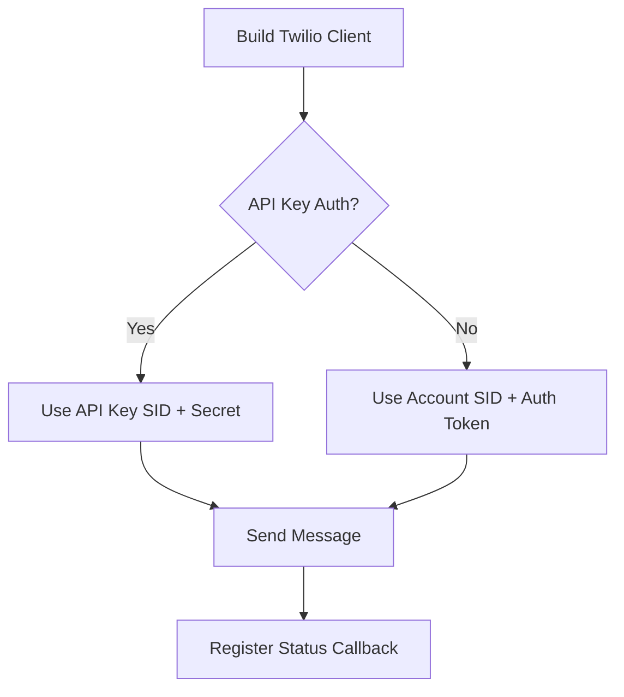
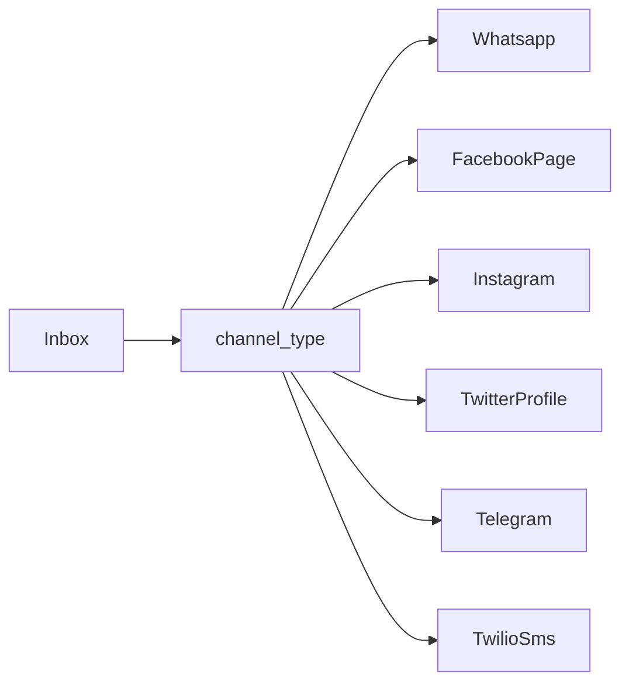

# Channel Integrations

<cite>
**Referenced Files in This Document**
- [inbox.rb](file://app/models/inbox.rb)
- [whatsapp.rb](file://app/models/channel/whatsapp.rb)
- [facebook_page.rb](file://app/models/channel/facebook_page.rb)
- [instagram.rb](file://app/models/channel/instagram.rb)
- [twitter_profile.rb](file://app/models/channel/twitter_profile.rb)
- [telegram.rb](file://app/models/channel/telegram.rb)
- [twilio_sms.rb](file://app/models/channel/twilio_sms.rb)
</cite>

## Table of Contents
1. [Introduction](#introduction)
2. [Project Structure](#project-structure)
3. [Core Components](#core-components)
4. [Architecture Overview](#architecture-overview)
5. [Detailed Component Analysis](#detailed-component-analysis)
6. [Dependency Analysis](#dependency-analysis)
7. [Performance Considerations](#performance-considerations)
8. [Troubleshooting Guide](#troubleshooting-guide)
9. [Conclusion](#conclusion)

## Introduction
This document explains Chatwoot’s channel integration system and how it unifies multiple communication platforms behind a consistent interface. It focuses on the channel abstraction layer, native integrations (WhatsApp Business API, Facebook Messenger, Instagram Direct Messages, Twitter DMs, Telegram bots, and SMS via Twilio), configuration and authentication flows, message formatting, error handling, media support, rate limiting/retry strategies, and monitoring for reliable delivery.

## Project Structure
Chatwoot models each platform as a polymorphic channel associated with an Inbox. The Inbox acts as the user-facing surface that routes messages to and from the underlying channel implementation. Each channel model encapsulates provider-specific configuration, webhook setup, token management, and outbound messaging helpers.

**Diagram sources**
- [inbox.rb:62-62](file://app/models/inbox.rb#L62-L62)
- [whatsapp.rb:25-29](file://app/models/channel/whatsapp.rb#L25-L29)
- [facebook_page.rb:20-30](file://app/models/channel/facebook_page.rb#L20-L30)
- [instagram.rb:17-20](file://app/models/channel/instagram.rb#L17-L20)
- [twitter_profile.rb:19-28](file://app/models/channel/twitter_profile.rb#L19-L28)
- [telegram.rb:17-23](file://app/models/channel/telegram.rb#L17-L23)
- [twilio_sms.rb:29-33](file://app/models/channel/twilio_sms.rb#L29-L33)

**Section sources**
- [inbox.rb:42-79](file://app/models/inbox.rb#L42-L79)

## Core Components
- Inbox: Central entity that owns a polymorphic channel and exposes type checks and callback URL generation for webhooks.
- Channel models: Platform-specific implementations that manage credentials, webhooks, and outbound operations.

Key responsibilities:
- Inbox provides routing, type detection, and webhook endpoint construction.
- Channel models implement provider-specific logic such as token refresh, webhook subscription, message sending, and error mapping.

**Section sources**
- [inbox.rb:122-172](file://app/models/inbox.rb#L122-L172)
- [inbox.rb:189-200](file://app/models/inbox.rb#L189-L200)

## Architecture Overview
The channel abstraction ensures a uniform experience across platforms:
- Configuration: Each channel stores provider credentials and settings. Some channels encrypt sensitive fields when encryption is configured.
- Authentication: Channels may perform token validation, refresh tokens, or subscribe to platform webhooks upon creation.
- Messaging: Outbound methods are delegated to provider services or direct HTTP calls; inbound events are routed through webhooks into Chatwoot.
- Error Handling: Provider errors are normalized and attached to messages for visibility and retry logic.

[No sources needed since this diagram shows conceptual workflow, not actual code structure]

## Detailed Component Analysis

### WhatsApp Business API
- Providers: Supports multiple providers (e.g., default/360Dialog and whatsapp_cloud). The model selects the appropriate provider service based on configuration.
- Credentials: Stores business management token and provider config; supports embedded signup vs manual setup migration.
- Webhooks: Automatic webhook registration/unregistration during lifecycle hooks; supports coexistence scenarios and voice calling subscriptions.
- Voice Calling: Conditional support for Meta Calling API depending on provider and feature flags; enables/disables calling status and re-registers webhooks accordingly.
- Templates: Syncs message templates and tracks last update time.
- Message Delegation: Delegates send_message, send_template, sync_templates, media_url, and api_headers to the selected provider service.

**Diagram sources**
- [whatsapp.rb:25-193](file://app/models/channel/whatsapp.rb#L25-L193)

Configuration and setup highlights:
- Provider selection and validation occur during model validation; invalid credentials trigger errors.
- Embedded signup to manual setup transitions are logged and handled without re-validating remote credentials unnecessarily.
- Webhook setup is idempotent and can be explicitly controlled by source types.

Error handling:
- Webhook setup failures prompt reauthorization and log errors.
- Voice enabling/disabling gracefully handles webhook re-subscription failures while preserving state consistency.

Media and rich content:
- Media URLs and headers are delegated to the provider service; template synchronization ensures available message templates.

Rate limiting and retries:
- Provider-specific behavior is encapsulated in provider services; ensure your deployment uses robust job queues and backoff policies for outbound sends.

Monitoring:
- Logs credential transfers and webhook setup outcomes; consider alerting on repeated webhook setup failures.

**Section sources**
- [whatsapp.rb:25-193](file://app/models/channel/whatsapp.rb#L25-L193)

### Facebook Messenger
- Credentials: Stores page access token and user access token; encrypted when configured.
- Webhooks: Subscribes to Messenger webhook events on create; unsubscribes on destroy.
- Contact Inboxes: Creates contact inboxes using a builder with source_id and inbox association.

**Diagram sources**
- [facebook_page.rb:20-69](file://app/models/channel/facebook_page.rb#L20-L69)

Configuration and setup:
- Ensure Facebook app permissions and webhook endpoints are configured externally; the model subscribes to required fields.

Error handling:
- Subscription/unsubscription errors are caught and logged; the operation returns true to avoid blocking lifecycle hooks.

**Section sources**
- [facebook_page.rb:20-69](file://app/models/channel/facebook_page.rb#L20-L69)

### Instagram Direct Messages
- Credentials: Stores Instagram access token and expiration; encrypted when configured.
- Webhooks: Subscribes to Instagram messaging events via Graph API; unsubscribes on destroy.
- Token Refresh: Access token retrieval delegates to a refresh service to handle expiration.

**Diagram sources**
- [instagram.rb:17-82](file://app/models/channel/instagram.rb#L17-L82)

Configuration and setup:
- Uses Graph API versioned base URI; ensure environment variables for API version are set appropriately.

Error handling:
- Subscription/unsubscription errors are caught and logged; operations return true to prevent lifecycle hook failures.

Token management:
- Access token is refreshed automatically via a dedicated service before use.

**Section sources**
- [instagram.rb:17-82](file://app/models/channel/instagram.rb#L17-L82)

### Twitter DMs
- Credentials: Stores Twitter access token and secret; encrypted when configured.
- Client: Builds a Twitter client instance with consumer keys/secrets and environment settings.
- Unsubscribe: Removes subscription on destroy using the Twitter client.

**Diagram sources**
- [twitter_profile.rb:19-69](file://app/models/channel/twitter_profile.rb#L19-L69)

Configuration and setup:
- Requires environment variables for consumer key/secret and environment; ensure these are set before creating the channel.

Error handling:
- Unsubscribe attempts are logged; errors are captured and do not block destruction.

**Section sources**
- [twitter_profile.rb:19-69](file://app/models/channel/twitter_profile.rb#L19-L69)

### Telegram Bots
- Credentials: Stores bot token; encrypted deterministically when configured.
- Webhooks: Sets and deletes Telegram webhook on save; validates bot token on create.
- Messaging: Sends text and attachments; converts markdown to Telegram HTML; supports inline keyboards for input_select content types.
- Error Mapping: Normalizes provider error responses and marks messages as failed with external_error details.

**Diagram sources**
- [telegram.rb:17-172](file://app/models/channel/telegram.rb#L17-L172)

Configuration and setup:
- Ensure FRONTEND_URL is configured so the webhook points to the correct endpoint.

Message formatting:
- Markdown is converted to sanitized HTML compatible with Telegram; paragraph breaks and line breaks are preserved.

Attachments:
- Attachments are sent via a dedicated service after text messages.

Error handling:
- Provider errors are parsed and attached to messages; status is updated to failed.

**Section sources**
- [telegram.rb:17-172](file://app/models/channel/telegram.rb#L17-L172)

### SMS via Twilio
- Credentials: Supports both legacy auth and newer API key-based auth; stores account SID, auth token, optional API key SID/secret, and messaging service SID or phone number.
- Medium: Enumerates SMS and WhatsApp modes within the same model.
- Messaging: Sends messages with optional media URLs and status callbacks; chooses sender based on messaging service SID or phone number.
- Callbacks: Uses a callback URL for delivery status updates.

**Diagram sources**
- [twilio_sms.rb:29-94](file://app/models/channel/twilio_sms.rb#L29-L94)

Configuration and setup:
- Either messaging_service_sid or phone_number must be present; messaging_service_sid takes precedence.

Message formatting and media:
- Media URLs are appended when present; body content is passed directly to Twilio.

Delivery tracking:
- Status callbacks are registered to track delivery outcomes.

Error handling:
- Errors from Twilio should be surfaced at higher layers; ensure job retries and dead-letter queues are configured.

**Section sources**
- [twilio_sms.rb:29-94](file://app/models/channel/twilio_sms.rb#L29-L94)

## Dependency Analysis
- Inbox depends on channel_type to determine capabilities and generate webhook URLs.
- Channel models depend on provider APIs and may delegate complex operations to services.
- Encryption is conditionally applied based on application configuration.

**Diagram sources**
- [inbox.rb:122-172](file://app/models/inbox.rb#L122-L172)

**Section sources**
- [inbox.rb:122-172](file://app/models/inbox.rb#L122-L172)

## Performance Considerations
- Webhook subscriptions: Minimize redundant subscription calls; leverage idempotent operations where possible.
- Token refresh: Batch token refreshes and cache results to reduce API calls.
- Message sending: Use background jobs with exponential backoff and circuit breakers for provider rate limits.
- Media handling: Stream large files and offload storage to object storage; avoid synchronous downloads in request paths.
- Database writes: Avoid unnecessary updates; use atomic operations and selective column updates.

[No sources needed since this section provides general guidance]

## Troubleshooting Guide
Common issues and resolutions:
- Webhook setup failures: Check provider credentials and network connectivity; verify FRONTEND_URL and route configurations.
- Token expiration: Ensure token refresh services are invoked; monitor authorization thresholds and reauthorization prompts.
- Message failures: Inspect external_error fields on messages; correlate with provider error codes and descriptions.
- Rate limiting: Implement retry with backoff; monitor provider quotas and adjust concurrency.

Operational tips:
- Enable logging for webhook setup and credential migrations.
- Alert on repeated reauthorization requirements.
- Monitor delivery status callbacks for SMS/MMS and platform-specific delivery events.

**Section sources**
- [whatsapp.rb:145-150](file://app/models/channel/whatsapp.rb#L145-L150)
- [telegram.rb:62-69](file://app/models/channel/telegram.rb#L62-L69)
- [instagram.rb:45-70](file://app/models/channel/instagram.rb#L45-L70)
- [facebook_page.rb:49-67](file://app/models/channel/facebook_page.rb#L49-L67)

## Conclusion
Chatwoot’s channel abstraction layer provides a unified interface for diverse communication platforms. By encapsulating provider-specific logic in channel models and leveraging Inbox for routing and webhook management, Chatwoot achieves consistent configuration, authentication, messaging, and error handling across WhatsApp, Facebook Messenger, Instagram DMs, Twitter DMs, Telegram, and Twilio SMS. Proper configuration, robust error handling, and operational monitoring ensure reliable message delivery and scalable multi-channel support.

[No sources needed since this section summarizes without analyzing specific files]