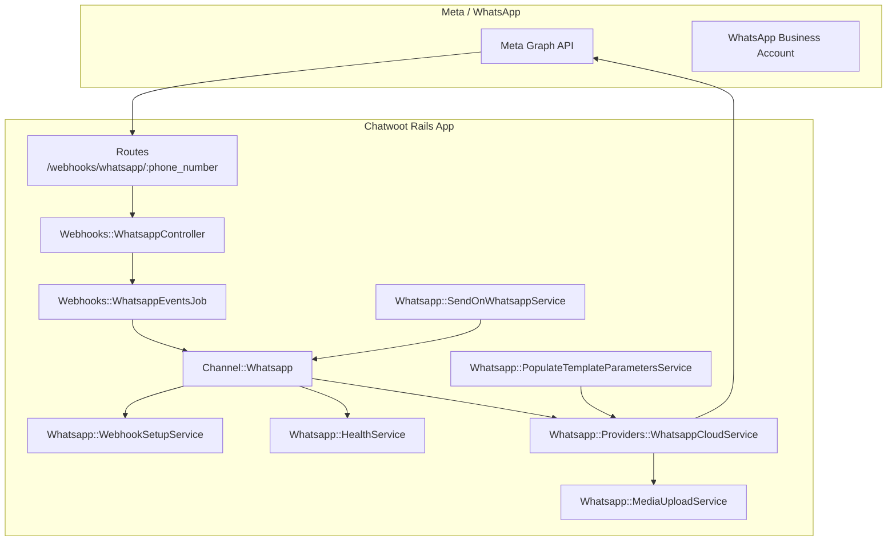
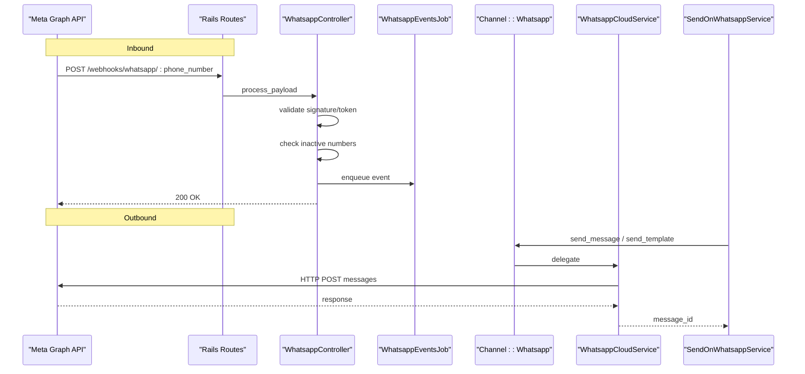
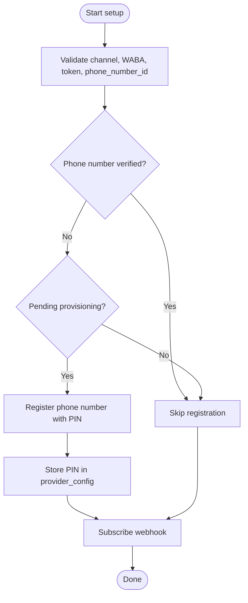
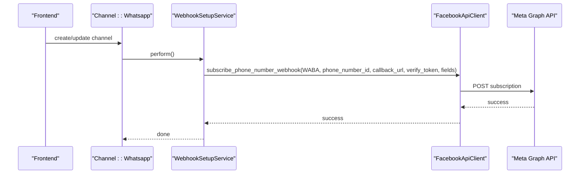
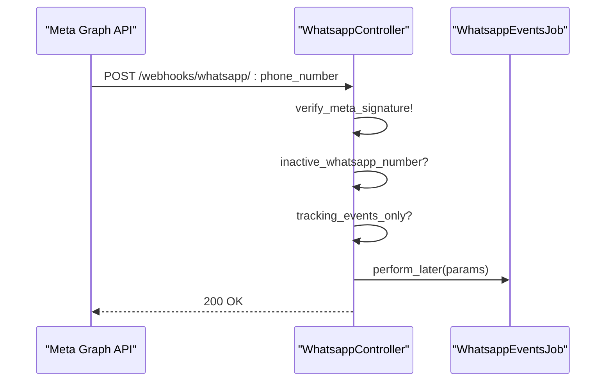
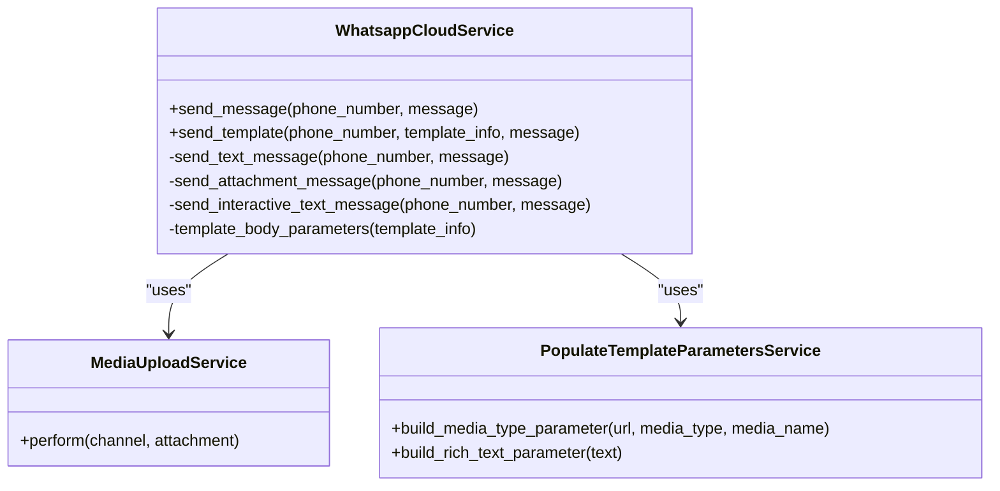
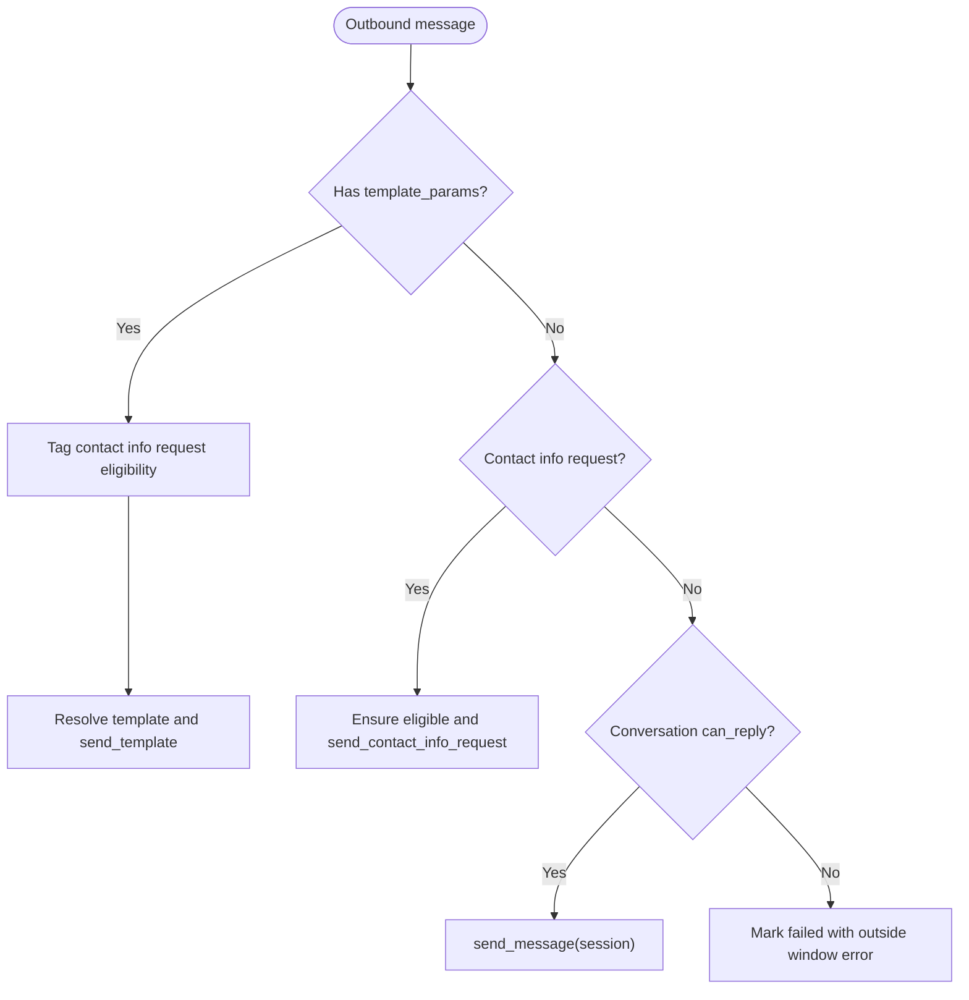
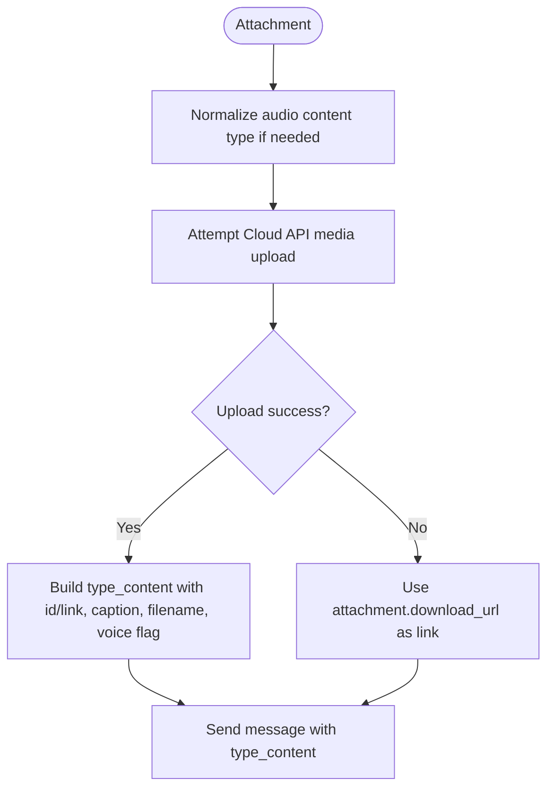
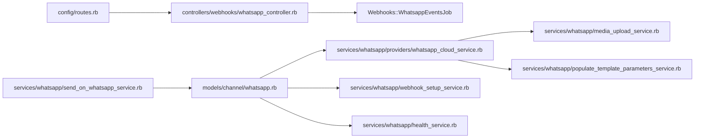

# WhatsApp Business API Integration

<cite>
**Referenced Files in This Document**
- [whatsapp_controller.rb](file://app/controllers/webhooks/whatsapp_controller.rb)
- [whatsapp_channel_model.rb](file://app/models/channel/whatsapp.rb)
- [whatsapp_cloud_service.rb](file://app/services/whatsapp/providers/whatsapp_cloud_service.rb)
- [send_on_whatsapp_service.rb](file://app/services/whatsapp/send_on_whatsapp_service.rb)
- [webhook_setup_service.rb](file://app/services/whatsapp/webhook_setup_service.rb)
- [health_service.rb](file://app/services/whatsapp/health_service.rb)
- [media_upload_service.rb](file://app/services/whatsapp/media_upload_service.rb)
- [populate_template_parameters_service.rb](file://app/services/whatsapp/populate_template_parameters_service.rb)
- [routes.rb](file://config/routes.rb)
- [inbox_model.rb](file://app/models/inbox.rb)
</cite>

## Table of Contents
1. [Introduction](#introduction)
2. [Project Structure](#project-structure)
3. [Core Components](#core-components)
4. [Architecture Overview](#architecture-overview)
5. [Detailed Component Analysis](#detailed-component-analysis)
6. [Dependency Analysis](#dependency-analysis)
7. [Performance Considerations](#performance-considerations)
8. [Troubleshooting Guide](#troubleshooting-guide)
9. [Conclusion](#conclusion)

## Introduction
This document explains how Chatwoot integrates with the WhatsApp Business API. It covers channel configuration, Meta Business Manager setup, phone number verification, message formatting (text, media, templates, interactive messages), webhook handling for incoming messages and delivery receipts, conversation session management, rate limiting, error handling, retry behavior, and monitoring delivery status. The guidance is grounded in Chatwoot’s WhatsApp implementation and points to specific source files for deeper inspection.

## Project Structure
The WhatsApp integration spans models, services, controllers, and routes:
- Channel model stores provider credentials, health state, and template metadata.
- Provider service implements Cloud API calls for text, media, templates, and interactive messages.
- Webhook controller receives inbound events from Meta and queues background processing.
- Webhook setup service registers phone numbers and subscribes webhooks.
- Health service inspects business account and phone number health.
- Template parameter service builds component payloads for approved templates.
- Routes define verify and payload endpoints.

**Diagram sources**
- [routes.rb:726-727](file://config/routes.rb#L726-L727)
- [whatsapp_controller.rb:1-76](file://app/controllers/webhooks/whatsapp_controller.rb#L1-L76)
- [whatsapp_channel_model.rb:25-190](file://app/models/channel/whatsapp.rb#L25-L190)
- [webhook_setup_service.rb:1-141](file://app/services/whatsapp/webhook_setup_service.rb#L1-L141)
- [health_service.rb:145-172](file://app/services/whatsapp/health_service.rb#L145-L172)
- [whatsapp_cloud_service.rb:1-262](file://app/services/whatsapp/providers/whatsapp_cloud_service.rb#L1-L262)
- [send_on_whatsapp_service.rb:1-80](file://app/services/whatsapp/send_on_whatsapp_service.rb#L1-L80)
- [populate_template_parameters_service.rb:89-135](file://app/services/whatsapp/populate_template_parameters_service.rb#L89-L135)
- [media_upload_service.rb](file://app/services/whatsapp/media_upload_service.rb)

**Section sources**
- [routes.rb:726-727](file://config/routes.rb#L726-L727)
- [whatsapp_controller.rb:1-76](file://app/controllers/webhooks/whatsapp_controller.rb#L1-L76)
- [whatsapp_channel_model.rb:25-190](file://app/models/channel/whatsapp.rb#L25-L190)

## Core Components
- Channel model: Stores provider type, credentials, phone number, health data, and template cache; delegates send operations to provider service; manages webhook lifecycle.
- Provider service: Implements Cloud API calls for sending text, attachments, templates, and interactive messages; handles reply context and content normalization.
- Send orchestrator: Chooses between contact info requests, template messages, or session messages based on conversation rules and message attributes.
- Webhook controller: Validates signatures/tokens, rejects inactive numbers, filters tracking-only events, and enqueues event processing.
- Webhook setup service: Registers phone numbers when needed, sets callback URL and verify token, and subscribes fields including optional call events.
- Health service: Reads business account and phone number health, including throughput level and messaging limits.
- Template parameter service: Builds component payloads for headers, body, buttons, and rich text.
- Media upload service: Uploads media via Cloud API and falls back to link-based attachment when upload fails.

**Section sources**
- [whatsapp_channel_model.rb:25-190](file://app/models/channel/whatsapp.rb#L25-L190)
- [whatsapp_cloud_service.rb:1-262](file://app/services/whatsapp/providers/whatsapp_cloud_service.rb#L1-L262)
- [send_on_whatsapp_service.rb:1-80](file://app/services/whatsapp/send_on_whatsapp_service.rb#L1-L80)
- [whatsapp_controller.rb:1-76](file://app/controllers/webhooks/whatsapp_controller.rb#L1-L76)
- [webhook_setup_service.rb:1-141](file://app/services/whatsapp/webhook_setup_service.rb#L1-L141)
- [health_service.rb:145-172](file://app/services/whatsapp/health_service.rb#L145-L172)
- [populate_template_parameters_service.rb:89-135](file://app/services/whatsapp/populate_template_parameters_service.rb#L89-L135)

## Architecture Overview
The integration follows a clear separation of concerns:
- Inbound path: Meta sends webhooks to Chatwoot’s endpoint; the controller validates and dispatches to a background job that processes messages and updates conversations.
- Outbound path: Chatwoot decides whether to send a session message, template, or interactive request; the provider service formats and posts to the Cloud API.
- Setup path: On creation or explicit finish flows, Chatwoot registers the phone number if required and subscribes webhooks with the correct fields.

**Diagram sources**
- [routes.rb:726-727](file://config/routes.rb#L726-L727)
- [whatsapp_controller.rb:6-17](file://app/controllers/webhooks/whatsapp_controller.rb#L6-L17)
- [send_on_whatsapp_service.rb:8-20](file://app/services/whatsapp/send_on_whatsapp_service.rb#L8-L20)
- [whatsapp_channel_model.rb:133-137](file://app/models/channel/whatsapp.rb#L133-L137)
- [whatsapp_cloud_service.rb:2-33](file://app/services/whatsapp/providers/whatsapp_cloud_service.rb#L2-L33)

## Detailed Component Analysis

### Channel Configuration and Meta Business Manager Setup
- Provider selection: The channel supports providers such as default and whatsapp_cloud. The provider determines which service handles API calls.
- Credentials: The channel stores an API key, business account ID, phone number ID, and optional embedded signup source marker. A secure business management token can be used in cloud environments.
- Webhook verify token: For Cloud provider, a random verify token is generated and persisted to validate Meta’s challenge.
- Voice calling: When enabled, the channel toggles calling at Meta and re-registers webhooks to include call events.

Key behaviors:
- After creation, templates are synced from Meta.
- Before destroy, webhooks are torn down.
- Auto webhook setup runs unless explicitly configured by embedded signup or manual setup v2 flows.

Operational notes:
- Use the inbox helper to compute the expected webhook URL.
- Health checks surface throughput levels and messaging limit tiers.

**Section sources**
- [whatsapp_channel_model.rb:25-190](file://app/models/channel/whatsapp.rb#L25-L190)
- [inbox_model.rb:198](file://app/models/inbox.rb#L198)
- [health_service.rb:145-172](file://app/services/whatsapp/health_service.rb#L145-L172)

### Phone Number Verification and Registration
- Verification detection: The setup service checks whether the phone number is verified or connected before registration.
- Registration flow: If not verified or pending provisioning (e.g., NOT_APPLICABLE throughput), it generates or retrieves a PIN and registers the number.
- Coexistence support: Numbers already connected or known to be on the business app skip redundant registration.
- Health-driven decisions: Health data informs whether registration is necessary.

**Diagram sources**
- [webhook_setup_service.rb:12-18](file://app/services/whatsapp/webhook_setup_service.rb#L12-L18)
- [webhook_setup_service.rb:33-56](file://app/services/whatsapp/webhook_setup_service.rb#L33-L56)
- [webhook_setup_service.rb:112-139](file://app/services/whatsapp/webhook_setup_service.rb#L112-L139)

**Section sources**
- [webhook_setup_service.rb:12-56](file://app/services/whatsapp/webhook_setup_service.rb#L12-L56)
- [webhook_setup_service.rb:112-139](file://app/services/whatsapp/webhook_setup_service.rb#L112-L139)

### Webhook Setup for Incoming Messages
- Callback URL: Built using FRONTEND_URL and the channel’s phone number.
- Verify token: Read from channel provider config for Cloud provider validation.
- Subscribed fields: Includes messages and echo events; adds calls when voice calling is enabled on any inbox sharing the same WABA.
- Signature verification: Optional for Cloud provider depending on app secrets and embedded signup source.

**Diagram sources**
- [webhook_setup_service.rb:73-82](file://app/services/whatsapp/webhook_setup_service.rb#L73-L82)
- [webhook_setup_service.rb:105-110](file://app/services/whatsapp/webhook_setup_service.rb#L105-L110)
- [whatsapp_channel_model.rb:145-150](file://app/models/channel/whatsapp.rb#L145-L150)

**Section sources**
- [webhook_setup_service.rb:73-110](file://app/services/whatsapp/webhook_setup_service.rb#L73-L110)
- [whatsapp_controller.rb:28-51](file://app/controllers/webhooks/whatsapp_controller.rb#L28-L51)

### Handling Incoming Messages and Delivery Receipts
- Controller entrypoint: Validates signature/token, rejects inactive numbers, ignores tracking-only events, and enqueues processing.
- Event routing: Background job consumes the payload and updates conversations accordingly.
- Tracking-only filtering: Events with field tracking_events are acknowledged without processing.

**Diagram sources**
- [whatsapp_controller.rb:4-17](file://app/controllers/webhooks/whatsapp_controller.rb#L4-L17)
- [whatsapp_controller.rb:21-26](file://app/controllers/webhooks/whatsapp_controller.rb#L21-L26)
- [whatsapp_controller.rb:65-74](file://app/controllers/webhooks/whatsapp_controller.rb#L65-L74)

**Section sources**
- [whatsapp_controller.rb:1-76](file://app/controllers/webhooks/whatsapp_controller.rb#L1-L76)

### Message Formatting Capabilities
- Text messages: Sent directly with body content; supports reply context linking to external IDs.
- Media attachments: Supports image, audio, video, and document types. Audio may be normalized to OGG Opus for voice messages. Attachment content includes caption and filename where applicable.
- Templates: Uses approved templates with components for header, body, and buttons. Parameters are built into the component structure.
- Interactive messages: Input select and other interactive payloads are supported for user engagement.

**Diagram sources**
- [whatsapp_cloud_service.rb:2-33](file://app/services/whatsapp/providers/whatsapp_cloud_service.rb#L2-L33)
- [whatsapp_cloud_service.rb:128-162](file://app/services/whatsapp/providers/whatsapp_cloud_service.rb#L128-L162)
- [whatsapp_cloud_service.rb:188-232](file://app/services/whatsapp/providers/whatsapp_cloud_service.rb#L188-L232)
- [populate_template_parameters_service.rb:89-135](file://app/services/whatsapp/populate_template_parameters_service.rb#L89-L135)

**Section sources**
- [whatsapp_cloud_service.rb:2-33](file://app/services/whatsapp/providers/whatsapp_cloud_service.rb#L2-L33)
- [whatsapp_cloud_service.rb:128-162](file://app/services/whatsapp/providers/whatsapp_cloud_service.rb#L128-L162)
- [whatsapp_cloud_service.rb:188-232](file://app/services/whatsapp/providers/whatsapp_cloud_service.rb#L188-L232)
- [populate_template_parameters_service.rb:89-135](file://app/services/whatsapp/populate_template_parameters_service.rb#L89-L135)

### Sending Different Message Types
- Session messages: When a conversation window allows replies, the sender uses the channel’s send_message method.
- Template messages: When template parameters are present, the sender resolves template name, namespace, language code, and processed parameters, then calls send_template.
- Contact information requests: Eligibility is checked and sent as interactive or template depending on mode.

**Diagram sources**
- [send_on_whatsapp_service.rb:8-20](file://app/services/whatsapp/send_on_whatsapp_service.rb#L8-L20)
- [send_on_whatsapp_service.rb:22-56](file://app/services/whatsapp/send_on_whatsapp_service.rb#L22-L56)

**Section sources**
- [send_on_whatsapp_service.rb:1-80](file://app/services/whatsapp/send_on_whatsapp_service.rb#L1-L80)

### Handling Media Uploads and Downloads
- Upload strategy: Prefer uploading media via Cloud API to avoid rate-limited proxy downloads; on failure, fall back to sending the download link.
- Content normalization: Audio blobs detected as Opus are normalized to OGG for voice messages.
- Caption and filename: Captions are attached except for audio/sticker; filenames are included for documents.

**Diagram sources**
- [whatsapp_cloud_service.rb:169-195](file://app/services/whatsapp/providers/whatsapp_cloud_service.rb#L169-L195)
- [media_upload_service.rb](file://app/services/whatsapp/media_upload_service.rb)

**Section sources**
- [whatsapp_cloud_service.rb:169-195](file://app/services/whatsapp/providers/whatsapp_cloud_service.rb#L169-L195)

### Implementing Template Message Workflows
- Template resolution: The sender resolves template name, namespace, language code, and processed parameters.
- Parameter building: The template parameter service constructs components for headers, body, buttons, and rich text.
- Submission: The provider service posts a template message with deterministic language policy and component array.

Best practices:
- Pre-approve templates in Meta Business Manager.
- Provide all required parameters per component.
- Use deterministic language codes matching the template.

**Section sources**
- [send_on_whatsapp_service.rb:30-51](file://app/services/whatsapp/send_on_whatsapp_service.rb#L30-L51)
- [populate_template_parameters_service.rb:89-135](file://app/services/whatsapp/populate_template_parameters_service.rb#L89-L135)
- [whatsapp_cloud_service.rb:197-232](file://app/services/whatsapp/providers/whatsapp_cloud_service.rb#L197-L232)

### Conversation Sessions and Reply Context
- Session gating: Outbound messages are only allowed when the conversation can reply; otherwise, the message is marked failed with an appropriate error.
- Reply context: Outbound messages can reference an external message ID to create a thread-like reply context.

Operational implications:
- Respect Meta’s 24-hour messaging window.
- Use templates or interactive requests to initiate new sessions.

**Section sources**
- [send_on_whatsapp_service.rb:15-20](file://app/services/whatsapp/send_on_whatsapp_service.rb#L15-L20)
- [whatsapp_cloud_service.rb:234-241](file://app/services/whatsapp/providers/whatsapp_cloud_service.rb#L234-L241)

### Rate Limiting, Error Handling, and Retry Mechanisms
- Rate limiting:
  - Media uploads may hit per-ASN rate limits; the implementation falls back to link-based attachments when upload fails.
  - Health service exposes throughput level and messaging limit tier to inform capacity planning.
- Error handling:
  - Provider responses parse error messages; fallback details are used when user-facing messages are blank.
  - Webhook setup failures log errors and raise exceptions to surface issues.
- Retry mechanisms:
  - Background jobs provide natural retries through the queue system.
  - Reauthorization prompts are triggered when credential or health checks fail.

Recommendations:
- Monitor throughput level and messaging limit tier; scale usage accordingly.
- Implement application-level retry policies for transient network errors.
- Track delivery statuses and update campaign recipients or conversation metrics.

**Section sources**
- [whatsapp_cloud_service.rb:188-195](file://app/services/whatsapp/providers/whatsapp_cloud_service.rb#L188-L195)
- [health_service.rb:145-172](file://app/services/whatsapp/health_service.rb#L145-L172)
- [webhook_setup_service.rb:73-82](file://app/services/whatsapp/webhook_setup_service.rb#L73-L82)

### Monitoring Message Delivery Status
- Delivery events: Webhook processing updates conversation state and message status based on Meta events.
- Campaign recipients: Enterprise recipient records normalize status and persist timestamps; failed statuses capture detailed error objects.
- Operational visibility:
  - Inspect channel health for throughput and limit tiers.
  - Review webhook logs and error messages for setup and delivery issues.

**Section sources**
- [enterprise campaign_recipient.rb:52-88](file://enterprise/app/models/campaign_recipient.rb#L52-L88)
- [health_service.rb:145-172](file://app/services/whatsapp/health_service.rb#L145-L172)

## Dependency Analysis
The following diagram shows key dependencies among WhatsApp-related components:

**Diagram sources**
- [routes.rb:726-727](file://config/routes.rb#L726-L727)
- [whatsapp_controller.rb:1-76](file://app/controllers/webhooks/whatsapp_controller.rb#L1-L76)
- [whatsapp_channel_model.rb:25-190](file://app/models/channel/whatsapp.rb#L25-L190)
- [whatsapp_cloud_service.rb:1-262](file://app/services/whatsapp/providers/whatsapp_cloud_service.rb#L1-L262)
- [webhook_setup_service.rb:1-141](file://app/services/whatsapp/webhook_setup_service.rb#L1-L141)
- [health_service.rb:145-172](file://app/services/whatsapp/health_service.rb#L145-L172)
- [send_on_whatsapp_service.rb:1-80](file://app/services/whatsapp/send_on_whatsapp_service.rb#L1-L80)
- [media_upload_service.rb](file://app/services/whatsapp/media_upload_service.rb)
- [populate_template_parameters_service.rb:89-135](file://app/services/whatsapp/populate_template_parameters_service.rb#L89-L135)

**Section sources**
- [routes.rb:726-727](file://config/routes.rb#L726-L727)
- [whatsapp_controller.rb:1-76](file://app/controllers/webhooks/whatsapp_controller.rb#L1-L76)
- [whatsapp_channel_model.rb:25-190](file://app/models/channel/whatsapp.rb#L25-L190)
- [whatsapp_cloud_service.rb:1-262](file://app/services/whatsapp/providers/whatsapp_cloud_service.rb#L1-L262)
- [webhook_setup_service.rb:1-141](file://app/services/whatsapp/webhook_setup_service.rb#L1-L141)
- [health_service.rb:145-172](file://app/services/whatsapp/health_service.rb#L145-L172)
- [send_on_whatsapp_service.rb:1-80](file://app/services/whatsapp/send_on_whatsapp_service.rb#L1-L80)
- [populate_template_parameters_service.rb:89-135](file://app/services/whatsapp/populate_template_parameters_service.rb#L89-L135)

## Performance Considerations
- Prefer Cloud API media uploads to avoid rate-limited proxy downloads; implement fallback to links for reliability.
- Batch template sync operations and cache template lists to reduce API calls.
- Monitor throughput level and messaging limit tier; adjust outbound volume to stay within Meta’s quotas.
- Use background jobs for heavy operations like media upload and template processing.

[No sources needed since this section provides general guidance]

## Troubleshooting Guide
Common issues and resolutions:
- Webhook verification failures:
  - Ensure the verify token matches the one stored in the channel’s provider config.
  - Confirm the callback URL matches the expected pattern and environment FRONTEND_URL.
- Phone number not verified:
  - Check health status; if platform_type or throughput_level indicates pending provisioning, register the number with a PIN.
- Media upload rate limits:
  - Expect fallback to link-based attachments; ensure stable CDN hosting for downloadable URLs.
- Outside messaging window:
  - Outbound session messages will fail; use templates or interactive requests to initiate new sessions.
- Credential or health errors:
  - Reauthorization prompts are triggered; refresh tokens or business account access as needed.

**Section sources**
- [whatsapp_controller.rb:28-51](file://app/controllers/webhooks/whatsapp_controller.rb#L28-L51)
- [webhook_setup_service.rb:47-71](file://app/services/whatsapp/webhook_setup_service.rb#L47-L71)
- [whatsapp_cloud_service.rb:188-195](file://app/services/whatsapp/providers/whatsapp_cloud_service.rb#L188-L195)
- [send_on_whatsapp_service.rb:15-20](file://app/services/whatsapp/send_on_whatsapp_service.rb#L15-L20)

## Conclusion
Chatwoot’s WhatsApp integration provides a robust pathway for both inbound and outbound messaging. It supports text, media, templates, and interactive messages, while managing phone number verification, webhook subscriptions, and conversation sessions. Operators should monitor health and throughput, handle media uploads with fallback strategies, and respect Meta’s messaging windows. With proper configuration and monitoring, the integration enables reliable WhatsApp Business communication at scale.

[No sources needed since this section summarizes without analyzing specific files]