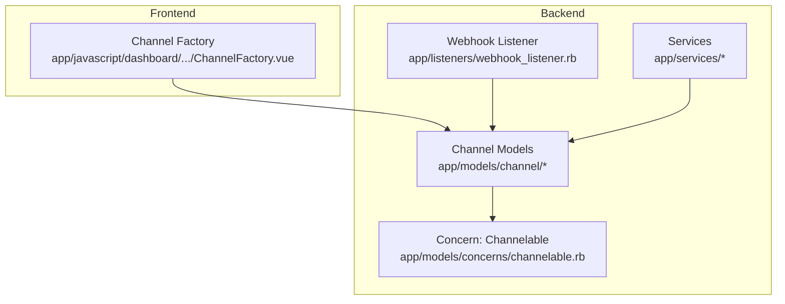
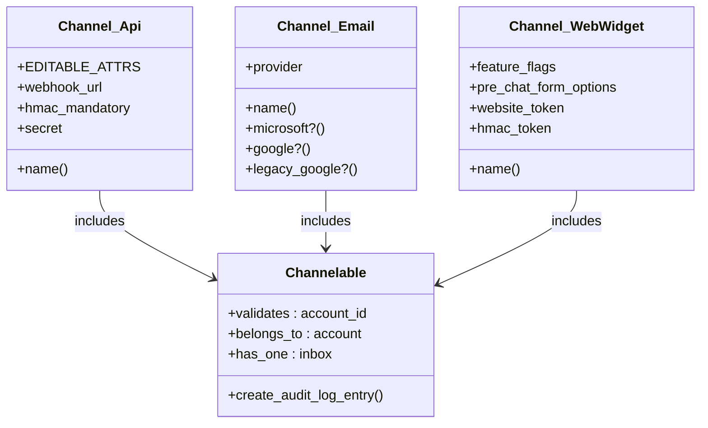
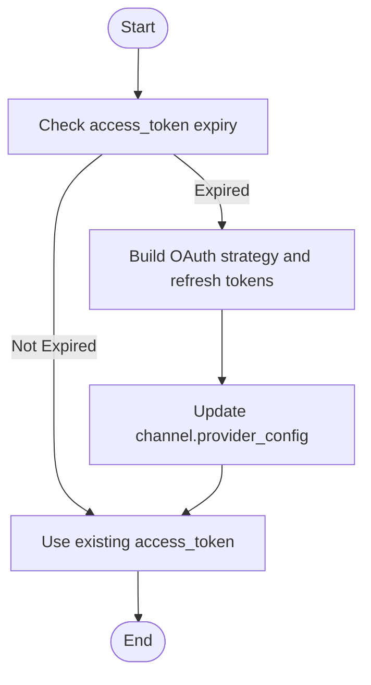
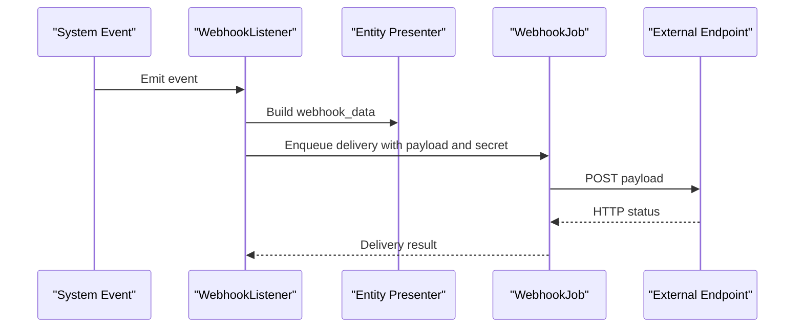
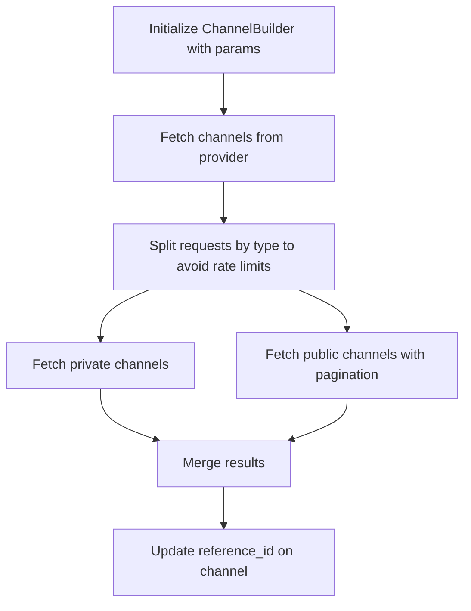
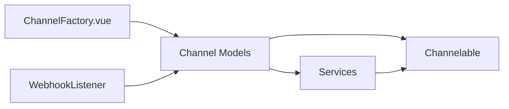

# Custom Integrations

<cite>
**Referenced Files in This Document**
- [channelable.rb](file://app/models/concerns/channelable.rb)
- [api.rb](file://app/models/channel/api.rb)
- [email.rb](file://app/models/channel/email.rb)
- [web_widget.rb](file://app/models/channel/web_widget.rb)
- [ChannelFactory.vue](file://app/javascript/dashboard/routes/dashboard/settings/inbox/ChannelFactory.vue)
- [webhook_listener.rb](file://app/listeners/webhook_listener.rb)
- [base_refresh_oauth_token_service.rb](file://app/services/base_refresh_oauth_token_service.rb)
- [base_token_service.rb](file://app/services/base_token_service.rb)
- [channel_builder.rb](file://lib/integrations/slack/channel_builder.rb)
</cite>

## Table of Contents
1. [Introduction](#introduction)
2. [Project Structure](#project-structure)
3. [Core Components](#core-components)
4. [Architecture Overview](#architecture-overview)
5. [Detailed Component Analysis](#detailed-component-analysis)
6. [Dependency Analysis](#dependency-analysis)
7. [Performance Considerations](#performance-considerations)
8. [Troubleshooting Guide](#troubleshooting-guide)
9. [Conclusion](#conclusion)
10. [Appendices](#appendices)

## Introduction
This document explains how to build custom integrations in Chatwoot, focusing on:
- Creating new channel integrations (e.g., SMS, WhatsApp, social platforms)
- Implementing service adapters for external APIs
- Extending webhook handling and event delivery
- Base classes and interfaces to implement
- Step-by-step guides, best practices, testing strategies, deployment considerations, and version compatibility

Chatwoot’s extension model centers around:
- Channel models that represent a messaging provider or integration point
- Services that encapsulate business logic and API interactions
- Webhooks and listeners that propagate events to external systems
- Frontend components that render configuration UI for channels

## Project Structure
The relevant parts of the codebase for custom integrations are organized as follows:
- Channel models under app/models/channel define the data schema and behavior for each channel type
- A shared concern app/models/concerns/channelable.rb provides common behavior for all channels
- The frontend uses a channel factory to render per-channel setup UI
- Webhooks are dispatched via listeners that publish events to configured endpoints
- Service base classes provide reusable patterns for OAuth token refresh and JWT-based tokens



**Diagram sources**
- [channelable.rb:1-14](file://app/models/concerns/channelable.rb#L1-L14)
- [api.rb:22-46](file://app/models/channel/api.rb#L22-L46)
- [email.rb:38-81](file://app/models/channel/email.rb#L38-L81)
- [web_widget.rb:29-109](file://app/models/channel/web_widget.rb#L29-L109)
- [ChannelFactory.vue:17-45](file://app/javascript/dashboard/routes/dashboard/settings/inbox/ChannelFactory.vue#L17-L45)
- [webhook_listener.rb:1-135](file://app/listeners/webhook_listener.rb#L1-L135)

**Section sources**
- [channelable.rb:1-14](file://app/models/concerns/channelable.rb#L1-L14)
- [ChannelFactory.vue:17-45](file://app/javascript/dashboard/routes/dashboard/settings/inbox/ChannelFactory.vue#L17-L45)
- [webhook_listener.rb:1-135](file://app/listeners/webhook_listener.rb#L1-L135)

## Core Components
Key building blocks for custom integrations:

- Channelable concern
  - Provides account association, inbox linkage, and audit hooks for all channels
  - Ensures consistent lifecycle and relationships across channel types

- Channel models
  - Channel::Api: API channel with HMAC security and webhook URL support
  - Channel::Email: Email channel with IMAP/SMTP configuration and provider-specific flags
  - Channel::WebWidget: Website widget channel with feature flags and pre-chat form options

- Frontend Channel Factory
  - Renders per-channel setup UI based on channel name mapping

- Webhook Listener
  - Subscribes to system events and delivers payloads to configured webhooks

- Service Base Classes
  - BaseRefreshOauthTokenService: Handles OAuth token refresh flows
  - BaseTokenService: Encapsulates JWT generation and decoding

**Section sources**
- [channelable.rb:1-14](file://app/models/concerns/channelable.rb#L1-L14)
- [api.rb:22-46](file://app/models/channel/api.rb#L22-L46)
- [email.rb:38-81](file://app/models/channel/email.rb#L38-L81)
- [web_widget.rb:29-109](file://app/models/channel/web_widget.rb#L29-L109)
- [ChannelFactory.vue:17-45](file://app/javascript/dashboard/routes/dashboard/settings/inbox/ChannelFactory.vue#L17-L45)
- [webhook_listener.rb:1-135](file://app/listeners/webhook_listener.rb#L1-L135)
- [base_refresh_oauth_token_service.rb:1-65](file://app/services/base_refresh_oauth_token_service.rb#L1-L65)
- [base_token_service.rb:1-28](file://app/services/base_token_service.rb#L1-L28)

## Architecture Overview
The integration architecture connects backend channel models, services, and frontend UI through well-defined extension points.

```mermaid
sequenceDiagram
participant Admin as "Admin UI"
participant Factory as "ChannelFactory.vue"
participant Model as "Channel Model"
participant Concern as "Channelable"
participant Listener as "WebhookListener"
participant Job as "WebhookJob"
participant External as "External Webhook Endpoint"
Admin->>Factory : Select channel type
Factory->>Model : Create/update channel config
Model->>Concern : Validate & persist (account_id, inbox)
Note over Model,Concern : Common behavior via Channelable
Event occurs in system
Listener->>Listener : Build payload from entity
Listener->>Job : Enqueue webhook delivery
Job->>External : POST payload with optional HMAC secret
```

**Diagram sources**
- [ChannelFactory.vue:17-45](file://app/javascript/dashboard/routes/dashboard/settings/inbox/ChannelFactory.vue#L17-L45)
- [channelable.rb:1-14](file://app/models/concerns/channelable.rb#L1-L14)
- [webhook_listener.rb:1-135](file://app/listeners/webhook_listener.rb#L1-L135)

## Detailed Component Analysis

### Building a Custom Channel Integration
Steps to create a new channel:
1. Define a new channel model under app/models/channel
   - Include Channelable concern
   - Set table_name and EDITABLE_ATTRS
   - Provide a human-readable name method
   - Add validations and any provider-specific attributes
2. Register the channel in the frontend ChannelFactory
   - Map a channel key to a Vue component for setup UI
3. Wire up webhooks if needed
   - Ensure your channel supports webhook_url and HMAC signing where applicable
4. Implement services for external API calls
   - Use BaseRefreshOauthTokenService for OAuth flows
   - Use BaseTokenService for generating/decoding tokens when necessary



**Diagram sources**
- [channelable.rb:1-14](file://app/models/concerns/channelable.rb#L1-L14)
- [api.rb:22-46](file://app/models/channel/api.rb#L22-L46)
- [email.rb:38-81](file://app/models/channel/email.rb#L38-L81)
- [web_widget.rb:29-109](file://app/models/channel/web_widget.rb#L29-L109)

Best practices:
- Keep channel attributes minimal and focused on provider configuration
- Use Channelable for common behaviors; override only what is necessary
- Validate inputs rigorously; use presence and uniqueness constraints
- For sensitive credentials, rely on encrypted fields where available

Testing strategy:
- Unit test channel validations and computed methods
- Integration test channel creation and inbox linkage
- Frontend tests for channel factory rendering and validation

Deployment considerations:
- Ensure database migrations add required columns for new channel attributes
- Update environment variables and secrets management for provider credentials
- Verify webhook endpoints are reachable and secure (HMAC verification)

**Section sources**
- [channelable.rb:1-14](file://app/models/concerns/channelable.rb#L1-L14)
- [api.rb:22-46](file://app/models/channel/api.rb#L22-L46)
- [email.rb:38-81](file://app/models/channel/email.rb#L38-L81)
- [web_widget.rb:29-109](file://app/models/channel/web_widget.rb#L29-L109)
- [ChannelFactory.vue:17-45](file://app/javascript/dashboard/routes/dashboard/settings/inbox/ChannelFactory.vue#L17-L45)

### Implementing Service Adapters for External APIs
Use service classes to encapsulate API interactions:
- BaseRefreshOauthTokenService
  - Manages access token expiry checks and refresh flows
  - Updates provider_config on the channel after successful refresh
- BaseTokenService
  - Generates and decodes JWT tokens using HS256
  - Useful for internal authentication between services or SDKs



**Diagram sources**
- [base_refresh_oauth_token_service.rb:1-65](file://app/services/base_refresh_oauth_token_service.rb#L1-L65)

Best practices:
- Always handle network errors and retries gracefully
- Log token refresh events for observability
- Avoid storing raw secrets in logs; mask sensitive values
- Use BaseTokenService for consistent JWT handling across services

Testing strategy:
- Mock OAuth providers and verify token refresh logic
- Assert provider_config updates after refresh
- Test JWT encode/decode paths with valid and invalid tokens

**Section sources**
- [base_refresh_oauth_token_service.rb:1-65](file://app/services/base_refresh_oauth_token_service.rb#L1-L65)
- [base_token_service.rb:1-28](file://app/services/base_token_service.rb#L1-L28)

### Extending Webhook Handling
To extend webhook handling:
- Subscribe to system events in a listener similar to WebhookListener
- Build payloads from entities and deliver them to configured endpoints
- Support both account-level and inbox-level webhooks



**Diagram sources**
- [webhook_listener.rb:1-135](file://app/listeners/webhook_listener.rb#L1-L135)

Best practices:
- Validate and sanitize payloads before sending
- Use HMAC signatures for endpoint security
- Implement idempotency keys (delivery_id) to avoid duplicates
- Monitor delivery failures and retry policies

Testing strategy:
- Unit test payload construction and filtering by subscriptions
- Integration test webhook delivery and signature verification
- Simulate endpoint failures and verify retry behavior

**Section sources**
- [webhook_listener.rb:1-135](file://app/listeners/webhook_listener.rb#L1-L135)

### Example: Slack Channel Builder Pattern
For integrations requiring external API clients (e.g., Slack), follow a builder pattern to fetch resources and update references:



**Diagram sources**
- [channel_builder.rb:1-45](file://lib/integrations/slack/channel_builder.rb#L1-L45)

Best practices:
- Separate API calls by type to mitigate rate limiting
- Paginate large lists efficiently
- Cache client instances to reduce overhead
- Handle provider-specific error codes and retries

**Section sources**
- [channel_builder.rb:1-45](file://lib/integrations/slack/channel_builder.rb#L1-L45)

## Dependency Analysis
Relationships among core components:



**Diagram sources**
- [ChannelFactory.vue:17-45](file://app/javascript/dashboard/routes/dashboard/settings/inbox/ChannelFactory.vue#L17-L45)
- [channelable.rb:1-14](file://app/models/concerns/channelable.rb#L1-L14)
- [webhook_listener.rb:1-135](file://app/listeners/webhook_listener.rb#L1-L135)

Coupling and cohesion:
- Channel models depend on Channelable for shared behavior, promoting cohesion
- Services are loosely coupled to channels via attribute accessors and provider configs
- WebhookListener depends on entity presenters and jobs for delivery, maintaining separation of concerns

Potential circular dependencies:
- Avoid direct imports between channel models and services unless necessary
- Prefer using presenter objects or service interfaces to decouple layers

**Section sources**
- [channelable.rb:1-14](file://app/models/concerns/channelable.rb#L1-L14)
- [ChannelFactory.vue:17-45](file://app/javascript/dashboard/routes/dashboard/settings/inbox/ChannelFactory.vue#L17-L45)
- [webhook_listener.rb:1-135](file://app/listeners/webhook_listener.rb#L1-L135)

## Performance Considerations
- Batch external API calls and paginate responses to avoid timeouts
- Cache frequently accessed provider data (e.g., channel lists)
- Use background jobs for heavy operations like webhook delivery and token refresh
- Minimize payload sizes by selecting only necessary fields for webhooks
- Monitor and tune Sidekiq queues for webhook processing throughput

[No sources needed since this section provides general guidance]

## Troubleshooting Guide
Common issues and resolutions:
- Token expiration errors
  - Verify BaseRefreshOauthTokenService refresh flow and provider_config updates
  - Check logs for OAuth strategy initialization and token refresh attempts
- Webhook delivery failures
  - Confirm endpoint reachability and HMAC signature verification
  - Inspect WebhookJob logs and retry policies
- Channel configuration validation errors
  - Review EDITABLE_ATTRS and validations in channel models
  - Ensure required fields are present and correctly formatted

**Section sources**
- [base_refresh_oauth_token_service.rb:1-65](file://app/services/base_refresh_oauth_token_service.rb#L1-L65)
- [webhook_listener.rb:1-135](file://app/listeners/webhook_listener.rb#L1-L135)
- [api.rb:22-46](file://app/models/channel/api.rb#L22-L46)
- [email.rb:38-81](file://app/models/channel/email.rb#L38-L81)

## Conclusion
Chatwoot provides robust extension points for building custom integrations:
- Channel models with Channelable for consistent behavior
- Service base classes for OAuth and token management
- Webhook listeners for event-driven integrations
- Frontend factory for intuitive channel setup

By following the patterns and best practices outlined here, you can create reliable, maintainable, and scalable integrations that fit seamlessly into Chatwoot’s ecosystem.

[No sources needed since this section summarizes without analyzing specific files]

## Appendices

### Step-by-Step Guides

#### Creating a Custom Channel
1. Define a new channel model under app/models/channel
   - Include Channelable
   - Set table_name and EDITABLE_ATTRS
   - Implement name and any provider-specific methods
2. Add frontend UI in ChannelFactory.vue
   - Map channel key to a Vue component
3. Configure webhooks if needed
   - Support webhook_url and HMAC signing
4. Implement services for API interactions
   - Use BaseRefreshOauthTokenService for OAuth
   - Use BaseTokenService for JWT handling

**Section sources**
- [channelable.rb:1-14](file://app/models/concerns/channelable.rb#L1-L14)
- [api.rb:22-46](file://app/models/channel/api.rb#L22-L46)
- [email.rb:38-81](file://app/models/channel/email.rb#L38-L81)
- [web_widget.rb:29-109](file://app/models/channel/web_widget.rb#L29-L109)
- [ChannelFactory.vue:17-45](file://app/javascript/dashboard/routes/dashboard/settings/inbox/ChannelFactory.vue#L17-L45)
- [base_refresh_oauth_token_service.rb:1-65](file://app/services/base_refresh_oauth_token_service.rb#L1-L65)
- [base_token_service.rb:1-28](file://app/services/base_token_service.rb#L1-L28)

#### Implementing Service Adapters
- Use BaseRefreshOauthTokenService for OAuth flows
- Use BaseTokenService for JWT generation/decoding
- Handle errors and log events appropriately

**Section sources**
- [base_refresh_oauth_token_service.rb:1-65](file://app/services/base_refresh_oauth_token_service.rb#L1-L65)
- [base_token_service.rb:1-28](file://app/services/base_token_service.rb#L1-L28)

#### Extending Webhook Handlers
- Follow WebhookListener patterns to build and deliver payloads
- Support account-level and inbox-level webhooks
- Implement HMAC verification at endpoints

**Section sources**
- [webhook_listener.rb:1-135](file://app/listeners/webhook_listener.rb#L1-L135)

### Best Practices
- Error handling: Wrap external API calls in try/catch and return meaningful errors
- Logging: Use structured logging with correlation IDs for traceability
- Security: Validate and sanitize inputs; sign webhooks with HMAC
- Testing: Write unit and integration tests for channels, services, and webhooks

[No sources needed since this section provides general guidance]

### Deployment Considerations
- Database migrations: Add columns for new channel attributes
- Secrets management: Store provider credentials securely
- Environment variables: Configure FRONTEND_URL and other runtime settings
- Version compatibility: Align Ruby/Rails versions and gem dependencies with Chatwoot releases

[No sources needed since this section provides general guidance]