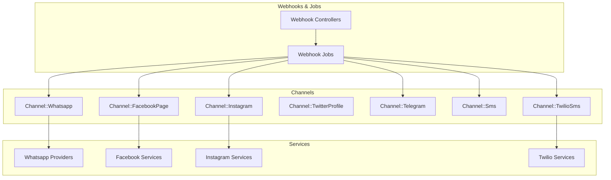
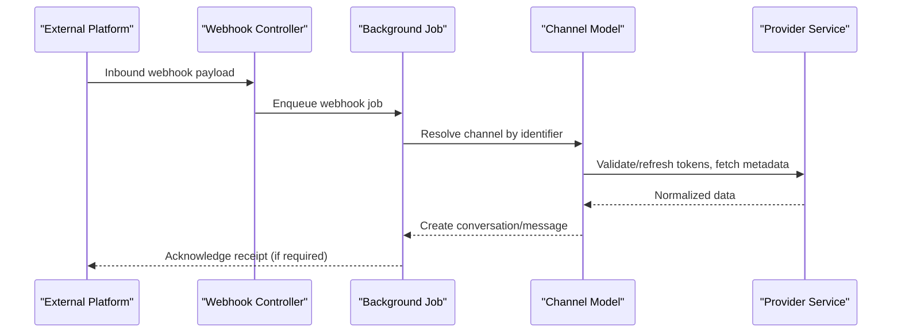
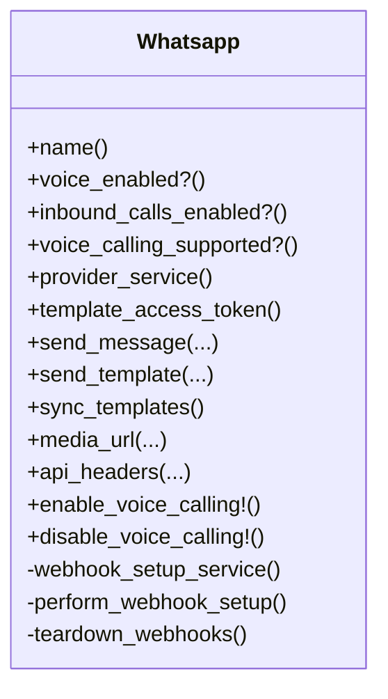
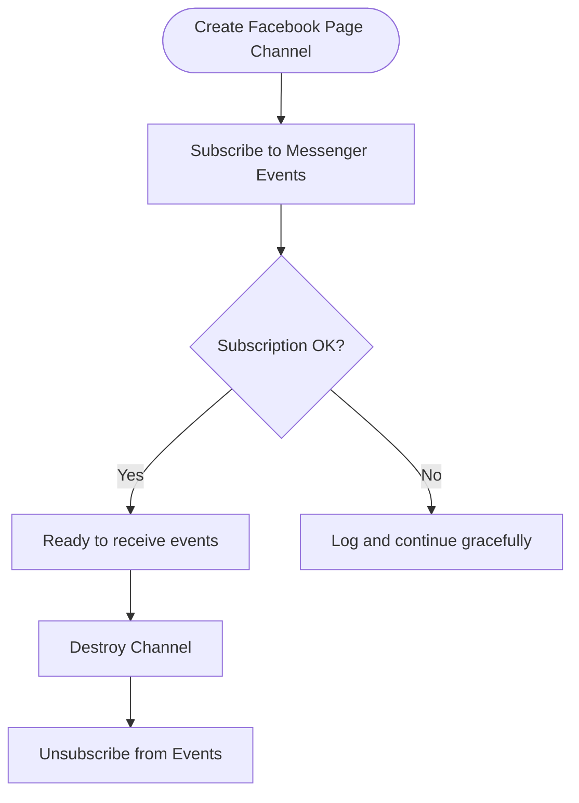
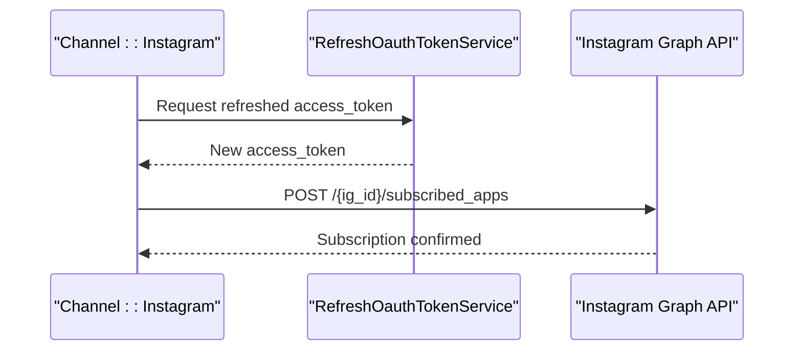
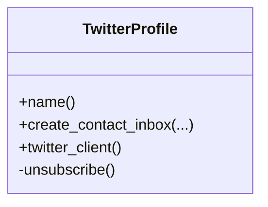
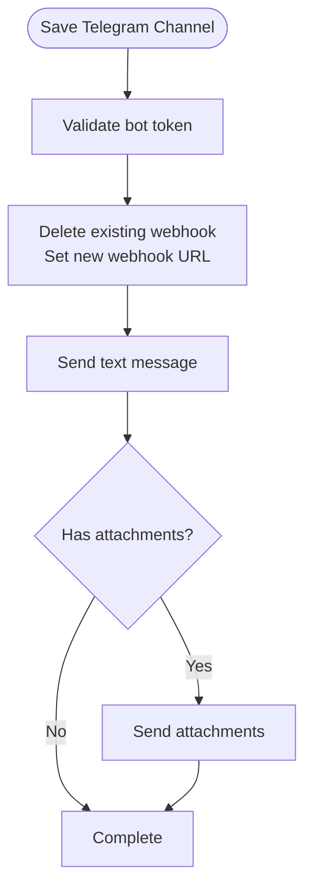
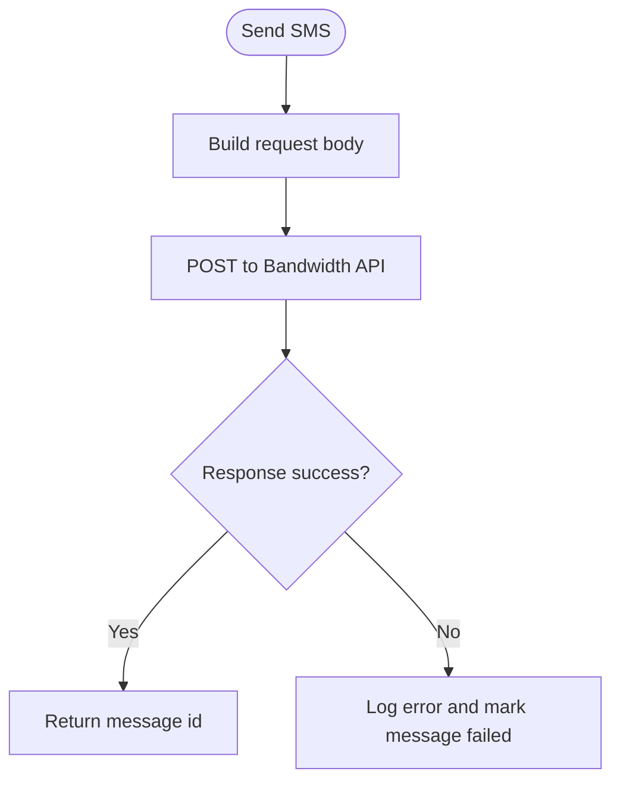
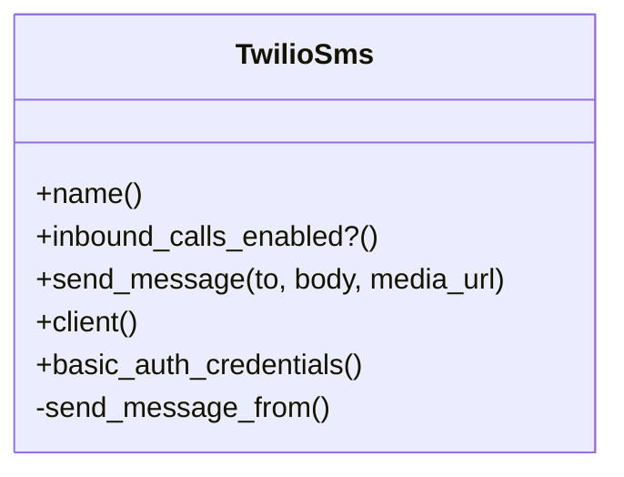
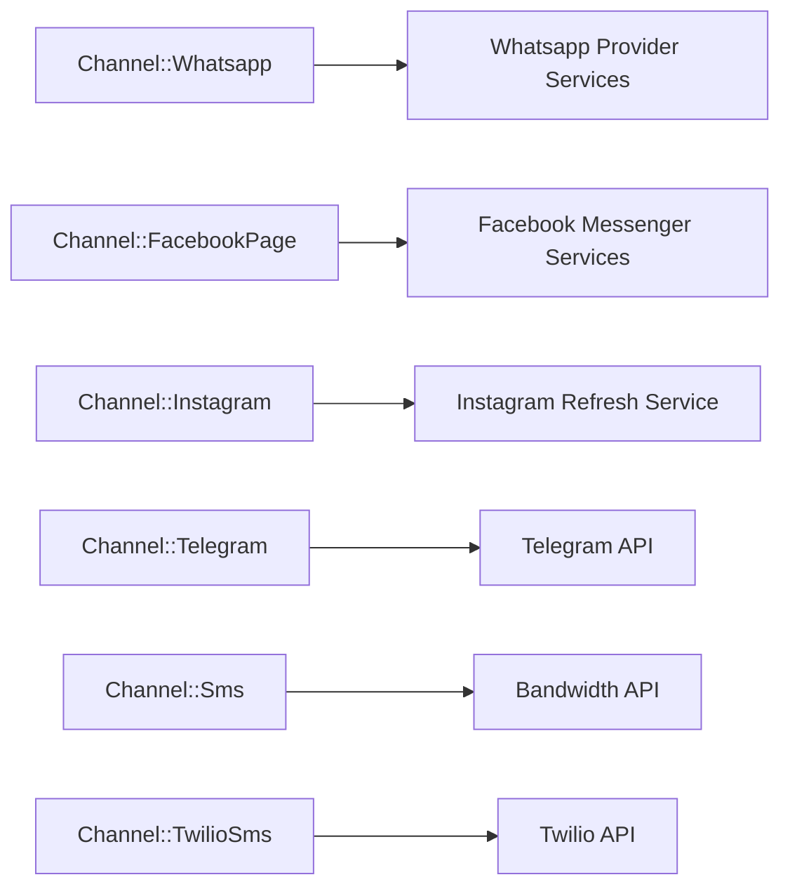

# Integrations

<cite>
**Referenced Files in This Document**
- [whatsapp.rb](file://app/models/channel/whatsapp.rb)
- [facebook_page.rb](file://app/models/channel/facebook_page.rb)
- [instagram.rb](file://app/models/channel/instagram.rb)
- [twitter_profile.rb](file://app/models/channel/twitter_profile.rb)
- [telegram.rb](file://app/models/channel/telegram.rb)
- [sms.rb](file://app/models/channel/sms.rb)
- [twilio_sms.rb](file://app/models/channel/twilio_sms.rb)
</cite>

## Table of Contents
1. [Introduction](#introduction)
2. [Project Structure](#project-structure)
3. [Core Components](#core-components)
4. [Architecture Overview](#architecture-overview)
5. [Detailed Component Analysis](#detailed-component-analysis)
6. [Dependency Analysis](#dependency-analysis)
7. [Performance Considerations](#performance-considerations)
8. [Troubleshooting Guide](#troubleshooting-guide)
9. [Conclusion](#conclusion)

## Introduction
This document explains Chatwoot’s integration ecosystem with a focus on the channel abstraction layer and how different communication platforms are integrated. It covers native integrations (WhatsApp Business API, Facebook Messenger, Instagram, Twitter, Telegram, SMS), third-party service integrations (Slack, Linear, Shopify, Stripe), the webhook system for external event handling and custom integrations, OAuth flows, API authentication patterns, error handling strategies, and guidance for building custom channels, webhook handlers, and service adapters. It also addresses rate limiting, retry mechanisms, and monitoring to ensure reliable integrations.

## Project Structure
Chatwoot organizes platform-specific integrations under app/models/channel for channel entities and app/services for provider-specific logic. Controllers and jobs handle inbound webhooks and outbound messaging. The following diagram shows the high-level structure relevant to integrations:

[No sources needed since this diagram shows conceptual workflow, not actual code structure]

## Core Components
- Channel models encapsulate credentials, configuration, and lifecycle hooks (subscribe/unsubscribe, webhook setup/teardown). They delegate sending and template operations to provider services where applicable.
- Provider services implement platform-specific APIs, token refresh, template management, and webhook registration.
- Webhook controllers receive inbound events from platforms and dispatch them to background jobs for processing.
- Background jobs orchestrate message creation, contact resolution, and downstream integrations.

Key responsibilities by component:
- Channel::Whatsapp: Multi-provider support (Meta Cloud API and 360dialog), template sync, voice calling toggles, webhook registration/teardown, credential encryption.
- Channel::FacebookPage: Page subscription to Messenger events, access token encryption.
- Channel::Instagram: Subscription to Instagram messages/reactions, token refresh via dedicated service.
- Channel::TwitterProfile: Twitter client configuration, tweet enablement toggle, unsubscription on destroy.
- Channel::Telegram: Bot token validation, webhook setup, HTML formatting, file retrieval, business connection support.
- Channel::Sms: Bandwidth provider integration, basic auth, error mapping to message status.
- Channel::TwilioSms: Twilio client initialization (legacy or API key auth), send message with media and delivery callbacks, voice call gating.

**Section sources**
- [whatsapp.rb:25-193](file://app/models/channel/whatsapp.rb#L25-L193)
- [facebook_page.rb:20-69](file://app/models/channel/facebook_page.rb#L20-L69)
- [instagram.rb:17-82](file://app/models/channel/instagram.rb#L17-L82)
- [twitter_profile.rb:19-69](file://app/models/channel/twitter_profile.rb#L19-L69)
- [telegram.rb:17-172](file://app/models/channel/telegram.rb#L17-L172)
- [sms.rb:18-100](file://app/models/channel/sms.rb#L18-L100)
- [twilio_sms.rb:29-94](file://app/models/channel/twilio_sms.rb#L29-L94)

## Architecture Overview
The integration architecture follows a layered approach:
- Channels: Represent each platform as a model with lifecycle hooks and delegation to provider services.
- Services: Encapsulate platform SDKs/APIs, token refresh, templates, and webhook management.
- Webhooks: Controllers parse inbound payloads and enqueue jobs for reliable processing.
- Jobs: Perform durable work such as creating conversations/messages and invoking downstream integrations.

[No sources needed since this diagram shows conceptual workflow, not actual code structure]

## Detailed Component Analysis

### WhatsApp Business API Integration
- Multi-provider support: Meta Cloud API and 360dialog.
- Template synchronization and update tracking.
- Voice calling support gated by feature flags and provider capability.
- Webhook registration and teardown for calls and messages.
- Credential encryption and safe serialization.

**Diagram sources**
- [whatsapp.rb:25-193](file://app/models/channel/whatsapp.rb#L25-L193)

**Section sources**
- [whatsapp.rb:25-193](file://app/models/channel/whatsapp.rb#L25-L193)

### Facebook Messenger Integration
- Subscribes/unsubscribes page to Messenger events using page access token.
- Encrypts sensitive tokens when configured.
- Creates contact inboxes for Instagram-linked accounts.

**Diagram sources**
- [facebook_page.rb:34-67](file://app/models/channel/facebook_page.rb#L34-L67)

**Section sources**
- [facebook_page.rb:20-69](file://app/models/channel/facebook_page.rb#L20-L69)

### Instagram Integration
- Subscribes/unsubscribes Instagram account to message events.
- Refreshes access token via a dedicated service before use.
- Uses Graph API versioned endpoints.

**Diagram sources**
- [instagram.rb:45-74](file://app/models/channel/instagram.rb#L45-L74)

**Section sources**
- [instagram.rb:17-82](file://app/models/channel/instagram.rb#L17-L82)

### Twitter Integration
- Configures Twitter client with consumer keys and profile tokens.
- Supports enabling/disabling tweets per profile.
- Handles unsubscription on destroy.

**Diagram sources**
- [twitter_profile.rb:19-69](file://app/models/channel/twitter_profile.rb#L19-L69)

**Section sources**
- [twitter_profile.rb:19-69](file://app/models/channel/twitter_profile.rb#L19-L69)

### Telegram Integration
- Validates bot token and sets up webhook on save.
- Sends text and attachments; converts Markdown to Telegram HTML safely.
- Retrieves user profile photos and files.
- Supports business connections and reply-to semantics.

**Diagram sources**
- [telegram.rb:85-170](file://app/models/channel/telegram.rb#L85-L170)

**Section sources**
- [telegram.rb:17-172](file://app/models/channel/telegram.rb#L17-L172)

### SMS Integrations

#### Bandwidth SMS
- Direct HTTP integration with Bandwidth Messaging API using basic auth.
- Maps provider errors to message status and external_error fields.

**Diagram sources**
- [sms.rb:50-83](file://app/models/channel/sms.rb#L50-L83)

**Section sources**
- [sms.rb:18-100](file://app/models/channel/sms.rb#L18-L100)

#### Twilio SMS
- Initializes Twilio client with legacy or API key auth.
- Sends messages with optional media and delivery callbacks.
- Supports voice calling gating via provider config.

**Diagram sources**
- [twilio_sms.rb:29-94](file://app/models/channel/twilio_sms.rb#L29-L94)

**Section sources**
- [twilio_sms.rb:29-94](file://app/models/channel/twilio_sms.rb#L29-L94)

### Third-Party Service Integrations
- Slack: Notifications and unfurling via dedicated jobs and controllers.
- Linear: Issue linking and updates through helper modules and controllers.
- Shopify: Store integration and order-related workflows via helpers and controllers.
- Stripe: Billing and payment flows via service classes and controllers.

These integrations follow the same pattern: controller endpoints trigger jobs that call provider APIs, persist results, and emit events for downstream consumers.

[No sources needed since this section provides general guidance]

### Webhook System for External Event Handling
- Webhook controllers accept inbound payloads from platforms and external systems.
- Jobs process events asynchronously, ensuring reliability and scalability.
- Listeners react to internal events to trigger automations, notifications, and integrations.

Best practices:
- Idempotent handlers keyed by external event IDs.
- Robust error logging and metrics.
- Retry policies with exponential backoff for transient failures.

[No sources needed since this section provides general guidance]

### OAuth Flows and API Authentication Patterns
- Token storage and encryption: Sensitive tokens are encrypted at rest when configured.
- Token refresh: Dedicated services refresh OAuth tokens before API calls.
- Provider-specific auth: Basic auth (Bandwidth), bearer tokens (Meta/Twitter/Instagram), Twilio legacy vs API key auth.

Patterns:
- Centralize credential rotation and refresh logic in services.
- Use feature flags to gate advanced capabilities (e.g., voice calling).
- Validate provider configurations during channel creation/update.

[No sources needed since this section provides general guidance]

### Building Custom Channel Integrations
Steps:
1. Define a channel model under app/models/channel with:
   - Credentials and provider_config schema.
   - Lifecycle hooks for subscribe/unsubscribe and webhook setup/teardown.
   - Delegation methods for send_message and other provider operations.
2. Implement a provider service under app/services/<channel>/providers to encapsulate API calls, token refresh, and template management.
3. Add webhook controller and job to process inbound events and create conversations/messages.
4. Wire routing and authorization for your channel’s endpoints.

Guidelines:
- Keep channel models thin; move complex logic to services.
- Use encryption for secrets and sanitize all inputs.
- Provide clear error mapping to message statuses and logs.

[No sources needed since this section provides general guidance]

### Building Webhook Handlers and Service Adapters
- Webhook handlers should validate signatures, normalize payloads, and delegate to domain services.
- Service adapters should abstract provider differences behind consistent interfaces.
- Use background jobs for long-running tasks and retries.

[No sources needed since this section provides general guidance]

## Dependency Analysis
Channel models depend on:
- Provider services for API interactions.
- Encryption utilities for secrets.
- Global configuration for base URLs and versions.
- Feature flags for capability gating.

**Diagram sources**
- [whatsapp.rb:71-77](file://app/models/channel/whatsapp.rb#L71-L77)
- [instagram.rb:72-74](file://app/models/channel/instagram.rb#L72-L74)
- [twilio_sms.rb:70-76](file://app/models/channel/twilio_sms.rb#L70-L76)

**Section sources**
- [whatsapp.rb:71-77](file://app/models/channel/whatsapp.rb#L71-L77)
- [instagram.rb:72-74](file://app/models/channel/instagram.rb#L72-L74)
- [twilio_sms.rb:70-76](file://app/models/channel/twilio_sms.rb#L70-L76)

## Performance Considerations
- Prefer background jobs for outbound API calls and webhook processing.
- Cache provider metadata (templates, phone numbers) and invalidate on updates.
- Use feature flags to avoid unnecessary remote checks.
- Implement rate limiting at the service layer to respect provider quotas.
- Monitor latency and error rates per provider; alert on anomalies.

[No sources needed since this section provides general guidance]

## Troubleshooting Guide
Common issues and resolutions:
- Webhook setup failures: Check provider credentials and network reachability; re-register webhooks after credential changes.
- Token expiration: Ensure refresh services run before API calls; log refresh outcomes.
- Message delivery failures: Inspect external_error and status fields; correlate with provider error codes.
- Voice calling toggles: Verify feature flags and provider capability; confirm webhook subscriptions include call events.

Operational tips:
- Enable detailed logging for provider interactions.
- Track webhook verification tokens and signature validations.
- Use health checks for provider connectivity and template freshness.

**Section sources**
- [whatsapp.rb:145-182](file://app/models/channel/whatsapp.rb#L145-L182)
- [telegram.rb:85-102](file://app/models/channel/telegram.rb#L85-L102)
- [sms.rb:75-83](file://app/models/channel/sms.rb#L75-L83)

## Conclusion
Chatwoot’s integration ecosystem is built around a robust channel abstraction layer that standardizes how different platforms are connected. Native integrations cover major messaging channels, while third-party services extend functionality across productivity and commerce tools. A strong webhook system, secure authentication patterns, and disciplined error handling ensure reliability. By following the provided patterns for custom channels, webhook handlers, and service adapters, teams can extend Chatwoot’s capabilities confidently and maintainably.