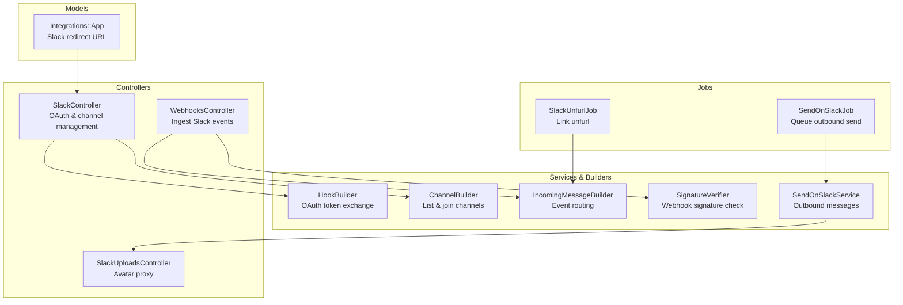
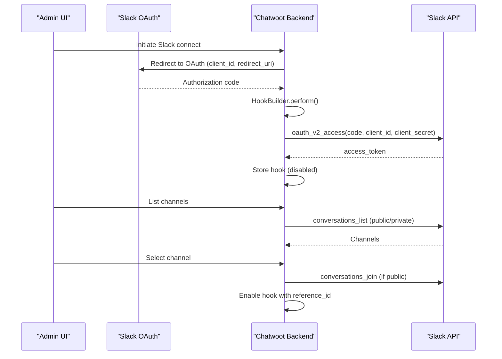
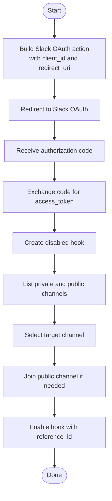
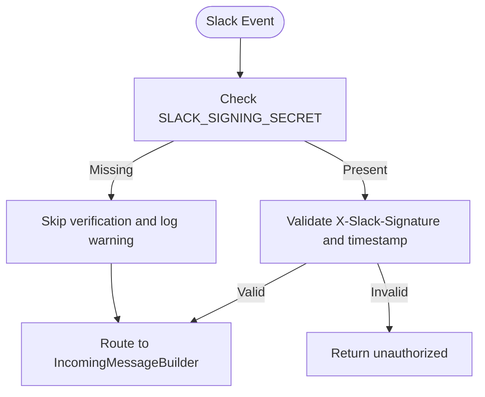
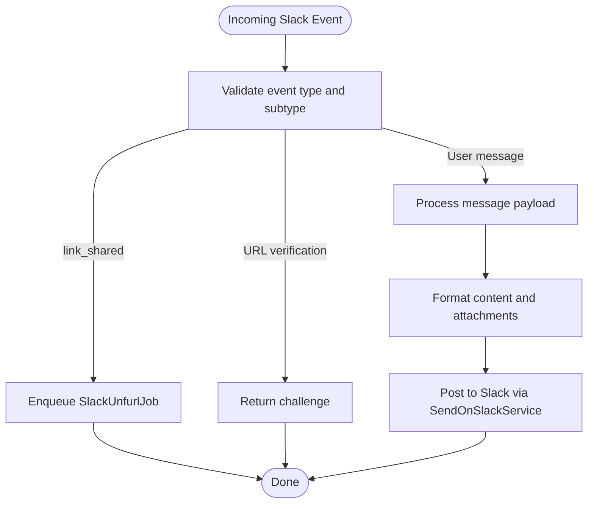
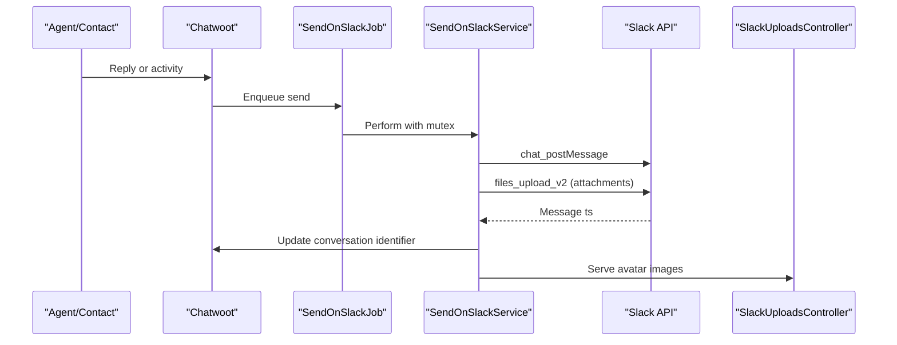
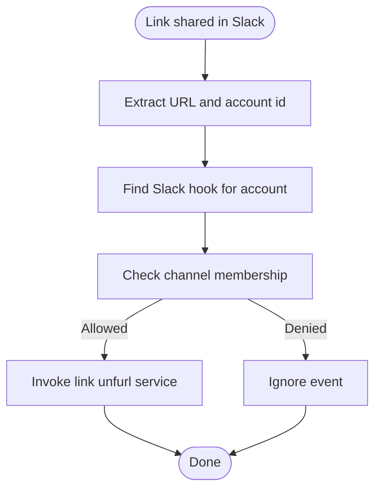
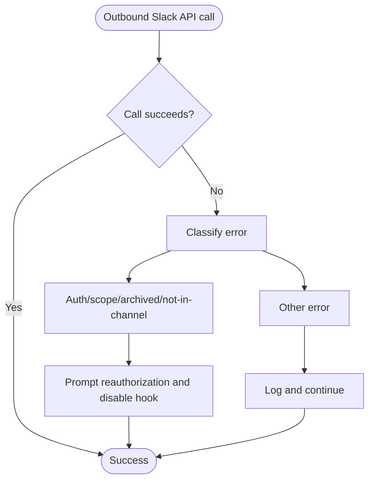
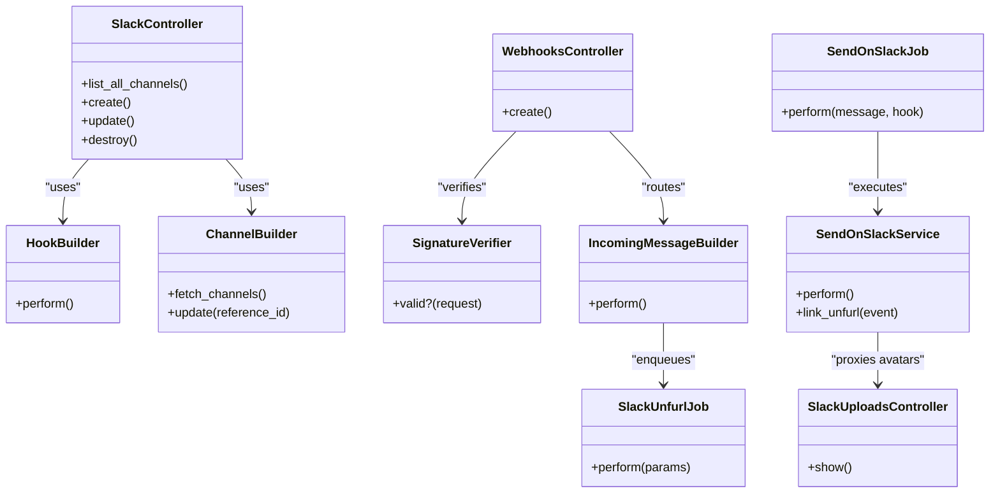

# Slack Integration

<cite>
**Referenced Files in This Document**
- [slack_controller.rb](file://app/controllers/api/v1/accounts/integrations/slack_controller.rb)
- [webhooks_controller.rb](file://app/controllers/api/v1/integrations/webhooks_controller.rb)
- [signature_verifier.rb](file://lib/integrations/slack/signature_verifier.rb)
- [incoming_message_builder.rb](file://lib/integrations/slack/incoming_message_builder.rb)
- [send_on_slack_service.rb](file://lib/integrations/slack/send_on_slack_service.rb)
- [hook_builder.rb](file://lib/integrations/slack/hook_builder.rb)
- [channel_builder.rb](file://lib/integrations/slack/channel_builder.rb)
- [app.rb](file://app/models/integrations/app.rb)
- [send_on_slack_job.rb](file://app/jobs/send_on_slack_job.rb)
- [slack_unfurl_job.rb](file://app/jobs/slack_unfurl_job.rb)
- [slack_uploads_controller.rb](file://app/controllers/slack_uploads_controller.rb)
</cite>

## Table of Contents
1. [Introduction](#introduction)
2. [Project Structure](#project-structure)
3. [Core Components](#core-components)
4. [Architecture Overview](#architecture-overview)
5. [Detailed Component Analysis](#detailed-component-analysis)
6. [Dependency Analysis](#dependency-analysis)
7. [Performance Considerations](#performance-considerations)
8. [Troubleshooting Guide](#troubleshooting-guide)
9. [Conclusion](#conclusion)

## Introduction
This document explains how Chatwoot integrates with Slack, including app setup, OAuth authentication, webhook configuration, sending messages to Slack channels, and handling incoming Slack events. It also covers advanced behaviors such as link unfurling, avatar handling, and error patterns for reauthorization.

## Project Structure
The Slack integration spans controllers, services, jobs, and helper classes:

- Controllers
  - Account-level Slack integration controller for OAuth and channel management
  - Webhooks controller for Slack event ingestion
  - Uploads controller for avatars used in Slack messages
- Services and builders
  - Hook builder for OAuth token exchange
  - Channel builder for listing and joining channels
  - Incoming message builder for processing Slack events
  - Signature verifier for webhook security
  - Send-on-Slack service for outbound messaging
- Jobs
  - Outbound message job
  - Link unfurl job
- Models
  - Integrations app metadata and Slack redirect URL

**Diagram sources**
- [slack_controller.rb:1-48](file://app/controllers/api/v1/accounts/integrations/slack_controller.rb#L1-L48)
- [webhooks_controller.rb:1-27](file://app/controllers/api/v1/integrations/webhooks_controller.rb#L1-L27)
- [signature_verifier.rb:1-24](file://lib/integrations/slack/signature_verifier.rb#L1-L24)
- [incoming_message_builder.rb:1-104](file://lib/integrations/slack/incoming_message_builder.rb#L1-L104)
- [send_on_slack_service.rb:1-223](file://lib/integrations/slack/send_on_slack_service.rb#L1-L223)
- [hook_builder.rb:1-43](file://lib/integrations/slack/hook_builder.rb#L1-L43)
- [channel_builder.rb:1-71](file://lib/integrations/slack/channel_builder.rb#L1-L71)
- [app.rb:1-151](file://app/models/integrations/app.rb#L1-L151)
- [send_on_slack_job.rb:1-12](file://app/jobs/send_on_slack_job.rb#L1-L12)
- [slack_unfurl_job.rb:1-50](file://app/jobs/slack_unfurl_job.rb#L1-L50)
- [slack_uploads_controller.rb:1-33](file://app/controllers/slack_uploads_controller.rb#L1-L33)

**Section sources**
- [slack_controller.rb:1-48](file://app/controllers/api/v1/accounts/integrations/slack_controller.rb#L1-L48)
- [webhooks_controller.rb:1-27](file://app/controllers/api/v1/integrations/webhooks_controller.rb#L1-L27)
- [app.rb:108-110](file://app/models/integrations/app.rb#L108-L110)

## Core Components
- OAuth and channel management
  - SlackController orchestrates the Slack OAuth flow and channel selection.
  - HookBuilder exchanges the authorization code for an access token.
  - ChannelBuilder lists public/private channels and joins a selected channel.
- Inbound events
  - WebhooksController verifies Slack signatures and routes events via IncomingMessageBuilder.
  - SignatureVerifier validates timestamps and HMAC signatures.
  - IncomingMessageBuilder handles verification challenges, user messages, and link sharing.
- Outbound messages
  - SendOnSlackService formats and posts messages and attachments to Slack.
  - SendOnSlackJob queues outbound sends with concurrency control.
- Link unfurling
  - SlackUnfurlJob triggers link unfurling when links are shared in Slack.
- Avatar proxy
  - SlackUploadsController serves avatar images for Slack messages.

**Section sources**
- [slack_controller.rb:1-48](file://app/controllers/api/v1/accounts/integrations/slack_controller.rb#L1-L48)
- [hook_builder.rb:1-43](file://lib/integrations/slack/hook_builder.rb#L1-L43)
- [channel_builder.rb:1-71](file://lib/integrations/slack/channel_builder.rb#L1-L71)
- [webhooks_controller.rb:1-27](file://app/controllers/api/v1/integrations/webhooks_controller.rb#L1-L27)
- [signature_verifier.rb:1-24](file://lib/integrations/slack/signature_verifier.rb#L1-L24)
- [incoming_message_builder.rb:1-104](file://lib/integrations/slack/incoming_message_builder.rb#L1-L104)
- [send_on_slack_service.rb:1-223](file://lib/integrations/slack/send_on_slack_service.rb#L1-L223)
- [send_on_slack_job.rb:1-12](file://app/jobs/send_on_slack_job.rb#L1-L12)
- [slack_unfurl_job.rb:1-50](file://app/jobs/slack_unfurl_job.rb#L1-L50)
- [slack_uploads_controller.rb:1-33](file://app/controllers/slack_uploads_controller.rb#L1-L33)

## Architecture Overview
End-to-end flows for Slack integration:

**Diagram sources**
- [app.rb:43-57](file://app/models/integrations/app.rb#L43-L57)
- [app.rb:108-110](file://app/models/integrations/app.rb#L108-L110)
- [hook_builder.rb:32-41](file://lib/integrations/slack/hook_builder.rb#L32-L41)
- [channel_builder.rb:26-69](file://lib/integrations/slack/channel_builder.rb#L26-L69)
- [slack_controller.rb:5-23](file://app/controllers/api/v1/accounts/integrations/slack_controller.rb#L5-L23)

## Detailed Component Analysis

### Slack App Setup and OAuth Flow
- The frontend redirects users to Slack’s OAuth endpoint using the Slack app ID and a redirect URI generated by the application.
- After authorization, Chatwoot exchanges the code for an access token and stores it in a disabled hook until a channel is selected.
- Channel selection involves listing private and public channels separately to avoid rate limits, then optionally joining a public channel and enabling the hook.

Key responsibilities:
- Generate Slack OAuth action and redirect URL
- Exchange authorization code for access token
- Fetch and update channel reference

**Diagram sources**
- [app.rb:43-57](file://app/models/integrations/app.rb#L43-L57)
- [hook_builder.rb:8-41](file://lib/integrations/slack/hook_builder.rb#L8-L41)
- [channel_builder.rb:26-69](file://lib/integrations/slack/channel_builder.rb#L26-L69)
- [slack_controller.rb:9-23](file://app/controllers/api/v1/accounts/integrations/slack_controller.rb#L9-L23)

**Section sources**
- [app.rb:43-57](file://app/models/integrations/app.rb#L43-L57)
- [app.rb:108-110](file://app/models/integrations/app.rb#L108-L110)
- [hook_builder.rb:8-41](file://lib/integrations/slack/hook_builder.rb#L8-L41)
- [channel_builder.rb:26-69](file://lib/integrations/slack/channel_builder.rb#L26-L69)
- [slack_controller.rb:9-23](file://app/controllers/api/v1/accounts/integrations/slack_controller.rb#L9-L23)

### Webhook Configuration and Signature Verification
- Slack sends events to Chatwoot’s webhooks endpoint.
- If a signing secret is configured, requests are verified using timestamp tolerance and HMAC signature validation.
- If no signing secret is configured, verification is skipped with a warning to maintain backward compatibility.

**Diagram sources**
- [webhooks_controller.rb:1-27](file://app/controllers/api/v1/integrations/webhooks_controller.rb#L1-L27)
- [signature_verifier.rb:1-24](file://lib/integrations/slack/signature_verifier.rb#L1-L24)

**Section sources**
- [webhooks_controller.rb:1-27](file://app/controllers/api/v1/integrations/webhooks_controller.rb#L1-L27)
- [signature_verifier.rb:1-24](file://lib/integrations/slack/signature_verifier.rb#L1-L24)

### Handling Incoming Messages from Slack
- IncomingMessageBuilder filters supported event types and subtypes, ignoring bot messages and non-user interactions.
- It supports rich text messages and file shares while excluding specific “Attached File!” postbacks to avoid duplicate comments.
- For link_shared events, it delegates to SlackUnfurlJob for asynchronous unfurling.

**Diagram sources**
- [incoming_message_builder.rb:14-24](file://lib/integrations/slack/incoming_message_builder.rb#L14-L24)
- [incoming_message_builder.rb:28-76](file://lib/integrations/slack/incoming_message_builder.rb#L28-L76)
- [slack_unfurl_job.rb:1-50](file://app/jobs/slack_unfurl_job.rb#L1-L50)

**Section sources**
- [incoming_message_builder.rb:14-24](file://lib/integrations/slack/incoming_message_builder.rb#L14-L24)
- [incoming_message_builder.rb:28-76](file://lib/integrations/slack/incoming_message_builder.rb#L28-L76)
- [slack_unfurl_job.rb:1-50](file://app/jobs/slack_unfurl_job.rb#L1-L50)

### Sending Notifications to Slack Channels
- Outbound messages are queued via SendOnSlackJob to prevent concurrent sends on the same conversation-channel pair.
- SendOnSlackService formats messages, includes inbox context and conversation links, and uploads attachments.
- Avatars are proxied through SlackUploadsController to ensure proper image rendering in Slack.

**Diagram sources**
- [send_on_slack_job.rb:1-12](file://app/jobs/send_on_slack_job.rb#L1-L12)
- [send_on_slack_service.rb:44-127](file://lib/integrations/slack/send_on_slack_service.rb#L44-L127)
- [slack_uploads_controller.rb:1-33](file://app/controllers/slack_uploads_controller.rb#L1-L33)

**Section sources**
- [send_on_slack_job.rb:1-12](file://app/jobs/send_on_slack_job.rb#L1-L12)
- [send_on_slack_service.rb:44-127](file://lib/integrations/slack/send_on_slack_service.rb#L44-L127)
- [slack_uploads_controller.rb:1-33](file://app/controllers/slack_uploads_controller.rb#L1-L33)

### Advanced Features: Link Unfurling and Real-time Updates
- When a link is shared in Slack, Chatwoot asynchronously unfurls it using SlackUnfurlJob.
- The job determines the account from the link and checks channel membership before invoking the unfurl service.
- Real-time updates within Slack threads are maintained by storing and updating the conversation identifier with Slack’s thread timestamp.

**Diagram sources**
- [slack_unfurl_job.rb:1-50](file://app/jobs/slack_unfurl_job.rb#L1-L50)
- [send_on_slack_service.rb:21-29](file://lib/integrations/slack/send_on_slack_service.rb#L21-L29)

**Section sources**
- [slack_unfurl_job.rb:1-50](file://app/jobs/slack_unfurl_job.rb#L1-L50)
- [send_on_slack_service.rb:21-29](file://lib/integrations/slack/send_on_slack_service.rb#L21-L29)

### Error Handling Patterns
- Authentication and scope errors during outbound posting trigger reauthorization prompts and disable the hook to prevent further failures.
- Missing scopes for link unfurling are logged and ignored to keep core functionality intact.
- Channel-related errors (archived, inactive, not found, not in channel) are handled gracefully.

**Diagram sources**
- [send_on_slack_service.rb:107-116](file://lib/integrations/slack/send_on_slack_service.rb#L107-L116)
- [send_on_slack_service.rb:21-29](file://lib/integrations/slack/send_on_slack_service.rb#L21-L29)

**Section sources**
- [send_on_slack_service.rb:107-116](file://lib/integrations/slack/send_on_slack_service.rb#L107-L116)
- [send_on_slack_service.rb:21-29](file://lib/integrations/slack/send_on_slack_service.rb#L21-L29)

## Dependency Analysis
High-level dependencies between components:

**Diagram sources**
- [slack_controller.rb:1-48](file://app/controllers/api/v1/accounts/integrations/slack_controller.rb#L1-L48)
- [hook_builder.rb:1-43](file://lib/integrations/slack/hook_builder.rb#L1-L43)
- [channel_builder.rb:1-71](file://lib/integrations/slack/channel_builder.rb#L1-L71)
- [webhooks_controller.rb:1-27](file://app/controllers/api/v1/integrations/webhooks_controller.rb#L1-L27)
- [signature_verifier.rb:1-24](file://lib/integrations/slack/signature_verifier.rb#L1-L24)
- [incoming_message_builder.rb:1-104](file://lib/integrations/slack/incoming_message_builder.rb#L1-L104)
- [send_on_slack_service.rb:1-223](file://lib/integrations/slack/send_on_slack_service.rb#L1-L223)
- [send_on_slack_job.rb:1-12](file://app/jobs/send_on_slack_job.rb#L1-L12)
- [slack_unfurl_job.rb:1-50](file://app/jobs/slack_unfurl_job.rb#L1-L50)
- [slack_uploads_controller.rb:1-33](file://app/controllers/slack_uploads_controller.rb#L1-L33)

**Section sources**
- [slack_controller.rb:1-48](file://app/controllers/api/v1/accounts/integrations/slack_controller.rb#L1-L48)
- [webhooks_controller.rb:1-27](file://app/controllers/api/v1/integrations/webhooks_controller.rb#L1-L27)
- [send_on_slack_service.rb:1-223](file://lib/integrations/slack/send_on_slack_service.rb#L1-L223)

## Performance Considerations
- Channel listing splits private and public channel fetches to avoid rate limiting and improves pagination efficiency.
- Outbound Slack messages are queued and protected by a mutex per conversation-channel pair to prevent duplicate sends.
- Attachment uploads stream content in chunks to reduce memory usage.
- Link unfurling runs asynchronously to avoid blocking request handling.

[No sources needed since this section provides general guidance]

## Troubleshooting Guide
Common issues and resolutions:

- Slack OAuth fails or returns invalid client credentials
  - Ensure SLACK_CLIENT_ID and SLACK_CLIENT_SECRET are configured correctly.
  - Confirm the redirect URI matches the Slack app settings and the application’s FRONTEND_URL-based route.
  - Reference: [hook_builder.rb:32-41](file://lib/integrations/slack/hook_builder.rb#L32-L41), [app.rb:43-57](file://app/models/integrations/app.rb#L43-L57), [app.rb:108-110](file://app/models/integrations/app.rb#L108-L110)

- Webhook signature verification fails
  - Set SLACK_SIGNING_SECRET and configure it in your environment.
  - Verify that Slack’s X-Slack-Signature and X-Slack-Request-Timestamp headers are present and valid.
  - Reference: [signature_verifier.rb:1-24](file://lib/integrations/slack/signature_verifier.rb#L1-L24), [webhooks_controller.rb:12-20](file://app/controllers/api/v1/integrations/webhooks_controller.rb#L12-L20)

- Cannot list or join Slack channels
  - Confirm the access token has appropriate scopes for conversations:read and conversations:join.
  - Private channels require the bot to be invited; public channels can be joined automatically.
  - Reference: [channel_builder.rb:26-69](file://lib/integrations/slack/channel_builder.rb#L26-L69)

- Messages not appearing in Slack or threads misaligned
  - Ensure the conversation identifier is set and matches Slack’s thread_ts.
  - Check that external_source_id_slack is set to avoid loops.
  - Reference: [send_on_slack_service.rb:118-127](file://lib/integrations/slack/send_on_slack_service.rb#L118-L127), [send_on_slack_service.rb:195-205](file://lib/integrations/slack/send_on_slack_service.rb#L195-L205)

- Link unfurling does not work
  - Verify the channel membership and that the bot has permissions to unfurl links.
  - Errors are logged and ignored to preserve core functionality.
  - Reference: [slack_unfurl_job.rb:36-48](file://app/jobs/slack_unfurl_job.rb#L36-L48), [send_on_slack_service.rb:21-29](file://lib/integrations/slack/send_on_slack_service.rb#L21-L29)

- Avatars not displaying in Slack
  - Confirm FRONTEND_URL is set and SlackUploadsController is reachable.
  - Reference: [slack_uploads_controller.rb:1-33](file://app/controllers/slack_uploads_controller.rb#L1-L33), [send_on_slack_service.rb:95-105](file://lib/integrations/slack/send_on_slack_service.rb#L95-L105)

**Section sources**
- [hook_builder.rb:32-41](file://lib/integrations/slack/hook_builder.rb#L32-L41)
- [app.rb:43-57](file://app/models/integrations/app.rb#L43-L57)
- [app.rb:108-110](file://app/models/integrations/app.rb#L108-L110)
- [signature_verifier.rb:1-24](file://lib/integrations/slack/signature_verifier.rb#L1-L24)
- [webhooks_controller.rb:12-20](file://app/controllers/api/v1/integrations/webhooks_controller.rb#L12-L20)
- [channel_builder.rb:26-69](file://lib/integrations/slack/channel_builder.rb#L26-L69)
- [send_on_slack_service.rb:118-127](file://lib/integrations/slack/send_on_slack_service.rb#L118-L127)
- [send_on_slack_service.rb:195-205](file://lib/integrations/slack/send_on_slack_service.rb#L195-L205)
- [slack_unfurl_job.rb:36-48](file://app/jobs/slack_unfurl_job.rb#L36-L48)
- [slack_uploads_controller.rb:1-33](file://app/controllers/slack_uploads_controller.rb#L1-L33)

## Conclusion
Chatwoot’s Slack integration provides a robust path for connecting Slack channels to conversations, securely ingesting events, and sending formatted messages with attachments. It includes safeguards against loops, rate limits, and permission errors, along with asynchronous processing for link unfurling. Proper configuration of OAuth credentials, signing secrets, and environment variables ensures reliable operation across inbound and outbound flows.

[No sources needed since this section summarizes without analyzing specific files]