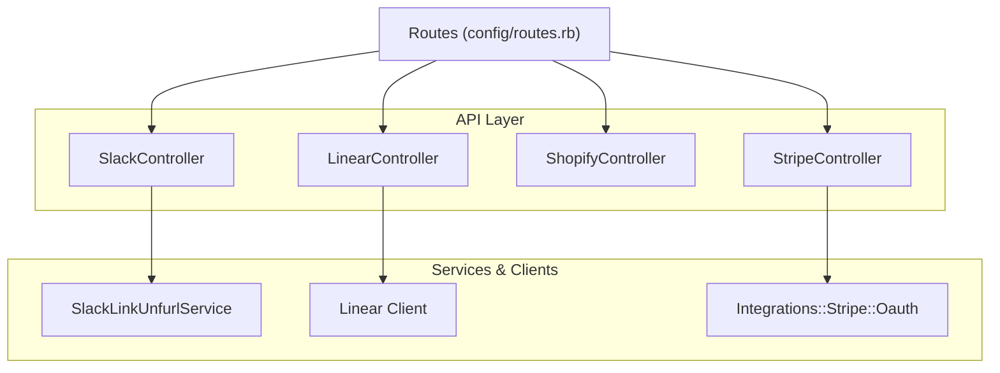
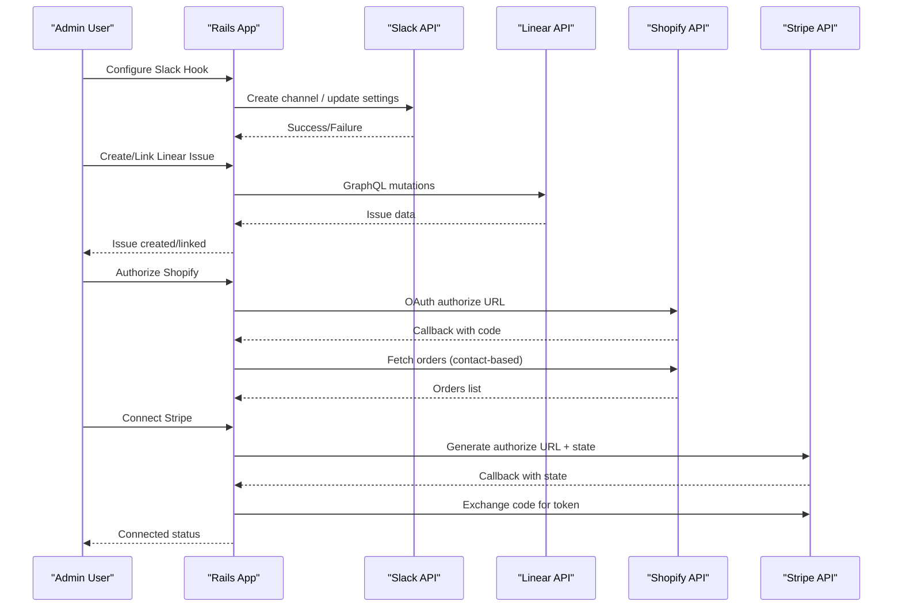
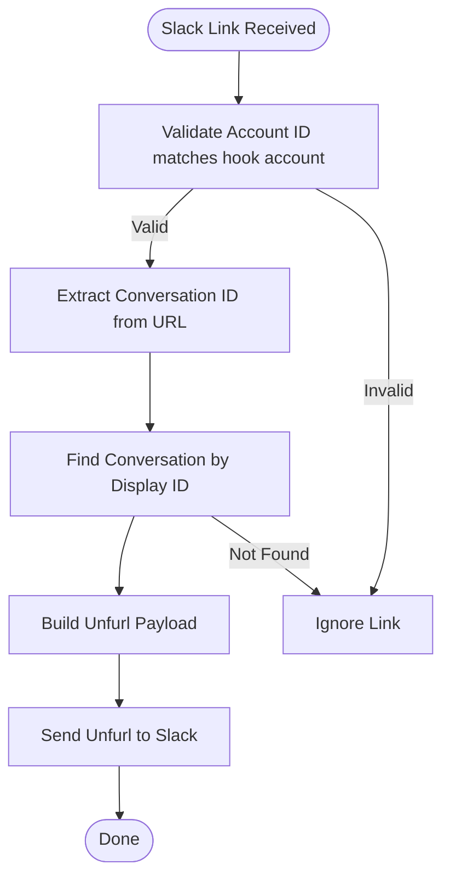
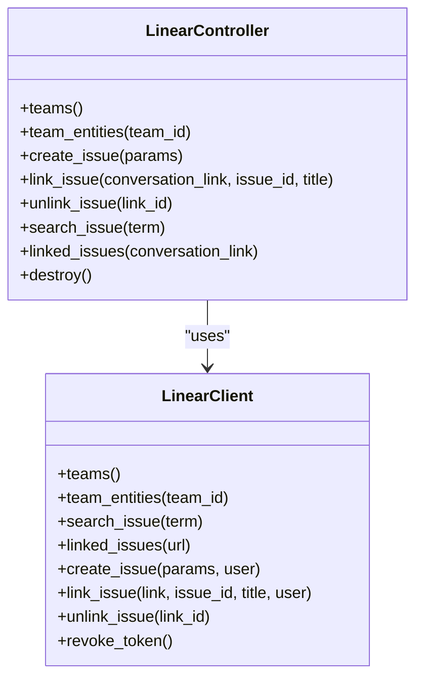
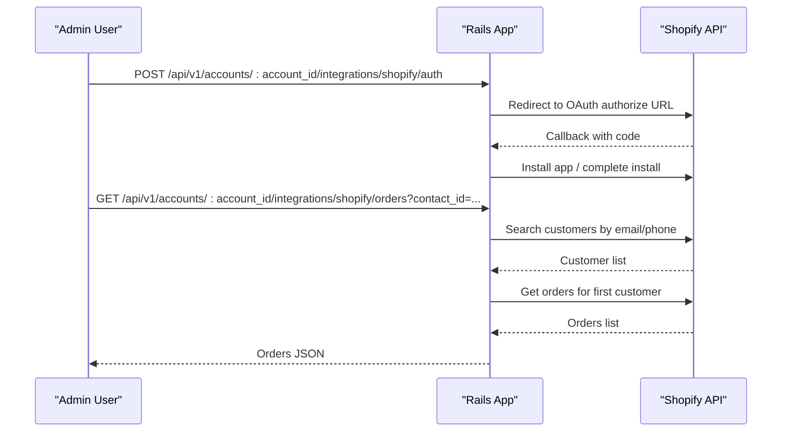
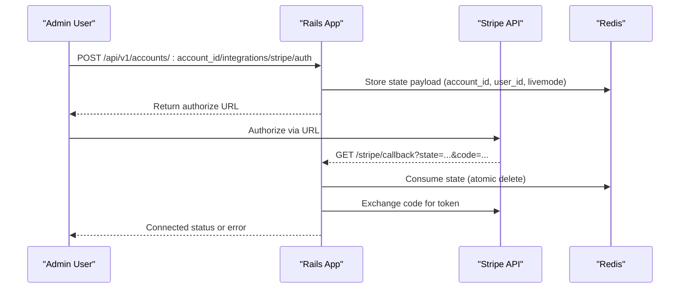
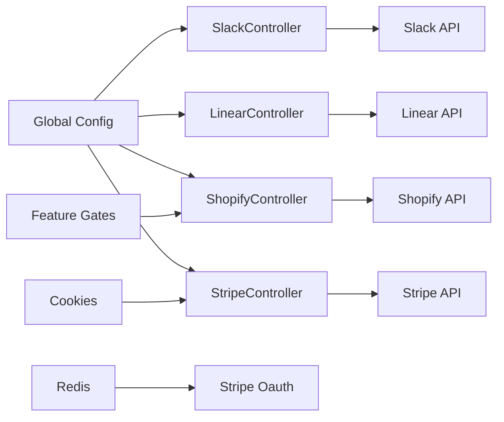

# Third-Party Services

<cite>
**Referenced Files in This Document**
- [slack_controller.rb](file://app/controllers/api/v1/accounts/integrations/slack_controller.rb)
- [linear_controller.rb](file://app/controllers/api/v1/accounts/integrations/linear_controller.rb)
- [shopify_controller.rb](file://app/controllers/api/v1/accounts/integrations/shopify_controller.rb)
- [stripe_controller.rb](file://app/controllers/api/v1/accounts/integrations/stripe_controller.rb)
- [routes.rb](file://config/routes.rb)
- [slack_link_unfurl_service.rb](file://lib/integrations/slack/slack_link_unfurl_service.rb)
- [linear.rb](file://lib/linear.rb)
- [oauth.rb](file://app/services/integrations/stripe/oauth.rb)
</cite>

## Table of Contents
1. [Introduction](#introduction)
2. [Project Structure](#project-structure)
3. [Core Components](#core-components)
4. [Architecture Overview](#architecture-overview)
5. [Detailed Component Analysis](#detailed-component-analysis)
6. [Dependency Analysis](#dependency-analysis)
7. [Performance Considerations](#performance-considerations)
8. [Troubleshooting Guide](#troubleshooting-guide)
9. [Conclusion](#conclusion)

## Introduction
This document explains how Chatwoot integrates with third-party services, focusing on Slack notifications and commands, Linear issue tracking, Shopify e-commerce integration, and Stripe payment processing. It covers OAuth flows, webhook handling, data synchronization patterns, error recovery strategies, configuration examples, API usage patterns, and guidance for extending integrations and handling edge cases.

## Project Structure
Third-party integrations are implemented as:
- Controllers under app/controllers/api/v1/accounts/integrations/* for account-scoped operations
- Service classes under lib/* or app/services/* for external API interactions
- Routes defined in config/routes.rb that expose endpoints for authorization, callbacks, and data access
- Webhook routes for receiving events from external platforms

**Diagram sources**
- [slack_controller.rb:1-48](file://app/controllers/api/v1/accounts/integrations/slack_controller.rb#L1-L48)
- [linear_controller.rb:1-137](file://app/controllers/api/v1/accounts/integrations/linear_controller.rb#L1-L137)
- [shopify_controller.rb:1-145](file://app/controllers/api/v1/accounts/integrations/shopify_controller.rb#L1-L145)
- [stripe_controller.rb:1-59](file://app/controllers/api/v1/accounts/integrations/stripe_controller.rb#L1-L59)
- [slack_link_unfurl_service.rb:1-85](file://lib/integrations/slack/slack_link_unfurl_service.rb#L1-L85)
- [linear.rb:1-164](file://lib/linear.rb#L1-L164)
- [oauth.rb:1-73](file://app/services/integrations/stripe/oauth.rb#L1-L73)
- [routes.rb:437-478](file://config/routes.rb#L437-L478)

**Section sources**
- [routes.rb:437-478](file://config/routes.rb#L437-L478)

## Core Components
- Slack Integration: Channel listing, hook creation/update/destruction, message mode settings, and link unfurling for conversation previews.
- Linear Integration: Team/entity enumeration, issue creation/linking/unlinking, search, linked issues retrieval, and token revocation.
- Shopify Integration: OAuth authorization, custom app flow, order lookup by contact, pending installation completion, and deletion.
- Stripe Integration: Marketplace OAuth authorize URL generation, callback state handling, connection status, customer summary retrieval, and reauthorization prompts.

**Section sources**
- [slack_controller.rb:1-48](file://app/controllers/api/v1/accounts/integrations/slack_controller.rb#L1-L48)
- [linear_controller.rb:1-137](file://app/controllers/api/v1/accounts/integrations/linear_controller.rb#L1-L137)
- [shopify_controller.rb:1-145](file://app/controllers/api/v1/accounts/integrations/shopify_controller.rb#L1-L145)
- [stripe_controller.rb:1-59](file://app/controllers/api/v1/accounts/integrations/stripe_controller.rb#L1-L59)

## Architecture Overview
The integration architecture follows a controller-driven pattern where each service has a dedicated controller exposing REST endpoints. External API calls are encapsulated in service classes or client wrappers. OAuth flows use secure state parameters stored in Redis (for Stripe) or cookies (for Stripe frontend redirect), while other services rely on standard OAuth2 clients. Webhooks are routed to dedicated controllers for event processing.

**Diagram sources**
- [slack_controller.rb:1-48](file://app/controllers/api/v1/accounts/integrations/slack_controller.rb#L1-L48)
- [linear_controller.rb:1-137](file://app/controllers/api/v1/accounts/integrations/linear_controller.rb#L1-L137)
- [shopify_controller.rb:1-145](file://app/controllers/api/v1/accounts/integrations/shopify_controller.rb#L1-L145)
- [stripe_controller.rb:1-59](file://app/controllers/api/v1/accounts/integrations/stripe_controller.rb#L1-L59)
- [oauth.rb:1-73](file://app/services/integrations/stripe/oauth.rb#L1-L73)

## Detailed Component Analysis

### Slack Integration
Responsibilities:
- List all channels available to the connected Slack workspace
- Create/update/destroy Slack hooks per account
- Toggle message mode in hook settings
- Unfurl links to show conversation context within Slack messages

Key behaviors:
- Channel listing uses a builder to fetch channels via Slack API
- Hook management updates settings and reference IDs
- Link unfurling validates account scope and formats preview cards

**Diagram sources**
- [slack_link_unfurl_service.rb:1-85](file://lib/integrations/slack/slack_link_unfurl_service.rb#L1-L85)

Configuration and usage patterns:
- Use the Slack integration endpoint to create a hook with an authorization code and optional inbox ID
- Update hook settings to toggle message mode or change channel reference
- Destroy hook to disconnect Slack

Error handling:
- Invalid channel ID returns unprocessable entity
- Unfurling is skipped if account mismatch or conversation not found

Extensibility:
- Add new Slack actions by extending the controller’s permitted params and adding corresponding builders/services
- Customize unfurl formatting by modifying the unfurl payload construction

**Section sources**
- [slack_controller.rb:1-48](file://app/controllers/api/v1/accounts/integrations/slack_controller.rb#L1-L48)
- [slack_link_unfurl_service.rb:1-85](file://lib/integrations/slack/slack_link_unfurl_service.rb#L1-L85)

### Linear Integration
Responsibilities:
- Enumerate teams and team entities
- Create, link, unlink, and search issues
- Retrieve linked issues for a conversation
- Revoke tokens during disconnection

Key behaviors:
- All operations go through a Linear GraphQL client wrapper
- Controller methods delegate to a processor service which constructs queries/mutations
- Activity messages are posted back into conversations upon successful issue operations

**Diagram sources**
- [linear_controller.rb:1-137](file://app/controllers/api/v1/accounts/integrations/linear_controller.rb#L1-L137)
- [linear.rb:1-164](file://lib/linear.rb#L1-L164)

Configuration and usage patterns:
- Use the Linear integration endpoints to fetch teams/entities, create issues, and manage links
- Provide required fields such as team_id, title, priority, label_ids when creating issues
- Search issues using a query parameter

Error handling:
- Missing or invalid parameters raise argument errors in the client
- API failures return structured error responses from the controller

Extensibility:
- Extend the Linear client to support additional GraphQL queries/mutations
- Add new controller endpoints to expose new capabilities

**Section sources**
- [linear_controller.rb:1-137](file://app/controllers/api/v1/accounts/integrations/linear_controller.rb#L1-L137)
- [linear.rb:1-164](file://lib/linear.rb#L1-L164)

### Shopify Integration
Responsibilities:
- OAuth authorization for public apps and custom app flow
- Complete pending installations
- Fetch customers and orders based on contact information
- Manage integration lifecycle (enable/disable/delete)

Key behaviors:
- Authorization redirects to Shopify’s OAuth flow with required scopes and state
- Custom app flow checks feature flags and billing provider constraints
- Order fetching uses the Shopify REST Admin API with session built from stored credentials

**Diagram sources**
- [shopify_controller.rb:1-145](file://app/controllers/api/v1/accounts/integrations/shopify_controller.rb#L1-L145)
- [routes.rb:459-466](file://config/routes.rb#L459-L466)

Configuration and usage patterns:
- Ensure Shopify feature gate is enabled for the account
- For custom apps, verify shop domain matches configured store and billing provider constraints
- Provide contact_id when querying orders; ensure contact has email or phone number

Error handling:
- Invalid shop domain returns unprocessable entity
- HTTP response errors from Shopify are surfaced to the caller
- Pending installation conflicts handled with appropriate status codes

Extensibility:
- Add new Shopify endpoints by extending the controller and service layer
- Integrate additional Shopify resources (products, inventory) following the same session/client pattern

**Section sources**
- [shopify_controller.rb:1-145](file://app/controllers/api/v1/accounts/integrations/shopify_controller.rb#L1-L145)
- [routes.rb:459-466](file://config/routes.rb#L459-L466)

### Stripe Integration
Responsibilities:
- Generate Stripe Marketplace authorize URLs with secure state
- Handle callback and exchange authorization code for token
- Show connection status (live/sandbox) and reauthorization requirements
- Retrieve customer summaries for conversations

Key behaviors:
- OAuth state is stored in Redis with TTL and validated on callback
- Livemode detection is derived from secret key prefix
- Connection status includes connected_at timestamp and reauthorization flag

**Diagram sources**
- [stripe_controller.rb:1-59](file://app/controllers/api/v1/accounts/integrations/stripe_controller.rb#L1-L59)
- [oauth.rb:1-73](file://app/services/integrations/stripe/oauth.rb#L1-L73)
- [routes.rb:437-441](file://config/routes.rb#L437-L441)

Configuration and usage patterns:
- Set Stripe Marketplace authorize URL and secret key in global configuration
- Ensure encryption is configured for storing sensitive data
- Use the customer endpoint to retrieve summary data for a conversation

Error handling:
- Invalid authorize URL or secret key format produces configuration errors
- Authentication errors trigger reauthorization prompts
- Network timeouts and Stripe API errors are logged and surfaced as unavailable

Extensibility:
- Add new Stripe actions by extending the controller and service layer
- Implement additional webhook handlers for Stripe events if needed

**Section sources**
- [stripe_controller.rb:1-59](file://app/controllers/api/v1/accounts/integrations/stripe_controller.rb#L1-L59)
- [oauth.rb:1-73](file://app/services/integrations/stripe/oauth.rb#L1-L73)
- [routes.rb:437-441](file://config/routes.rb#L437-L441)

## Dependency Analysis
Integration components depend on:
- Global configuration for service credentials and feature flags
- External APIs (Slack, Linear, Shopify, Stripe)
- Redis for secure state storage (Stripe OAuth)
- Cookies for frontend redirect state (Stripe)
- Feature gates for conditional availability (Shopify)

**Diagram sources**
- [slack_controller.rb:1-48](file://app/controllers/api/v1/accounts/integrations/slack_controller.rb#L1-L48)
- [linear_controller.rb:1-137](file://app/controllers/api/v1/accounts/integrations/linear_controller.rb#L1-L137)
- [shopify_controller.rb:1-145](file://app/controllers/api/v1/accounts/integrations/shopify_controller.rb#L1-L145)
- [stripe_controller.rb:1-59](file://app/controllers/api/v1/accounts/integrations/stripe_controller.rb#L1-L59)
- [oauth.rb:1-73](file://app/services/integrations/stripe/oauth.rb#L1-L73)

**Section sources**
- [oauth.rb:1-73](file://app/services/integrations/stripe/oauth.rb#L1-L73)

## Performance Considerations
- Prefer background jobs for long-running operations (e.g., bulk order syncs, large unfurl payloads).
- Cache frequently accessed data like teams and entities where possible.
- Use pagination and field selection in external API calls to reduce payload sizes.
- Monitor network timeouts and implement retries with exponential backoff for transient failures.
- Avoid synchronous blocking calls in request paths; offload heavy work to workers.

[No sources needed since this section provides general guidance]

## Troubleshooting Guide
Common issues and resolutions:
- Slack:
  - Invalid channel ID: Verify the selected channel exists and the hook is correctly updated.
  - Unfurl not showing: Ensure the link belongs to the same account and the conversation exists.
- Linear:
  - Missing parameters: Provide required fields like team_id and title when creating issues.
  - Token revocation failures: Check logs for token revocation errors; ensure refresh token is present if used.
- Shopify:
  - Invalid shop domain: Confirm the domain format and that it matches the configured custom app store.
  - Billing provider conflict: Custom apps cannot be used when Shopify billing is enabled.
- Stripe:
  - Configuration errors: Validate authorize URL format and secret key prefix.
  - Reauthorization required: Prompt users to reconnect when authentication errors occur.
  - Unavailable service: Log detailed error information and surface a generic unavailable message.

Operational tips:
- Inspect controller error responses and log outputs for precise failure reasons.
- Verify environment variables and global configuration values before testing integrations.
- Use feature gates to enable/disable integrations during development and rollout.

**Section sources**
- [slack_controller.rb:1-48](file://app/controllers/api/v1/accounts/integrations/slack_controller.rb#L1-L48)
- [linear_controller.rb:1-137](file://app/controllers/api/v1/accounts/integrations/linear_controller.rb#L1-L137)
- [shopify_controller.rb:1-145](file://app/controllers/api/v1/accounts/integrations/shopify_controller.rb#L1-L145)
- [stripe_controller.rb:1-59](file://app/controllers/api/v1/accounts/integrations/stripe_controller.rb#L1-L59)
- [oauth.rb:1-73](file://app/services/integrations/stripe/oauth.rb#L1-L73)

## Conclusion
Chatwoot’s third-party integrations follow a consistent controller-service-client pattern, enabling robust OAuth flows, webhook handling, and data synchronization across Slack, Linear, Shopify, and Stripe. By leveraging configuration-driven setup, feature gates, and clear error handling, these integrations can be extended and customized to meet diverse operational needs while maintaining reliability and security.

[No sources needed since this section summarizes without analyzing specific files]