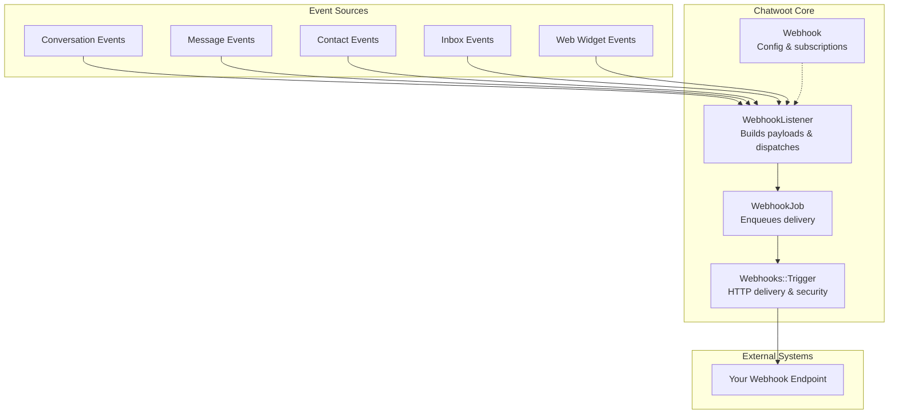
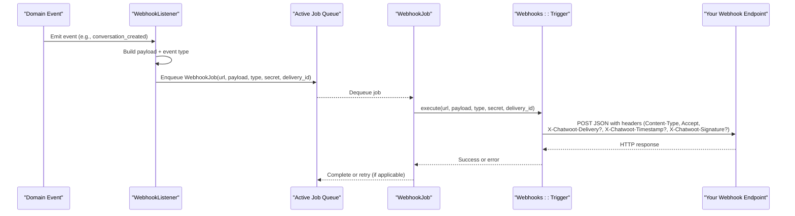
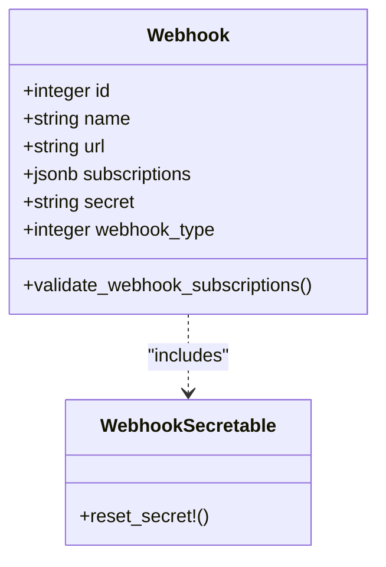
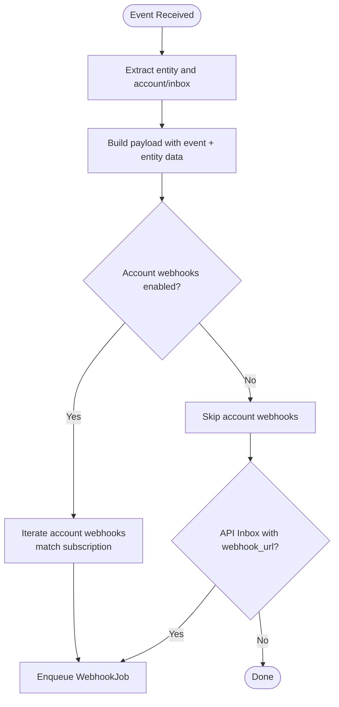
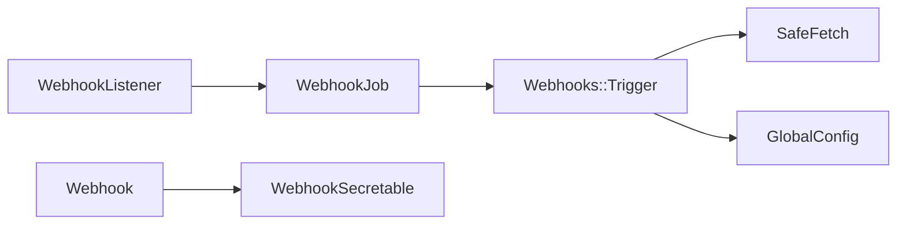

# Webhook System

<cite>
**Referenced Files in This Document**
- [webhook.rb](file://app/models/webhook.rb)
- [webhooks_controller.rb](file://app/controllers/api/v1/accounts/webhooks_controller.rb)
- [webhook_listener.rb](file://app/listeners/webhook_listener.rb)
- [webhook_job.rb](file://app/jobs/webhook_job.rb)
- [trigger.rb](file://lib/webhooks/trigger.rb)
- [webhook_secretable.rb](file://app/models/concerns/webhook_secretable.rb)
- [webhook.yml](file://swagger/definitions/resource/webhook.yml)
- [webhook_id.yml](file://swagger/parameters/webhook_id.yml)
- [create.json.jbuilder](file://app/views/api/v1/accounts/webhooks/create.json.jbuilder)
- [update.json.jbuilder](file://app/views/api/v1/accounts/webhooks/update.json.jbuilder)
</cite>

## Table of Contents
1. [Introduction](#introduction)
2. [Project Structure](#project-structure)
3. [Core Components](#core-components)
4. [Architecture Overview](#architecture-overview)
5. [Detailed Component Analysis](#detailed-component-analysis)
6. [Dependency Analysis](#dependency-analysis)
7. [Performance Considerations](#performance-considerations)
8. [Troubleshooting Guide](#troubleshooting-guide)
9. [Conclusion](#conclusion)

## Introduction
This document explains Chatwoot’s webhook system: how events are published, how payloads are built and delivered, how security is enforced with signatures, and how failures are handled and retried. It also provides guidance for creating custom webhooks, handling incoming events from external services, testing locally, and monitoring deliveries.

## Project Structure
The webhook system spans models, listeners, jobs, and a trigger service:
- Model defines webhook configuration and allowed events.
- Listener translates domain events into webhook payloads and enqueues delivery jobs.
- Job executes the HTTP request via a trigger service.
- Trigger service performs the outbound request, adds security headers, and handles errors.
- API controller exposes CRUD endpoints to manage webhooks.



**Diagram sources**
- [webhook_listener.rb:1-135](file://app/listeners/webhook_listener.rb#L1-L135)
- [webhook_job.rb:1-8](file://app/jobs/webhook_job.rb#L1-L8)
- [trigger.rb:1-135](file://lib/webhooks/trigger.rb#L1-L135)
- [webhook.rb:1-47](file://app/models/webhook.rb#L1-L47)

**Section sources**
- [webhook.rb:1-47](file://app/models/webhook.rb#L1-L47)
- [webhook_listener.rb:1-135](file://app/listeners/webhook_listener.rb#L1-L135)
- [webhook_job.rb:1-8](file://app/jobs/webhook_job.rb#L1-L8)
- [trigger.rb:1-135](file://lib/webhooks/trigger.rb#L1-L135)

## Core Components
- Webhook model: stores endpoint URL, name, secret, and event subscriptions; validates allowed events.
- WebhookListener: maps domain events (conversation, message, contact, inbox, widget) to webhook payloads and routes them to account-level or API-inbox-level destinations.
- WebhookJob: queues delivery tasks on a background queue.
- Webhooks::Trigger: performs the HTTP POST, sets Content-Type/Accept, optional X-Chatwoot-Delivery, and HMAC signature when a secret is configured; handles timeouts and error classification.
- WebhookSecretable: provides secure token generation and optional encryption for secrets.
- API Controller: exposes REST endpoints to create, update, list, and delete webhooks.

**Section sources**
- [webhook.rb:1-47](file://app/models/webhook.rb#L1-L47)
- [webhook_listener.rb:1-135](file://app/listeners/webhook_listener.rb#L1-L135)
- [webhook_job.rb:1-8](file://app/jobs/webhook_job.rb#L1-L8)
- [trigger.rb:1-135](file://lib/webhooks/trigger.rb#L1-L135)
- [webhook_secretable.rb:1-14](file://app/models/concerns/webhook_secretable.rb#L1-L14)
- [webhooks_controller.rb:1-33](file://app/controllers/api/v1/accounts/webhooks_controller.rb#L1-L33)

## Architecture Overview
End-to-end flow from event occurrence to webhook delivery:



**Diagram sources**
- [webhook_listener.rb:10-52](file://app/listeners/webhook_listener.rb#L10-L52)
- [webhook_job.rb:1-8](file://app/jobs/webhook_job.rb#L1-L8)
- [trigger.rb:22-63](file://lib/webhooks/trigger.rb#L22-L63)

## Detailed Component Analysis

### Webhook Model and Subscriptions
- Stores webhook URL, name, secret, and an array of subscriptions.
- Validates that subscriptions contain only allowed events.
- Supports two scopes: account-level and inbox-level (via webhook_type).

Key behaviors:
- Allowed events include conversation lifecycle, message changes, contact updates, inbox changes, and typing indicators.
- Secret is managed via a secure token concern and can be reset.



**Diagram sources**
- [webhook.rb:21-44](file://app/models/webhook.rb#L21-L44)
- [webhook_secretable.rb:1-14](file://app/models/concerns/webhook_secretable.rb#L1-L14)

**Section sources**
- [webhook.rb:21-44](file://app/models/webhook.rb#L21-L44)
- [webhook_secretable.rb:1-14](file://app/models/concerns/webhook_secretable.rb#L1-L14)

### WebhookListener: Event Mapping and Payload Routing
- Translates domain events into webhook payloads by merging entity data with event metadata.
- Routes payloads to:
  - Account-level webhooks if the account has API/webhooks enabled and the webhook subscribes to the event.
  - API inbox webhooks when the inbox uses the API channel and has a webhook URL configured.

Typing events are grouped into a specific payload structure including user and conversation data.



**Diagram sources**
- [webhook_listener.rb:1-135](file://app/listeners/webhook_listener.rb#L1-L135)

**Section sources**
- [webhook_listener.rb:1-135](file://app/listeners/webhook_listener.rb#L1-L135)

### WebhookJob: Background Delivery
- Queues webhook delivery on a dedicated queue.
- Delegates execution to Webhooks::Trigger.

**Section sources**
- [webhook_job.rb:1-8](file://app/jobs/webhook_job.rb#L1-L8)

### Webhooks::Trigger: Outbound Delivery and Security
- Performs an HTTP POST with JSON body.
- Adds standard headers: Content-Type and Accept.
- Adds X-Chatwoot-Delivery when a delivery ID is present.
- When a secret is provided:
  - Adds X-Chatwoot-Timestamp (current epoch seconds).
  - Adds X-Chatwoot-Signature computed as sha256(HMAC(secret, timestamp.body)).
- Applies configurable timeout using a global config value; defaults to a safe minimum.
- Classifies certain errors as retryable for agent bot scenarios and logs non-retryable failures.

```mermaid
flowchart TD
A["execute()"] --> B["perform_request()"]
B --> C["Serialize payload to JSON"]
C --> D["Build headers:<br/>Content-Type, Accept,<br/>X-Chatwoot-Delivery?"]
D --> E{"Secret present?"}
E --> |Yes| F["Compute X-Chatwoot-Timestamp<br/>and X-Chatwoot-Signature"]
E --> |No| G["Skip signing headers"]
F --> H["SafeFetch.fetch(url, method: POST, body, headers, timeouts)"]
G --> H
H --> I{"Error?"}
I --> |Retryable (agent bot)| J["Raise RetryableError"]
I --> |Other| K["handle_failure() + log"]
J --> L["Job may retry based on policy"]
K --> M["Delivery failed"]
```

**Diagram sources**
- [trigger.rb:22-63](file://lib/webhooks/trigger.rb#L22-L63)
- [trigger.rb:118-133](file://lib/webhooks/trigger.rb#L118-L133)

**Section sources**
- [trigger.rb:1-135](file://lib/webhooks/trigger.rb#L1-L135)

### API Endpoints for Managing Webhooks
- List, create, update, and delete webhooks scoped to the current account.
- Accepts fields: name, url, inbox_id, and subscriptions array.
- Responses render a webhook object under a payload wrapper.

Swagger definitions describe the resource schema, including the secret field and its usage for signing deliveries.

**Section sources**
- [webhooks_controller.rb:1-33](file://app/controllers/api/v1/accounts/webhooks_controller.rb#L1-L33)
- [webhook.yml:1-36](file://swagger/definitions/resource/webhook.yml#L1-L36)
- [create.json.jbuilder:1-5](file://app/views/api/v1/accounts/webhooks/create.json.jbuilder#L1-L5)
- [update.json.jbuilder:1-5](file://app/views/api/v1/accounts/webhooks/update.json.jbuilder#L1-L5)
- [webhook_id.yml:1-6](file://swagger/parameters/webhook_id.yml#L1-L6)

## Dependency Analysis
- WebhookListener depends on domain entities’ webhook_data methods and presenter objects to build payloads.
- WebhookListener enqueues WebhookJob with parameters derived from the webhook configuration.
- WebhookJob delegates to Webhooks::Trigger for network I/O.
- Webhooks::Trigger depends on SafeFetch for outbound requests and GlobalConfig for timeouts.
- Webhook model depends on WebhookSecretable for secret management.



**Diagram sources**
- [webhook_listener.rb:110-133](file://app/listeners/webhook_listener.rb#L110-L133)
- [webhook_job.rb:1-8](file://app/jobs/webhook_job.rb#L1-L8)
- [trigger.rb:41-63](file://lib/webhooks/trigger.rb#L41-L63)
- [trigger.rb:118-123](file://lib/webhooks/trigger.rb#L118-L123)
- [webhook.rb:21-30](file://app/models/webhook.rb#L21-L30)
- [webhook_secretable.rb:1-14](file://app/models/concerns/webhook_secretable.rb#L1-L14)

**Section sources**
- [webhook_listener.rb:110-133](file://app/listeners/webhook_listener.rb#L110-L133)
- [webhook_job.rb:1-8](file://app/jobs/webhook_job.rb#L1-L8)
- [trigger.rb:41-63](file://lib/webhooks/trigger.rb#L41-L63)
- [trigger.rb:118-123](file://lib/webhooks/trigger.rb#L118-L123)
- [webhook.rb:21-30](file://app/models/webhook.rb#L21-L30)
- [webhook_secretable.rb:1-14](file://app/models/concerns/webhook_secretable.rb#L1-L14)

## Performance Considerations
- Delivery is asynchronous via background jobs to avoid blocking core operations.
- Timeouts are configurable through a global setting; ensure your endpoint responds within the configured window.
- Avoid heavy processing inside webhook handlers; prefer idempotent, lightweight consumers.
- Use X-Chatwoot-Delivery to correlate retries and deduplicate processing on the consumer side.

[No sources needed since this section provides general guidance]

## Troubleshooting Guide

### Verifying Signature and Timestamp
When a secret is configured, each delivery includes:
- X-Chatwoot-Timestamp: current epoch seconds.
- X-Chatwoot-Signature: sha256(HMAC-SHA256(secret, timestamp.body)).
- X-Chatwoot-Delivery: unique delivery identifier.

Validation steps:
- Ensure your endpoint accepts JSON and reads the raw body before parsing.
- Compute HMAC-SHA256 over the concatenation of timestamp and raw body using your stored secret.
- Compare the computed signature with the header value.
- Reject requests where the timestamp is too old to mitigate replay attacks.

**Section sources**
- [trigger.rb:54-63](file://lib/webhooks/trigger.rb#L54-L63)
- [webhook.yml:29-32](file://swagger/definitions/resource/webhook.yml#L29-L32)

### Handling Failures and Retries
- Non-retryable errors are logged and considered delivery failures.
- For agent bot webhooks, specific HTTP statuses are treated as retryable and will cause the job to retry according to job policy.
- Inspect application logs for “Invalid webhook URL” warnings to identify persistent failures.

**Section sources**
- [trigger.rb:26-37](file://lib/webhooks/trigger.rb#L26-L37)
- [trigger.rb:125-133](file://lib/webhooks/trigger.rb#L125-L133)
- [webhook_job.rb:1-8](file://app/jobs/webhook_job.rb#L1-L8)

### Testing Locally
- Use a local tunnel (e.g., ngrok) to expose your development server publicly.
- Configure a webhook with the public URL and desired subscriptions.
- Trigger test events by performing actions in Chatwoot (creating conversations/messages, updating contacts, etc.).
- Validate headers and signature using a logging proxy or middleware in your test endpoint.

[No sources needed since this section provides general guidance]

### Monitoring Deliveries
- Track X-Chatwoot-Delivery across your systems to correlate retries and prevent duplicate processing.
- Monitor application logs for exceptions and warning messages related to invalid URLs.
- Instrument your endpoint to record success/failure rates per delivery ID.

**Section sources**
- [trigger.rb:34-37](file://lib/webhooks/trigger.rb#L34-L37)

## Conclusion
Chatwoot’s webhook system provides a robust, secure, and extensible mechanism to notify external systems about key events. By configuring webhooks via the API, subscribing to relevant events, and validating signatures on the receiving end, you can integrate reliably with order processing, user management, and status update workflows. Use background jobs for resilience, configure appropriate timeouts, and monitor deliveries using correlation IDs for operational visibility.